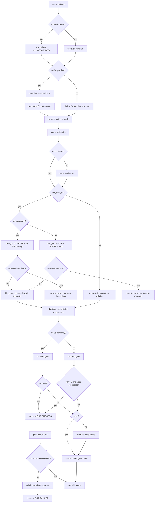

# `mktemp`: create temporary files or directories

Source: `src/mktemp.c` (358 lines) · Tests: `tests/mktemp/` ·
Manual: `info '(coreutils) mktemp invocation'`

`mktemp` creates temporary files or directories safely using `gen_tempname_len`
from gnulib. It replaces trailing `X` characters in a template with random
characters. The template must contain at least 3 consecutive `X`s. With `-d`,
it creates a directory; otherwise, it creates a file. If output fails after
creation, it cleans up the created file/directory.

## Options

The table lists `longopts[]` (`src/mktemp.c:46-56`) and the short-option
string `"dp:qtuV"`.

|| Option | Variables |
||---|---|
|| `-d`, `--directory` | `create_directory`: create a directory |
|| `-u`, `--dry-run` | `dry_run`: do not create, only print a name |
|| `-q`, `--quiet` | `suppress_file_err`: suppress error messages |
|| `--suffix=SUFF` | `suffix`: append SUFF to TEMPLATE |
|| `-p DIR`, `--tmpdir[=DIR]` | `dest_dir_arg`, `use_dest_dir`: use DIR as base directory |
|| `-t` | `use_dest_dir`, `deprecated_t_option`: treat TEMPLATE as single component (deprecated) |
|| `-V` | Undocumented alias for `--version` (compatibility) |

## Code map

|| Function | Location | Role |
||---|---|---|
|| `main` | `src/mktemp.c:154` | Option parsing, template validation, directory resolution, `mkstemp_len`/`mkdtemp_len`, output, cleanup on failure |
|| `mkstemp_len` | `:124` | Wrapper for `gen_tempname_len` with `GT_FILE` |
|| `mkdtemp_len` | `:131` | Wrapper for `gen_tempname_len` with `GT_DIR` |
|| `count_consecutive_X_s` | `:115` | Count trailing `X` characters |
|| `maybe_close_stdout` | `:145` | Avoid closing stdout twice |
|| `usage` | `:59` | Help message |

## How it works



### Template and suffix handling

`main` builds the full template from TEMPLATE and `--suffix`
(`src/mktemp.c:232-257`):

- With `--suffix`, TEMPLATE must end in `X`. The suffix is appended after
  the template.
- Without `--suffix`, the suffix is everything after the last `X`, or the
  entire string if there is no `X`.

The suffix must not contain a slash (`src/mktemp.c:260-265`). The number of
trailing `X`s before the suffix must be at least 3 (`src/mktemp.c:266-274`).

### Directory resolution

When `use_dest_dir` is set (no template argument, `-p`, or `-t`), the template
is interpreted relative to a directory (`src/mktemp.c:276-313`):

- With `-t` (deprecated): The directory is `$TMPDIR`, or the `-p` argument,
  or `/tmp`. The template must not contain slashes.
- With `-p` or no template: The directory is the `-p` argument, or `$TMPDIR`,
  or `/tmp`. The template must not be absolute.

The directory and template are concatenated with `file_name_concat`.

### File/directory creation

`main` calls `mkdtemp_len` for directories or `mkstemp_len` for files
(`src/mktemp.c:319-340`). These call `gen_tempname_len` with `GT_DIR` or
`GT_FILE`. With `--dry-run`, they use `GT_NOCREATE` to only generate a name
without creating anything. For files, the file descriptor is closed
immediately after creation.

### Cleanup on output failure

If the file/directory is created successfully but writing the name to stdout
fails, `mktemp` cleans up by calling `unlink` (for files) or `rmdir` (for
directories) before exiting (`src/mktemp.c:347-354`). This prevents leaving
temporary files when the name cannot be communicated.

## Platform notes

`mktemp` uses `gen_tempname_len` from gnulib's `tempname` module for portable
random name generation. The `-V` option is an undocumented alias for
`--version`, kept for compatibility with the original mktemp program
(`src/mktemp.c:207-209`).

## Errors and exit status

- **Too many templates:** "too many templates"
- **Invalid suffix with slash:** "invalid suffix SUFFIX, contains directory separator"
- **Template must end in X with `--suffix`:** "with --suffix, template TEMPLATE must end in X"
- **Too few Xs:** "too few X's in template TEMPLATE"
- **Template has slash with `-t`:** "invalid template TEMPLATE, contains directory separator"
- **Template absolute with `--tmpdir`:** "invalid template TEMPLATE; with --tmpdir, it may not be absolute"
- **Creation failure:** "failed to create file/directory via template TEMPLATE" (unless `-q`)
- **Write error:** "write error" (when stdout fails after creation)

Exit status is 0 on success, 1 on failure.

## Tests

|| File | Covers |
||---|---|
|| `tests/mktemp/mktemp-misc.sh` | Various template and option combinations |
|| `tests/mktemp/mktemp.pl` | Perl tests for edge cases |
|| `tests/mktemp/bad-unicode.sh` | Unicode handling in templates |
|| `tests/mktemp/write-error.sh` | Cleanup when stdout write fails |

## See also

- [tempname](../overview/shared-infrastructure.md) for the gnulib module

## Source code

`src/mktemp.c:1`

```c
/* Create a temporary file or directory, safely.
   Copyright (C) 2007-2026 Free Software Foundation, Inc.

   This program is free software: you can redistribute it and/or modify
   it under the terms of the GNU General Public License as published by
   the Free Software Foundation, either version 3 of the License, or
   (at your option) any later version.

   This program is distributed in the hope that it will be useful,
   but WITHOUT ANY WARRANTY; without even the implied warranty of
   MERCHANTABILITY or FITNESS FOR A PARTICULAR PURPOSE.  See the
   GNU General Public License for more details.

   You should have received a copy of the GNU General Public License
   along with this program.  If not, see <https://www.gnu.org/licenses/>.  */

/* Written by Jim Meyering and Eric Blake.  */

#include <config.h>
#include <sys/types.h>
#include <getopt.h>

#include "system.h"

#include "close-stream.h"
#include "filenamecat.h"
#include "quote.h"
#include "tempname.h"

/* The official name of this program (e.g., no 'g' prefix).  */
#define PROGRAM_NAME "mktemp"

#define AUTHORS \
  proper_name ("Jim Meyering"), \
  proper_name ("Eric Blake")

static char const *default_template = "tmp.XXXXXXXXXX";

/* For long options that have no equivalent short option, use a
   non-character as a pseudo short option, starting with CHAR_MAX + 1.  */
enum
{
  SUFFIX_OPTION = CHAR_MAX + 1,
};

static struct option const longopts[] =
{
  {"directory", no_argument, NULL, 'd'},
  {"quiet", no_argument, NULL, 'q'},
  {"dry-run", no_argument, NULL, 'u'},
  {"suffix", required_argument, NULL, SUFFIX_OPTION},
  {"tmpdir", optional_argument, NULL, 'p'},
  {GETOPT_HELP_OPTION_DECL},
  {GETOPT_VERSION_OPTION_DECL},
  {NULL, 0, NULL, 0}
};

void
usage (int status)
{
  if (status != EXIT_SUCCESS)
    emit_try_help ();
  else
    {
      printf (_("Usage: %s [OPTION]... [TEMPLATE]\n"), program_name);
      fputs (_("\
Create a temporary file or directory, safely, and print its name.\n\
TEMPLATE must contain at least 3 consecutive 'X's in last component.\n\
If TEMPLATE is not specified, use tmp.XXXXXXXXXX, and --tmpdir is implied.\n\
"), stdout);
      fputs (_("\
Files are created u+rw, and directories u+rwx, minus umask restrictions.\n\
"), stdout);
      fputs ("\n", stdout);
      oputs (_("\
  -d, --directory\n\
         create a directory, not a file\n\
"));
      oputs (_("\
  -u, --dry-run\n\
         do not create anything; merely print a name (unsafe)\n\
"));
      oputs (_("\
  -q, --quiet\n\
         suppress diagnostics about file/dir-creation failure\n\
"));
      oputs (_("\
      --suffix=SUFF\n\
         append SUFF to TEMPLATE; SUFF must not contain a slash.\n\
         This option is implied if TEMPLATE does not end in X\n\
"));
      oputs (_("\
  -p DIR, --tmpdir[=DIR]\n\
         interpret TEMPLATE relative to DIR;\n\
         if DIR is not specified, use $TMPDIR if set, else /tmp.\n\
         With this option, TEMPLATE must not be an absolute name;\n\
         unlike with -t, TEMPLATE may contain slashes,\n\
         but mktemp creates only the final component\n\
"));
      oputs (_("\
  -t\n\
         interpret TEMPLATE as a single file name component,\n\
         relative to a directory: $TMPDIR, if set;\n\
         else the directory specified via -p; else /tmp [deprecated]\n\
"));
      oputs (HELP_OPTION_DESCRIPTION);
      oputs (VERSION_OPTION_DESCRIPTION);
      emit_ancillary_info (PROGRAM_NAME);
    }

  exit (status);
}

static size_t
count_consecutive_X_s (char const *s, size_t len)
{
  size_t n = 0;
  for ( ; len && s[len - 1] == 'X'; len--)
    ++n;
  return n;
}

static int
mkstemp_len (char *tmpl, size_t suff_len, size_t x_len, bool dry_run)
{
  return gen_tempname_len (tmpl, suff_len, 0, dry_run ? GT_NOCREATE : GT_FILE,
                           x_len);
}

static int
mkdtemp_len (char *tmpl, size_t suff_len, size_t x_len, bool dry_run)
{
  return gen_tempname_len (tmpl, suff_len, 0, dry_run ? GT_NOCREATE : GT_DIR,
                           x_len);
}

/* True if we have already closed standard output.  */
static bool stdout_closed;

/* Avoid closing stdout twice.  Since we conditionally call
   close_stream (stdout) in order to decide whether to clean up a
   temporary file, the exit hook needs to know whether to do all of
   close_stdout or just the stderr half.  */
static void
maybe_close_stdout (void)
{
  if (!stdout_closed)
    close_stdout ();
  else if (close_stream (stderr) != 0)
    _exit (EXIT_FAILURE);
}

int
main (int argc, char **argv)
{
  char const *dest_dir;
  char const *dest_dir_arg = NULL;
  bool suppress_file_err = false;
  int c;
  char *template;
  char *suffix = NULL;
  bool use_dest_dir = false;
  bool deprecated_t_option = false;
  bool create_directory = false;
  bool dry_run = false;
  int status = EXIT_SUCCESS;
  size_t x_count;
  size_t suffix_len;
  char *dest_name = NULL;

  initialize_main (&argc, &argv);
  set_program_name (argv[0]);
  setlocale (LC_ALL, "");
  bindtextdomain (PACKAGE, LOCALEDIR);
  textdomain (PACKAGE);

  atexit (maybe_close_stdout);

  while ((c = getopt_long (argc, argv, "dp:qtuV", longopts, NULL)) != -1)
    {
      switch (c)
        {
        case 'd':
          create_directory = true;
          break;
        case 'p':
          dest_dir_arg = optarg;
          use_dest_dir = true;
          break;
        case 'q':
          suppress_file_err = true;
          break;
        case 't':
          use_dest_dir = true;
          deprecated_t_option = true;
          break;
        case 'u':
          dry_run = true;
          break;

        case SUFFIX_OPTION:
          suffix = optarg;
          break;

        case_GETOPT_HELP_CHAR;

        case 'V': /* Undocumented alias, for compatibility with the original
                     mktemp program.  */
        case_GETOPT_VERSION_CHAR (PROGRAM_NAME, AUTHORS);
        default:
          usage (EXIT_FAILURE);
        }
    }

  int n_args = argc - optind;
  if (2 <= n_args)
    {
      error (0, 0, _("too many templates"));
      usage (EXIT_FAILURE);
    }

  if (n_args == 0)
    {
      use_dest_dir = true;
      template = (char *) default_template;
    }
  else
    {
      template = argv[optind];
    }

  if (suffix)
    {
      size_t len = strlen (template);
      if (!len || template[len - 1] != 'X')
        {
          error (EXIT_FAILURE, 0,
                 _("with --suffix, template %s must end in X"),
                 quote (template));
        }
      suffix_len = strlen (suffix);
      dest_name = xcharalloc (len + suffix_len + 1);
      memcpy (dest_name, template, len);
      memcpy (dest_name + len, suffix, suffix_len + 1);
      template = dest_name;
      suffix = dest_name + len;
    }
  else
    {
      template = xstrdup (template);
      suffix = strrchr (template, 'X');
      if (!suffix)
        suffix = strchr (template, '\0');
      else
        suffix++;
      suffix_len = strlen (suffix);
    }

  /* At this point, template is malloc'd, and suffix points into template.  */
  if (suffix_len && last_component (suffix) != suffix)
    {
      error (EXIT_FAILURE, 0,
             _("invalid suffix %s, contains directory separator"),
             quote (suffix));
    }
  x_count = count_consecutive_X_s (template, suffix - template);
  if (x_count < 3)
    {
      /* when suffix was appended to template only diagnose the template.  */
      if (template == dest_name)
        template[suffix - template] = '\0';
      error (EXIT_FAILURE, 0, _("too few X's in template %s"),
             quote (template));
    }

  if (use_dest_dir)
    {
      if (deprecated_t_option)
        {
          char *env = getenv ("TMPDIR");
          if (env && *env)
            dest_dir = env;
          else if (dest_dir_arg && *dest_dir_arg)
            dest_dir = dest_dir_arg;
          else
            dest_dir = "/tmp";

          if (last_component (template) != template)
            error (EXIT_FAILURE, 0,
                   _("invalid template, %s, contains directory separator"),
                   quote (template));
        }
      else
        {
          if (dest_dir_arg && *dest_dir_arg)
            dest_dir = dest_dir_arg;
          else
            {
              char *env = getenv ("TMPDIR");
              dest_dir = (env && *env ? env : "/tmp");
            }
          if (IS_ABSOLUTE_FILE_NAME (template))
            error (EXIT_FAILURE, 0,
                   _("invalid template, %s; with --tmpdir,"
                     " it may not be absolute"),
                   quote (template));
        }

      dest_name = file_name_concat (dest_dir, template, NULL);
      free (template);
      template = dest_name;
      /* Note that suffix is now invalid.  */
    }

  /* Make a copy to be used in case of diagnostic, since failing
     mkstemp may leave the buffer in an undefined state.  */
  dest_name = xstrdup (template);

  if (create_directory)
    {
      int err = mkdtemp_len (dest_name, suffix_len, x_count, dry_run);
      if (err != 0)
        {
          if (!suppress_file_err)
            error (0, errno, _("failed to create directory via template %s"),
                   quote (template));
          status = EXIT_FAILURE;
        }
    }
  else
    {
      int fd = mkstemp_len (dest_name, suffix_len, x_count, dry_run);
      if (fd < 0 || (!dry_run && close (fd) != 0))
        {
          if (!suppress_file_err)
            error (0, errno, _("failed to create file via template %s"),
                   quote (template));
          status = EXIT_FAILURE;
        }
    }

  if (status == EXIT_SUCCESS)
    {
      puts (dest_name);
      /* If we created a file, but then failed to output the file
         name, we should clean up the mess before failing.  */
      if (!dry_run && ((stdout_closed = true), close_stream (stdout) != 0))
        {
          int saved_errno = errno;
          (create_directory ? rmdir : unlink) (dest_name);
          if (!suppress_file_err)
            error (0, saved_errno, _("write error"));
          status = EXIT_FAILURE;
        }
    }

  main_exit (status);
}
```
