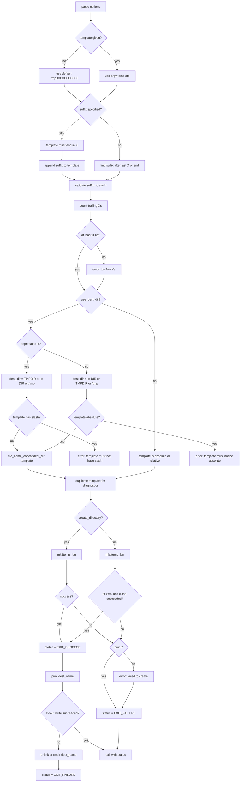

# `mktemp`: create temporary files or directories

Source: `src/mktemp.c` (358 lines) · Tests: `tests/mktemp/` ·
Manual: `info '(coreutils) mktemp invocation'`

`mktemp` creates temporary files or directories safely using `gen_tempname_len`
from gnulib. It replaces trailing `X` characters in a template with random
characters. The template must contain at least 3 consecutive `X`s. With `-d`,
it creates a directory; otherwise, it creates a file. If output fails after
creation, it cleans up the created file/directory.

## Options

The table lists `longopts[]` (`src/mktemp.c:46-56`) and the short-option
string `"dp:qtuV"`.

|| Option | Variables |
||---|---|
|| `-d`, `--directory` | `create_directory`: create a directory |
|| `-u`, `--dry-run` | `dry_run`: do not create, only print a name |
|| `-q`, `--quiet` | `suppress_file_err`: suppress error messages |
|| `--suffix=SUFF` | `suffix`: append SUFF to TEMPLATE |
|| `-p DIR`, `--tmpdir[=DIR]` | `dest_dir_arg`, `use_dest_dir`: use DIR as base directory |
|| `-t` | `use_dest_dir`, `deprecated_t_option`: treat TEMPLATE as single component (deprecated) |
|| `-V` | Undocumented alias for `--version` (compatibility) |

## Code map

|| Function | Location | Role |
||---|---|---|
|| `main` | `src/mktemp.c:154` | Option parsing, template validation, directory resolution, `mkstemp_len`/`mkdtemp_len`, output, cleanup on failure |
|| `mkstemp_len` | `:124` | Wrapper for `gen_tempname_len` with `GT_FILE` |
|| `mkdtemp_len` | `:131` | Wrapper for `gen_tempname_len` with `GT_DIR` |
|| `count_consecutive_X_s` | `:115` | Count trailing `X` characters |
|| `maybe_close_stdout` | `:145` | Avoid closing stdout twice |
|| `usage` | `:59` | Help message |

## How it works

### Template and suffix handling

`main` builds the full template from TEMPLATE and `--suffix`
(`src/mktemp.c:232-257`):

- With `--suffix`, TEMPLATE must end in `X`. The suffix is appended after
  the template.
- Without `--suffix`, the suffix is everything after the last `X`, or the
  entire string if there is no `X`.

The suffix must not contain a slash (`src/mktemp.c:260-265`). The number of
trailing `X`s before the suffix must be at least 3 (`src/mktemp.c:266-274`).

### Directory resolution

When `use_dest_dir` is set (no template argument, `-p`, or `-t`), the template
is interpreted relative to a directory (`src/mktemp.c:276-313`):

- With `-t` (deprecated): The directory is `$TMPDIR`, or the `-p` argument,
  or `/tmp`. The template must not contain slashes.
- With `-p` or no template: The directory is the `-p` argument, or `$TMPDIR`,
  or `/tmp`. The template must not be absolute.

The directory and template are concatenated with `file_name_concat`.

### File/directory creation

`main` calls `mkdtemp_len` for directories or `mkstemp_len` for files
(`src/mktemp.c:319-340`). These call `gen_tempname_len` with `GT_DIR` or
`GT_FILE`. With `--dry-run`, they use `GT_NOCREATE` to only generate a name
without creating anything. For files, the file descriptor is closed
immediately after creation.

### Cleanup on output failure

If the file/directory is created successfully but writing the name to stdout
fails, `mktemp` cleans up by calling `unlink` (for files) or `rmdir` (for
directories) before exiting (`src/mktemp.c:347-354`). This prevents leaving
temporary files when the name cannot be communicated.

## Platform notes

`mktemp` uses `gen_tempname_len` from gnulib's `tempname` module for portable
random name generation. The `-V` option is an undocumented alias for
`--version`, kept for compatibility with the original mktemp program
(`src/mktemp.c:207-209`).

## Errors and exit status

- **Too many templates:** "too many templates"
- **Invalid suffix with slash:** "invalid suffix SUFFIX, contains directory separator"
- **Template must end in X with `--suffix`:** "with --suffix, template TEMPLATE must end in X"
- **Too few Xs:** "too few X's in template TEMPLATE"
- **Template has slash with `-t`:** "invalid template TEMPLATE, contains directory separator"
- **Template absolute with `--tmpdir`:** "invalid template TEMPLATE; with --tmpdir, it may not be absolute"
- **Creation failure:** "failed to create file/directory via template TEMPLATE" (unless `-q`)
- **Write error:** "write error" (when stdout fails after creation)

Exit status is 0 on success, 1 on failure.

## Tests

|| File | Covers |
||---|---|
|| `tests/mktemp/mktemp-misc.sh` | Various template and option combinations |
|| `tests/mktemp/mktemp.pl` | Perl tests for edge cases |
|| `tests/mktemp/bad-unicode.sh` | Unicode handling in templates |
|| `tests/mktemp/write-error.sh` | Cleanup when stdout write fails |

## See also

- [tempname](../overview/shared-infrastructure.md) for the gnulib module
