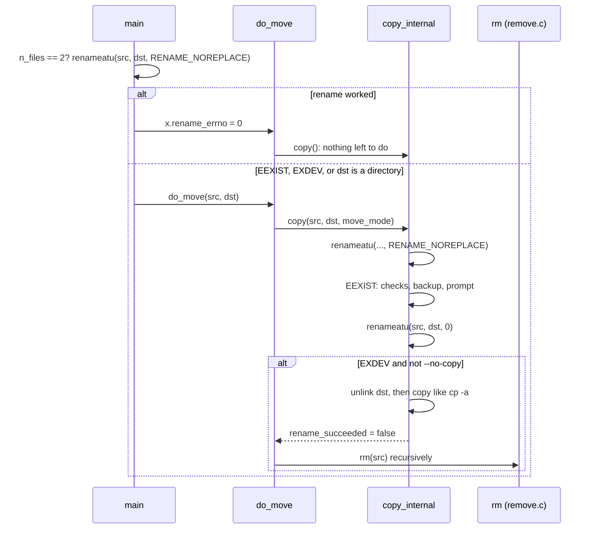

# `mv`: move (rename) files

Source: `src/mv.c` (573 lines), plus `src/copy.c`, `src/remove.c` and the
other copy modules · Tests: `tests/mv/` (about 50 scripts) · Manual:
`info '(coreutils) mv invocation'`

`mv` is a thin layer over two engines:

- `copy()` in `copy.c`, with `move_mode = true`. In this mode `copy()` first
  tries `rename()`. It copies only if the rename fails with `EXDEV` (the
  source and destination are on different file systems).
- `rm()` in `remove.c`, which removes the source after a cross-device
  copy.

## Options

The table lists `long_options[]` (`src/mv.c:66-86`) and the short-option
string `"bfint:uvS:TZ"`.

| Option | Field | Notes |
|---|---|---|
| `-f`, `--force` | `interactive = I_ALWAYS_YES` | Never ask. |
| `-i`, `--interactive` | `I_ASK_USER` | Ask before overwriting. |
| `-n`, `--no-clobber` (deprecated) | `I_ALWAYS_SKIP`, so `update = UPDATE_NONE` | The last of `-f`, `-i`, `-n` wins. |
| `-u`, `--update[=all\|none\|none-fail\|older]` | `update` | |
| `-b`, `--backup[=CONTROL]`, `-S` | `backup_type` | Cannot be combined with `--exchange`, `-n` or `--update=none-fail`. |
| `--exchange` | `exchange` | Swap SOURCE and DEST atomically with `renameat2 (RENAME_EXCHANGE)`. Both must exist. It never copies. |
| `--no-copy` | `no_copy` | Fail if `rename` fails, and do not fall back to copy and remove. |
| `-t DIR`, `-T` | | As in `cp`. |
| `--strip-trailing-slashes` | | Remove trailing `/` from each SOURCE. |
| `-Z`, `--context` | `set_security_context` | Give the destination the default SELinux context, and do not keep the old one. |
| `-v`, `--debug` | `verbose`, `debug` | |

## Settings passed to `copy()`

`mv`'s `cp_option_init()` (`src/mv.c:121-161`) explains why a move across
file systems keeps everything:

| Field | Value | Why |
|---|---|---|
| `move_mode` | `true` | Try `rename` first. |
| `dereference` | `DEREF_NEVER` | Move symlinks, not their targets. |
| `recursive` | `true` | Move whole directories. |
| `preserve_ownership`, `preserve_mode`, `preserve_timestamps`, `preserve_links`, `preserve_xattr` | `true` | A move should give the same file. |
| `preserve_security_context` | `true` if SELinux is on | |
| `require_preserve` | `false` | A copy that cannot keep the owner (for example, run by a normal user) still succeeds. |
| `require_preserve_xattr` | `true` | But `copy_reg` ignores xattr failures in move mode (`src/copy.c:1081-1086`). |
| `copy_as_regular` | `false` | FIFOs and devices are created again, not read. |

`rm_option_init()` (`src/mv.c:89-118`) sets `recursive`,
`remove_empty_directories` and `interactive = RMI_NEVER`, because the user
already agreed to the move. It sets `require_restore_cwd = true`, because
later operands may be relative to the working directory. It always fills
in `root_dev_ino`.

## Code map

| Function | Location | Role |
|---|---|---|
| `main` | `src/mv.c:343` | Options, the fast rename for two operands, the target directory, a loop over sources. |
| `do_move` | `:169` | `copy()`, then `rm()` of the source if the data was copied and not renamed. |
| `cp_option_init`, `rm_option_init` | `:121`, `:89` | The settings described above. |

## How it works

The sequence diagram shows a move that crosses file systems.



### The fast path

With exactly two operands and no `--exchange`, `main` tries
`renameatu (AT_FDCWD, src, AT_FDCWD, dst, RENAME_NOREPLACE)` before doing
anything else (`src/mv.c:477-480`). In the common case (`mv a b` where `b`
does not exist) this one system call does the whole move, with no `stat`
and no check of the target directory. The result is passed to
`copy_internal` in `x.rename_errno`. If the rename failed, `main` checks
whether the last operand is a directory and carries on.

### Renames inside `copy_internal`

In move mode, `copy_internal` (`src/copy.c:1647-1654`) tries
`RENAME_NOREPLACE` first. If that gives `EEXIST`, it does the usual
existing-destination checks: `same_file_ok`, `-i` prompts, `--update`,
backups, and directory versus non-directory. Then it calls `renameatu`
again **without** `RENAME_NOREPLACE` (or with `RENAME_EXCHANGE`)
(`:2147-2153`). Errors are then handled like this:

| `rename_errno` | Result |
|---|---|
| 0 | Done: `renamed 'a' -> 'b'` with `-v`. |
| `EINVAL` | `cannot move 'a' to a subdirectory of itself, 'a/b'`. Sets `copy_into_self`. |
| `EXDEV`, without `--no-copy` or `--exchange` | Remove any existing destination, set `new_dst`, then copy as `cp -a` would. |
| `EDQUOT`, `EEXIST`, `EISDIR`, `EMLINK`, `ENOSPC`, `ETXTBSY`, `ENOTEMPTY` | `cannot overwrite 'b'`. Only the destination is named. |
| anything else | `cannot move 'a' to 'b'`. |

### After a cross-device copy

`do_move` (`src/mv.c:169-244`) checks what `copy()` reported:

- `copy_into_self`: fail, without removing anything.
- `rename_succeeded`: nothing more to do.
- Otherwise the data was copied, so `rm()` removes the source tree. If the
  removal fails, `mv` fails, and the copy is left in place.

A long comment there notes that equal `st_dev` values do not prove that a
rename will work (for example NFS, or a Hurd ftpfs). That is why `mv`
always tries `rename` and checks the error, and never compares devices
first.

## Errors and exit status

The exit status is 1 if any source could not be moved. `copy_into_self`
counts as a failure.

## Tests

The table lists some of the tests.

| File | Covers |
|---|---|
| `tests/mv/atomic.sh`, `atomic2.sh` | `mv` does not unlink the destination before the rename. |
| `tests/mv/mv-exchange.sh` | `--exchange`. |
| `tests/mv/no-copy.sh` | `--no-copy` with a cross-device move. |
| `tests/mv/part-*.sh`, `partition-perm.sh`, `sticky-to-xpart.sh`, `meta-to-xpart.sh` | Moves across file systems (needs a second file system, see `tests/other-fs-tmpdir`). |
| `tests/mv/part-fail.sh` | A clear message when the destination of a cross-device move cannot be removed. |
| `tests/mv/into-self*.sh` | Moving a directory into itself. |
| `tests/mv/i-*.sh`, `mv-n.sh`, `update.sh`, `force.sh` | Prompts, `-n` and `--update`. |
| `tests/mv/hard-*.sh`, `hardlink-case.sh`, `symlink-onto-hardlink*.sh` | Hard links, including on file systems that ignore case. |
| `tests/mv/dup-source.sh` | A source given twice. |
| `tests/mv/trailing-slash.sh` | Trailing `/` handling. |

## See also

- [cp](cp.md): the same `copy()` engine.
- [rm](rm.md): the `rm()` engine.
- [Shared infrastructure](../overview/shared-infrastructure.md).

## Source code

`src/mv.c:1`

```c
/* mv -- move or rename files
   Copyright (C) 1986-2026 Free Software Foundation, Inc.

   This program is free software: you can redistribute it and/or modify
   it under the terms of the GNU General Public License as published by
   the Free Software Foundation, either version 3 of the License, or
   (at your option) any later version.

   This program is distributed in the hope that it will be useful,
   but WITHOUT ANY WARRANTY; without even the implied warranty of
   MERCHANTABILITY or FITNESS FOR A PARTICULAR PURPOSE.  See the
   GNU General Public License for more details.

   You should have received a copy of the GNU General Public License
   along with this program.  If not, see <https://www.gnu.org/licenses/>.  */

/* Written by Mike Parker, David MacKenzie, and Jim Meyering */

#include <config.h>
#include <stdio.h>
#include <getopt.h>
#include <sys/types.h>
#include <selinux/label.h>

#include "system.h"
#include "argmatch.h"
#include "assure.h"
#include "backupfile.h"
#include "copy.h"
#include "cp-hash.h"
#include "filenamecat.h"
#include "remove.h"
#include "renameatu.h"
#include "root-dev-ino.h"
#include "targetdir.h"
#include "priv-set.h"

/* The official name of this program (e.g., no 'g' prefix).  */
#define PROGRAM_NAME "mv"

#define AUTHORS \
  proper_name ("Mike Parker"), \
  proper_name ("David MacKenzie"), \
  proper_name ("Jim Meyering")

/* For long options that have no equivalent short option, use a
   non-character as a pseudo short option, starting with CHAR_MAX + 1.  */
enum
{
  DEBUG_OPTION = CHAR_MAX + 1,
  EXCHANGE_OPTION,
  NO_COPY_OPTION,
  STRIP_TRAILING_SLASHES_OPTION
};

static char const *const update_type_string[] =
{
  "all", "none", "none-fail", "older", NULL
};
static enum Update_type const update_type[] =
{
  UPDATE_ALL, UPDATE_NONE, UPDATE_NONE_FAIL, UPDATE_OLDER,
};
ARGMATCH_VERIFY (update_type_string, update_type);

static struct option const long_options[] =
{
  {"backup", optional_argument, NULL, 'b'},
  {"context", no_argument, NULL, 'Z'},
  {"debug", no_argument, NULL, DEBUG_OPTION},
  {"exchange", no_argument, NULL, EXCHANGE_OPTION},
  {"force", no_argument, NULL, 'f'},
  {"interactive", no_argument, NULL, 'i'},
  {"no-clobber", no_argument, NULL, 'n'},   /* Deprecated.  */
  {"no-copy", no_argument, NULL, NO_COPY_OPTION},
  {"no-target-directory", no_argument, NULL, 'T'},
  {"strip-trailing-slashes", no_argument, NULL,
   STRIP_TRAILING_SLASHES_OPTION},
  {"suffix", required_argument, NULL, 'S'},
  {"target-directory", required_argument, NULL, 't'},
  {"update", optional_argument, NULL, 'u'},
  {"verbose", no_argument, NULL, 'v'},
  {GETOPT_HELP_OPTION_DECL},
  {GETOPT_VERSION_OPTION_DECL},
  {NULL, 0, NULL, 0}
};

static void
rm_option_init (struct rm_options *x)
{
  x->ignore_missing_files = false;
  x->remove_empty_directories = true;
  x->recursive = true;
  x->one_file_system = false;

  /* Should we prompt for removal, too?  No.  Prompting for the 'move'
     part is enough.  It implies removal.  */
  x->interactive = RMI_NEVER;
  x->stdin_tty = false;

  x->verbose = false;

  /* Since this program may well have to process additional command
     line arguments after any call to 'rm', that function must preserve
     the initial working directory, in case one of those is a
     '.'-relative name.  */
  x->require_restore_cwd = true;

  {
    static struct dev_ino dev_ino_buf;
    x->root_dev_ino = get_root_dev_ino (&dev_ino_buf);
    if (x->root_dev_ino == NULL)
      error (EXIT_FAILURE, errno, _("failed to get attributes of %s"),
             quoteaf ("/"));
  }

  x->preserve_all_root = false;
}

static void
cp_option_init (struct cp_options *x)
{
  bool selinux_enabled = (0 < is_selinux_enabled ());

  cp_options_default (x);
  x->copy_as_regular = false;  /* FIXME: maybe make this an option */
  x->reflink_mode = REFLINK_AUTO;
  x->dereference = DEREF_NEVER;
  x->unlink_dest_before_opening = false;
  x->unlink_dest_after_failed_open = false;
  x->hard_link = false;
  x->interactive = I_UNSPECIFIED;
  x->move_mode = true;
  x->install_mode = false;
  x->one_file_system = false;
  x->preserve_ownership = true;
  x->preserve_links = true;
  x->preserve_mode = true;
  x->preserve_timestamps = true;
  x->explicit_no_preserve_mode= false;
  x->preserve_security_context = selinux_enabled;
  x->set_security_context = NULL;
  x->reduce_diagnostics = false;
  x->data_copy_required = true;
  x->require_preserve = false;  /* FIXME: maybe make this an option */
  x->require_preserve_context = false;
  x->preserve_xattr = true;
  x->require_preserve_xattr = true;
  x->recursive = true;
  x->sparse_mode = SPARSE_AUTO;  /* FIXME: maybe make this an option */
  x->symbolic_link = false;
  x->set_mode = false;
  x->mode = 0;
  x->stdin_tty = isatty (STDIN_FILENO);

  x->open_dangling_dest_symlink = false;
  x->update = UPDATE_ALL;
  x->verbose = false;
  x->dest_info = NULL;
  x->src_info = NULL;
}

/* Move SOURCE onto DEST aka DEST_DIRFD+DEST_RELNAME.
   Handle cross-file-system moves.
   If SOURCE is a directory, DEST must not exist.
   Return true if successful.  */

static bool
do_move (char const *source, char const *dest,
         int dest_dirfd, char const *dest_relname, const struct cp_options *x)
{
  bool copy_into_self;
  bool rename_succeeded;
  bool ok = copy (source, dest, dest_dirfd, dest_relname, 0, x,
                  &copy_into_self, &rename_succeeded);

  if (ok)
    {
      char const *dir_to_remove;
      if (copy_into_self)
        {
          /* In general, when copy returns with copy_into_self set, SOURCE is
             the same as, or a parent of DEST.  In this case we know it's a
             parent.  It doesn't make sense to move a directory into itself, and
             besides in some situations doing so would give highly unintuitive
             results.  Run this 'mkdir b; touch a c; mv * b' in an empty
             directory.  Here's the result of running echo $(find b -print):
             b b/a b/b b/b/a b/c.  Notice that only file 'a' was copied
             into b/b.  Handle this by giving a diagnostic, removing the
             copied-into-self directory, DEST ('b/b' in the example),
             and failing.  */

          dir_to_remove = NULL;
          ok = false;
        }
      else if (rename_succeeded)
        {
          /* No need to remove anything.  SOURCE was successfully
             renamed to DEST.  Or the user declined to rename a file.  */
          dir_to_remove = NULL;
        }
      else
        {
          /* This may mean SOURCE and DEST referred to different devices.
             It may also conceivably mean that even though they referred
             to the same device, rename wasn't implemented for that device.

             E.g., (from Joel N. Weber),
             [...] there might someday be cases where you can't rename
             but you can copy where the device name is the same, especially
             on Hurd.  Consider an ftpfs with a primitive ftp server that
             supports uploading, downloading and deleting, but not renaming.

             Also, note that comparing device numbers is not a reliable
             check for 'can-rename'.  Some systems can be set up so that
             files from many different physical devices all have the same
             st_dev field.  This is a feature of some NFS mounting
             configurations.

             We reach this point if SOURCE has been successfully copied
             to DEST.  Now we have to remove SOURCE.

             This function used to resort to copying only when rename
             failed and set errno to EXDEV.  */

          dir_to_remove = source;
        }

      if (dir_to_remove != NULL)
        {
          struct rm_options rm_options;
          rm_option_init (&rm_options);
          rm_options.verbose = x->verbose;
          char const *dir[2] = { dir_to_remove, NULL };

          enum RM_status status = rm ((void *) dir, &rm_options);
          affirm (VALID_STATUS (status));
          if (status == RM_ERROR)
            ok = false;
        }
    }

  return ok;
}

void
usage (int status)
{
  if (status != EXIT_SUCCESS)
    emit_try_help ();
  else
    {
      printf (_("\
Usage: %s [OPTION]... [-T] SOURCE DEST\n\
  or:  %s [OPTION]... SOURCE... DIRECTORY\n\
  or:  %s [OPTION]... -t DIRECTORY SOURCE...\n\
"),
              program_name, program_name, program_name);
      fputs (_("\
Rename SOURCE to DEST, or move SOURCE(s) to DIRECTORY.\n\
"), stdout);

      emit_mandatory_arg_note ();

      oputs (_("\
      --backup[=CONTROL]\n\
         make a backup of each existing destination file\n\
"));
      oputs (_("\
  -b\n\
         like --backup but does not accept an argument\n\
"));
      oputs (_("\
      --debug\n\
         explain how a file is copied.  Implies -v\n\
"));
      oputs (_("\
      --exchange\n\
         exchange source and destination\n\
"));
      oputs (_("\
  -f, --force\n\
         do not prompt before overwriting\n\
"));
      oputs (_("\
  -i, --interactive\n\
         prompt before overwrite\n\
"));
      oputs (_("\
  -n, --no-clobber\n\
         (deprecated) silently skip existing files.  See also --update\n\
"));
      fputs (_("\
If you specify more than one of -i, -f, -n, only the final one takes effect.\n\
"), stdout);
      oputs (_("\
      --no-copy\n\
         do not copy if renaming fails\n\
"));
      oputs (_("\
      --strip-trailing-slashes\n\
         remove any trailing slashes from each SOURCE argument\n\
"));
      oputs (_("\
  -S, --suffix=SUFFIX\n\
         override the usual backup suffix\n\
"));
      oputs (_("\
  -t, --target-directory=DIRECTORY\n\
         move all SOURCE arguments into DIRECTORY\n\
"));
      oputs (_("\
  -T, --no-target-directory\n\
         treat DEST as a normal file\n\
"));
      oputs (_("\
      --update[=UPDATE]\n\
         control which existing files are updated;\n\
         UPDATE={all,none,none-fail,older(default)}\n\
"));
      oputs (_("\
  -u\n\
         equivalent to --update[=older].  See below\n\
"));
      oputs (_("\
  -v, --verbose\n\
         explain what is being done\n\
"));
      oputs (_("\
  -Z, --context\n\
         set SELinux security context of destination file to default type\n\
"));
      oputs (HELP_OPTION_DESCRIPTION);
      oputs (VERSION_OPTION_DESCRIPTION);
      emit_update_parameters_note ();
      emit_backup_suffix_note ();
      emit_ancillary_info (PROGRAM_NAME);
    }
  exit (status);
}

int
main (int argc, char **argv)
{
  bool make_backups = false;
  char const *backup_suffix = NULL;
  char *version_control_string = NULL;
  struct cp_options x;
  bool remove_trailing_slashes = false;
  char const *target_directory = NULL;
  bool no_target_directory = false;
  bool selinux_enabled = (0 < is_selinux_enabled ());

  initialize_main (&argc, &argv);
  set_program_name (argv[0]);
  setlocale (LC_ALL, "");
  bindtextdomain (PACKAGE, LOCALEDIR);
  textdomain (PACKAGE);

  atexit (close_stdin);

  cp_option_init (&x);

  /* Try to disable the ability to unlink a directory.  */
  priv_set_remove_linkdir ();

  int c;
  while ((c = getopt_long (argc, argv, "bfint:uvS:TZ", long_options, NULL))
         != -1)
    {
      switch (c)
        {
        case 'b':
          make_backups = true;
          if (optarg)
            version_control_string = optarg;
          break;
        case 'f':
          x.interactive = I_ALWAYS_YES;
          break;
        case 'i':
          x.interactive = I_ASK_USER;
          break;
        case 'n':
          x.interactive = I_ALWAYS_SKIP;
          break;
        case DEBUG_OPTION:
          x.debug = x.verbose = true;
          break;
        case EXCHANGE_OPTION:
          x.exchange = true;
          break;
        case NO_COPY_OPTION:
          x.no_copy = true;
          break;
        case STRIP_TRAILING_SLASHES_OPTION:
          remove_trailing_slashes = true;
          break;
        case 't':
          if (target_directory)
            error (EXIT_FAILURE, 0, _("multiple target directories specified"));
          target_directory = optarg;
          break;
        case 'T':
          no_target_directory = true;
          break;
        case 'u':
          x.update = UPDATE_OLDER;
          if (optarg)
            x.update = XARGMATCH ("--update", optarg,
                                  update_type_string, update_type);
          break;
        case 'v':
          x.verbose = true;
          break;
        case 'S':
          make_backups = true;
          backup_suffix = optarg;
          break;
        case 'Z':
          /* As a performance enhancement, don't even bother trying
             to "restorecon" when not on an selinux-enabled kernel.  */
          if (selinux_enabled)
            {
              x.preserve_security_context = false;
              x.set_security_context = selabel_open (SELABEL_CTX_FILE,
                                                     NULL, 0);
              if (! x.set_security_context)
                error (0, errno, _("warning: ignoring --context"));
            }
          break;
        case_GETOPT_HELP_CHAR;
        case_GETOPT_VERSION_CHAR (PROGRAM_NAME, AUTHORS);
        default:
          usage (EXIT_FAILURE);
        }
    }

  int n_files = argc - optind;
  char **file = argv + optind;

  if (n_files <= !target_directory)
    {
      if (n_files <= 0)
        error (0, 0, _("missing file operand"));
      else
        error (0, 0, _("missing destination file operand after %s"),
               quoteaf (file[0]));
      usage (EXIT_FAILURE);
    }

  struct stat sb;
  sb.st_mode = 0;
  int target_dirfd = AT_FDCWD;
  if (no_target_directory)
    {
      if (target_directory)
        error (EXIT_FAILURE, 0,
               _("cannot combine --target-directory (-t) "
                 "and --no-target-directory (-T)"));
      if (2 < n_files)
        {
          error (0, 0, _("extra operand %s"), quoteaf (file[2]));
          usage (EXIT_FAILURE);
        }
    }
  else if (target_directory)
    {
      target_dirfd = target_directory_operand (target_directory, &sb);
      if (! target_dirfd_valid (target_dirfd))
        error (EXIT_FAILURE, errno, _("target directory %s"),
               quoteaf (target_directory));
    }
  else
    {
      char const *lastfile = file[n_files - 1];
      if (n_files == 2 && !x.exchange)
        x.rename_errno = (renameatu (AT_FDCWD, file[0], AT_FDCWD, lastfile,
                                     RENAME_NOREPLACE)
                          ? errno : 0);
      if (x.rename_errno != 0)
        {
          int fd = target_directory_operand (lastfile, &sb);
          if (target_dirfd_valid (fd))
            {
              x.rename_errno = -1;
              target_dirfd = fd;
              target_directory = lastfile;
              n_files--;
            }
          else
            {
              /* The last operand LASTFILE cannot be opened as a directory.
                 If there are more than two operands, report an error.

                 Also, report an error if LASTFILE is known to be a directory
                 even though it could not be opened, which can happen if
                 opening failed with EACCES on a platform lacking O_PATH.
                 In this case use stat to test whether LASTFILE is a
                 directory, in case opening a non-directory with (O_SEARCH
                 | O_DIRECTORY) failed with EACCES not ENOTDIR.  */
              int err = errno;
              if (2 < n_files
                  || (O_PATHSEARCH == O_SEARCH && err == EACCES
                      && (sb.st_mode != 0 || stat (lastfile, &sb) == 0)
                      && S_ISDIR (sb.st_mode)))
                error (EXIT_FAILURE, err, _("target %s"), quoteaf (lastfile));
            }
        }
    }

  /* Handle the ambiguity in the semantics of mv induced by the
     varying semantics of the rename function.  POSIX-compatible
     systems (e.g., GNU/Linux) have a rename function that honors a
     trailing slash in the source, while others (Solaris 9, FreeBSD
     7.2) have a rename function that ignores it.  */
  if (remove_trailing_slashes)
    for (int i = 0; i < n_files; i++)
      strip_trailing_slashes (file[i]);

  if (x.interactive == I_ALWAYS_SKIP)
    x.update = UPDATE_NONE;

  if (make_backups
      && (x.exchange
          || x.update == UPDATE_NONE
          || x.update == UPDATE_NONE_FAIL))
    {
      error (0, 0,
             _("cannot combine --backup with "
               "--exchange, -n, or --update=none-fail"));
      usage (EXIT_FAILURE);
    }

  x.backup_type = (make_backups
                   ? xget_version (_("backup type"),
                                   version_control_string)
                   : no_backups);
  set_simple_backup_suffix (backup_suffix);

  hash_init ();

  bool ok;
  if (target_directory)
    {
      /* Initialize the hash table only if we'll need it.
         The problem it is used to detect can arise only if there are
         two or more files to move.  */
      if (2 <= n_files)
        dest_info_init (&x);

      ok = true;
      for (int i = 0; i < n_files; ++i)
        {
          x.last_file = i + 1 == n_files;
          char const *source = file[i];
          char const *source_basename = last_component (source);
          char *dest_relname;
          char *dest = file_name_concat (target_directory, source_basename,
                                         &dest_relname);
          strip_trailing_slashes (dest_relname);
          ok &= do_move (source, dest, target_dirfd, dest_relname, &x);
          free (dest);
        }
    }
  else
    {
      x.last_file = true;
      ok = do_move (file[0], file[1], AT_FDCWD, file[1], &x);
    }

  main_exit (ok ? EXIT_SUCCESS : EXIT_FAILURE);
}
```
