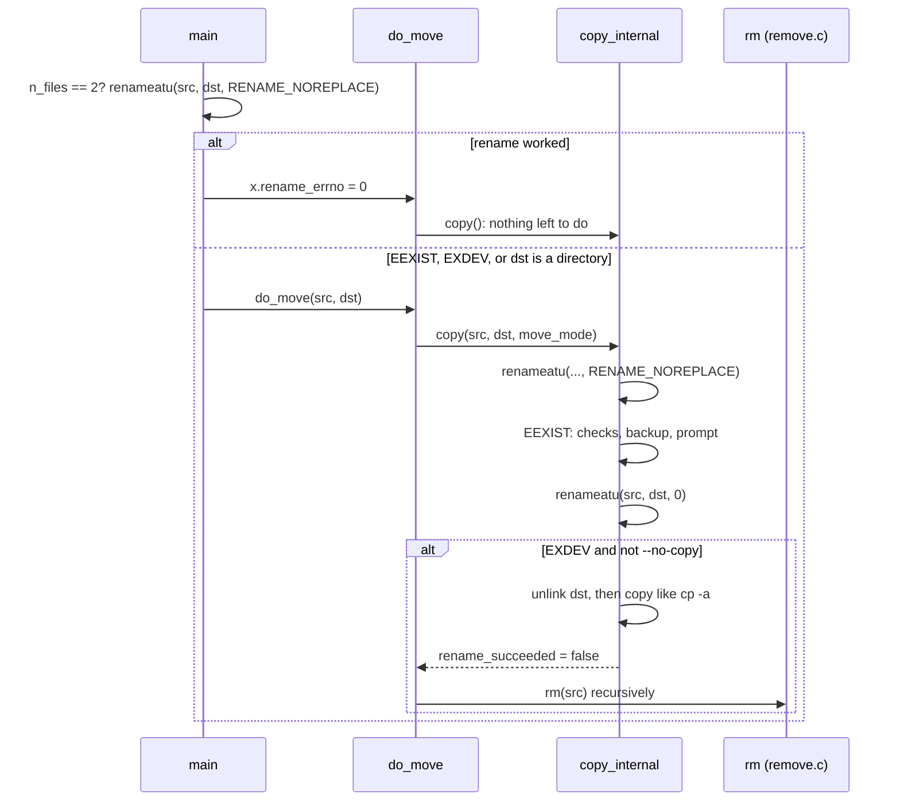

# `mv`: move (rename) files

Source: `src/mv.c` (573 lines), plus `src/copy.c`, `src/remove.c` and the
other copy modules · Tests: `tests/mv/` (about 50 scripts) · Manual:
`info '(coreutils) mv invocation'`

`mv` is a thin layer over two engines:

- `copy()` in `copy.c`, with `move_mode = true`. In this mode `copy()` first
  tries `rename()`. It copies only if the rename fails with `EXDEV` (the
  source and destination are on different file systems).
- `rm()` in `remove.c`, which removes the source after a cross-device
  copy.

## Options

The table lists `long_options[]` (`src/mv.c:66-86`) and the short-option
string `"bfint:uvS:TZ"`.

| Option | Field | Notes |
|---|---|---|
| `-f`, `--force` | `interactive = I_ALWAYS_YES` | Never ask. |
| `-i`, `--interactive` | `I_ASK_USER` | Ask before overwriting. |
| `-n`, `--no-clobber` (deprecated) | `I_ALWAYS_SKIP`, so `update = UPDATE_NONE` | The last of `-f`, `-i`, `-n` wins. |
| `-u`, `--update[=all\|none\|none-fail\|older]` | `update` | |
| `-b`, `--backup[=CONTROL]`, `-S` | `backup_type` | Cannot be combined with `--exchange`, `-n` or `--update=none-fail`. |
| `--exchange` | `exchange` | Swap SOURCE and DEST atomically with `renameat2 (RENAME_EXCHANGE)`. Both must exist. It never copies. |
| `--no-copy` | `no_copy` | Fail if `rename` fails, and do not fall back to copy and remove. |
| `-t DIR`, `-T` | | As in `cp`. |
| `--strip-trailing-slashes` | | Remove trailing `/` from each SOURCE. |
| `-Z`, `--context` | `set_security_context` | Give the destination the default SELinux context, and do not keep the old one. |
| `-v`, `--debug` | `verbose`, `debug` | |

## Settings passed to `copy()`

`mv`'s `cp_option_init()` (`src/mv.c:121-161`) explains why a move across
file systems keeps everything:

| Field | Value | Why |
|---|---|---|
| `move_mode` | `true` | Try `rename` first. |
| `dereference` | `DEREF_NEVER` | Move symlinks, not their targets. |
| `recursive` | `true` | Move whole directories. |
| `preserve_ownership`, `preserve_mode`, `preserve_timestamps`, `preserve_links`, `preserve_xattr` | `true` | A move should give the same file. |
| `preserve_security_context` | `true` if SELinux is on | |
| `require_preserve` | `false` | A copy that cannot keep the owner (for example, run by a normal user) still succeeds. |
| `require_preserve_xattr` | `true` | But `copy_reg` ignores xattr failures in move mode (`src/copy.c:1081-1086`). |
| `copy_as_regular` | `false` | FIFOs and devices are created again, not read. |

`rm_option_init()` (`src/mv.c:89-118`) sets `recursive`,
`remove_empty_directories` and `interactive = RMI_NEVER`, because the user
already agreed to the move. It sets `require_restore_cwd = true`, because
later operands may be relative to the working directory. It always fills
in `root_dev_ino`.

## Code map

| Function | Location | Role |
|---|---|---|
| `main` | `src/mv.c:343` | Options, the fast rename for two operands, the target directory, a loop over sources. |
| `do_move` | `:169` | `copy()`, then `rm()` of the source if the data was copied and not renamed. |
| `cp_option_init`, `rm_option_init` | `:121`, `:89` | The settings described above. |

## How it works

The sequence diagram shows a move that crosses file systems.

### The fast path

With exactly two operands and no `--exchange`, `main` tries
`renameatu (AT_FDCWD, src, AT_FDCWD, dst, RENAME_NOREPLACE)` before doing
anything else (`src/mv.c:477-480`). In the common case (`mv a b` where `b`
does not exist) this one system call does the whole move, with no `stat`
and no check of the target directory. The result is passed to
`copy_internal` in `x.rename_errno`. If the rename failed, `main` checks
whether the last operand is a directory and carries on.

### Renames inside `copy_internal`

In move mode, `copy_internal` (`src/copy.c:1647-1654`) tries
`RENAME_NOREPLACE` first. If that gives `EEXIST`, it does the usual
existing-destination checks: `same_file_ok`, `-i` prompts, `--update`,
backups, and directory versus non-directory. Then it calls `renameatu`
again **without** `RENAME_NOREPLACE` (or with `RENAME_EXCHANGE`)
(`:2147-2153`). Errors are then handled like this:

| `rename_errno` | Result |
|---|---|
| 0 | Done: `renamed 'a' -> 'b'` with `-v`. |
| `EINVAL` | `cannot move 'a' to a subdirectory of itself, 'a/b'`. Sets `copy_into_self`. |
| `EXDEV`, without `--no-copy` or `--exchange` | Remove any existing destination, set `new_dst`, then copy as `cp -a` would. |
| `EDQUOT`, `EEXIST`, `EISDIR`, `EMLINK`, `ENOSPC`, `ETXTBSY`, `ENOTEMPTY` | `cannot overwrite 'b'`. Only the destination is named. |
| anything else | `cannot move 'a' to 'b'`. |

### After a cross-device copy

`do_move` (`src/mv.c:169-244`) checks what `copy()` reported:

- `copy_into_self`: fail, without removing anything.
- `rename_succeeded`: nothing more to do.
- Otherwise the data was copied, so `rm()` removes the source tree. If the
  removal fails, `mv` fails, and the copy is left in place.

A long comment there notes that equal `st_dev` values do not prove that a
rename will work (for example NFS, or a Hurd ftpfs). That is why `mv`
always tries `rename` and checks the error, and never compares devices
first.

## Errors and exit status

The exit status is 1 if any source could not be moved. `copy_into_self`
counts as a failure.

## Tests

The table lists some of the tests.

| File | Covers |
|---|---|
| `tests/mv/atomic.sh`, `atomic2.sh` | `mv` does not unlink the destination before the rename. |
| `tests/mv/mv-exchange.sh` | `--exchange`. |
| `tests/mv/no-copy.sh` | `--no-copy` with a cross-device move. |
| `tests/mv/part-*.sh`, `partition-perm.sh`, `sticky-to-xpart.sh`, `meta-to-xpart.sh` | Moves across file systems (needs a second file system, see `tests/other-fs-tmpdir`). |
| `tests/mv/part-fail.sh` | A clear message when the destination of a cross-device move cannot be removed. |
| `tests/mv/into-self*.sh` | Moving a directory into itself. |
| `tests/mv/i-*.sh`, `mv-n.sh`, `update.sh`, `force.sh` | Prompts, `-n` and `--update`. |
| `tests/mv/hard-*.sh`, `hardlink-case.sh`, `symlink-onto-hardlink*.sh` | Hard links, including on file systems that ignore case. |
| `tests/mv/dup-source.sh` | A source given twice. |
| `tests/mv/trailing-slash.sh` | Trailing `/` handling. |

## See also

- [cp](cp.md): the same `copy()` engine.
- [rm](rm.md): the `rm()` engine.
- [Shared infrastructure](../overview/shared-infrastructure.md).
