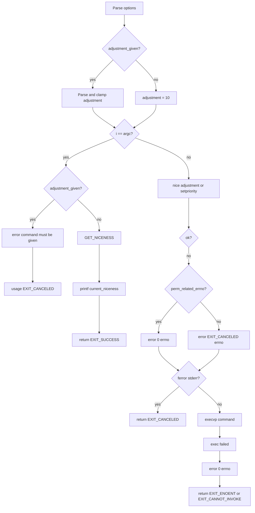

# `nice`: run with modified scheduling priority

Source: `src/nice.c` (256 lines) · Tests: `tests/misc/nice.sh` ·
Manual: `info '(coreutils) nice invocation'`

`nice` runs a command with an adjusted niceness (scheduling priority). With no
command, it prints the current niceness. The niceness range is from `-NZERO`
(most favorable) to `NZERO - 1` (least favorable), where `NZERO` is typically
20.

## Options

The table lists `longopts[]` (`src/nice.c:57-63`) and the adjustment argument.

|| Option | Variable |
||---|---|
|| `-n`, `--adjustment=N` | `adjustment` (add N to niceness, default 10) |

## Code map

|| Function | Location | Role |
||---|---|---|
|| `main` | `src/nice.c:102` | Parse adjustment, get/set niceness, exec command. |
|| `perm_related_errno` | `:95` | Check if errno is EACCES or EPERM. |
|| `usage` | `:65` | Help text. |

## How it works

The diagram shows the main flow.

### Adjustment parsing

`main` parses the adjustment value, which can be specified as `-nN` or just
`-N` (traditional BSD syntax) (`src/nice.c:119-164`). The value is clamped to
the valid range for the platform (`src/nice.c:166-211`). On GNU/Hurd with old
glibc, the range is more restrictive.

### No command mode

With no command, `main` prints the current niceness using `GET_NICENESS`
(`src/nice.c:221-226`). This macro expands to either `nice(0)` (if available)
or `getpriority(PRIO_PROCESS, 0)`.

### Execute command

With a command, `main` calls `nice(adjustment)` or `setpriority` to set the
niceness (`src/nice.c:229-237`), then `execvp` to run the command
(`src/nice.c:251`).

## Platform notes

- `HAVE_NICE` determines whether to use `nice()` or `setpriority()`
- GNU/Hurd before glibc 2.43 has a more restricted niceness range
- `NZERO` is typically 20 but can be 0 on some platforms (Darwin Kernel 7.7.0)

## Errors and exit status

- Invalid adjustment: `error (EXIT_CANCELED, 0, ...)`
- Command required with adjustment: `error (0, 0, ...)` then `usage`
- Cannot get/set niceness: `error (EXIT_CANCELED, errno, ...)` (or 0 for
  permission errors)
- Exec failure: `error (0, errno, ...)` then return `EXIT_ENOENT` or
  `EXIT_CANNOT_INVOKE`

## Tests

|| File | Covers |
||---|---|
|| `tests/misc/nice.sh` | Various adjustment values, error cases. |

## See also

- [nohup](nohup.md) (run command immune to hangups)
