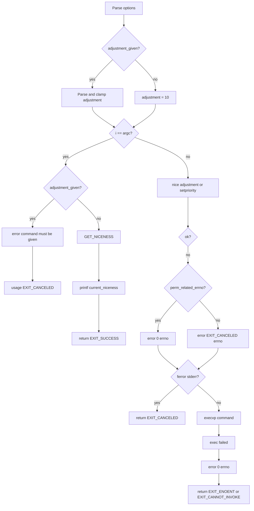

# `nice`: run with modified scheduling priority

Source: `src/nice.c` (256 lines) · Tests: `tests/misc/nice.sh` ·
Manual: `info '(coreutils) nice invocation'`

`nice` runs a command with an adjusted niceness (scheduling priority). With no
command, it prints the current niceness. The niceness range is from `-NZERO`
(most favorable) to `NZERO - 1` (least favorable), where `NZERO` is typically
20.

## Options

The table lists `longopts[]` (`src/nice.c:57-63`) and the adjustment argument.

|| Option | Variable |
||---|---|
|| `-n`, `--adjustment=N` | `adjustment` (add N to niceness, default 10) |

## Code map

|| Function | Location | Role |
||---|---|---|
|| `main` | `src/nice.c:102` | Parse adjustment, get/set niceness, exec command. |
|| `perm_related_errno` | `:95` | Check if errno is EACCES or EPERM. |
|| `usage` | `:65` | Help text. |

## How it works

The diagram shows the main flow.



### Adjustment parsing

`main` parses the adjustment value, which can be specified as `-nN` or just
`-N` (traditional BSD syntax) (`src/nice.c:119-164`). The value is clamped to
the valid range for the platform (`src/nice.c:166-211`). On GNU/Hurd with old
glibc, the range is more restrictive.

### No command mode

With no command, `main` prints the current niceness using `GET_NICENESS`
(`src/nice.c:221-226`). This macro expands to either `nice(0)` (if available)
or `getpriority(PRIO_PROCESS, 0)`.

### Execute command

With a command, `main` calls `nice(adjustment)` or `setpriority` to set the
niceness (`src/nice.c:229-237`), then `execvp` to run the command
(`src/nice.c:251`).

## Platform notes

- `HAVE_NICE` determines whether to use `nice()` or `setpriority()`
- GNU/Hurd before glibc 2.43 has a more restricted niceness range
- `NZERO` is typically 20 but can be 0 on some platforms (Darwin Kernel 7.7.0)

## Errors and exit status

- Invalid adjustment: `error (EXIT_CANCELED, 0, ...)`
- Command required with adjustment: `error (0, 0, ...)` then `usage`
- Cannot get/set niceness: `error (EXIT_CANCELED, errno, ...)` (or 0 for
  permission errors)
- Exec failure: `error (0, errno, ...)` then return `EXIT_ENOENT` or
  `EXIT_CANNOT_INVOKE`

## Tests

|| File | Covers |
||---|---|
|| `tests/misc/nice.sh` | Various adjustment values, error cases. |

## See also

- [nohup](nohup.md) (run command immune to hangups)

## Source code

`src/nice.c:1`

```c
/* nice -- run a program with modified niceness
   Copyright (C) 1990-2026 Free Software Foundation, Inc.

   This program is free software: you can redistribute it and/or modify
   it under the terms of the GNU General Public License as published by
   the Free Software Foundation, either version 3 of the License, or
   (at your option) any later version.

   This program is distributed in the hope that it will be useful,
   but WITHOUT ANY WARRANTY; without even the implied warranty of
   MERCHANTABILITY or FITNESS FOR A PARTICULAR PURPOSE.  See the
   GNU General Public License for more details.

   You should have received a copy of the GNU General Public License
   along with this program.  If not, see <https://www.gnu.org/licenses/>.  */

/* David MacKenzie <djm@gnu.ai.mit.edu> */

#include <config.h>
#include <stdio.h>
#include <getopt.h>
#include <sys/types.h>

#include "system.h"

#if ! HAVE_NICE
/* Include this after "system.h" so we're sure to have definitions
   (from time.h or sys/time.h) required for e.g. the ru_utime member.  */
# include <sys/resource.h>
#endif

#include "c-ctype.h"
#include "quote.h"
#include "xstrtol.h"

/* The official name of this program (e.g., no 'g' prefix).  */
#define PROGRAM_NAME "nice"

#define AUTHORS proper_name ("David MacKenzie")

#if HAVE_NICE
# define GET_NICENESS() nice (0)
#else
# define GET_NICENESS() getpriority (PRIO_PROCESS, 0)
#endif

#ifndef NZERO
# define NZERO 20
#endif

/* This is required for Darwin Kernel Version 7.7.0.  */
#if NZERO == 0
# undef  NZERO
# define NZERO 20
#endif

static struct option const longopts[] =
{
  {"adjustment", required_argument, NULL, 'n'},
  {GETOPT_HELP_OPTION_DECL},
  {GETOPT_VERSION_OPTION_DECL},
  {NULL, 0, NULL, 0}
};

void
usage (int status)
{
  if (status != EXIT_SUCCESS)
    emit_try_help ();
  else
    {
      printf (_("Usage: %s [OPTION] [COMMAND [ARG]...]\n"), program_name);
      printf (_("\
Run COMMAND with an adjusted niceness, which affects process scheduling.\n\
With no COMMAND, print the current niceness.  Niceness values range from\n\
%d (most favorable to the process) to %d (least favorable to the process).\n\
"),
              - NZERO, NZERO - 1);

      emit_mandatory_arg_note ();

      oputs (_("\
  -n, --adjustment=N\n\
         add integer N to the niceness (default 10)\n\
"));
      oputs (HELP_OPTION_DESCRIPTION);
      oputs (VERSION_OPTION_DESCRIPTION);
      printf (USAGE_BUILTIN_WARNING, PROGRAM_NAME);
      emit_exec_status (PROGRAM_NAME);
      emit_ancillary_info (PROGRAM_NAME);
    }
  exit (status);
}

static bool
perm_related_errno (int err)
{
  return err == EACCES || err == EPERM;
}

int
main (int argc, char **argv)
{
  int current_niceness;
  int adjustment = 10;
  char const *adjustment_given = NULL;
  bool ok;
  int i;

  initialize_main (&argc, &argv);
  set_program_name (argv[0]);
  setlocale (LC_ALL, "");
  bindtextdomain (PACKAGE, LOCALEDIR);
  textdomain (PACKAGE);

  initialize_exit_failure (EXIT_CANCELED);
  atexit (close_stdout);

  for (i = 1; i < argc; /* empty */)
    {
      char const *s = argv[i];

      if (s[0] == '-' && c_isdigit (s[1 + (s[1] == '-' || s[1] == '+')]))
        {
          adjustment_given = s + 1;
          ++i;
        }
      else
        {
          int c;
          int fake_argc = argc - (i - 1);
          char **fake_argv = argv + (i - 1);

          /* Ensure that any getopt diagnostics use the right name.  */
          fake_argv[0] = argv[0];

          /* Initialize getopt_long's internal state.  */
          optind = 0;

          c = getopt_long (fake_argc, fake_argv, "+n:", longopts, NULL);
          i += optind - 1;

          switch (c)
            {
            case 'n':
              adjustment_given = optarg;
              break;

            case -1:
              break;

            case_GETOPT_HELP_CHAR;

            case_GETOPT_VERSION_CHAR (PROGRAM_NAME, AUTHORS);

            default:
              usage (EXIT_CANCELED);
              break;
            }

          if (c == -1)
            break;
        }
    }

  if (adjustment_given)
    {
      /* If the requested adjustment is outside the valid range,
         silently bring it to just within range; this mimics what
         "setpriority" and "nice" do.  */
#if (defined __gnu_hurd__                                               \
     && (__GLIBC__ < 2 || (__GLIBC__ == 2 && __GLIBC_MINOR__ < 43)))
      /* GNU/Hurd's nice(2) only supported 0 to (2 * NZERO - 2) niceness
         until glibc 2.43.  */
      enum { MIN_ADJUSTMENT = 0, MAX_ADJUSTMENT = 2 * NZERO - 2 };
#else
      enum { MIN_ADJUSTMENT = 1 - 2 * NZERO, MAX_ADJUSTMENT = 2 * NZERO - 1 };
#endif
      long int tmp;
      if (LONGINT_OVERFLOW < xstrtol (adjustment_given, NULL, 10, &tmp, ""))
        error (EXIT_CANCELED, 0, _("invalid adjustment %s"),
               quote (adjustment_given));
#if (defined __gnu_hurd__                                               \
     && (__GLIBC__ < 2 || (__GLIBC__ == 2 && __GLIBC_MINOR__ < 43)))
      /* GNU/Hurd's nice(2) also did not clamp the new niceness into the
         supported range until glibc 2.43.
         See <https://sourceware.org/PR33614>.  */
      errno = 0;
      current_niceness = GET_NICENESS ();
      if (current_niceness == -1 && errno != 0)
        error (EXIT_CANCELED, errno, _("cannot get niceness"));
      if (tmp < 0)
        {
          int sum;
          if (ckd_add (&sum, current_niceness, tmp) || sum < MIN_ADJUSTMENT)
            adjustment = MIN_ADJUSTMENT - current_niceness;
          else
            adjustment = tmp;
        }
      else
        {
          int sum;
          if (ckd_add (&sum, current_niceness, tmp) || MAX_ADJUSTMENT < sum)
            adjustment = MAX_ADJUSTMENT - current_niceness;
          else
            adjustment = tmp;
        }
#else
      adjustment = MAX (MIN_ADJUSTMENT, MIN (tmp, MAX_ADJUSTMENT));
#endif
    }

  if (i == argc)
    {
      if (adjustment_given)
        {
          error (0, 0, _("a command must be given with an adjustment"));
          usage (EXIT_CANCELED);
        }
      /* No command given; print the niceness.  */
      errno = 0;
      current_niceness = GET_NICENESS ();
      if (current_niceness == -1 && errno != 0)
        error (EXIT_CANCELED, errno, _("cannot get niceness"));
      printf ("%d\n", current_niceness);
      return EXIT_SUCCESS;
    }

  errno = 0;
#if HAVE_NICE
  ok = (nice (adjustment) != -1 || errno == 0);
#else
  current_niceness = GET_NICENESS ();
  if (current_niceness == -1 && errno != 0)
    error (EXIT_CANCELED, errno, _("cannot get niceness"));
  ok = (setpriority (PRIO_PROCESS, 0, current_niceness + adjustment) == 0);
#endif
  if (!ok)
    {
      error (perm_related_errno (errno) ? 0
             : EXIT_CANCELED, errno, _("cannot set niceness"));
      /* error() flushes stderr, but does not check for write failure.
         Normally, we would catch this via our atexit() hook of
         close_stdout, but execvp() gets in the way.  If stderr
         encountered a write failure, there is no need to try calling
         error() again.  */
      if (ferror (stderr))
        return EXIT_CANCELED;
    }

  execvp (argv[i], &argv[i]);

  int exit_status = errno == ENOENT ? EXIT_ENOENT : EXIT_CANNOT_INVOKE;
  error (0, errno, "%s", quote (argv[i]));
  return exit_status;
}
```
