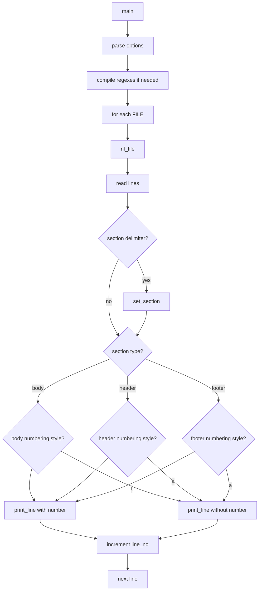

# `nl`: number lines of files

Source: `src/nl.c` (661 lines) · Tests: `tests/nl/` ·
Manual: `info '(coreutils) nl invocation'`

`nl` numbers lines of files, separating them into header, body, and footer
sections based on delimiter patterns. It can number only body lines, header
lines, or footer lines, or lines matching a regex. Line numbers can be formatted
with various styles (right/left justified, with/without leading zeros).

## Options

The table lists long options from the source and short options.

|| Option | Variables |
||---|---|
|| `-b STYLE`, `--body-numbering=STYLE` | `body_type`: body line numbering style |
|| `-d DELIM`, `--section-delimiter=DELIM` | `section_del`: section delimiter string |
|| `-f STYLE`, `--footer-numbering=STYLE` | `footer_type`: footer line numbering style |
|| `-h STYLE`, `--header-numbering=STYLE` | `header_type`: header line numbering style |
|| `-i INCR`, `--line-increment=INCR` | `page_incr`: line number increment |
|| `-l NUMBER`, `--blank-lines=NUMBER` | `blank_join`: blank lines to count as one |
|| `-n FORMAT`, `--number-format=FORMAT` | `lineno_format`: ln, rn, rz |
|| `-p`, `--no-renumber` | `reset_numbers = false`: don't reset line numbers |
|| `-s STRING`, `--number-separator=STRING` | `separator_str`: separator after line number |
|| `-v NUMBER`, `--first-line=NUMBER` | `starting_line_number`: first line number |
|| `-w WIDTH`, `--number-width=WIDTH` | `lineno_width`: line number width |

## Code map

|| Function | Location | Role |
||---|---|---|
|| `main` | `src/nl.c:547` | Option parsing, compile regexes, call `nl_file` for each file |
|| `nl_file` | `:428` | Read file, identify sections, number and output lines |
|| `print_line` | `:398` | Print line with or without line number |
|| `set_section` | `:380` | Change section based on delimiter |
|| `usage` | `:507` | Help message |

## How it works

### Section delimiters

Input is divided into header, body, and footer sections based on delimiter
patterns (`src/nl.c:98-119`). The default section delimiter is `\:`. Custom
delimiters can be set with `-d`. Header and footer delimiters can also be
specified.

### Line numbering

Line numbering can be controlled separately for each section type
(`src/nl.c:65-75`):

- **`t`**: number all lines (default for body)
- **`n`**: no line numbers (default for header/footer)
- **`a`:** number all lines
- **`p` regex`: number lines matching the regex

### Number formatting

Line numbers are formatted with `printf` using the selected format
(`src/nl.c:46-53`):

- **`rn` (right, no leading zero):** `%*jd`
- **`rz` (right, leading zero):** `%0*jd`
- **`ln` (left, no leading zero):** `%-*jd`

The width is set with `-w` (default 6).

## Platform notes

`nl` uses POSIX regex for pattern matching. Multi-byte character handling uses
`mcel` from gnulib.

## Errors and exit status

- **Invalid numeric argument:** Error from `xdectoint`
- **Invalid regex:** Error from `re_compile_pattern`
- **File open failure:** Error from `quotef(FILE)`

Exit status is 0 on success, 1 on errors.

## Tests

|| File | Covers |
||---|---|
|| `tests/nl/nl.sh` | Basic numbering |
|| `tests/nl/multiple-files.sh` | Multiple file handling |
|| `tests/nl/multibyte.sh` | Multi-byte character handling |

## See also

- [cat](cat.md) with `-n` for simple line numbering
