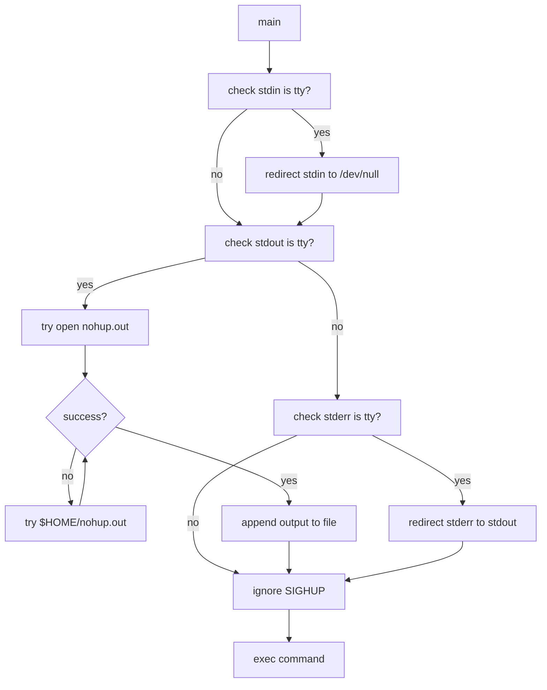

# `nohup`: run a command immune to hangups

Source: `src/nohup.c` (229 lines) · Tests: `tests/misc/nohup.sh` ·
Manual: `info '(coreutils) nohup invocation'`

`nohup` runs a command ignoring hangup signals (`SIGHUP`). It redirects
standard input from `/dev/null` if it's a terminal, and appends standard
output and standard error to `nohup.out` (or `$HOME/nohup.out`) if they are
terminals. This allows the command to continue running after the shell exits.

## Options

No options besides `--help` and `--version` (handled by
`parse_gnu_standard_options_only`).

## Code map

|| Function | Location | Role |
||---|---|---|
|| `main` | `src/nohup.c:82` | Redirect I/O, ignore `SIGHUP`, exec command |
|| `usage` | `:43` | Help message |

## How it works

### Input redirection

If standard input is a terminal, `nohup` redirects it to `/dev/null` opened
for writing (`src/nohup.c:117-124`). This ensures any read attempt fails.

### Output redirection

If standard output is a terminal, `nohup` appends to `nohup.out` in the current
directory (`src/nohup.c:130-172`). If that fails, it tries `$HOME/nohup.out`.
The file is opened with `O_CREAT | O_WRONLY | O_APPEND` with mode `0600`.

### Error redirection

If standard error is a terminal, it's redirected to standard output
(`src/nohup.c:176-198`). A copy of the original stderr is saved with
`F_DUPFD_CLOEXEC` for error reporting if `execvp` fails.

### Signal handling

On systems with `SIGHUP` support, the signal is set to ignore
(`src/nohup.c:210-212`). This prevents the command from being killed when the
shell exits.

## Platform notes

Windows does not support `SIGHUP`. The exit status for internal failure is 127
when `POSIXLY_CORRECT` is set, otherwise `EXIT_CANCELED` (125).

## Errors and exit status

- **Missing operand:** "missing operand" (exit 127 or 125)
- **Failed to redirect input:** "failed to render standard input unusable"
- **Failed to open output:** "failed to open nohup.out" or "$HOME/nohup.out"
- **Failed to redirect stderr:** "failed to redirect standard error"
- **Command not found:** Exit status 127
- **Command execution failure:** Exit status 126

Exit status is the command's exit status on success, or 126/127 on failure.

## Tests

|| File | Covers |
||---|---|
|| `tests/misc/nohup.sh` | Basic nohup functionality |

## See also

- [disown](https://man7.org/linux/man-pages/man1/disown.1p.html) (shell builtin) for detaching jobs
