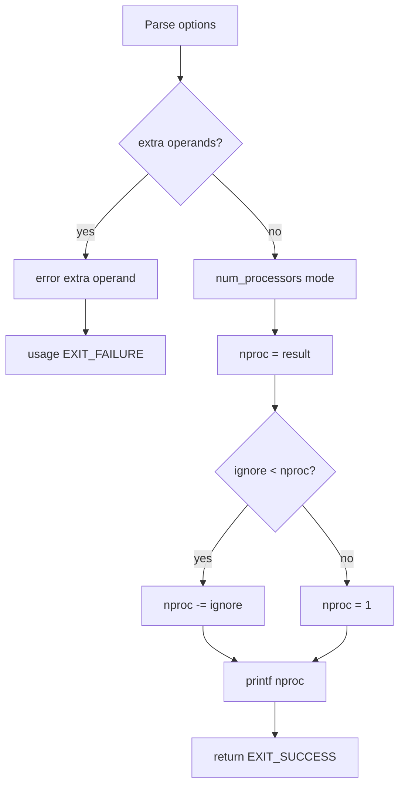

# `nproc`: print number of processors

Source: `src/nproc.c` (137 lines) · Tests: `tests/misc/nproc.sh` ·
Manual: `info '(coreutils) nproc invocation'`

`nproc` prints the number of processing units available to the current process.
By default, it respects OpenMP environment variables (`OMP_NUM_THREADS`,
`OMP_THREAD_LIMIT`) and CPU quotas. The actual processor count is obtained
from the gnulib `num_processors` function.

## Options

The table lists `longopts[]` (`src/nproc.c:40-47`).

|| Option | Variable |
||---|---|
|| `--all` | `mode = NPROC_ALL` (ignore OpenMP and quotas) |
|| `--ignore=N` | `ignore = N` (exclude N processors, result at least 1) |

## Code map

|| Function | Location | Role |
||---|---|---|
|| `main` | `src/nproc.c:83` | Option parsing, call `num_processors`, apply ignore, print result. |
|| `usage` | `:49` | Help text. |

## How it works

The diagram shows the flow.



### Mode selection

`main` sets the query mode based on options (`src/nproc.c:94-109`):

- Default: `NPROC_CURRENT_OVERRIDABLE` (respect OpenMP and quotas)
- `--all`: `NPROC_ALL` (ignore OpenMP and quotas)

### Processor count

`main` calls the gnulib `num_processors` function with the selected mode
(`src/nproc.c:127`). Then it subtracts the `--ignore` count if specified,
ensuring the result is at least 1 (`src/nproc.c:129-132`).

## Platform notes

- The gnulib `num_processors` function handles platform differences in
  querying processor counts
- OpenMP environment variables affect the default mode

## Errors and exit status

- Extra operand: `error (0, 0, ...)` then `usage (EXIT_FAILURE)`
- Invalid `--ignore` value: `xnumtoumax` reports error
- Write failure: handled by `atexit (close_stdout)`

## Tests

|| File | Covers |
||---|---|
|| `tests/misc/nproc.sh` | Basic functionality, `--all`, `--ignore` options. |

## See also

- None directly related

## Source code

`src/nproc.c:1`

```c
/* nproc - print the number of processors.
   Copyright (C) 2009-2026 Free Software Foundation, Inc.

   This program is free software: you can redistribute it and/or modify
   it under the terms of the GNU General Public License as published by
   the Free Software Foundation, either version 3 of the License, or
   (at your option) any later version.

   This program is distributed in the hope that it will be useful,
   but WITHOUT ANY WARRANTY; without even the implied warranty of
   MERCHANTABILITY or FITNESS FOR A PARTICULAR PURPOSE.  See the
   GNU General Public License for more details.

   You should have received a copy of the GNU General Public License
   along with this program.  If not, see <https://www.gnu.org/licenses/>.  */

/* Written by Giuseppe Scrivano.  */

#include <config.h>
#include <getopt.h>
#include <stdio.h>
#include <sys/types.h>

#include "system.h"
#include "nproc.h"
#include "quote.h"
#include "xdectoint.h"

/* The official name of this program (e.g., no 'g' prefix).  */
#define PROGRAM_NAME "nproc"

#define AUTHORS proper_name ("Giuseppe Scrivano")

enum
{
  ALL_OPTION = CHAR_MAX + 1,
  IGNORE_OPTION
};

static struct option const longopts[] =
{
  {"all", no_argument, NULL, ALL_OPTION},
  {"ignore", required_argument, NULL, IGNORE_OPTION},
  {GETOPT_HELP_OPTION_DECL},
  {GETOPT_VERSION_OPTION_DECL},
  {NULL, 0, NULL, 0}
};

void
usage (int status)
{
  if (status != EXIT_SUCCESS)
    emit_try_help ();
  else
    {
      printf (_("Usage: %s [OPTION]...\n"), program_name);
      fputs (_("\
Print the number of processing units available to the current process,\n\
which may be less than the number of online processors.\n\
If the 'OMP_NUM_THREADS' or 'OMP_THREAD_LIMIT' environment variables are set,\n\
then they will determine the minimum and maximum returned value respectively.\n\
\n\
"), stdout);
      oputs (_("\
      --all\n\
         print the number of installed processors,\n\
         disregarding any OpenMP environment variables, or CPU quotas.\n\
"));
      oputs (_("\
      --ignore=N\n\
         if possible, exclude N processing units.\n\
         The result is guaranteed to be at least 1.\n\
"));

      oputs (HELP_OPTION_DESCRIPTION);
      oputs (VERSION_OPTION_DESCRIPTION);
      emit_ancillary_info (PROGRAM_NAME);
    }
  exit (status);
}

int
main (int argc, char **argv)
{
  unsigned long ignore = 0;
  initialize_main (&argc, &argv);
  set_program_name (argv[0]);
  setlocale (LC_ALL, "");
  bindtextdomain (PACKAGE, LOCALEDIR);
  textdomain (PACKAGE);

  atexit (close_stdout);

  enum nproc_query mode = NPROC_CURRENT_OVERRIDABLE;

  while (true)
    {
      int c = getopt_long (argc, argv, "", longopts, NULL);
      if (c == -1)
        break;
      switch (c)
        {
        case_GETOPT_HELP_CHAR;

        case_GETOPT_VERSION_CHAR (PROGRAM_NAME, AUTHORS);

        case ALL_OPTION:
          mode = NPROC_ALL;
          break;

        case IGNORE_OPTION:
          ignore = xnumtoumax (optarg, 10, 0, ULONG_MAX, "",
                               _("invalid number"), 0, XTOINT_MAX_QUIET);
          break;

        default:
          usage (EXIT_FAILURE);
        }
    }

  if (argc != optind)
    {
      error (0, 0, _("extra operand %s"), quote (argv[optind]));
      usage (EXIT_FAILURE);
    }

  unsigned long nproc = num_processors (mode);

  if (ignore < nproc)
    nproc -= ignore;
  else
    nproc = 1;

  printf ("%lu\n", nproc);

  return EXIT_SUCCESS;
}
```
