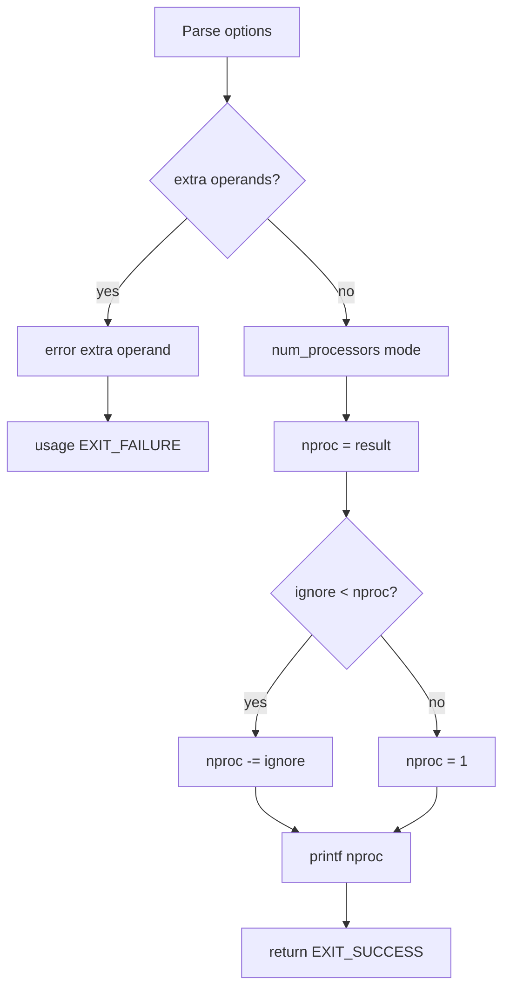

# `nproc`: print number of processors

Source: `src/nproc.c` (137 lines) · Tests: `tests/misc/nproc.sh` ·
Manual: `info '(coreutils) nproc invocation'`

`nproc` prints the number of processing units available to the current process.
By default, it respects OpenMP environment variables (`OMP_NUM_THREADS`,
`OMP_THREAD_LIMIT`) and CPU quotas. The actual processor count is obtained
from the gnulib `num_processors` function.

## Options

The table lists `longopts[]` (`src/nproc.c:40-47`).

|| Option | Variable |
||---|---|
|| `--all` | `mode = NPROC_ALL` (ignore OpenMP and quotas) |
|| `--ignore=N` | `ignore = N` (exclude N processors, result at least 1) |

## Code map

|| Function | Location | Role |
||---|---|---|
|| `main` | `src/nproc.c:83` | Option parsing, call `num_processors`, apply ignore, print result. |
|| `usage` | `:49` | Help text. |

## How it works

The diagram shows the flow.

### Mode selection

`main` sets the query mode based on options (`src/nproc.c:94-109`):

- Default: `NPROC_CURRENT_OVERRIDABLE` (respect OpenMP and quotas)
- `--all`: `NPROC_ALL` (ignore OpenMP and quotas)

### Processor count

`main` calls the gnulib `num_processors` function with the selected mode
(`src/nproc.c:127`). Then it subtracts the `--ignore` count if specified,
ensuring the result is at least 1 (`src/nproc.c:129-132`).

## Platform notes

- The gnulib `num_processors` function handles platform differences in
  querying processor counts
- OpenMP environment variables affect the default mode

## Errors and exit status

- Extra operand: `error (0, 0, ...)` then `usage (EXIT_FAILURE)`
- Invalid `--ignore` value: `xnumtoumax` reports error
- Write failure: handled by `atexit (close_stdout)`

## Tests

|| File | Covers |
||---|---|
|| `tests/misc/nproc.sh` | Basic functionality, `--all`, `--ignore` options. |

## See also

- None directly related
