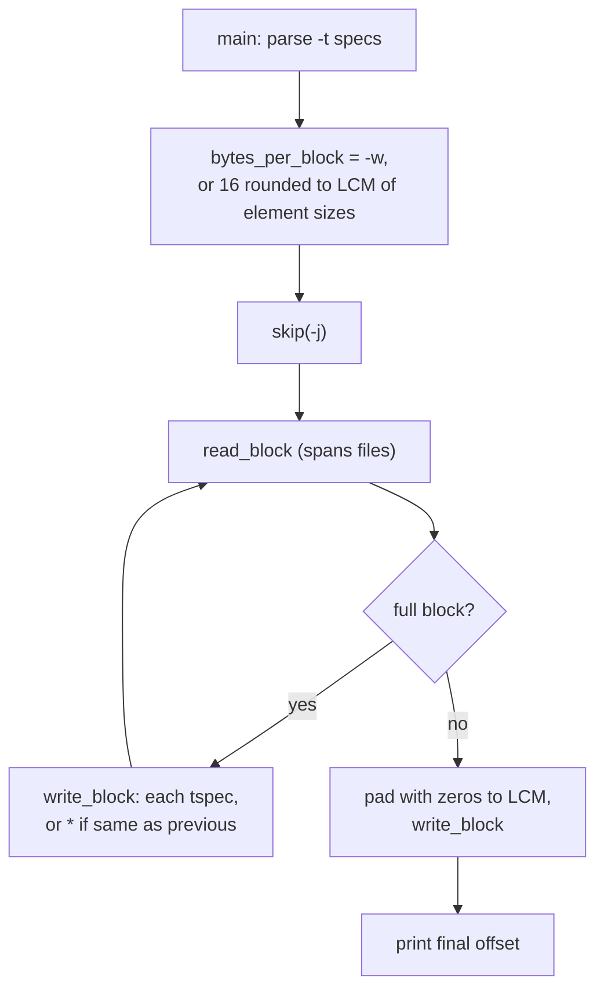

# `od`: dump files in octal and other formats

Source: `src/od.c` (2079 lines) · Tests: `tests/od/` · Manual:
`info '(coreutils) od invocation'`

`od` reads its inputs as one stream and prints each block of
`bytes_per_block` bytes (default 16) in one or more formats. Each `-t`
format becomes a `struct tspec`. It holds a `printf` format string and a
print function for one element type. `write_block` calls each `tspec` in
turn for the same block, so several formats appear one under another.

## Options

The table lists `long_options[]` (`src/od.c:333-348`).

| Option | Effect |
|---|---|
| `-A`, `--address-radix=d\|o\|x\|n` | Offset format: `format_address_std` with base 10, 8 or 16, or `format_address_none`. |
| `-j`, `--skip-bytes=N` | Skip N bytes (`skip()` seeks when it can). |
| `-N`, `--read-bytes=N` | Stop after N bytes (`end_offset`). |
| `-t`, `--format=TYPE` | Add an output format: `a`, `c`, `d[SIZE]`, `o[SIZE]`, `u[SIZE]`, `x[SIZE]`, `f[SIZE]`, with an optional `z` suffix for a printable-character trailer. SIZE is a number of bytes or `C S I L` (integers) / `F D L` (floating point), plus `H` and `B` for 16-bit floats where the compiler supports them. |
| `-v`, `--output-duplicates` | Do not replace repeated lines with `*`. |
| `-w`, `--width[=N]` | Bytes per line (32 if N is not given). Must be a multiple of the least common multiple of the element sizes. |
| `-S`, `--strings[=N]` | Print runs of at least N (default 3) printable characters ended by NUL (`dump_strings`). |
| `--endian=little\|big` | Byte order for multi-byte elements. |
| `--traditional` | Accept old offset and label operands (`[+]OFFSET[.][b]` and a label). |
| `-a -b -c -d -f -i -l -o -s -x` | Old one-letter formats. They map to `-t` forms, for example `-x` is `x2` and `-c` is `c` (`CASE_OLD_ARG`, `src/od.c:1827-1851`). Some extra letters (`-D`, `-e`, `-H`, ...) are kept for FreeBSD compatibility but not documented. |

## Code map

| Function | Location | Role |
|---|---|---|
| `main` | `src/od.c:1692` | Options, old-style operands, `bytes_per_block`, open the first file, `skip`, `dump` or `dump_strings`. |
| `decode_format_string`, `decode_one_format` | `:1098`, `:750` | Turn a `-t` string into `struct tspec` entries: choose the print function, width and `printf` format. |
| `dump` | `:1528` | Read blocks, `write_block`, then pad and print the last short block and the final offset. |
| `write_block` | `:1312` | Print one block with each format, or `*` for repeats. |
| `read_block`, `read_char` | `:1407`, `:1377` | Read across file boundaries as if the inputs were one stream. |
| `open_next_file`, `check_and_close` | `:1019`, `:1063` | Move to the next input and report errors. |
| `skip` | `:1128` | Skip `-j` bytes: `fstat` and seek when the file is regular and large enough, otherwise read. |
| `print_named_ascii`, `print_ascii`, and the generated `print_*` functions | `:605`, `:636` | Format one block for one type. |
| `dump_hexl_mode_trailer` | `:592` | The `z` suffix: `>printable<` text after the line. |
| `parse_old_offset` | `:1466` | Old offset syntax: octal by default, decimal with a `.`, hex with `0x`, and `b` meaning 512-byte blocks. |
| `format_address_*` | `:1233-1290` | Offset printing. `format_address_label` is for `--traditional` labels. |

## How it works

The diagram shows the main loop in `dump()`.

### Element sizes and line width

`enum size_spec` (`src/od.c:65-81`) has one value for each distinct C type
size on the platform. Duplicates are removed at compile time, for example
`INT = SHORT + (USHRT_MAX < UINT_MAX)`. `width_bytes[]` maps each value to
`sizeof`. `bytes_per_block` must be a multiple of every format's element
size (`get_lcm()`). An invalid `-w` gives a warning and the LCM is used
instead. The last short block is padded with zeros up to the LCM, but
only the real bytes count towards the offset.

### Repeated lines

When `-v` is not given (`abbreviate_duplicate_blocks`), `dump` keeps two
block buffers and swaps them. `write_block` compares the current block
with the previous one using `memeq`. The first repeat prints `*` and
later repeats print nothing. The unreleased `NEWS` notes that `-v` now
uses half the memory, because it needs only one buffer.

### Reading several files

`read_block` and `read_char` read from `in_stream`. At the end of a file
they call `check_and_close` and `open_next_file`, so blocks and strings
can span file boundaries, as POSIX requires.

## Errors and exit status

A file that cannot be opened or read is reported, and the exit status is 1,
but the other files are still dumped. Invalid `-t` strings, sizes, or
offsets are fatal.

## Tests

| File | Covers |
|---|---|
| `tests/od/od.pl` | The main table of formats and options. |
| `tests/od/od-N.sh`, `od-j.sh` | `-N` and `-j`, including across files. |
| `tests/od/od-float.sh` | Floating-point formats. |
| `tests/od/od-endian.sh` | `--endian`. |
| `tests/od/od-multiple-t.sh`, `od-x8.sh` | Several `-t` options, 8-byte integers. |
| `tests/od/big-w.sh` | Very large `-w`. |

## See also

- [cksum](cksum.md) and [wc](wc.md) for other ways to inspect file data.
