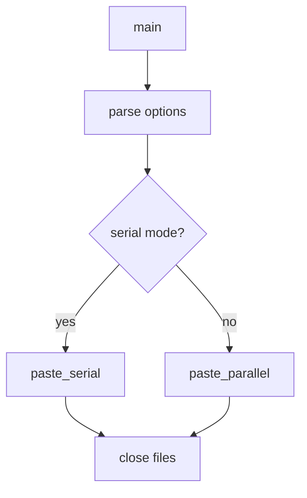

# `paste`: merge lines of files

Source: `src/paste.c` (553 lines) · Tests: `tests/paste/` ·
Manual: `info '(coreutils) paste invocation'`

`paste` merges lines from multiple files. By default, it writes corresponding
lines from each file separated by tabs. With `-s`, it merges files serially (one
file at a time). Delimiters can be specified with `-d` and use escape sequences
like `\n`, `\t`, `\0`. With `-z`, lines are NUL-terminated.

## Options

The table lists `longopts[]` (`src/paste.c:74-82`) and the short-option
string `"sd:z"`.

|| Option | Variables |
||---|---|
|| `-s`, `--serial` | `serial_merge = true`: merge one file at a time |
|| `-d LIST`, `--delimiters=LIST` | Parse delimiters with `collapse_escapes` |
|| `-z`, `--zero-terminated` | `line_delim = '\0'`: NUL line delimiter |

## Code map

|| Function | Location | Role |
||---|---|---|
|| `main` | `src/paste.c:484` | Option parsing, parse delimiters, call `paste_files` |
|| `paste_files` | `:423` | Open files, merge lines according to mode |
|| `collapse_escapes` | `:93` | Parse delimiter string with escape sequences |
|| `paste_serial` | `:362` | Merge files serially |
|| `paste_parallel` | `:261` | Merge files in parallel |
|| `usage` | `:167` | Help message |

## How it works

### Parallel mode (default)

`paste_parallel` reads one line from each file and joins them with delimiters
(`src/paste.c:261-360`). Delimiters are used cyclically from the list parsed by
`collapse_escapes`. When a file is exhausted, it contributes no more lines.

### Serial mode

`paste_serial` reads each file completely before moving to the next
(`src/paste.c:362-421`). Lines within each file are separated by the delimiters.

### Delimiter parsing

`collapse_escapes` parses the delimiter string, converting escape sequences
(`src/paste.c:93-165`):

- `\0`: Empty delimiter (no separator at that position)
- `\b`, `\f`, `\n`, `\r`, `\t`, `\v`, `\\`: Control characters
- Other characters: copied literally

Multi-byte characters are handled with `mcel_scanz`.

## Platform notes

`paste` uses `mcel` from gnulib for multi-byte character handling.

## Errors and exit status

- **Trailing backslash:** Warning (ignored)
- **File open failure:** Error from `quotef(FILE)`

Exit status is 0 on success, 1 on errors.

## Tests

|| File | Covers |
||---|---|
|| `tests/paste/paste.pl` | Basic merging scenarios |
|| `tests/paste/multi-byte.sh` | Multi-byte character handling |

## See also

- [join](join.md) for joining on a common field
