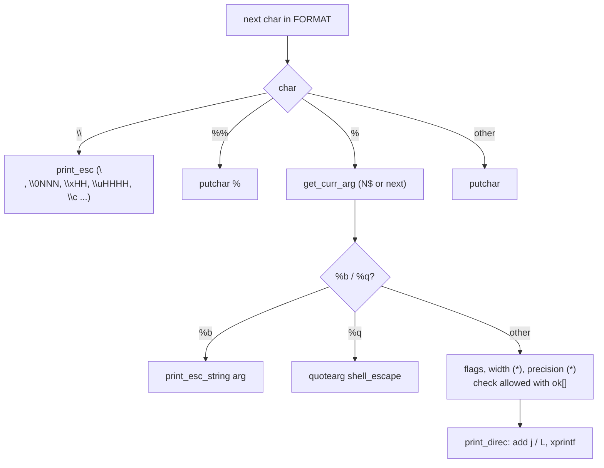

# `printf`: format and print data

Source: `src/printf.c` (777 lines) · Tests: `tests/printf/` · Manual:
`info '(coreutils) printf invocation'`

`printf FORMAT [ARGUMENT]...` works like C `printf`, but every argument is
a string. `printf.c` reads FORMAT itself. For each `%` directive it checks
the flags, converts the argument to the right C type, and passes a rebuilt
format (with a `j` or `L` length modifier) to the C library's `printf`
(`xprintf`). If there are more arguments than FORMAT uses, FORMAT is used
again until they are all used.

Shells usually have a built-in `printf`, so `/usr/bin/printf` is often not
the one that runs. `--help` says this (`USAGE_BUILTIN_WARNING`).

## Options

`printf` does not use `getopt`. `main` (`src/printf.c:715-777`) accepts
`--help` and `--version` only when they are the **only** argument, and
does not accept abbreviations. A leading `--` is skipped. Everything else
is FORMAT and its arguments, so `printf -n` prints `-n`.

## Code map

| Function | Location | Role |
|---|---|---|
| `main` | `src/printf.c:715` | `--help`, `--version`, `--`, then call `print_formatted` again and again until the arguments run out. |
| `print_formatted` | `:536` | Read FORMAT once: text, `\` escapes, `%` directives. Returns how many arguments it used. |
| `get_curr_arg` | `:488` | Choose the argument for a directive, `*` width or `*` precision. Supports `%N$` indexed arguments. |
| `print_direc` | `:327` | Build the C format with `j` (integers) or `L` (floating point) and call `xprintf`. |
| `vstrtoimax`, `vstrtoumax`, `vstrtold` | `:192-194` | Convert an argument (made by the `STRTOX` macro). `'c` or `"c` gives the character code. |
| `verify_numeric` | `:130` | Report `expected a numeric value`, range errors, or `value not completely converted`. |
| `print_esc`, `print_esc_char`, `print_esc_string` | `:243`, `:199`, `:311` | `\` escapes in FORMAT and in `%b` arguments. |

## How it works

The diagram shows how one directive is handled.

### Flags and conversions

`print_formatted` keeps a table `ok[256]` of which conversions are allowed
(`src/printf.c:589-617`). Each flag removes the conversions it cannot be
used with. For example `#` is not allowed with `%c %d %i %s %u`, and `'`
(thousands grouping) is only allowed with `%d %i %u %f %F %g %G`. A
conversion that is not allowed is a fatal error: `%#d: invalid conversion
specification`. Length modifiers in FORMAT (`l`, `h`, `j`, ...) are skipped,
because `print_direc` adds its own.

### Converting arguments

- Integers are parsed with `strtoimax` or `strtoumax` with base 0, so
  `0x1F` and `017` work. Floating-point values use `cl_strtold`, which
  accepts both the C locale and the user's locale.
- An argument that starts with `'` or `"` gives the code of the next
  character. In a multibyte locale `mbrtowc` is used, as POSIX requires
  (comment at `:167`). Extra characters after it give a warning unless
  `POSIXLY_CORRECT` is set.
- A bad number is reported but **does not stop** `printf`. The value
  converted so far is printed and the exit status becomes 1.

### Escapes

| Escape | In FORMAT | In `%b` arguments |
|---|---|---|
| `\NNN` octal | up to 3 digits | written `\0NNN` (`octal_0`); `\NNN` also works as a Bash-compatible extension |
| `\xHH` | 1 or 2 hex digits | same |
| `\uHHHH`, `\UHHHHHHHH` | Unicode character via `print_unicode_char`. Surrogates `D800`-`DFFF` are an error. | same |
| `\c` | stop all output and exit with status 0 | same |
| `\a \b \e \f \n \r \t \v \" \\` | the usual characters | same |

### `%q` and indexed arguments

- `%q` prints the argument quoted with `shell_escape_quoting_style`, so
  the output can be used again as shell input (`tests/printf/printf-quote.sh`).
- `%2$s` uses argument 2. `print_formatted` returns `end_arg + 1`, the
  highest argument it used. `main` uses that to decide whether FORMAT
  should be used again (`tests/printf/printf-indexed.sh`).

If FORMAT uses no arguments but some were given, `printf` prints FORMAT
once and warns `ignoring excess arguments`.

## Errors and exit status

`exit_status` is set to 1 by any conversion error, but output continues.
Fatal errors (exit status 1 at once) are: an invalid conversion, a bad
`\x` or `\u` escape, and a `*` width or precision out of range.
`tests/printf/printf-surprise.sh` checks that a failing `printf(3)` is
reported even when it does not set the stream's error flag.

## Tests

| File | Covers |
|---|---|
| `tests/printf/printf.sh`, `printf-cov.pl` | Basic use and coverage of rare paths. |
| `tests/printf/printf-hex.sh` | `\x` uses at most two hex digits. |
| `tests/printf/printf-indexed.sh` | `%N$` arguments. |
| `tests/printf/printf-mb.sh` | `'c` with multibyte characters. |
| `tests/printf/printf-quote.sh` | `%q`. |
| `tests/printf/printf-surprise.sh` | `printf(3)` failure detection. |

## See also

- [seq](seq.md) also passes formats to the C library's `printf`.
