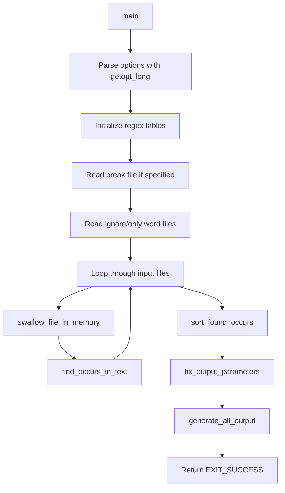

# `ptx`: produce a permuted index

Source: `src/ptx.c` · Tests: `tests/ptx/` · Manual: `info '(coreutils) ptx invocation'`

`ptx` generates a permuted index (keyword-in-context) from input files. It extracts keywords from text, collects surrounding context, sorts by keyword, and formats output for dumb terminals, troff, or TeX. The program supports word filtering, regular expressions for word/context patterns, and various reference formats. It loads entire files into memory and can be CPU- and memory-intensive on large inputs.

## Options

| Option | Description |
|--------|-------------|
| `-A, --auto-reference` | References are `file_name:line_number:` |
| `-F, --flag-truncation=STRING` | String used to mark line truncations |
| `-G, --traditional` | Disable GNU extensions |
| `-M, --macro-name=NAME` | Macro name for roff or TeX output |
| `-O, --format=FORMAT` | Output format: `roff`, `tex`, or default |
| `-R, --right-side-refs` | Output references after right context |
| `-S, --sentence-regexp=REGEXP` | Regexp for end of context |
| `-W, --word-regexp=REGEXP` | Regexp to match each keyword |
| `-b, --break-file=FILE` | Word break characters in this FILE |
| `-f, --ignore-case` | Fold lower case to upper for sorting |
| `-g, --gap-size=NUMBER` | Gap size in columns between output fields |
| `-i, --ignore-file=FILE` | Read ignore word list from FILE |
| `-o, --only-file=FILE` | Read only word list from this FILE |
| `-r, --references` | First field of each line is a reference |
| `-t, --typeset-mode` | Change default width from 72 to 100 |
| `-w, --width=NUMBER` | Output width in columns, reference excluded |

## Code map

| Function | Location | Role |
|----------|----------|------|
| `main` | `src/ptx.c:1793-2049` | Parse options, read files, orchestrate processing |
| `initialize_regex` | `src/ptx.c:423-483` | Initialize case folding and compile regex patterns |
| `swallow_file_in_memory` | `src/ptx.c:496-517` | Read entire file into memory |
| `digest_break_file` | `src/ptx.c:626-657` | Build word character fastmap from break file |
| `digest_word_file` | `src/ptx.c:666-712` | Read and sort word table from ignore/only file |
| `find_occurs_in_text` | `src/ptx.c:720-987` | Scan text for keywords, build OCCURS table |
| `sort_found_occurs` | `src/ptx.c:608-616` | Sort occurrences by keyword |
| `fix_output_parameters` | `src/ptx.c:1068-1203` | Compute output field widths |
| `define_all_fields` | `src/ptx.c:1210-1411` | Compute field boundaries for one occurrence |
| `generate_all_output` | `src/ptx.c:1608-1662` | Output all sorted occurrences |
| `compare_words` | `src/ptx.c:529-558` | Compare two words for sorting |
| `compare_occurs` | `src/ptx.c:566-578` | Compare two occurrences for sorting |
| `search_table` | `src/ptx.c:582-600` | Binary search in ignore/only word table |

## How it works

The main function parses options, loads all input files into memory, finds keyword occurrences, sorts them, and generates formatted output.

### Keyword detection

`find_occurs_in_text` scans each file character by character, using either a user-provided regex (`word_regex`) or a fastmap (`word_fastmap`) to identify keywords. For each keyword, it captures left and right context up to configurable limits, builds an `OCCURS` structure with the keyword, context offsets, reference information, and file index, and adds it to the global `occurs_table` (`src/ptx.c:720-987`). Words in the ignore table are skipped; words in the only table are kept exclusively.

### Word filtering

The ignore and only word tables are built by `digest_word_file`, which reads a file of one word per line, stores each word in a `WORD_TABLE`, and sorts it with `qsort` using `compare_words` (`src/ptx.c:666-712`). During keyword detection, `search_table` performs binary search to check if a word should be ignored or kept (`src/ptx.c:582-600`).

### Sorting

`sort_found_occurs` sorts the `occurs_table` using `qsort` with `compare_occurs` as the comparison function (`src/ptx.c:608-616`). The comparison first compares keywords with `compare_words` (which handles case folding if `-f` is set), then breaks ties by pointer address to preserve original order (`src/ptx.c:566-578`).

### Output formatting

`fix_output_parameters` computes maximum field widths based on the longest keywords, references, and context lengths (`src/ptx.c:1068-1203`). `define_all_fields` calculates the exact boundaries of tail, before, keyafter, head, and reference fields for each occurrence, respecting the line width and truncation settings (`src/ptx.c:1210-1411`). `generate_all_output` loops through all occurrences and calls format-specific output functions (`output_one_dumb_line`, `output_one_roff_line`, or `output_one_tex_line`) (`src/ptx.c:1608-1662`).

## Platform notes

- Uses POSIX regex functions (`re_compile_pattern`, `re_match`, `re_search`) from gnulib
- No conditional compilation for specific platforms
- The program has known unchecked integer overflows in large inputs (commented in source)
- With `-G` (traditional mode), behavior changes to match System V ptx

## Errors and exit status

| Error | Exit status |
|-------|-------------|
| Regex compilation error | EXIT_FAILURE (via error) |
| File read error | EXIT_FAILURE (via error) |
| Invalid numeric argument | EXIT_FAILURE (via error) |
| Regex matcher error | EXIT_FAILURE (via matcher_error) |
| Success | EXIT_SUCCESS |

## Tests

| Test file | Coverage |
|-----------|----------|
| `tests/ptx/ptx.pl` | Comprehensive Perl tests for ptx functionality |
| `tests/ptx/ptx-overrun.sh` | Tests for buffer overrun handling |
| `tests/ptx/word-regex-loop.sh` | Tests for word regex edge cases |

## See also

- [`sort`](sort.md) - Sort text lines (similar sorting logic)
- [`grep`](../index.md) - Search for patterns in files
