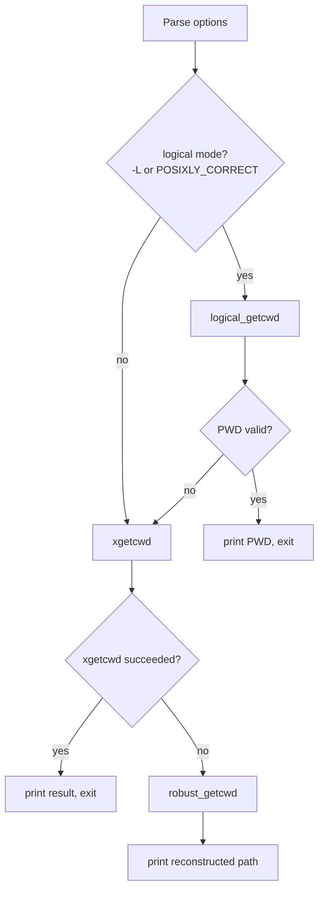

# `pwd`: print working directory

Source: `src/pwd.c` (386 lines) · Tests: `tests/pwd/` ·
Manual: `info '(coreutils) pwd invocation'`

`pwd` prints the absolute path of the current working directory. It has two
modes: logical mode (`-L`) uses the `PWD` environment variable if valid, while
physical mode (`-P`) resolves all symbolic links. When `getcwd` fails (e.g.,
due to path length exceeding `PATH_MAX` or permission issues), `pwd` falls back
to a custom algorithm that walks up the directory tree using `..` and matches
i-nodes to reconstruct the path.

## Options

The table lists `longopts[]` (`src/pwd.c:39-46`) and short options.

|| Option | Variable |
||---|---|
|| `-L`, `--logical` | `logical = true` (use `PWD` from environment) |
|| `-P`, `--physical` | `logical = false` (resolve symlinks) |

## Code map

|| Function | Location | Role |
||---|---|---|
|| `main` | `src/pwd.c:320` | Option parsing, choose logical or physical mode, call `xgetcwd` or `robust_getcwd`. |
|| `logical_getcwd` | `:293` | Validate `PWD` environment variable (textual and stat checks). |
|| `robust_getcwd` | `:262` | Walk up directory tree matching i-nodes when `getcwd` fails. |
|| `find_dir_entry` | `:152` | Find current directory's entry in parent by i-node match. |
|| `file_name_init` | `:86` | Allocate growable buffer for path construction. |
|| `file_name_prepend` | `:103` | Prepend directory name to the growing path. |
|| `file_name_free` | `:79` | Free the file_name structure. |
|| `nth_parent` | `:126` | Generate string like `../../..` for error messages. |

## How it works

The diagram shows the main decision flow.

### Logical mode

`logical_getcwd` (`src/pwd.c:293-316`) first checks that `PWD` starts with `/`
and contains no `/.` or `/..` components (textual validation). Then it stats
both `PWD` and `.` and verifies they refer to the same i-node. If either check
fails, it returns NULL and `main` falls back to physical mode.

### Physical mode fallback

`xgetcwd` is a gnulib wrapper around `getcwd`. If it fails (returns NULL),
`main` calls `robust_getcwd` (`src/pwd.c:262-288`). This function:

1. Gets the root directory's device/i-node with `get_root_dev_ino`
2. Stats the current directory `.`
3. Loops until it reaches the root:
   - Calls `find_dir_entry` to find the current directory's name in `..`
   - Prepends the name to the path
   - Chdirs to `..` and stats it
4. Prepends a leading `/` if needed

### Directory entry lookup

`find_dir_entry` (`src/pwd.c:152-236`) opens `..` and reads its entries until it
finds one with the same i-node as the current directory. If parent and child
are on different devices, it uses `lstat` on each entry instead of relying on
`d_ino`. It then `chdir`s to the parent and prepends the matching name to the
path.

### Path construction

The `file_name` struct (`src/pwd.c:32-37`) holds a growable buffer with a
`start` pointer that moves backward as components are prepended. This avoids
reallocating and copying the entire path for each new component.

## Platform notes

- The default mode depends on `POSIXLY_CORRECT`: if set, logical mode is the
  default; otherwise, physical mode is the default (`src/pwd.c:325`).
- `robust_getcwd` can handle paths longer than `PATH_MAX`, unlike the system
  `getcwd`.
- If `d_ino` is not available (`NOT_AN_INODE_NUMBER`) or crossing device
  boundaries, `lstat` is used instead (`src/pwd.c:199-207`).

## Errors and exit status

- Invalid options: `usage (EXIT_FAILURE)`
- `stat` failures in `robust_getcwd`: `error (EXIT_FAILURE, errno, ...)`
- Cannot open parent directory: `error (EXIT_FAILURE, errno, ...)`
- Cannot find matching i-node in parent: `error (EXIT_FAILURE, 0, ...)`
- Write failure: handled by `atexit (close_stdout)`

## Tests

|| File | Covers |
||---|---|
|| `tests/pwd/pwd-option.sh` | `-L` and `-P` options, `POSIXLY_CORRECT` behavior. |
|| `tests/pwd/pwd-long.sh` | Paths longer than `PATH_MAX` (tests `robust_getcwd`). |

## See also

- [realpath](realpath.md) (canonicalize paths)
- [readlink](readlink.md) (resolve symlinks)
