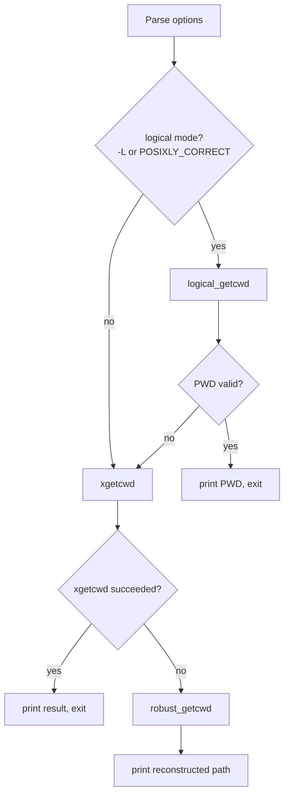

# `pwd`: print working directory

Source: `src/pwd.c` (386 lines) · Tests: `tests/pwd/` ·
Manual: `info '(coreutils) pwd invocation'`

`pwd` prints the absolute path of the current working directory. It has two
modes: logical mode (`-L`) uses the `PWD` environment variable if valid, while
physical mode (`-P`) resolves all symbolic links. When `getcwd` fails (e.g.,
due to path length exceeding `PATH_MAX` or permission issues), `pwd` falls back
to a custom algorithm that walks up the directory tree using `..` and matches
i-nodes to reconstruct the path.

## Options

The table lists `longopts[]` (`src/pwd.c:39-46`) and short options.

|| Option | Variable |
||---|---|
|| `-L`, `--logical` | `logical = true` (use `PWD` from environment) |
|| `-P`, `--physical` | `logical = false` (resolve symlinks) |

## Code map

|| Function | Location | Role |
||---|---|---|
|| `main` | `src/pwd.c:320` | Option parsing, choose logical or physical mode, call `xgetcwd` or `robust_getcwd`. |
|| `logical_getcwd` | `:293` | Validate `PWD` environment variable (textual and stat checks). |
|| `robust_getcwd` | `:262` | Walk up directory tree matching i-nodes when `getcwd` fails. |
|| `find_dir_entry` | `:152` | Find current directory's entry in parent by i-node match. |
|| `file_name_init` | `:86` | Allocate growable buffer for path construction. |
|| `file_name_prepend` | `:103` | Prepend directory name to the growing path. |
|| `file_name_free` | `:79` | Free the file_name structure. |
|| `nth_parent` | `:126` | Generate string like `../../..` for error messages. |

## How it works

The diagram shows the main decision flow.



### Logical mode

`logical_getcwd` (`src/pwd.c:293-316`) first checks that `PWD` starts with `/`
and contains no `/.` or `/..` components (textual validation). Then it stats
both `PWD` and `.` and verifies they refer to the same i-node. If either check
fails, it returns NULL and `main` falls back to physical mode.

### Physical mode fallback

`xgetcwd` is a gnulib wrapper around `getcwd`. If it fails (returns NULL),
`main` calls `robust_getcwd` (`src/pwd.c:262-288`). This function:

1. Gets the root directory's device/i-node with `get_root_dev_ino`
2. Stats the current directory `.`
3. Loops until it reaches the root:
   - Calls `find_dir_entry` to find the current directory's name in `..`
   - Prepends the name to the path
   - Chdirs to `..` and stats it
4. Prepends a leading `/` if needed

### Directory entry lookup

`find_dir_entry` (`src/pwd.c:152-236`) opens `..` and reads its entries until it
finds one with the same i-node as the current directory. If parent and child
are on different devices, it uses `lstat` on each entry instead of relying on
`d_ino`. It then `chdir`s to the parent and prepends the matching name to the
path.

### Path construction

The `file_name` struct (`src/pwd.c:32-37`) holds a growable buffer with a
`start` pointer that moves backward as components are prepended. This avoids
reallocating and copying the entire path for each new component.

## Platform notes

- The default mode depends on `POSIXLY_CORRECT`: if set, logical mode is the
  default; otherwise, physical mode is the default (`src/pwd.c:325`).
- `robust_getcwd` can handle paths longer than `PATH_MAX`, unlike the system
  `getcwd`.
- If `d_ino` is not available (`NOT_AN_INODE_NUMBER`) or crossing device
  boundaries, `lstat` is used instead (`src/pwd.c:199-207`).

## Errors and exit status

- Invalid options: `usage (EXIT_FAILURE)`
- `stat` failures in `robust_getcwd`: `error (EXIT_FAILURE, errno, ...)`
- Cannot open parent directory: `error (EXIT_FAILURE, errno, ...)`
- Cannot find matching i-node in parent: `error (EXIT_FAILURE, 0, ...)`
- Write failure: handled by `atexit (close_stdout)`

## Tests

|| File | Covers |
||---|---|
|| `tests/pwd/pwd-option.sh` | `-L` and `-P` options, `POSIXLY_CORRECT` behavior. |
|| `tests/pwd/pwd-long.sh` | Paths longer than `PATH_MAX` (tests `robust_getcwd`). |

## See also

- [realpath](realpath.md) (canonicalize paths)
- [readlink](readlink.md) (resolve symlinks)

## Source code

`src/pwd.c:1`

```c
/* pwd - print current directory
   Copyright (C) 1994-2026 Free Software Foundation, Inc.

   This program is free software: you can redistribute it and/or modify
   it under the terms of the GNU General Public License as published by
   the Free Software Foundation, either version 3 of the License, or
   (at your option) any later version.

   This program is distributed in the hope that it will be useful,
   but WITHOUT ANY WARRANTY; without even the implied warranty of
   MERCHANTABILITY or FITNESS FOR A PARTICULAR PURPOSE.  See the
   GNU General Public License for more details.

   You should have received a copy of the GNU General Public License
   along with this program.  If not, see <https://www.gnu.org/licenses/>.  */

#include <config.h>
#include <getopt.h>
#include <stdio.h>
#include <sys/types.h>

#include "system.h"
#include "quote.h"
#include "root-dev-ino.h"
#include "xgetcwd.h"

/* The official name of this program (e.g., no 'g' prefix).  */
#define PROGRAM_NAME "pwd"

#define AUTHORS proper_name ("Jim Meyering")

struct file_name
{
  idx_t n_alloc;
  char *buf COUNTED_BY (n_alloc);
  char *start;
};

static struct option const longopts[] =
{
  {"logical", no_argument, NULL, 'L'},
  {"physical", no_argument, NULL, 'P'},
  {GETOPT_HELP_OPTION_DECL},
  {GETOPT_VERSION_OPTION_DECL},
  {NULL, 0, NULL, 0}
};

void
usage (int status)
{
  if (status != EXIT_SUCCESS)
    emit_try_help ();
  else
    {
      printf (_("Usage: %s [OPTION]...\n"), program_name);
      fputs (_("\
Print the full filename of the current working directory.\n\
\n\
"), stdout);
      oputs (_("\
  -L, --logical\n\
         use PWD from environment, even if it contains symlinks\n\
"));
      oputs (_("\
  -P, --physical\n\
         resolve all symlinks\n\
"));
      oputs (HELP_OPTION_DESCRIPTION);
      oputs (VERSION_OPTION_DESCRIPTION);
      fputs (_("\n\
If no option is specified, -P is assumed.\n\
"), stdout);
      printf (USAGE_BUILTIN_WARNING, PROGRAM_NAME);
      emit_ancillary_info (PROGRAM_NAME);
    }
  exit (status);
}

static void
file_name_free (struct file_name *p)
{
  free (p->buf);
  free (p);
}

static struct file_name *
file_name_init (void)
{
  struct file_name *p = xmalloc (sizeof *p);

  /* Start with a buffer larger than likely file names, but beware of systems
     on which PATH_MAX is very large -- e.g., INT_MAX.  */
  int init_alloc = 2 * MIN (PATH_MAX, 16 * 1024);
  p->n_alloc = init_alloc;

  p->buf = xmalloc (init_alloc);
  p->start = p->buf + init_alloc - 1;
  p->start[0] = '\0';
  return p;
}

/* Prepend the name S of length S_LEN, to the growing file_name, P.  */
static void
file_name_prepend (struct file_name *p, char const *s, size_t s_len)
{
  idx_t n_free = p->start - p->buf;
  if (n_free < 1 + s_len)
    {
      /* Call xpalloc with NULL not p->buf, since with the latter
         we'd end up copying the data twice: once via realloc, then again
         to align it with the end of the new buffer.  By passing NULL we
         copy it only once.  */
      idx_t n_used = p->n_alloc - n_free;
      char *buf = xpalloc (NULL, &p->n_alloc, 1 + s_len - n_free, -1, 1);
      p->start = memcpy (buf + p->n_alloc - n_used, p->start, n_used);
      free (p->buf);
      p->buf = buf;
    }

  p->start -= 1 + s_len;
  p->start[0] = '/';
  memcpy (p->start + 1, s, s_len);
}

/* Return a string (malloc'd) consisting of N '/'-separated ".." components.  */
static char *
nth_parent (size_t n)
{
  char *buf = xnmalloc (3, n);
  char *p = buf;

  for (size_t i = 0; i < n; i++)
    {
      memcpy (p, "../", 3);
      p += 3;
    }
  p[-1] = '\0';
  return buf;
}

/* Determine the basename of the current directory, where DOT_SB is the
   result of lstat'ing "." and prepend that to the file name in *FILE_NAME.
   Find the directory entry in '..' that matches the dev/i-node of DOT_SB.
   Upon success, update *DOT_SB with stat information of '..', chdir to '..',
   and prepend "/basename" to FILE_NAME.
   Otherwise, exit with a diagnostic.
   PARENT_HEIGHT is the number of levels '..' is above the starting directory.
   The first time this function is called (from the initial directory),
   PARENT_HEIGHT is 1.  This is solely for diagnostics.
   Exit nonzero upon error.  */

static void
find_dir_entry (struct stat *dot_sb, struct file_name *file_name,
                size_t parent_height)
{
  DIR *dirp = opendir ("..");
  if (dirp == NULL)
    error (EXIT_FAILURE, errno, _("cannot open directory %s"),
           quote (nth_parent (parent_height)));

  int fd = dirfd (dirp);
  if ((0 <= fd ? fchdir (fd) : chdir ("..")) < 0)
    error (EXIT_FAILURE, errno, _("failed to chdir to %s"),
           quote (nth_parent (parent_height)));

  struct stat parent_sb;
  if ((0 <= fd ? fstat (fd, &parent_sb) : stat (".", &parent_sb)) < 0)
    error (EXIT_FAILURE, errno, _("failed to stat %s"),
           quote (nth_parent (parent_height)));

  /* If parent and child directory are on different devices, then we
     can't rely on d_ino for useful i-node numbers; use lstat instead.  */
  bool use_lstat = (parent_sb.st_dev != dot_sb->st_dev);

  bool found = false;
  while (true)
    {
      struct dirent const *dp;

      errno = 0;
      if ((dp = readdir_ignoring_dot_and_dotdot (dirp)) == NULL)
        {
          if (errno)
            {
              /* Save/restore errno across closedir call.  */
              int e = errno;
              closedir (dirp);
              errno = e;

              /* Arrange to give a diagnostic after exiting this loop.  */
              dirp = NULL;
            }
          break;
        }

      ino_t ino = D_INO (dp);

      struct stat ent_sb;
      if (ino == NOT_AN_INODE_NUMBER || use_lstat)
        {
          if (lstat (dp->d_name, &ent_sb) < 0)
            {
              /* Skip any entry we can't stat.  */
              continue;
            }
          ino = ent_sb.st_ino;
        }

      if (ino != dot_sb->st_ino)
        continue;

      /* If we're not crossing a device boundary, then a simple i-node
         match is enough.  */
      if ( ! use_lstat || ent_sb.st_dev == dot_sb->st_dev)
        {
          file_name_prepend (file_name, dp->d_name, _D_EXACT_NAMLEN (dp));
          found = true;
          break;
        }
    }

  if (dirp == NULL || closedir (dirp) != 0)
    {
      /* Note that this diagnostic serves for both readdir
         and closedir failures.  */
      error (EXIT_FAILURE, errno, _("reading directory %s"),
             quote (nth_parent (parent_height)));
    }

  if ( ! found)
    error (EXIT_FAILURE, 0,
           _("couldn't find directory entry in %s with matching i-node"),
           quote (nth_parent (parent_height)));

  *dot_sb = parent_sb;
}

/* Construct the full, absolute name of the current working
   directory and store it in *FILE_NAME.
   The getcwd function performs nearly the same task, but is typically
   unable to handle names longer than PATH_MAX.  This function has
   no such limitation.  However, this function *can* fail due to
   permission problems or a lack of memory, while GNU/Linux's getcwd
   function works regardless of restricted permissions on parent
   directories.  Upon failure, give a diagnostic and exit nonzero.

   Note: although this function is similar to getcwd, it has a fundamental
   difference in that it gives a diagnostic and exits upon failure.
   I would have liked a function that did not exit, and that could be
   used as a getcwd replacement.  Unfortunately, considering all of
   the information the caller would require in order to produce good
   diagnostics, it doesn't seem worth the added complexity.
   In any case, any getcwd replacement must *not* exceed the PATH_MAX
   limitation.  Otherwise, functions like 'chdir' would fail with
   ENAMETOOLONG.

   FIXME-maybe: if find_dir_entry fails due to permissions, try getcwd,
   in case the unreadable directory is close enough to the root that
   getcwd works from there.  */

static void
robust_getcwd (struct file_name *file_name)
{
  size_t height = 1;
  struct dev_ino dev_ino_buf;
  struct dev_ino *root_dev_ino = get_root_dev_ino (&dev_ino_buf);

  if (root_dev_ino == NULL)
    error (EXIT_FAILURE, errno, _("failed to get attributes of %s"),
           quoteaf ("/"));

  struct stat dot_sb;
  if (stat (".", &dot_sb) < 0)
    error (EXIT_FAILURE, errno, _("failed to stat %s"), quoteaf ("."));

  while (true)
    {
      /* If we've reached the root, we're done.  */
      if (PSAME_INODE (&dot_sb, root_dev_ino))
        break;

      find_dir_entry (&dot_sb, file_name, height++);
    }

  /* See if a leading slash is needed; file_name_prepend adds one.  */
  if (file_name->start[0] == '\0')
    file_name_prepend (file_name, "", 0);
}


/* Return PWD from the environment if it is acceptable for 'pwd -L'
   output, otherwise NULL.  */
static char const *
logical_getcwd (void)
{
  char const *wd = getenv ("PWD");

  /* Textual validation first.  */
  if (!wd || wd[0] != '/')
    return NULL;
  char const *p = wd;
  while ((p = strstr (p, "/.")))
    {
      if (!p[2] || p[2] == '/'
          || (p[2] == '.' && (!p[3] || p[3] == '/')))
        return NULL;
      p++;
    }

  /* System call validation.  */
  struct stat st1;
  struct stat st2;
  if (stat (wd, &st1) == 0 && stat (".", &st2) == 0 && psame_inode (&st1, &st2))
    return wd;
  return NULL;
}


int
main (int argc, char **argv)
{
  /* POSIX requires a default of -L, but most scripts expect -P.
     Currently shells default to -L, while stand-alone
     pwd implementations default to -P.  */
  bool logical = (getenv ("POSIXLY_CORRECT") != NULL);

  initialize_main (&argc, &argv);
  set_program_name (argv[0]);
  setlocale (LC_ALL, "");
  bindtextdomain (PACKAGE, LOCALEDIR);
  textdomain (PACKAGE);

  atexit (close_stdout);

  while (true)
    {
      int c = getopt_long (argc, argv, "LP", longopts, NULL);
      if (c == -1)
        break;
      switch (c)
        {
        case 'L':
          logical = true;
          break;
        case 'P':
          logical = false;
          break;

        case_GETOPT_HELP_CHAR;

        case_GETOPT_VERSION_CHAR (PROGRAM_NAME, AUTHORS);

        default:
          usage (EXIT_FAILURE);
        }
    }

  if (optind < argc)
    error (0, 0, _("ignoring non-option arguments"));

  if (logical)
    {
      char const *wd = logical_getcwd ();
      if (wd)
        {
          puts (wd);
          return EXIT_SUCCESS;
        }
    }

  char *wd = xgetcwd ();
  if (wd != NULL)
    {
      puts (wd);
      free (wd);
    }
  else
    {
      struct file_name *file_name = file_name_init ();
      robust_getcwd (file_name);
      puts (file_name->start);
      file_name_free (file_name);
    }

  return EXIT_SUCCESS;
}
```
