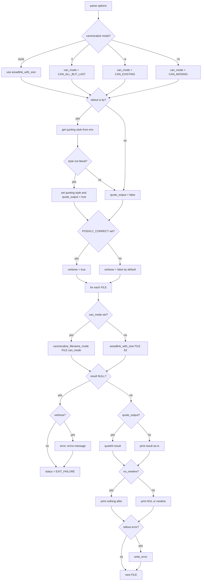

# `readlink`: print symbolic link targets or canonical paths

Source: `src/readlink.c` (218 lines) · Tests: `tests/readlink/` ·
Manual: `info '(coreutils) readlink invocation'`

`readlink` prints the value of a symbolic link, or canonicalizes a pathname
by following all symlinks. Without canonicalization options, it uses
`areadlink_with_size` to read the link target. With `-f`, `-e`, or `-m`, it
uses `canonicalize_filename_mode` from gnulib to resolve all symlinks
recursively. Output is quoted when stdout is a terminal, unless the quoting
style is literal.

## Options

The table lists `longopts[]` (`src/readlink.c:43-56`) and the short-option
string `"efmnqsvz"`.

|| Option | Variables |
||---|---|
|| `-f`, `--canonicalize` | `can_mode = CAN_ALL_BUT_LAST`: canonicalize, all but last must exist |
|| `-e`, `--canonicalize-existing` | `can_mode = CAN_EXISTING`: canonicalize, all must exist |
|| `-m`, `--canonicalize-missing` | `can_mode = CAN_MISSING`: canonicalize, no existence requirement |
|| `-n`, `--no-newline` | `no_newline`: omit trailing delimiter |
|| `-q`, `-s`, `--quiet`, `--silent` | `verbose = false`: suppress error messages |
|| `-v`, `--verbose` | `verbose = true`: print error messages |
|| `-z`, `--zero` | `use_nuls`: end output with NUL instead of newline |

## Code map

|| Function | Location | Role |
||---|---|---|
|| `main` | `src/readlink.c:115` | Option parsing, quoting setup, loop over files, `areadlink_with_size` or `canonicalize_filename_mode`, output |
|| `usage` | `:59` | Help message |

## How it works



### Canonicalization modes

The three canonicalization options correspond to modes in gnulib's
`canonicalize_filename_mode` (`src/readlink.c:135-143`):

- **`-f` (`CAN_ALL_BUT_LAST`):** Follow all symlinks in every component.
  All but the last component must exist.
- **`-e` (`CAN_EXISTING`):** Follow all symlinks. All components must exist.
- **`-m` (`CAN_MISSING`):** Follow all symlinks. No components need to exist.

Without these options, `readlink` simply reads the link target with
`areadlink_with_size` (`src/readlink.c:199`).

### Quoting

When stdout is a terminal and not using NUL delimiters, `readlink` quotes the
output (`src/readlink.c:177-187`). It gets the quoting style from
`getenv_quoting_style` (which reads `$QUOTING_STYLE`), defaulting to
`shell_escape_quoting_style`. If the style is not `literal_quoting_style`,
it sets the quoting style and enables `quote_output`. Output uses `quoteN`
to apply quoting (`src/readlink.c:202`).

### POSIX mode

If `POSIXLY_CORRECT` is set, `verbose` is forced to true
(`src/readlink.c:191-192`). POSIX requires a diagnostic message and non-zero
exit status when given a file that is not a symbolic link.

### Multiple files

With multiple files, `--no-newline` is ignored with a warning
(`src/readlink.c:170-175`). Each file's result is printed on a separate line
(or NUL-terminated with `-z`).

## Platform notes

`readlink` uses `areadlink_with_size` and `canonicalize_filename_mode` from
gnulib for portability. The quoting style detection uses `getenv_quoting_style`
from gnulib.

## Errors and exit status

- **Missing operand:** "missing operand"
- **Ignoring `--no-newline` with multiple arguments:** Warning, not an error
- **Read/canonicalize failure:** Error message from `quotef(FILE)` (unless `-q`/`-s`)

Exit status is 0 if all files succeed, 1 if any fail.

## Tests

|| File | Covers |
||---|---|
|| `tests/readlink/rl-1.sh` | Basic link reading |
|| `tests/readlink/can-f.sh` | `-f` canonicalization |
|| `tests/readlink/can-e.sh` | `-e` canonicalization |
|| `tests/readlink/can-m.sh` | `-m` canonicalization |
|| `tests/readlink/readlink-posix.sh` | POSIX mode behavior |
|| `tests/readlink/readlink-root.sh` | Handling of `/` |
|| `tests/readlink/readlink-fp-loop.sh` | Symlink loop detection |
|| `tests/readlink/multi.sh` | Multiple file arguments |

## See also

- [realpath](realpath.md) for canonicalization with `-e` by default
- [ln](ln.md) for creating symbolic links

## Source code

`src/readlink.c:1`

```c
/* readlink -- display value of a symbolic link.
   Copyright (C) 2002-2026 Free Software Foundation, Inc.

   This program is free software: you can redistribute it and/or modify
   it under the terms of the GNU General Public License as published by
   the Free Software Foundation, either version 3 of the License, or
   (at your option) any later version.

   This program is distributed in the hope that it will be useful,
   but WITHOUT ANY WARRANTY; without even the implied warranty of
   MERCHANTABILITY or FITNESS FOR A PARTICULAR PURPOSE.  See the
   GNU General Public License for more details.

   You should have received a copy of the GNU General Public License
   along with this program.  If not, see <https://www.gnu.org/licenses/>.  */

/* Written by Dmitry V. Levin */

#include <config.h>
#include <stdio.h>
#include <getopt.h>
#include <sys/types.h>

#include "argmatch.h"  /* argmatch($QUOTING_STYLE).  */
#include "system.h"
#include "canonicalize.h"
#include "areadlink.h"

/* The official name of this program (e.g., no 'g' prefix).  */
#define PROGRAM_NAME "readlink"

#define AUTHORS proper_name ("Dmitry V. Levin")

/* If true, do not output the trailing newline.  */
static bool no_newline;

/* If true, report error messages.  */
static bool verbose;

/* If true, quote output according to the selected quoting style.  */
static bool quote_output;

static struct option const longopts[] =
{
  {"canonicalize", no_argument, NULL, 'f'},
  {"canonicalize-existing", no_argument, NULL, 'e'},
  {"canonicalize-missing", no_argument, NULL, 'm'},
  {"no-newline", no_argument, NULL, 'n'},
  {"quiet", no_argument, NULL, 'q'},
  {"silent", no_argument, NULL, 's'},
  {"verbose", no_argument, NULL, 'v'},
  {"zero", no_argument, NULL, 'z'},
  {GETOPT_HELP_OPTION_DECL},
  {GETOPT_VERSION_OPTION_DECL},
  {NULL, 0, NULL, 0}
};

void
usage (int status)
{
  if (status != EXIT_SUCCESS)
    emit_try_help ();
  else
    {
      printf (_("Usage: %s [OPTION]... FILE...\n"), program_name);
      fputs (_("Print value of a symbolic link or canonical file name\n\n"),
             stdout);
      oputs (_("\
  -f, --canonicalize\n\
         canonicalize by following every symlink\n\
         in every component of the given name recursively;\n\
         all but the last component must exist\n\
"));
      oputs (_("\
  -e, --canonicalize-existing\n\
         canonicalize by following every symlink\n\
         in every component of the given name recursively;\n\
         all components must exist\n\
"));
      oputs (_("\
  -m, --canonicalize-missing\n\
         canonicalize by following every symlink\n\
         in every component of the given name recursively,\n\
         without requirements on components existence\n\
"));
      oputs (_("\
  -n, --no-newline\n\
         do not output the trailing delimiter\n\
"));
      oputs (_("\
  -q, --quiet\n\
"));
      oputs (_("\
  -s, --silent\n\
         suppress most error messages\n\
         (on by default if POSIXLY_CORRECT is not set)\n\
"));
      oputs (_("\
  -v, --verbose\n\
         report error messages\n\
         (on by default if POSIXLY_CORRECT is set)\n\
"));
      oputs (_("\
  -z, --zero\n\
         end each output line with NUL, not newline\n\
"));
      oputs (HELP_OPTION_DESCRIPTION);
      oputs (VERSION_OPTION_DESCRIPTION);
      emit_ancillary_info (PROGRAM_NAME);
    }
  exit (status);
}

int
main (int argc, char **argv)
{
  /* If not -1, use this method to canonicalize.  */
  int can_mode = -1;
  int status = EXIT_SUCCESS;
  int optc;
  bool use_nuls = false;

  initialize_main (&argc, &argv);
  set_program_name (argv[0]);
  setlocale (LC_ALL, "");
  bindtextdomain (PACKAGE, LOCALEDIR);
  textdomain (PACKAGE);

  atexit (close_stdout);

  while ((optc = getopt_long (argc, argv, "efmnqsvz", longopts, NULL)) != -1)
    {
      switch (optc)
        {
        case 'e':
          can_mode = CAN_EXISTING;
          break;
        case 'f':
          can_mode = CAN_ALL_BUT_LAST;
          break;
        case 'm':
          can_mode = CAN_MISSING;
          break;
        case 'n':
          no_newline = true;
          break;
        case 'q':
        case 's':
          verbose = false;
          break;
        case 'v':
          verbose = true;
          break;
        case 'z':
          use_nuls = true;
          break;
        case_GETOPT_HELP_CHAR;
        case_GETOPT_VERSION_CHAR (PROGRAM_NAME, AUTHORS);
        default:
          usage (EXIT_FAILURE);
        }
    }

  if (optind >= argc)
    {
      error (0, 0, _("missing operand"));
      usage (EXIT_FAILURE);
    }

  if (argc - optind > 1)
    {
      if (no_newline)
        error (0, 0, _("ignoring --no-newline with multiple arguments"));
      no_newline = false;
    }

  if (!use_nuls && isatty (STDOUT_FILENO))
    {
      int qs = getenv_quoting_style ();
      if (qs < 0)
        qs = shell_escape_quoting_style;
      if (qs != literal_quoting_style)
        {
          set_quoting_style (NULL, qs);
          quote_output = true;
        }
    }

  /* POSIX requires a diagnostic message written to standard error and a
     non-zero exit status when given a file that is not a symbolic link.  */
  if (getenv ("POSIXLY_CORRECT") != NULL)
    verbose = true;

  for (; optind < argc; ++optind)
    {
      char const *fname = argv[optind];
      char *value = (can_mode != -1
                     ? canonicalize_filename_mode (fname, can_mode)
                     : areadlink_with_size (fname, 63));
      if (value)
        {
          fputs (quote_output ? quoteN (value) : value, stdout);
          if (! no_newline)
            putchar (use_nuls ? '\0' : '\n');
          free (value);
          if (ferror (stdout))
            write_error ();
        }
      else
        {
          status = EXIT_FAILURE;
          if (verbose)
            error (0, errno, "%s", quotef (fname));
        }
    }

  return status;
}
```
