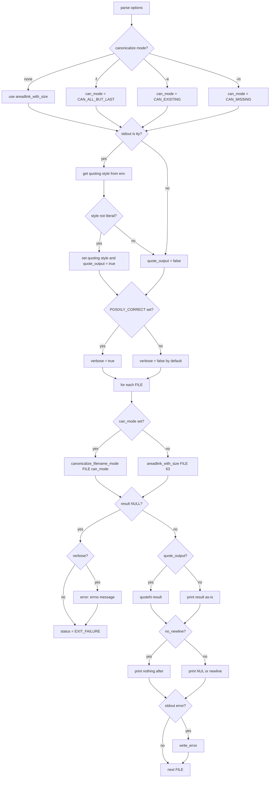

# `readlink`: print symbolic link targets or canonical paths

Source: `src/readlink.c` (218 lines) · Tests: `tests/readlink/` ·
Manual: `info '(coreutils) readlink invocation'`

`readlink` prints the value of a symbolic link, or canonicalizes a pathname
by following all symlinks. Without canonicalization options, it uses
`areadlink_with_size` to read the link target. With `-f`, `-e`, or `-m`, it
uses `canonicalize_filename_mode` from gnulib to resolve all symlinks
recursively. Output is quoted when stdout is a terminal, unless the quoting
style is literal.

## Options

The table lists `longopts[]` (`src/readlink.c:43-56`) and the short-option
string `"efmnqsvz"`.

|| Option | Variables |
||---|---|
|| `-f`, `--canonicalize` | `can_mode = CAN_ALL_BUT_LAST`: canonicalize, all but last must exist |
|| `-e`, `--canonicalize-existing` | `can_mode = CAN_EXISTING`: canonicalize, all must exist |
|| `-m`, `--canonicalize-missing` | `can_mode = CAN_MISSING`: canonicalize, no existence requirement |
|| `-n`, `--no-newline` | `no_newline`: omit trailing delimiter |
|| `-q`, `-s`, `--quiet`, `--silent` | `verbose = false`: suppress error messages |
|| `-v`, `--verbose` | `verbose = true`: print error messages |
|| `-z`, `--zero` | `use_nuls`: end output with NUL instead of newline |

## Code map

|| Function | Location | Role |
||---|---|---|
|| `main` | `src/readlink.c:115` | Option parsing, quoting setup, loop over files, `areadlink_with_size` or `canonicalize_filename_mode`, output |
|| `usage` | `:59` | Help message |

## How it works

### Canonicalization modes

The three canonicalization options correspond to modes in gnulib's
`canonicalize_filename_mode` (`src/readlink.c:135-143`):

- **`-f` (`CAN_ALL_BUT_LAST`):** Follow all symlinks in every component.
  All but the last component must exist.
- **`-e` (`CAN_EXISTING`):** Follow all symlinks. All components must exist.
- **`-m` (`CAN_MISSING`):** Follow all symlinks. No components need to exist.

Without these options, `readlink` simply reads the link target with
`areadlink_with_size` (`src/readlink.c:199`).

### Quoting

When stdout is a terminal and not using NUL delimiters, `readlink` quotes the
output (`src/readlink.c:177-187`). It gets the quoting style from
`getenv_quoting_style` (which reads `$QUOTING_STYLE`), defaulting to
`shell_escape_quoting_style`. If the style is not `literal_quoting_style`,
it sets the quoting style and enables `quote_output`. Output uses `quoteN`
to apply quoting (`src/readlink.c:202`).

### POSIX mode

If `POSIXLY_CORRECT` is set, `verbose` is forced to true
(`src/readlink.c:191-192`). POSIX requires a diagnostic message and non-zero
exit status when given a file that is not a symbolic link.

### Multiple files

With multiple files, `--no-newline` is ignored with a warning
(`src/readlink.c:170-175`). Each file's result is printed on a separate line
(or NUL-terminated with `-z`).

## Platform notes

`readlink` uses `areadlink_with_size` and `canonicalize_filename_mode` from
gnulib for portability. The quoting style detection uses `getenv_quoting_style`
from gnulib.

## Errors and exit status

- **Missing operand:** "missing operand"
- **Ignoring `--no-newline` with multiple arguments:** Warning, not an error
- **Read/canonicalize failure:** Error message from `quotef(FILE)` (unless `-q`/`-s`)

Exit status is 0 if all files succeed, 1 if any fail.

## Tests

|| File | Covers |
||---|---|
|| `tests/readlink/rl-1.sh` | Basic link reading |
|| `tests/readlink/can-f.sh` | `-f` canonicalization |
|| `tests/readlink/can-e.sh` | `-e` canonicalization |
|| `tests/readlink/can-m.sh` | `-m` canonicalization |
|| `tests/readlink/readlink-posix.sh` | POSIX mode behavior |
|| `tests/readlink/readlink-root.sh` | Handling of `/` |
|| `tests/readlink/readlink-fp-loop.sh` | Symlink loop detection |
|| `tests/readlink/multi.sh` | Multiple file arguments |

## See also

- [realpath](realpath.md) for canonicalization with `-e` by default
- [ln](ln.md) for creating symbolic links
