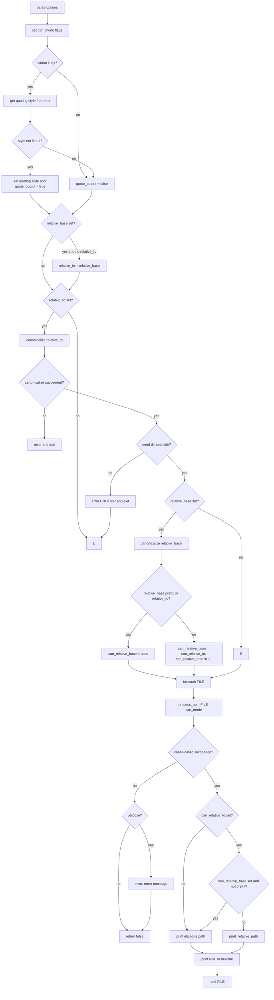

# `realpath`: print resolved absolute paths

Source: `src/realpath.c` (344 lines) · Tests: (none) ·
Manual: `info '(coreutils) realpath invocation'`

`realpath` prints the resolved absolute path for each file. It uses
`canonicalize_filename_mode` from gnulib to follow symlinks and resolve `.`
and `..` components. With `-s` or `--no-symlinks`, it skips symlink expansion.
With `--relative-to`, it prints paths relative to a directory. With
`--relative-base`, it prints absolute paths unless the result is under the base
directory.

## Options

The table lists `longopts[]` (`src/realpath.c:47-63`) and the short-option
string `"EeLmPqsz"`.

|| Option | Variables |
||---|---|
|| `-E`, `--canonicalize` | `can_mode |= CAN_ALL_BUT_LAST` (default) |
|| `-e`, `--canonicalize-existing` | `can_mode |= CAN_EXISTING`: all components must exist |
|| `-m`, `--canonicalize-missing` | `can_mode |= CAN_MISSING`: no existence requirement |
|| `-s`, `--strip`, `--no-symlinks` | `can_mode |= CAN_NOLINKS`: don't expand symlinks |
|| `-L`, `--logical` | `can_mode |= CAN_NOLINKS`, `logical = true`: resolve `..` before symlinks |
|| `-P`, `--physical` | `can_mode &= ~CAN_NOLINKS`, `logical = false`: resolve symlinks as encountered (default) |
|| `-q`, `--quiet` | `verbose = false`: suppress error messages |
|| `-z`, `--zero` | `use_nuls`: end output with NUL instead of newline |
|| `--relative-to=DIR` | `relative_to`: print relative to DIR |
|| `--relative-base=DIR` | `relative_base`: print absolute unless under DIR |

## Code map

|| Function | Location | Role |
||---|---|---|
|| `main` | `src/realpath.c:224` | Option parsing, quoting setup, canonicalize relative-to/base, loop over files, `process_path` |
|| `realpath_canon` | `:118` | Wrapper for `canonicalize_filename_mode`, calls twice in logical mode |
|| `process_path` | `:198` | Canonicalize, optionally print relative path, output |
|| `print_relative_path` | `:178` | Call `relpath` with quoting if needed |
|| `print_path` | `:170` | Print with quoting if `quote_output` |
|| `path_prefix` | `:134` | Check if a path is a prefix of another |
|| `isdir` | `:161` | Check if a path is a directory |
|| `usage` | `:66` | Help message |

## How it works



### Canonicalization modes

The canonicalization mode is a bitmask built from options
(`src/realpath.c:246-269`):

- **Default (`CAN_ALL_BUT_LAST`):** All but the last component must exist.
- **`-e` (`CAN_EXISTING`):** All components must exist.
- **`-m` (`CAN_MISSING`):** No components need exist.
- **`-s`/`--no-symlinks` (`CAN_NOLINKS`):** Don't expand symlinks.
- **`-L` (`CAN_NOLINKS` + `logical = true`):** Resolve `..` before symlinks.
- **`-P` (default, no `CAN_NOLINKS`):** Resolve symlinks as encountered.

### Logical mode

With `-L`, `realpath_canon` calls `canonicalize_filename_mode` twice
(`src/realpath.c:118-129`). The first call uses `CAN_NOLINKS` to resolve
`..` components without following symlinks. The second call clears
`CAN_NOLINKS` to follow symlinks in the resolved path. This implements the
POSIX "logical" resolution where `..` removes path components before symlinks
are expanded.

### Relative path output

With `--relative-to=DIR`, the canonicalized path is printed relative to DIR
(`src/realpath.c:311-318`). DIR is canonicalized first. If the mode requires
existence (`CAN_EXISTING`), DIR must be a directory. `relpath` from gnulib
computes the relative path. With quoting enabled, a buffer is allocated for
the relative path and `quoteN` is applied (`src/realpath.c:177-195`).

With `--relative-base=DIR`, paths are printed relative only if they are under
DIR (`src/realpath.c:319-338`). If `--relative-to` is not set, it defaults to
`--relative-base`. The base is canonicalized and must be a directory if the
mode requires existence. If the base is a prefix of the relative-to directory,
`can_relative_base` is set; otherwise, relative-to is disabled. `path_prefix`
checks the prefix relationship (`src/realpath.c:134-158`).

### Quoting

Quoting is enabled when stdout is a terminal and not using NUL delimiters,
similar to `readlink` (`src/realpath.c:295-305`). The quoting style comes from
`getenv_quoting_style`, defaulting to `shell_escape_quoting_style`.

## Platform notes

`realpath` uses `canonicalize_filename_mode`, `relpath`, and `getenv_quoting_style`
from gnulib. `ckd_mul` and `ckd_add` check for overflow when allocating the
relative path buffer (`src/realpath.c:184-187`).

## Errors and exit status

- **Missing operand:** "missing operand"
- **Relative-to/base canonicalize failure:** Error from `quotef(DIR)` (exit 1)
- **Relative-to/base not a directory (with `-e`):** Error with `ENOTDIR` (exit 1)
- **Path canonicalize failure:** Error from `quotef(FILE)` (unless `-q`)

Exit status is 0 if all files succeed, 1 if any fail.

## Tests

No dedicated test files exist for `realpath`. It is tested indirectly through
other utilities that use path canonicalization.

## See also

- [readlink](readlink.md) for reading link targets and canonicalization
- [pwd](pwd.md) for printing the current directory

## Source code

`src/realpath.c:1`

```c
/* realpath - print the resolved path
   Copyright (C) 2011-2026 Free Software Foundation, Inc.

   This program is free software: you can redistribute it and/or modify
   it under the terms of the GNU General Public License as published by
   the Free Software Foundation, either version 3 of the License, or
   (at your option) any later version.

   This program is distributed in the hope that it will be useful,
   but WITHOUT ANY WARRANTY; without even the implied warranty of
   MERCHANTABILITY or FITNESS FOR A PARTICULAR PURPOSE.  See the
   GNU General Public License for more details.

   You should have received a copy of the GNU General Public License
   along with this program.  If not, see <https://www.gnu.org/licenses/>.  */

/* Written by Pádraig Brady.  */

#include <config.h>
#include <getopt.h>
#include <stdio.h>
#include <sys/types.h>

#include "argmatch.h"  /* argmatch($QUOTING_STYLE).  */
#include "system.h"
#include "canonicalize.h"
#include "relpath.h"

/* The official name of this program (e.g., no 'g' prefix).  */
#define PROGRAM_NAME "realpath"

#define AUTHORS proper_name_lite ("Padraig Brady", "P\303\241draig Brady")

enum
{
  RELATIVE_TO_OPTION = CHAR_MAX + 1,
  RELATIVE_BASE_OPTION
};

static bool verbose = true;
static bool logical;
static bool use_nuls;
static bool quote_output;
static char const *can_relative_to;
static char const *can_relative_base;

static struct option const longopts[] =
{
  {"canonicalize", no_argument, NULL, 'E'},
  {"canonicalize-existing", no_argument, NULL, 'e'},
  {"canonicalize-missing", no_argument, NULL, 'm'},
  {"relative-to", required_argument, NULL, RELATIVE_TO_OPTION},
  {"relative-base", required_argument, NULL, RELATIVE_BASE_OPTION},
  {"quiet", no_argument, NULL, 'q'},
  {"strip", no_argument, NULL, 's'},
  {"no-symlinks", no_argument, NULL, 's'},
  {"zero", no_argument, NULL, 'z'},
  {"logical", no_argument, NULL, 'L'},
  {"physical", no_argument, NULL, 'P'},
  {GETOPT_HELP_OPTION_DECL},
  {GETOPT_VERSION_OPTION_DECL},
  {NULL, 0, NULL, 0}
};

void
usage (int status)
{
  if (status != EXIT_SUCCESS)
    emit_try_help ();
  else
    {
      printf (_("Usage: %s [OPTION]... FILE...\n"), program_name);
      fputs (_("\
Print the resolved absolute file name.\n\
"), stdout);
      oputs (_("\
  -E, --canonicalize           all but the last component must exist (default)\
\n\
"));
      oputs (_("\
  -e, --canonicalize-existing  all components of the path must exist\n\
"));
      oputs (_("\
  -m, --canonicalize-missing   no path components need exist or be a directory\
\n\
"));
      oputs (_("\
  -L, --logical                resolve '..' components before symlinks\n\
"));
      oputs (_("\
  -P, --physical               resolve symlinks as encountered (default)\n\
"));
      oputs (_("\
  -q, --quiet                  suppress most error messages\n\
"));
      oputs (_("\
      --relative-to=DIR        print the resolved path relative to DIR\n\
"));
      oputs (_("\
      --relative-base=DIR      print absolute paths unless paths below DIR\n\
"));
      oputs (_("\
  -s, --strip, --no-symlinks   don't expand symlinks\n\
"));
      oputs (_("\
  -z, --zero                   end each output line with NUL, not newline\n\
"));
      oputs (HELP_OPTION_DESCRIPTION);
      oputs (VERSION_OPTION_DESCRIPTION);
      emit_ancillary_info (PROGRAM_NAME);
    }
  exit (status);
}

/* A wrapper around canonicalize_filename_mode(),
   to call it twice when in LOGICAL mode.  */
static char *
realpath_canon (char const *fname, int can_mode)
{
  char *can_fname = canonicalize_filename_mode (fname, can_mode);
  if (logical && can_fname)  /* canonicalize again to resolve symlinks.  */
    {
      can_mode &= ~CAN_NOLINKS;
      char *can_fname2 = canonicalize_filename_mode (can_fname, can_mode);
      free (can_fname);
      return can_fname2;
    }
  return can_fname;
}

/* Test whether canonical prefix is parent or match of path.  */
ATTRIBUTE_PURE
static bool
path_prefix (char const *prefix, char const *path)
{
  /* We already know prefix[0] and path[0] are '/'.  */
  prefix++;
  path++;

  /* '/' is the prefix of everything except '//' (since we know '//'
     is only present after canonicalization if it is distinct).  */
  if (!*prefix)
    return *path != '/';

  /* Likewise, '//' is a prefix of any double-slash path.  */
  if (*prefix == '/' && !prefix[1])
    return *path == '/';

  /* Any other prefix has a non-slash portion.  */
  while (*prefix && *path)
    {
      if (*prefix != *path)
        break;
      prefix++;
      path++;
    }
  return (!*prefix && (*path == '/' || !*path));
}

static bool
isdir (char const *path)
{
  struct stat sb;
  if (stat (path, &sb) != 0)
    error (EXIT_FAILURE, errno, _("cannot stat %s"), quoteaf (path));
  return S_ISDIR (sb.st_mode);
}

static void
print_path (char const *path)
{
  fputs (quote_output ? quoteN (path) : path, stdout);
}

/* Print CAN_FNAME relative to can_relative_to, quoting the complete
   relative file name when appropriate.  */
static bool
print_relative_path (char const *can_fname)
{
  if (!quote_output)
    return relpath (can_fname, can_relative_to, NULL, 0);

  size_t size;
  if (ckd_mul (&size, strlen (can_relative_to), 2)
      || ckd_add (&size, size, strlen (can_fname))
      || ckd_add (&size, size, 1))
    xalloc_die ();

  char *relative_path = xmalloc (size);
  bool success = relpath (can_fname, can_relative_to, relative_path, size);
  if (success)
    print_path (relative_path);
  free (relative_path);
  return success;
}

static bool
process_path (char const *fname, int can_mode)
{
  char *can_fname = realpath_canon (fname, can_mode);
  if (!can_fname)
    {
      if (verbose)
        error (0, errno, "%s", quotef (fname));
      return false;
    }

  if (!can_relative_to
      || (can_relative_base && !path_prefix (can_relative_base, can_fname))
      || (can_relative_to && !print_relative_path (can_fname)))
    print_path (can_fname);

  putchar (use_nuls ? '\0' : '\n');

  free (can_fname);

  if (ferror (stdout))
    write_error ();

  return true;
}

int
main (int argc, char **argv)
{
  bool ok = true;
  int can_mode = CAN_ALL_BUT_LAST;
  char const *relative_to = NULL;
  char const *relative_base = NULL;

  initialize_main (&argc, &argv);
  set_program_name (argv[0]);
  setlocale (LC_ALL, "");
  bindtextdomain (PACKAGE, LOCALEDIR);
  textdomain (PACKAGE);

  atexit (close_stdout);

  while (true)
    {
      int c = getopt_long (argc, argv, "EeLmPqsz", longopts, NULL);
      if (c == -1)
        break;
      switch (c)
        {
        case 'E':
          can_mode &= ~CAN_MODE_MASK;
          can_mode |= CAN_ALL_BUT_LAST;
          break;
        case 'e':
          can_mode &= ~CAN_MODE_MASK;
          can_mode |= CAN_EXISTING;
          break;
        case 'm':
          can_mode &= ~CAN_MODE_MASK;
          can_mode |= CAN_MISSING;
          break;
        case 'L':
          can_mode |= CAN_NOLINKS;
          logical = true;
          break;
        case 's':
          can_mode |= CAN_NOLINKS;
          logical = false;
          break;
        case 'P':
          can_mode &= ~CAN_NOLINKS;
          logical = false;
          break;
        case 'q':
          verbose = false;
          break;
        case 'z':
          use_nuls = true;
          break;
        case RELATIVE_TO_OPTION:
          relative_to = optarg;
          break;
        case RELATIVE_BASE_OPTION:
          relative_base = optarg;
          break;
        case_GETOPT_HELP_CHAR;
        case_GETOPT_VERSION_CHAR (PROGRAM_NAME, AUTHORS);
        default:
          usage (EXIT_FAILURE);
        }
    }

  if (optind >= argc)
    {
      error (0, 0, _("missing operand"));
      usage (EXIT_FAILURE);
    }

  if (! use_nuls && isatty (STDOUT_FILENO))
    {
      int qs = getenv_quoting_style ();
      if (qs < 0)
        qs = shell_escape_quoting_style;
      if (qs != literal_quoting_style)
        {
          set_quoting_style (NULL, qs);
          quote_output = true;
        }
    }

  if (relative_base && !relative_to)
    relative_to = relative_base;

  bool need_dir = (can_mode & CAN_MODE_MASK) == CAN_EXISTING;
  if (relative_to)
    {
      can_relative_to = realpath_canon (relative_to, can_mode);
      if (!can_relative_to)
        error (EXIT_FAILURE, errno, "%s", quotef (relative_to));
      if (need_dir && !isdir (can_relative_to))
        error (EXIT_FAILURE, ENOTDIR, "%s", quotef (relative_to));
    }
  if (relative_base == relative_to)
    can_relative_base = can_relative_to;
  else if (relative_base)
    {
      char *base = realpath_canon (relative_base, can_mode);
      if (!base)
        error (EXIT_FAILURE, errno, "%s", quotef (relative_base));
      if (need_dir && !isdir (base))
        error (EXIT_FAILURE, ENOTDIR, "%s", quotef (relative_base));
      /* --relative-to is a no-op if it does not have --relative-base
           as a prefix */
      if (path_prefix (base, can_relative_to))
        can_relative_base = base;
      else
        {
          free (base);
          can_relative_base = can_relative_to;
          can_relative_to = NULL;
        }
    }

  for (; optind < argc; ++optind)
    ok &= process_path (argv[optind], can_mode);

  return ok ? EXIT_SUCCESS : EXIT_FAILURE;
}
```
