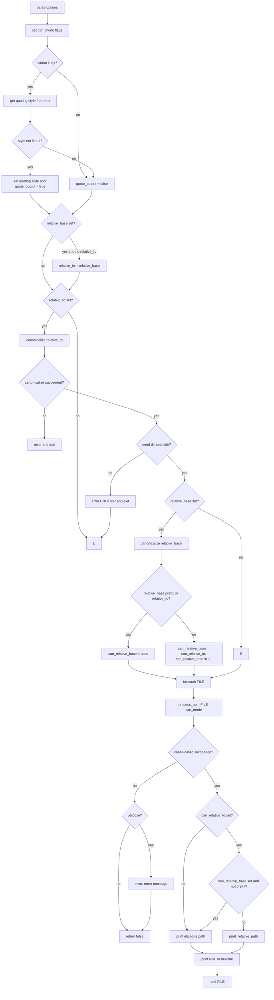

# `realpath`: print resolved absolute paths

Source: `src/realpath.c` (344 lines) · Tests: (none) ·
Manual: `info '(coreutils) realpath invocation'`

`realpath` prints the resolved absolute path for each file. It uses
`canonicalize_filename_mode` from gnulib to follow symlinks and resolve `.`
and `..` components. With `-s` or `--no-symlinks`, it skips symlink expansion.
With `--relative-to`, it prints paths relative to a directory. With
`--relative-base`, it prints absolute paths unless the result is under the base
directory.

## Options

The table lists `longopts[]` (`src/realpath.c:47-63`) and the short-option
string `"EeLmPqsz"`.

|| Option | Variables |
||---|---|
|| `-E`, `--canonicalize` | `can_mode |= CAN_ALL_BUT_LAST` (default) |
|| `-e`, `--canonicalize-existing` | `can_mode |= CAN_EXISTING`: all components must exist |
|| `-m`, `--canonicalize-missing` | `can_mode |= CAN_MISSING`: no existence requirement |
|| `-s`, `--strip`, `--no-symlinks` | `can_mode |= CAN_NOLINKS`: don't expand symlinks |
|| `-L`, `--logical` | `can_mode |= CAN_NOLINKS`, `logical = true`: resolve `..` before symlinks |
|| `-P`, `--physical` | `can_mode &= ~CAN_NOLINKS`, `logical = false`: resolve symlinks as encountered (default) |
|| `-q`, `--quiet` | `verbose = false`: suppress error messages |
|| `-z`, `--zero` | `use_nuls`: end output with NUL instead of newline |
|| `--relative-to=DIR` | `relative_to`: print relative to DIR |
|| `--relative-base=DIR` | `relative_base`: print absolute unless under DIR |

## Code map

|| Function | Location | Role |
||---|---|---|
|| `main` | `src/realpath.c:224` | Option parsing, quoting setup, canonicalize relative-to/base, loop over files, `process_path` |
|| `realpath_canon` | `:118` | Wrapper for `canonicalize_filename_mode`, calls twice in logical mode |
|| `process_path` | `:198` | Canonicalize, optionally print relative path, output |
|| `print_relative_path` | `:178` | Call `relpath` with quoting if needed |
|| `print_path` | `:170` | Print with quoting if `quote_output` |
|| `path_prefix` | `:134` | Check if a path is a prefix of another |
|| `isdir` | `:161` | Check if a path is a directory |
|| `usage` | `:66` | Help message |

## How it works

### Canonicalization modes

The canonicalization mode is a bitmask built from options
(`src/realpath.c:246-269`):

- **Default (`CAN_ALL_BUT_LAST`):** All but the last component must exist.
- **`-e` (`CAN_EXISTING`):** All components must exist.
- **`-m` (`CAN_MISSING`):** No components need exist.
- **`-s`/`--no-symlinks` (`CAN_NOLINKS`):** Don't expand symlinks.
- **`-L` (`CAN_NOLINKS` + `logical = true`):** Resolve `..` before symlinks.
- **`-P` (default, no `CAN_NOLINKS`):** Resolve symlinks as encountered.

### Logical mode

With `-L`, `realpath_canon` calls `canonicalize_filename_mode` twice
(`src/realpath.c:118-129`). The first call uses `CAN_NOLINKS` to resolve
`..` components without following symlinks. The second call clears
`CAN_NOLINKS` to follow symlinks in the resolved path. This implements the
POSIX "logical" resolution where `..` removes path components before symlinks
are expanded.

### Relative path output

With `--relative-to=DIR`, the canonicalized path is printed relative to DIR
(`src/realpath.c:311-318`). DIR is canonicalized first. If the mode requires
existence (`CAN_EXISTING`), DIR must be a directory. `relpath` from gnulib
computes the relative path. With quoting enabled, a buffer is allocated for
the relative path and `quoteN` is applied (`src/realpath.c:177-195`).

With `--relative-base=DIR`, paths are printed relative only if they are under
DIR (`src/realpath.c:319-338`). If `--relative-to` is not set, it defaults to
`--relative-base`. The base is canonicalized and must be a directory if the
mode requires existence. If the base is a prefix of the relative-to directory,
`can_relative_base` is set; otherwise, relative-to is disabled. `path_prefix`
checks the prefix relationship (`src/realpath.c:134-158`).

### Quoting

Quoting is enabled when stdout is a terminal and not using NUL delimiters,
similar to `readlink` (`src/realpath.c:295-305`). The quoting style comes from
`getenv_quoting_style`, defaulting to `shell_escape_quoting_style`.

## Platform notes

`realpath` uses `canonicalize_filename_mode`, `relpath`, and `getenv_quoting_style`
from gnulib. `ckd_mul` and `ckd_add` check for overflow when allocating the
relative path buffer (`src/realpath.c:184-187`).

## Errors and exit status

- **Missing operand:** "missing operand"
- **Relative-to/base canonicalize failure:** Error from `quotef(DIR)` (exit 1)
- **Relative-to/base not a directory (with `-e`):** Error with `ENOTDIR` (exit 1)
- **Path canonicalize failure:** Error from `quotef(FILE)` (unless `-q`)

Exit status is 0 if all files succeed, 1 if any fail.

## Tests

No dedicated test files exist for `realpath`. It is tested indirectly through
other utilities that use path canonicalization.

## See also

- [readlink](readlink.md) for reading link targets and canonicalization
- [pwd](pwd.md) for printing the current directory
