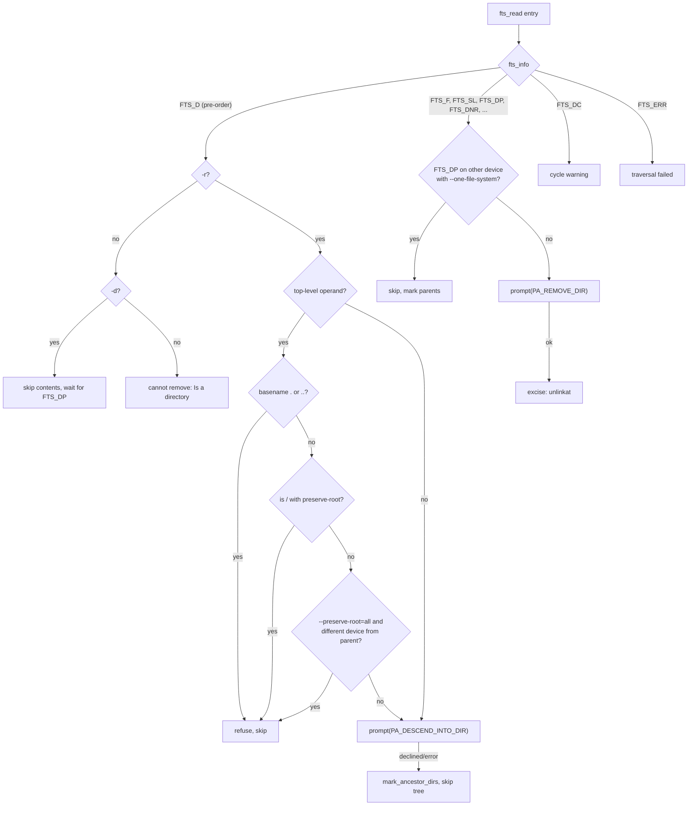

# `rm`: remove files or directories

Source: `src/rm.c` (396 lines), `src/remove.c` (645 lines),
`src/remove.h` · Tests: `tests/rm/` (about 55 scripts) · Manual:
`info '(coreutils) rm invocation'`

`rm.c` parses the options, fills in a `struct rm_options` and calls
`rm()`. `remove.c` does the removal by walking the operands with gnulib
`fts`. `mv` also calls `rm()`, to remove the source after copying it to
another file system. That is why the code is in its own module, and why
`struct rm_options` has a `require_restore_cwd` field.

## Options

The table lists `long_opts[]` (`src/rm.c:61-82`) and the short-option
string `"dfirvIR"`.

| Option | Settings |
|---|---|
| `-f`, `--force` | `interactive = RMI_NEVER`, `ignore_missing_files = true`. |
| `-i`, `--interactive[=always]` | `interactive = RMI_ALWAYS`. |
| `-I`, `--interactive=once` | `interactive = RMI_SOMETIMES`, `prompt_once = true`. Ask once if there are more than three operands or `-r` is given. |
| `--interactive=never` | `RMI_NEVER`, but missing files are still reported. |
| (default) | `RMI_SOMETIMES`: ask only for write-protected files, and only when stdin is a terminal. |
| `-r`, `-R`, `--recursive` | `recursive = true`. |
| `-d`, `--dir` | `remove_empty_directories = true`. |
| `-v`, `--verbose` | Print `removed 'f'` or `removed directory 'd'`. |
| `--one-file-system` | Add `FTS_XDEV`, and skip mount points below the operand. |
| `--preserve-root[=all]` | The default. With `all`, also skip any operand on a different device from its parent. |
| `--no-preserve-root` | Turn off root protection. **This option cannot be abbreviated** (`src/rm.c:319-324`). |
| `---presume-input-tty` | Hidden. For tests only: act as if stdin is a terminal. |

The last of `-f`, `-i`, `-I` and `--interactive` wins. They all reset each
other's settings.

If no operand is given, `rm -f` exits with status 0 and `rm` without `-f`
reports `missing operand`. If an unknown option is given and a file with
that name exists, `diagnose_leading_hyphen()` suggests `rm ./-foo`.

## Code map

| Function | Location | Role |
|---|---|---|
| `main` | `src/rm.c:234` | Options, the root `dev_ino`, the `-I` prompt, `rm()`. |
| `rm_option_init` | `src/rm.c:216` | Defaults. Note `require_restore_cwd = false` here; `mv` sets it to `true`. |
| `rm` | `src/remove.c:601` | `xfts_open` with `FTS_CWDFD \| FTS_NOSTAT \| FTS_PHYSICAL`, then a loop that keeps the worst status. |
| `rm_fts` | `:442` | One `fts` entry: pre-order directory checks, then `prompt` and `excise`. |
| `prompt` | `:189` | Decide whether to ask, and what to ask. Returns `RM_OK`, `RM_USER_ACCEPTED`, `RM_USER_DECLINED` or `RM_ERROR`. |
| `excise` | `:391` | `unlinkat (..., AT_REMOVEDIR or 0)`, the verbose message, and error mapping. |
| `write_protected_non_symlink` | `:96` | `faccessat (W_OK, AT_EACCESS)`. A long comment lists the other methods that were considered. |
| `mark_ancestor_dirs` | `:376` | After a failure or a "no", set `fts_number = 1` on each parent so that `rm` does not offer to remove them. |
| `cache_fstatat` | `:59` | Caches one `fstatat` result, with the "not yet called" state stored in `st_atim.tv_nsec`. |

## How it works

The diagram shows how `rm_fts` handles one entry.

### Two prompts per directory

With `-ri`, a directory is seen twice. At `FTS_D`, `prompt` asks
`descend into directory 'd'?`. At `FTS_DP`, after its contents, it asks
`remove directory 'd'?`. If the user said "no" to anything inside,
`mark_ancestor_dirs` has already set `fts_number` on the directory, and
`prompt` returns `RM_USER_DECLINED` at once without asking. When the first
prompt finds the directory empty (`DS_EMPTY`), `rm` removes it at once and
does not ask twice.

### When the default mode asks

Without `-i` or `-f`, `prompt` asks only if both of these are true
(`src/remove.c:212-221`):

- stdin is a terminal (`x->stdin_tty`), and
- the file is not a symlink and `faccessat (W_OK, AT_EACCESS)` fails with
  `EACCES`. That is, the file is write-protected.

`can_write_any_file()` (gnulib) skips the check for root.

### Status values

`enum RM_status` is ordered by how serious each value is: `RM_OK`,
`RM_USER_ACCEPTED`, `RM_USER_DECLINED`, `RM_ERROR`. `UPDATE_STATUS` keeps
the worst value seen. `main` maps only `RM_ERROR` to exit status 1, so
answering "no" to a prompt is not a failure.

### `excise` and error mapping

`excise` calls `unlinkat` with `AT_REMOVEDIR` for directories. Then:

- **`EROFS` for a missing file.** Some kernels (the comment names Linux
  2.6.32) return `EROFS` even when the file does not exist. `excise` calls
  `fstatat`. If that gives `ENOENT`, the error becomes `ENOENT`, so `rm -f`
  ignores it.
- **`-f` ignores missing files.** `nonexistent_file_errno()` treats
  `ENOENT`, `ENOTDIR`, `EINVAL` and `EILSEQ` as "does not exist". It leaves
  out `ELOOP` and `ENAMETOOLONG` on purpose (comment at `:332-342`).
- **Unreadable directories.** If `rmdir` on an `FTS_DNR` directory fails
  with `ENOTEMPTY`, `EISDIR`, `ENOTDIR` or `EEXIST`, the earlier `fts_errno`
  (usually `EACCES`) is reported. It describes the problem better.

### Other safety measures

- `main` calls `priv_set_remove_linkdir()` (gnulib `priv-set`). On Solaris
  this drops the privilege that lets root `unlink()` a directory.
- `fts` runs with `FTS_CWDFD`. It uses a virtual working directory (a
  descriptor and `*at()` calls) and does not `chdir`, so very deep trees
  work (`tests/rm/deep-1.sh`, `deep-2.sh`).
- With `FTS_NOSTAT`, `fts` does not `stat` each entry. It uses `d_type`
  when it can. `prompt` calls `fstatat` itself only when it needs to.

## Errors and exit status

`rm` exits with status 1 if any entry gave `RM_ERROR`. Messages begin with
`cannot remove 'X'`, except `refusing to remove '.' or '..' directory`,
`it is dangerous to operate recursively on '/'`, `skipping 'X', since it's
on a different device`, and `traversal failed`.

## Tests

The table lists some of the tests.

| File | Covers |
|---|---|
| `tests/rm/r-root.sh` | `rm -r /` with and without `--preserve-root`, and other names for `/` such as `/../` and `rootlink/..`. For safety it preloads a small library that intercepts `unlinkat`, can run `rm` under `gdb`, and adds `--one-file-system`. |
| `tests/rm/r-4.sh` | Refusing operands whose last component is `.` or `..`. |
| `tests/rm/dot-rel.sh` | Removing non-empty directories given as `./a/b`. |
| `tests/rm/i-1.sh`, `ir-1.sh`, `interactive-always.sh`, `interactive-once.sh`, `i-never.sh` | Prompt modes. |
| `tests/rm/f-1.sh`, `f-then-i-no-operand.sh`, `ignorable.sh` | `-f` with missing files (including `file/anything`, which gives `ENOTDIR`), and no operands. |
| `tests/rm/d-1.sh` … `d-3.sh`, `dir-nonrecur.sh` | `-d` and directories without `-r`. |
| `tests/rm/one-file-system.sh`, `one-file-system2.sh` | `--one-file-system` and `--preserve-root=all`. |
| `tests/rm/deep-1.sh`, `deep-2.sh`, `many-dir-entries-vs-OOM.sh` | Very deep and very wide trees. |
| `tests/rm/unreadable.pl`, `inaccessible.sh`, `empty-inacc.sh`, `fail-eacces.sh` | Permission errors. |
| `tests/rm/dash-hint.sh` | The `rm ./-foo` hint. |
| `tests/rm/v-slash.sh` | `-v` output for operands with a trailing slash. |

## See also

- [mv](mv.md): calls `rm()` to finish a move across file systems.
- [chmod](chmod.md) and [chown](chown.md) use the same root check.
