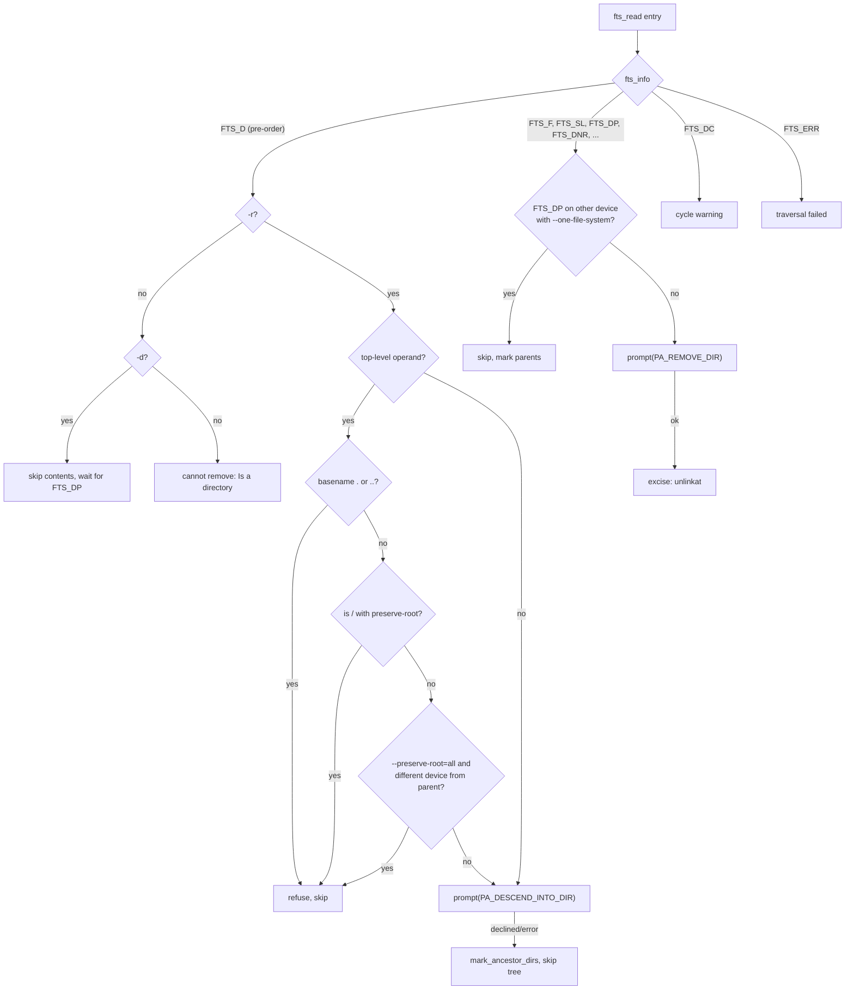

# `rm`: remove files or directories

Source: `src/rm.c` (396 lines), `src/remove.c` (645 lines),
`src/remove.h` · Tests: `tests/rm/` (about 55 scripts) · Manual:
`info '(coreutils) rm invocation'`

`rm.c` parses the options, fills in a `struct rm_options` and calls
`rm()`. `remove.c` does the removal by walking the operands with gnulib
`fts`. `mv` also calls `rm()`, to remove the source after copying it to
another file system. That is why the code is in its own module, and why
`struct rm_options` has a `require_restore_cwd` field.

## Options

The table lists `long_opts[]` (`src/rm.c:61-82`) and the short-option
string `"dfirvIR"`.

| Option | Settings |
|---|---|
| `-f`, `--force` | `interactive = RMI_NEVER`, `ignore_missing_files = true`. |
| `-i`, `--interactive[=always]` | `interactive = RMI_ALWAYS`. |
| `-I`, `--interactive=once` | `interactive = RMI_SOMETIMES`, `prompt_once = true`. Ask once if there are more than three operands or `-r` is given. |
| `--interactive=never` | `RMI_NEVER`, but missing files are still reported. |
| (default) | `RMI_SOMETIMES`: ask only for write-protected files, and only when stdin is a terminal. |
| `-r`, `-R`, `--recursive` | `recursive = true`. |
| `-d`, `--dir` | `remove_empty_directories = true`. |
| `-v`, `--verbose` | Print `removed 'f'` or `removed directory 'd'`. |
| `--one-file-system` | Add `FTS_XDEV`, and skip mount points below the operand. |
| `--preserve-root[=all]` | The default. With `all`, also skip any operand on a different device from its parent. |
| `--no-preserve-root` | Turn off root protection. **This option cannot be abbreviated** (`src/rm.c:319-324`). |
| `---presume-input-tty` | Hidden. For tests only: act as if stdin is a terminal. |

The last of `-f`, `-i`, `-I` and `--interactive` wins. They all reset each
other's settings.

If no operand is given, `rm -f` exits with status 0 and `rm` without `-f`
reports `missing operand`. If an unknown option is given and a file with
that name exists, `diagnose_leading_hyphen()` suggests `rm ./-foo`.

## Code map

| Function | Location | Role |
|---|---|---|
| `main` | `src/rm.c:234` | Options, the root `dev_ino`, the `-I` prompt, `rm()`. |
| `rm_option_init` | `src/rm.c:216` | Defaults. Note `require_restore_cwd = false` here; `mv` sets it to `true`. |
| `rm` | `src/remove.c:601` | `xfts_open` with `FTS_CWDFD \| FTS_NOSTAT \| FTS_PHYSICAL`, then a loop that keeps the worst status. |
| `rm_fts` | `:442` | One `fts` entry: pre-order directory checks, then `prompt` and `excise`. |
| `prompt` | `:189` | Decide whether to ask, and what to ask. Returns `RM_OK`, `RM_USER_ACCEPTED`, `RM_USER_DECLINED` or `RM_ERROR`. |
| `excise` | `:391` | `unlinkat (..., AT_REMOVEDIR or 0)`, the verbose message, and error mapping. |
| `write_protected_non_symlink` | `:96` | `faccessat (W_OK, AT_EACCESS)`. A long comment lists the other methods that were considered. |
| `mark_ancestor_dirs` | `:376` | After a failure or a "no", set `fts_number = 1` on each parent so that `rm` does not offer to remove them. |
| `cache_fstatat` | `:59` | Caches one `fstatat` result, with the "not yet called" state stored in `st_atim.tv_nsec`. |

## How it works

The diagram shows how `rm_fts` handles one entry.



### Two prompts per directory

With `-ri`, a directory is seen twice. At `FTS_D`, `prompt` asks
`descend into directory 'd'?`. At `FTS_DP`, after its contents, it asks
`remove directory 'd'?`. If the user said "no" to anything inside,
`mark_ancestor_dirs` has already set `fts_number` on the directory, and
`prompt` returns `RM_USER_DECLINED` at once without asking. When the first
prompt finds the directory empty (`DS_EMPTY`), `rm` removes it at once and
does not ask twice.

### When the default mode asks

Without `-i` or `-f`, `prompt` asks only if both of these are true
(`src/remove.c:212-221`):

- stdin is a terminal (`x->stdin_tty`), and
- the file is not a symlink and `faccessat (W_OK, AT_EACCESS)` fails with
  `EACCES`. That is, the file is write-protected.

`can_write_any_file()` (gnulib) skips the check for root.

### Status values

`enum RM_status` is ordered by how serious each value is: `RM_OK`,
`RM_USER_ACCEPTED`, `RM_USER_DECLINED`, `RM_ERROR`. `UPDATE_STATUS` keeps
the worst value seen. `main` maps only `RM_ERROR` to exit status 1, so
answering "no" to a prompt is not a failure.

### `excise` and error mapping

`excise` calls `unlinkat` with `AT_REMOVEDIR` for directories. Then:

- **`EROFS` for a missing file.** Some kernels (the comment names Linux
  2.6.32) return `EROFS` even when the file does not exist. `excise` calls
  `fstatat`. If that gives `ENOENT`, the error becomes `ENOENT`, so `rm -f`
  ignores it.
- **`-f` ignores missing files.** `nonexistent_file_errno()` treats
  `ENOENT`, `ENOTDIR`, `EINVAL` and `EILSEQ` as "does not exist". It leaves
  out `ELOOP` and `ENAMETOOLONG` on purpose (comment at `:332-342`).
- **Unreadable directories.** If `rmdir` on an `FTS_DNR` directory fails
  with `ENOTEMPTY`, `EISDIR`, `ENOTDIR` or `EEXIST`, the earlier `fts_errno`
  (usually `EACCES`) is reported. It describes the problem better.

### Other safety measures

- `main` calls `priv_set_remove_linkdir()` (gnulib `priv-set`). On Solaris
  this drops the privilege that lets root `unlink()` a directory.
- `fts` runs with `FTS_CWDFD`. It uses a virtual working directory (a
  descriptor and `*at()` calls) and does not `chdir`, so very deep trees
  work (`tests/rm/deep-1.sh`, `deep-2.sh`).
- With `FTS_NOSTAT`, `fts` does not `stat` each entry. It uses `d_type`
  when it can. `prompt` calls `fstatat` itself only when it needs to.

## Errors and exit status

`rm` exits with status 1 if any entry gave `RM_ERROR`. Messages begin with
`cannot remove 'X'`, except `refusing to remove '.' or '..' directory`,
`it is dangerous to operate recursively on '/'`, `skipping 'X', since it's
on a different device`, and `traversal failed`.

## Tests

The table lists some of the tests.

| File | Covers |
|---|---|
| `tests/rm/r-root.sh` | `rm -r /` with and without `--preserve-root`, and other names for `/` such as `/../` and `rootlink/..`. For safety it preloads a small library that intercepts `unlinkat`, can run `rm` under `gdb`, and adds `--one-file-system`. |
| `tests/rm/r-4.sh` | Refusing operands whose last component is `.` or `..`. |
| `tests/rm/dot-rel.sh` | Removing non-empty directories given as `./a/b`. |
| `tests/rm/i-1.sh`, `ir-1.sh`, `interactive-always.sh`, `interactive-once.sh`, `i-never.sh` | Prompt modes. |
| `tests/rm/f-1.sh`, `f-then-i-no-operand.sh`, `ignorable.sh` | `-f` with missing files (including `file/anything`, which gives `ENOTDIR`), and no operands. |
| `tests/rm/d-1.sh` … `d-3.sh`, `dir-nonrecur.sh` | `-d` and directories without `-r`. |
| `tests/rm/one-file-system.sh`, `one-file-system2.sh` | `--one-file-system` and `--preserve-root=all`. |
| `tests/rm/deep-1.sh`, `deep-2.sh`, `many-dir-entries-vs-OOM.sh` | Very deep and very wide trees. |
| `tests/rm/unreadable.pl`, `inaccessible.sh`, `empty-inacc.sh`, `fail-eacces.sh` | Permission errors. |
| `tests/rm/dash-hint.sh` | The `rm ./-foo` hint. |
| `tests/rm/v-slash.sh` | `-v` output for operands with a trailing slash. |

## See also

- [mv](mv.md): calls `rm()` to finish a move across file systems.
- [chmod](chmod.md) and [chown](chown.md) use the same root check.

## Source code

`src/rm.c:1`

```c
/* 'rm' file deletion utility for GNU.
   Copyright (C) 1988-2026 Free Software Foundation, Inc.

   This program is free software: you can redistribute it and/or modify
   it under the terms of the GNU General Public License as published by
   the Free Software Foundation, either version 3 of the License, or
   (at your option) any later version.

   This program is distributed in the hope that it will be useful,
   but WITHOUT ANY WARRANTY; without even the implied warranty of
   MERCHANTABILITY or FITNESS FOR A PARTICULAR PURPOSE.  See the
   GNU General Public License for more details.

   You should have received a copy of the GNU General Public License
   along with this program.  If not, see <https://www.gnu.org/licenses/>.  */

/* Initially written by Paul Rubin, David MacKenzie, and Richard Stallman.
   Reworked to use chdir and avoid recursion, and later, rewritten
   once again, to use fts, by Jim Meyering.  */

#include <config.h>
#include <stdio.h>
#include <getopt.h>
#include <sys/types.h>

#include "system.h"
#include "argmatch.h"
#include "assure.h"
#include "remove.h"
#include "root-dev-ino.h"
#include "yesno.h"
#include "priv-set.h"

/* The official name of this program (e.g., no 'g' prefix).  */
#define PROGRAM_NAME "rm"

#define AUTHORS \
  proper_name ("Paul Rubin"), \
  proper_name ("David MacKenzie"), \
  proper_name ("Richard M. Stallman"), \
  proper_name ("Jim Meyering")

/* For long options that have no equivalent short option, use a
   non-character as a pseudo short option, starting with CHAR_MAX + 1.  */
enum
{
  INTERACTIVE_OPTION = CHAR_MAX + 1,
  ONE_FILE_SYSTEM,
  NO_PRESERVE_ROOT,
  PRESERVE_ROOT,
  PRESUME_INPUT_TTY_OPTION
};

enum interactive_type
  {
    interactive_never,		/* 0: no option or --interactive=never */
    interactive_once,		/* 1: -I or --interactive=once */
    interactive_always		/* 2: default, -i or --interactive=always */
  };

static struct option const long_opts[] =
{
  {"force", no_argument, NULL, 'f'},
  {"interactive", optional_argument, NULL, INTERACTIVE_OPTION},

  {"one-file-system", no_argument, NULL, ONE_FILE_SYSTEM},
  {"no-preserve-root", no_argument, NULL, NO_PRESERVE_ROOT},
  {"preserve-root", optional_argument, NULL, PRESERVE_ROOT},

  /* This is solely for testing.  Do not document.  */
  /* It is relatively difficult to ensure that there is a tty on stdin.
     Since rm acts differently depending on that, without this option,
     it'd be harder to test the parts of rm that depend on that setting.  */
  {"-presume-input-tty", no_argument, NULL, PRESUME_INPUT_TTY_OPTION},

  {"recursive", no_argument, NULL, 'r'},
  {"dir", no_argument, NULL, 'd'},
  {"verbose", no_argument, NULL, 'v'},
  {GETOPT_HELP_OPTION_DECL},
  {GETOPT_VERSION_OPTION_DECL},
  {NULL, 0, NULL, 0}
};

static char const *const interactive_args[] =
{
  "never", "no", "none",
  "once",
  "always", "yes", NULL
};
static enum interactive_type const interactive_types[] =
{
  interactive_never, interactive_never, interactive_never,
  interactive_once,
  interactive_always, interactive_always
};
ARGMATCH_VERIFY (interactive_args, interactive_types);

/* Advise the user about invalid usages like "rm -foo" if the file
   "-foo" exists, assuming ARGC and ARGV are as with 'main'.  */

static void
diagnose_leading_hyphen (int argc, char **argv)
{
  /* OPTIND is unreliable, so iterate through the arguments looking
     for a file name that looks like an option.  */

  for (int i = 1; i < argc; i++)
    {
      char const *arg = argv[i];
      struct stat st;

      if (arg[0] == '-' && arg[1] && lstat (arg, &st) == 0)
        {
          fprintf (stderr,
                   _("Try '%s ./%s' to remove the file %s.\n"),
                   argv[0],
                   quotearg_n_style (1, shell_escape_quoting_style, arg),
                   quoteaf (arg));
          break;
        }
    }
}

void
usage (int status)
{
  if (status != EXIT_SUCCESS)
    emit_try_help ();
  else
    {
      printf (_("Usage: %s [OPTION]... [FILE]...\n"), program_name);
      fputs (_("\
Remove (unlink) the FILE(s).\n\
\n\
"), stdout);
      oputs (_("\
  -f, --force\n\
         ignore nonexistent files and arguments, never prompt\n\
"));
      oputs (_("\
  -i\n\
         prompt before every removal\n\
"));
      oputs (_("\
  -I\n\
         prompt once before removing more than three files,\n\
         or when removing recursively; less intrusive than -i,\n\
         while still giving protection against most mistakes\n\
"));
      oputs (_("\
      --interactive[=WHEN]\n\
         prompt according to WHEN: never, once (-I), or always (-i);\n\
         without WHEN, prompt always\n\
"));
      oputs (_("\
      --one-file-system\n\
         when removing a hierarchy recursively,\n\
         skip any directory that is on a file system different\n\
         from that of the corresponding command line argument\n\
"));
      oputs (_("\
      --no-preserve-root\n\
         do not treat '/' specially\n\
"));
      oputs (_("\
      --preserve-root[=all]\n\
         do not remove '/' (default);\n\
         with 'all', reject any command line argument\n\
         on a separate device from its parent\n\
"));
      oputs (_("\
  -r, -R, --recursive\n\
         remove directories and their contents recursively\n\
"));
      oputs (_("\
  -d, --dir\n\
         remove empty directories\n\
"));
      oputs (_("\
  -v, --verbose\n\
         explain what is being done\n\
"));
      oputs (HELP_OPTION_DESCRIPTION);
      oputs (VERSION_OPTION_DESCRIPTION);
      fputs (_("\
\n\
By default, rm does not remove directories.  Use the --recursive (-r or -R)\n\
option to remove each listed directory, too, along with all of its contents.\n\
"), stdout);
      fputs (_("\
\n\
Any attempt to remove a file whose last file name component is '.' or '..'\n\
is rejected with a diagnostic.\n\
"), stdout);
      printf (_("\
\n\
To remove a file whose name starts with a '-', for example '-foo',\n\
use one of these commands:\n\
  %s -- -foo\n\
\n\
  %s ./-foo\n\
"),
              program_name, program_name);
      fputs (_("\
\n\
If you use rm to remove a file, it might be possible to recover\n\
some of its contents, given sufficient expertise and/or time.  For greater\n\
assurance that the contents are unrecoverable, consider using shred(1).\n\
"), stdout);
      emit_ancillary_info (PROGRAM_NAME);
    }
  exit (status);
}

static void
rm_option_init (struct rm_options *x)
{
  x->ignore_missing_files = false;
  x->interactive = RMI_SOMETIMES;
  x->one_file_system = false;
  x->remove_empty_directories = false;
  x->recursive = false;
  x->root_dev_ino = NULL;
  x->preserve_all_root = false;
  x->stdin_tty = isatty (STDIN_FILENO);
  x->verbose = false;

  /* Since this program exits immediately after calling 'rm', rm need not
     expend unnecessary effort to preserve the initial working directory.  */
  x->require_restore_cwd = false;
}

int
main (int argc, char **argv)
{
  bool preserve_root = true;
  struct rm_options x;
  bool prompt_once = false;
  int c;

  initialize_main (&argc, &argv);
  set_program_name (argv[0]);
  setlocale (LC_ALL, "");
  bindtextdomain (PACKAGE, LOCALEDIR);
  textdomain (PACKAGE);

  atexit (close_stdin);

  rm_option_init (&x);

  /* Try to disable the ability to unlink a directory.  */
  priv_set_remove_linkdir ();

  while ((c = getopt_long (argc, argv, "dfirvIR", long_opts, NULL)) != -1)
    {
      switch (c)
        {
        case 'd':
          x.remove_empty_directories = true;
          break;

        case 'f':
          x.interactive = RMI_NEVER;
          x.ignore_missing_files = true;
          prompt_once = false;
          break;

        case 'i':
          x.interactive = RMI_ALWAYS;
          x.ignore_missing_files = false;
          prompt_once = false;
          break;

        case 'I':
          x.interactive = RMI_SOMETIMES;
          x.ignore_missing_files = false;
          prompt_once = true;
          break;

        case 'r':
        case 'R':
          x.recursive = true;
          break;

        case INTERACTIVE_OPTION:
          {
            int i;
            if (optarg)
              i = XARGMATCH ("--interactive", optarg, interactive_args,
                             interactive_types);
            else
              i = interactive_always;
            switch (i)
              {
              case interactive_never:
                x.interactive = RMI_NEVER;
                prompt_once = false;
                break;

              case interactive_once:
                x.interactive = RMI_SOMETIMES;
                x.ignore_missing_files = false;
                prompt_once = true;
                break;

              case interactive_always:
                x.interactive = RMI_ALWAYS;
                x.ignore_missing_files = false;
                prompt_once = false;
                break;
              }
            break;
          }

        case ONE_FILE_SYSTEM:
          x.one_file_system = true;
          break;

        case NO_PRESERVE_ROOT:
          if (! streq (argv[optind - 1], "--no-preserve-root"))
            error (EXIT_FAILURE, 0,
                   _("you may not abbreviate the --no-preserve-root option"));
          preserve_root = false;
          break;

        case PRESERVE_ROOT:
          if (optarg)
            {
              if (streq (optarg, "all"))
                x.preserve_all_root = true;
              else
                error (EXIT_FAILURE, 0,
                       _("unrecognized --preserve-root argument: %s"),
                       quoteaf (optarg));
            }
          preserve_root = true;
          break;

        case PRESUME_INPUT_TTY_OPTION:
          x.stdin_tty = true;
          break;

        case 'v':
          x.verbose = true;
          break;

        case_GETOPT_HELP_CHAR;
        case_GETOPT_VERSION_CHAR (PROGRAM_NAME, AUTHORS);
        default:
          diagnose_leading_hyphen (argc, argv);
          usage (EXIT_FAILURE);
        }
    }

  if (argc <= optind)
    {
      if (x.ignore_missing_files)
        return EXIT_SUCCESS;
      else
        {
          error (0, 0, _("missing operand"));
          usage (EXIT_FAILURE);
        }
    }

  if (x.recursive && preserve_root)
    {
      static struct dev_ino dev_ino_buf;
      x.root_dev_ino = get_root_dev_ino (&dev_ino_buf);
      if (x.root_dev_ino == NULL)
        error (EXIT_FAILURE, errno, _("failed to get attributes of %s"),
               quoteaf ("/"));
    }

  uintmax_t n_files = argc - optind;
  char **file =  argv + optind;

  if (prompt_once && (x.recursive || 3 < n_files))
    {
      fprintf (stderr,
               (x.recursive
                ? ngettext ("%s: remove %ju argument recursively? ",
                            "%s: remove %ju arguments recursively? ",
                            select_plural (n_files))
                : ngettext ("%s: remove %ju argument? ",
                            "%s: remove %ju arguments? ",
                            select_plural (n_files))),
               program_name, n_files);
      if (!yesno ())
        return EXIT_SUCCESS;
    }

  enum RM_status status = rm (file, &x);
  affirm (VALID_STATUS (status));
  return status == RM_ERROR ? EXIT_FAILURE : EXIT_SUCCESS;
}
```
