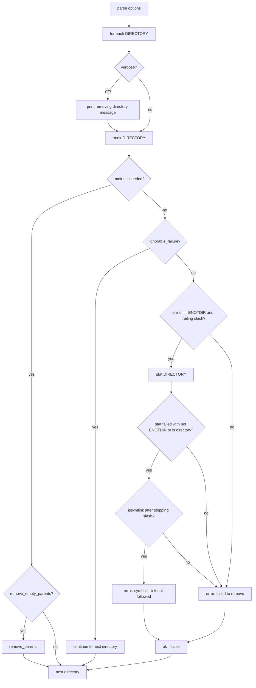

# `rmdir`: remove empty directories

Source: `src/rmdir.c` (295 lines) · Tests: `tests/rmdir/` ·
Manual: `info '(coreutils) rmdir invocation'`

`rmdir` removes empty directories using the `rmdir` system call. With `-p`,
it removes parent directories that become empty after removing the child.
With `--ignore-fail-on-non-empty`, it ignores failures due to non-empty
directories or permissions that may indicate non-emptiness. It handles the
ENOTDIR case for symlinks with trailing slashes specially.

## Options

The table lists `longopts[]` (`src/rmdir.c:56-69`) and the short-option
string `"pv"`.

|| Option | Variables |
||---|---|
|| `-p`, `--parents`, `--path` | `remove_empty_parents`: remove empty parent directories |
|| `--ignore-fail-on-non-empty` | `ignore_fail_on_non_empty`: ignore non-empty failures |
|| `-v`, `--verbose` | `verbose`: print each directory removed |

## Code map

|| Function | Location | Role |
||---|---|---|
|| `main` | `src/rmdir.c:198` | Option parsing, loop over directories, `rmdir`, `remove_parents`, error handling |
|| `remove_parents` | `:113` | Remove empty parent directories by modifying the path in-place |
|| `ignorable_failure` | `:99` | Check if a failure should be ignored based on errno and directory status |
|| `errno_rmdir_non_empty` | `:74` | Check if errno indicates non-empty directory |
|| `errno_may_be_non_empty` | `:82` | Check if errno may indicate non-empty directory |
|| `usage` | `:166` | Help message |

## How it works



### Parent directory removal

With `-p`, `remove_parents` removes empty parent directories
(`src/rmdir.c:113-163`). It strips trailing slashes, then walks up the path
by finding the rightmost `/`, replacing it with NUL, and calling `rmdir` on
each parent. The path is modified in-place. If any `rmdir` fails and the
failure is not ignorable, it stops and reports an error.

### Ignorable failures

`ignorable_failure` determines whether a failure should be ignored
(`src/rmdir.c:99-105`):

- With `--ignore-fail-on-non-empty`, failures with `ENOTEMPTY` or `EEXIST`
  are always ignored (`errno_rmdir_non_empty`).
- Failures with `EACCES`, `EPERM`, `EROFS`, or `EBUSY` are ignored only if
  `directory_status` reports the directory as non-empty
  (`errno_may_be_non_empty`).

This allows `rmdir` to continue when a directory cannot be removed due to
permissions or other issues that may indicate it is not empty.

### Symlink with trailing slash

When `rmdir` fails with `ENOTDIR` and the path has a trailing slash,
`main` checks if the path is a symlink (`src/rmdir.c:256-281`). It calls
`stat` on the path; if the stat fails with something other than `ENOTDIR`,
or succeeds and the target is a directory, it strips the trailing slash and
checks with `issymlink`. If it is a symlink, it prints "Symbolic link not
followed" instead of the generic error. This handles the platform difference
where Linux's `rmdir` does not follow symlinks but other systems do.

## Platform notes

`rmdir` uses the `rmdir` system call directly. The behavior with symlinks
and trailing slashes varies by platform. Linux's `rmdir` does not follow the
symlink, while other systems may follow it. `directory_status` and `issymlink`
are gnulib functions for portability.

## Errors and exit status

- **Missing operand:** "missing operand"
- **`rmdir` failure:** "failed to remove DIR" or "failed to remove directory DIR" (unless ignorable)
- **Symlink with trailing slash:** "failed to remove DIR: Symbolic link not followed"
- **Ignorable failure:** No error message, continues to next directory

Exit status is 0 if all directories are removed (or failures are ignored),
1 if any non-ignorable failure occurs.

## Tests

|| File | Covers |
||---|---|
|| `tests/rmdir/fail-perm.sh` | Permission failures |
|| `tests/rmdir/ignore.sh` | `--ignore-fail-on-non-empty` behavior |
|| `tests/rmdir/symlink-errors.sh` | Symlink error handling |
|| `tests/rmdir/t-slash.sh` | Trailing slash handling |

## See also

- [rm](rm.md) for removing files and non-empty directories
- [mkdir](mkdir.md) for creating directories

## Source code

`src/rmdir.c:1`

```c
/* rmdir -- remove directories

   Copyright (C) 1990-2026 Free Software Foundation, Inc.

   This program is free software: you can redistribute it and/or modify
   it under the terms of the GNU General Public License as published by
   the Free Software Foundation, either version 3 of the License, or
   (at your option) any later version.

   This program is distributed in the hope that it will be useful,
   but WITHOUT ANY WARRANTY; without even the implied warranty of
   MERCHANTABILITY or FITNESS FOR A PARTICULAR PURPOSE.  See the
   GNU General Public License for more details.

   You should have received a copy of the GNU General Public License
   along with this program.  If not, see <https://www.gnu.org/licenses/>.  */

/* Options:
   -p, --parent		Remove any parent dirs that are explicitly mentioned
                        in an argument, if they become empty after the
                        argument file is removed.

   David MacKenzie <djm@ai.mit.edu>  */

#include <config.h>
#include <stdio.h>
#include <getopt.h>
#include <sys/types.h>

#include "system.h"
#include "issymlink.h"
#include "prog-fprintf.h"

/* The official name of this program (e.g., no 'g' prefix).  */
#define PROGRAM_NAME "rmdir"

#define AUTHORS proper_name ("David MacKenzie")

/* If true, remove empty parent directories.  */
static bool remove_empty_parents;

/* If true, don't treat failure to remove a nonempty directory
   as an error.  */
static bool ignore_fail_on_non_empty;

/* If true, output a diagnostic for every directory processed.  */
static bool verbose;

/* For long options that have no equivalent short option, use a
   non-character as a pseudo short option, starting with CHAR_MAX + 1.  */
enum
{
  IGNORE_FAIL_ON_NON_EMPTY_OPTION = CHAR_MAX + 1
};

static struct option const longopts[] =
{
  /* Don't name this '--force' because it's not close enough in meaning
     to e.g. rm's -f option.  */
  {"ignore-fail-on-non-empty", no_argument, NULL,
   IGNORE_FAIL_ON_NON_EMPTY_OPTION},

  {"path", no_argument, NULL, 'p'},  /* Deprecated.  */
  {"parents", no_argument, NULL, 'p'},
  {"verbose", no_argument, NULL, 'v'},
  {GETOPT_HELP_OPTION_DECL},
  {GETOPT_VERSION_OPTION_DECL},
  {NULL, 0, NULL, 0}
};

/* Return true if ERROR_NUMBER is one of the values associated
   with a failed rmdir due to non-empty target directory.  */
static bool
errno_rmdir_non_empty (int error_number)
{
  return error_number == ENOTEMPTY || error_number == EEXIST;
}

/* Return true if when rmdir fails with errno == ERROR_NUMBER
   the directory may be non empty.  */
static bool
errno_may_be_non_empty (int error_number)
{
  switch (error_number)
    {
    case EACCES:
    case EPERM:
    case EROFS:
    case EBUSY:
      return true;
    default:
      return false;
    }
}

/* Return true if an rmdir failure with errno == error_number
   for DIR is ignorable.  */
static bool
ignorable_failure (int error_number, char const *dir)
{
  return (ignore_fail_on_non_empty
          && (errno_rmdir_non_empty (error_number)
              || (errno_may_be_non_empty (error_number)
                  && directory_status (AT_FDCWD, dir) == DS_NONEMPTY)));
}

/* Remove any empty parent directories of DIR.
   If DIR contains slash characters, at least one of them
   (beginning with the rightmost) is replaced with a NUL byte.
   Return true if successful.  */

static bool
remove_parents (char *dir)
{
  bool ok = true;

  strip_trailing_slashes (dir);
  while (true)
    {
      char *slash = strrchr (dir, '/');
      if (slash == NULL)
        break;
      /* Remove any characters after the slash, skipping any extra
         slashes in a row. */
      while (slash > dir && *slash == '/')
        --slash;
      slash[1] = 0;

      /* Give a diagnostic for each attempted removal if --verbose.  */
      if (verbose)
        prog_fprintf (stdout, _("removing directory, %s"), quoteaf (dir));

      ok = (rmdir (dir) == 0);
      int rmdir_errno = errno;

      if (! ok)
        {
          /* Stop quietly if --ignore-fail-on-non-empty. */
          if (ignorable_failure (rmdir_errno, dir))
            {
              ok = true;
            }
          else
            {
              char const *error_msg;
              if (rmdir_errno != ENOTDIR)
                {
                  /* Barring race conditions,
                     DIR is expected to be a directory.  */
                  error_msg = N_("failed to remove directory %s");
                }
              else
                {
                  /* A path component could be a symbolic link */
                  error_msg = N_("failed to remove %s");
                }
              error (0, rmdir_errno, _(error_msg), quoteaf (dir));
            }
          break;
        }
    }
  return ok;
}

void
usage (int status)
{
  if (status != EXIT_SUCCESS)
    emit_try_help ();
  else
    {
      printf (_("Usage: %s [OPTION]... DIRECTORY...\n"), program_name);
      fputs (_("\
Remove the DIRECTORY(ies), if they are empty.\n\
\n\
"), stdout);
      oputs (_("\
      --ignore-fail-on-non-empty\n\
         ignore each failure to remove a non-empty directory\n\
"));
      oputs (_("\
  -p, --parents\n\
         remove DIRECTORY and its ancestors;\n\
         e.g., 'rmdir -p a/b' is similar to 'rmdir a/b a'\n\
"));
      oputs (_("\
  -v, --verbose\n\
         output a diagnostic for every directory processed\n\
"));
      oputs (HELP_OPTION_DESCRIPTION);
      oputs (VERSION_OPTION_DESCRIPTION);
      emit_ancillary_info (PROGRAM_NAME);
    }
  exit (status);
}

int
main (int argc, char **argv)
{
  initialize_main (&argc, &argv);
  set_program_name (argv[0]);
  setlocale (LC_ALL, "");
  bindtextdomain (PACKAGE, LOCALEDIR);
  textdomain (PACKAGE);

  atexit (close_stdout);

  int optc;
  while ((optc = getopt_long (argc, argv, "pv", longopts, NULL)) != -1)
    {
      switch (optc)
        {
        case 'p':
          remove_empty_parents = true;
          break;
        case IGNORE_FAIL_ON_NON_EMPTY_OPTION:
          ignore_fail_on_non_empty = true;
          break;
        case 'v':
          verbose = true;
          break;
        case_GETOPT_HELP_CHAR;
        case_GETOPT_VERSION_CHAR (PROGRAM_NAME, AUTHORS);
        default:
          usage (EXIT_FAILURE);
        }
    }

  if (optind == argc)
    {
      error (0, 0, _("missing operand"));
      usage (EXIT_FAILURE);
    }

  bool ok = true;
  for (; optind < argc; ++optind)
    {
      char *dir = argv[optind];

      /* Give a diagnostic for each attempted removal if --verbose.  */
      if (verbose)
        prog_fprintf (stdout, _("removing directory, %s"), quoteaf (dir));

      if (rmdir (dir) != 0)
        {
          int rmdir_errno = errno;
          if (ignorable_failure (rmdir_errno, dir))
            continue;

          /* Distinguish the case for a symlink with trailing slash.
             On Linux, rmdir(2) confusingly does not follow the symlink,
             thus giving the errno ENOTDIR, while on other systems the symlink
             is followed.  We don't provide consistent behavior here,
             but at least we provide a more accurate error message.  */
          bool custom_error = false;
          if (rmdir_errno == ENOTDIR)
            {
              char const *last_unix_slash = strrchr (dir, '/');
              if (last_unix_slash && (*(last_unix_slash + 1) == '\0'))
                {
                  struct stat st;
                  int ret = stat (dir, &st);
                  /* Some other issue following, or is actually a directory. */
                  if ((ret != 0 && errno != ENOTDIR)
                      || (ret == 0 && S_ISDIR (st.st_mode)))
                    {
                      /* Ensure the last component was a symlink.  */
                      char *dir_arg = xstrdup (dir);
                      strip_trailing_slashes (dir);
                      if (issymlink (dir) == 1)
                        {
                          error (0, 0,
                                 _("failed to remove %s:"
                                   " Symbolic link not followed"),
                                 quoteaf (dir_arg));
                          custom_error = true;
                        }
                      free (dir_arg);
                    }
                }
            }

          if (! custom_error)
            error (0, rmdir_errno, _("failed to remove %s"), quoteaf (dir));

          ok = false;
        }
      else if (remove_empty_parents)
        {
          ok &= remove_parents (dir);
        }
    }

  return ok ? EXIT_SUCCESS : EXIT_FAILURE;
}
```
