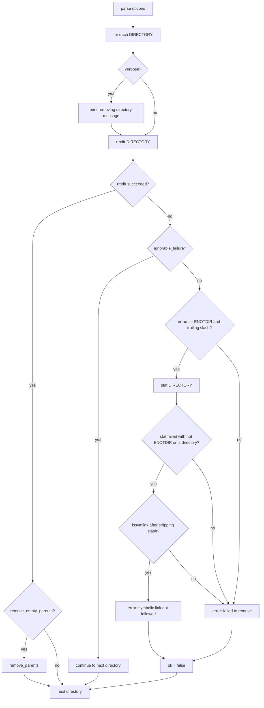

# `rmdir`: remove empty directories

Source: `src/rmdir.c` (295 lines) · Tests: `tests/rmdir/` ·
Manual: `info '(coreutils) rmdir invocation'`

`rmdir` removes empty directories using the `rmdir` system call. With `-p`,
it removes parent directories that become empty after removing the child.
With `--ignore-fail-on-non-empty`, it ignores failures due to non-empty
directories or permissions that may indicate non-emptiness. It handles the
ENOTDIR case for symlinks with trailing slashes specially.

## Options

The table lists `longopts[]` (`src/rmdir.c:56-69`) and the short-option
string `"pv"`.

|| Option | Variables |
||---|---|
|| `-p`, `--parents`, `--path` | `remove_empty_parents`: remove empty parent directories |
|| `--ignore-fail-on-non-empty` | `ignore_fail_on_non_empty`: ignore non-empty failures |
|| `-v`, `--verbose` | `verbose`: print each directory removed |

## Code map

|| Function | Location | Role |
||---|---|---|
|| `main` | `src/rmdir.c:198` | Option parsing, loop over directories, `rmdir`, `remove_parents`, error handling |
|| `remove_parents` | `:113` | Remove empty parent directories by modifying the path in-place |
|| `ignorable_failure` | `:99` | Check if a failure should be ignored based on errno and directory status |
|| `errno_rmdir_non_empty` | `:74` | Check if errno indicates non-empty directory |
|| `errno_may_be_non_empty` | `:82` | Check if errno may indicate non-empty directory |
|| `usage` | `:166` | Help message |

## How it works

### Parent directory removal

With `-p`, `remove_parents` removes empty parent directories
(`src/rmdir.c:113-163`). It strips trailing slashes, then walks up the path
by finding the rightmost `/`, replacing it with NUL, and calling `rmdir` on
each parent. The path is modified in-place. If any `rmdir` fails and the
failure is not ignorable, it stops and reports an error.

### Ignorable failures

`ignorable_failure` determines whether a failure should be ignored
(`src/rmdir.c:99-105`):

- With `--ignore-fail-on-non-empty`, failures with `ENOTEMPTY` or `EEXIST`
  are always ignored (`errno_rmdir_non_empty`).
- Failures with `EACCES`, `EPERM`, `EROFS`, or `EBUSY` are ignored only if
  `directory_status` reports the directory as non-empty
  (`errno_may_be_non_empty`).

This allows `rmdir` to continue when a directory cannot be removed due to
permissions or other issues that may indicate it is not empty.

### Symlink with trailing slash

When `rmdir` fails with `ENOTDIR` and the path has a trailing slash,
`main` checks if the path is a symlink (`src/rmdir.c:256-281`). It calls
`stat` on the path; if the stat fails with something other than `ENOTDIR`,
or succeeds and the target is a directory, it strips the trailing slash and
checks with `issymlink`. If it is a symlink, it prints "Symbolic link not
followed" instead of the generic error. This handles the platform difference
where Linux's `rmdir` does not follow symlinks but other systems do.

## Platform notes

`rmdir` uses the `rmdir` system call directly. The behavior with symlinks
and trailing slashes varies by platform. Linux's `rmdir` does not follow the
symlink, while other systems may follow it. `directory_status` and `issymlink`
are gnulib functions for portability.

## Errors and exit status

- **Missing operand:** "missing operand"
- **`rmdir` failure:** "failed to remove DIR" or "failed to remove directory DIR" (unless ignorable)
- **Symlink with trailing slash:** "failed to remove DIR: Symbolic link not followed"
- **Ignorable failure:** No error message, continues to next directory

Exit status is 0 if all directories are removed (or failures are ignored),
1 if any non-ignorable failure occurs.

## Tests

|| File | Covers |
||---|---|
|| `tests/rmdir/fail-perm.sh` | Permission failures |
|| `tests/rmdir/ignore.sh` | `--ignore-fail-on-non-empty` behavior |
|| `tests/rmdir/symlink-errors.sh` | Symlink error handling |
|| `tests/rmdir/t-slash.sh` | Trailing slash handling |

## See also

- [rm](rm.md) for removing files and non-empty directories
- [mkdir](mkdir.md) for creating directories
