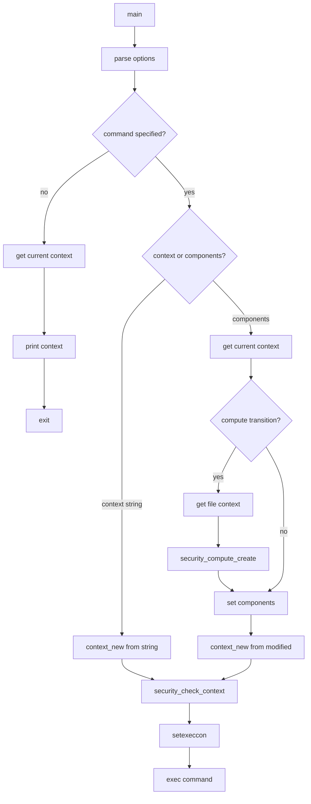

# `runcon`: run command with specified security context

Source: `src/runcon.c` (273 lines) · Tests: `tests/runcon/` ·
Manual: `info '(coreutils) runcon invocation'`

`runcon` runs a command in a different SELinux security context. It can specify
a complete context string, or modify individual components (user, role, type,
range) of the current context. With `-c`, it computes the process transition
context before modifying. Without a command, it prints the current security
context.

## Options

The table lists `long_options[]` (`src/runcon.c:57-67`) and the short-option
string `"r:t:u:l:c"`.

|| Option | Variables |
||---|---|
|| `-r ROLE`, `--role=ROLE` | Set the role |
|| `-t TYPE`, `--type=TYPE` | Set the type |
|| `-u USER`, `--user=USER` | Set the user |
|| `-l RANGE`, `--range=RANGE` | Set the MLS level range |
|| `-c`, `--compute` | `compute_trans = true`: compute process transition context |

## Code map

|| Function | Location | Role |
||---|---|---|
|| `main` | `src/runcon.c:114` | Option parsing, build context, set context, exec command |
|| `usage` | `:70` | Help message |

## How it works



### Context specification

Contexts can be specified in two ways (`src/runcon.c:187-195`):

1. **Complete context:** A single argument like `user:role:type:range`
2. **Components:** Using `-u`, `-r`, `-t`, `-l` to modify the current context

The number of components determines the interpretation:
- 1 component: type
- 2 components: role:type
- 3 components: user:role:type (non-MLS) or role:type:range (MLS)
- 4 components: user:role:type:range (MLS)

### Process transition

With `-c`, `runcon` computes the process transition context
(`src/runcon.c:220-238`):

1. Get the file context of the command to execute with `getfilecon`.
2. Compute the transition with `security_compute_create`.
3. Use the computed context as the base for further modifications.

### Context setting

The context is validated with `security_check_context` and set with
`setexeccon` (`src/runcon.c:258-264`). The command is then executed with
`execv` (if `-c` was used) or `execvp` (otherwise).

## Platform notes

`runcon` requires SELinux support. It uses libselinux functions:
`getcon`, `setexeccon`, `context_new`, `context_user_set`, `context_type_set`,
`context_role_set`, `context_range_set`, `security_check_context`,
`security_compute_create`, `getfilecon`.

## Errors and exit status

- **Multiple components specified:** "multiple roles/types/users/levelranges"
- **No context or components:** "you must specify -c, -t, -u, -l, -r, or context"
- **No command:** "no command specified"
- **SELinux not enabled:** "runcon may be used only on a SELinux kernel"
- **Context creation failure:** "failed to create security context"
- **Context component set failure:** "failed to set new user/type/range/role"
- **Invalid context:** "invalid context"
- **Set context failure:** "unable to set security context"
- **Command not found:** Exit status 127
- **Command execution failure:** Exit status 126

Exit status is 0 on success, 126 on command execution failure, 127 on command
not found, 125 on other errors.

## Tests

|| File | Covers |
||---|---|
|| `tests/runcon/runcon-compute.sh` | Process transition computation |
|| `tests/runcon/runcon-no-reorder.sh` | Argument ordering |

## See also

- [chcon](chcon.md) for changing file security contexts

## Source code

`src/runcon.c:1`

```c
/* runcon -- run command with specified security context
   Copyright (C) 2005-2026 Free Software Foundation, Inc.

   This program is free software: you can redistribute it and/or modify
   it under the terms of the GNU General Public License as published by
   the Free Software Foundation, either version 3 of the License, or
   (at your option) any later version.

   This program is distributed in the hope that it will be useful,
   but WITHOUT ANY WARRANTY; without even the implied warranty of
   MERCHANTABILITY or FITNESS FOR A PARTICULAR PURPOSE.  See the
   GNU General Public License for more details.

   You should have received a copy of the GNU General Public License
   along with this program.  If not, see <https://www.gnu.org/licenses/>.  */

/*
 * runcon [ context
 *          | ( [ -c ] [ -r role ] [-t type] [ -u user ] [ -l levelrange ] )
 *          command [arg1 [arg2 ...] ]
 *
 * attempt to run the specified command with the specified context.
 *
 * -r role  : use the current context with the specified role
 * -t type  : use the current context with the specified type
 * -u user  : use the current context with the specified user
 * -l level : use the current context with the specified level range
 * -c       : compute process transition context before modifying
 *
 * Contexts are interpreted as follows:
 *
 * Number of       MLS
 * components    system?
 *
 *     1            -         type
 *     2            -         role:type
 *     3            Y         role:type:range
 *     3            N         user:role:type
 *     4            Y         user:role:type:range
 *     4            N         error
 */

#include <config.h>
#include <stdio.h>
#include <getopt.h>
#include <selinux/selinux.h>
#include <selinux/context.h>
#include <sys/types.h>
#include "system.h"
#include "quote.h"

/* The official name of this program (e.g., no 'g' prefix).  */
#define PROGRAM_NAME "runcon"

#define AUTHORS proper_name ("Russell Coker")

static struct option const long_options[] =
{
  {"role", required_argument, NULL, 'r'},
  {"type", required_argument, NULL, 't'},
  {"user", required_argument, NULL, 'u'},
  {"range", required_argument, NULL, 'l'},
  {"compute", no_argument, NULL, 'c'},
  {GETOPT_HELP_OPTION_DECL},
  {GETOPT_VERSION_OPTION_DECL},
  {NULL, 0, NULL, 0}
};

void
usage (int status)
{
  if (status != EXIT_SUCCESS)
    emit_try_help ();
  else
    {
      printf (_("\
Usage: %s [CONTEXT COMMAND [ARG]...]\n\
  or:  %s [-c] [-u USER] [-r ROLE] [-t TYPE] [-l RANGE] COMMAND [ARG]...\n\
"), program_name, program_name);
      fputs (_("\
Run a program in a different SELinux security context.\n\
With neither CONTEXT nor COMMAND, print the current security context.\n\
"), stdout);

      emit_mandatory_arg_note ();

      fputs (_("\
  CONTEXT            Complete security context\n\
"), stdout);
      oputs (_("\
  -c, --compute      compute process transition context before modifying\n\
"));
      oputs (_("\
  -t, --type=TYPE    type (for same role as parent)\n\
"));
      oputs (_("\
  -u, --user=USER    user identity\n\
"));
      oputs (_("\
  -r, --role=ROLE    role\n\
"));
      oputs (_("\
  -l, --range=RANGE  levelrange\n\
"));
      oputs (HELP_OPTION_DESCRIPTION);
      oputs (VERSION_OPTION_DESCRIPTION);
      emit_exec_status (PROGRAM_NAME);
      emit_ancillary_info (PROGRAM_NAME);
    }
  exit (status);
}

int
main (int argc, char **argv)
{
  char *role = NULL;
  char *range = NULL;
  char *user = NULL;
  char *type = NULL;
  char *context = NULL;
  char *cur_context = NULL;
  char *file_context = NULL;
  char *new_context = NULL;
  bool compute_trans = false;

  context_t con;

  initialize_main (&argc, &argv);
  set_program_name (argv[0]);
  setlocale (LC_ALL, "");
  bindtextdomain (PACKAGE, LOCALEDIR);
  textdomain (PACKAGE);

  initialize_exit_failure (EXIT_CANCELED);
  atexit (close_stdout);

  while (true)
    {
      int option_index = 0;
      int c = getopt_long (argc, argv, "+r:t:u:l:c", long_options,
                           &option_index);
      if (c == -1)
        break;
      switch (c)
        {
        case 'r':
          if (role)
            error (EXIT_CANCELED, 0, _("multiple roles"));
          role = optarg;
          break;
        case 't':
          if (type)
            error (EXIT_CANCELED, 0, _("multiple types"));
          type = optarg;
          break;
        case 'u':
          if (user)
            error (EXIT_CANCELED, 0, _("multiple users"));
          user = optarg;
          break;
        case 'l':
          if (range)
            error (EXIT_CANCELED, 0, _("multiple levelranges"));
          range = optarg;
          break;
        case 'c':
          compute_trans = true;
          break;

        case_GETOPT_HELP_CHAR;
        case_GETOPT_VERSION_CHAR (PROGRAM_NAME, AUTHORS);
        default:
          usage (EXIT_CANCELED);
          break;
        }
    }

  if (argc - optind == 0)
    {
      if (getcon (&cur_context) < 0)
        error (EXIT_CANCELED, errno, _("failed to get current context"));
      fputs (cur_context, stdout);
      fputc ('\n', stdout);
      return EXIT_SUCCESS;
    }

  if (!(user || role || type || range || compute_trans))
    {
      if (optind >= argc)
        {
          error (0, 0, _("you must specify -c, -t, -u, -l, -r, or context"));
          usage (EXIT_CANCELED);
        }
      context = argv[optind++];
    }

  if (optind >= argc)
    {
      error (0, 0, _("no command specified"));
      usage (EXIT_CANCELED);
    }

  if (is_selinux_enabled () != 1)
    error (EXIT_CANCELED, 0, _("%s may be used only on a SELinux kernel"),
           program_name);

  if (context)
    {
      con = context_new (context);
      if (!con)
        error (EXIT_CANCELED, errno, _("failed to create security context: %s"),
               quote (context));
    }
  else
    {
      if (getcon (&cur_context) < 0)
        error (EXIT_CANCELED, errno, _("failed to get current context"));

      /* We will generate context based on process transition */
      if (compute_trans)
        {
          /* Get context of file to be executed */
          if (getfilecon (argv[optind], &file_context) == -1)
            error (EXIT_CANCELED, errno,
                   _("failed to get security context of %s"),
                   quoteaf (argv[optind]));
          /* compute result of process transition */
          if (security_compute_create (cur_context, file_context,
                                       string_to_security_class ("process"),
                                       &new_context) != 0)
            error (EXIT_CANCELED, errno, _("failed to compute a new context"));
          /* free contexts */
          freecon (file_context);
          freecon (cur_context);

          /* set cur_context equal to new_context */
          cur_context = new_context;
        }

      con = context_new (cur_context);
      if (!con)
        error (EXIT_CANCELED, errno, _("failed to create security context: %s"),
               quote (cur_context));
      if (user && context_user_set (con, user))
        error (EXIT_CANCELED, errno, _("failed to set new user: %s"),
               quote (user));
      if (type && context_type_set (con, type))
        error (EXIT_CANCELED, errno, _("failed to set new type: %s"),
               quote (type));
      if (range && context_range_set (con, range))
        error (EXIT_CANCELED, errno, _("failed to set new range: %s"),
               quote (range));
      if (role && context_role_set (con, role))
        error (EXIT_CANCELED, errno, _("failed to set new role: %s"),
               quote (role));
    }

  if (security_check_context (context_str (con)) < 0)
    error (EXIT_CANCELED, errno, _("invalid context: %s"),
           quote (context_str (con)));

  if (setexeccon (context_str (con)) != 0)
    error (EXIT_CANCELED, errno, _("unable to set security context %s"),
           quote (context_str (con)));
  if (cur_context != NULL)
    freecon (cur_context);

  (compute_trans ? execv : execvp) (argv[optind], argv + optind);

  int exit_status = errno == ENOENT ? EXIT_ENOENT : EXIT_CANNOT_INVOKE;
  error (0, errno, "%s", quote (argv[optind]));
  return exit_status;
}
```
