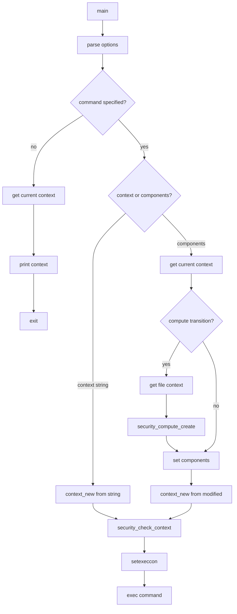

# `runcon`: run command with specified security context

Source: `src/runcon.c` (273 lines) · Tests: `tests/runcon/` ·
Manual: `info '(coreutils) runcon invocation'`

`runcon` runs a command in a different SELinux security context. It can specify
a complete context string, or modify individual components (user, role, type,
range) of the current context. With `-c`, it computes the process transition
context before modifying. Without a command, it prints the current security
context.

## Options

The table lists `long_options[]` (`src/runcon.c:57-67`) and the short-option
string `"r:t:u:l:c"`.

|| Option | Variables |
||---|---|
|| `-r ROLE`, `--role=ROLE` | Set the role |
|| `-t TYPE`, `--type=TYPE` | Set the type |
|| `-u USER`, `--user=USER` | Set the user |
|| `-l RANGE`, `--range=RANGE` | Set the MLS level range |
|| `-c`, `--compute` | `compute_trans = true`: compute process transition context |

## Code map

|| Function | Location | Role |
||---|---|---|
|| `main` | `src/runcon.c:114` | Option parsing, build context, set context, exec command |
|| `usage` | `:70` | Help message |

## How it works

### Context specification

Contexts can be specified in two ways (`src/runcon.c:187-195`):

1. **Complete context:** A single argument like `user:role:type:range`
2. **Components:** Using `-u`, `-r`, `-t`, `-l` to modify the current context

The number of components determines the interpretation:
- 1 component: type
- 2 components: role:type
- 3 components: user:role:type (non-MLS) or role:type:range (MLS)
- 4 components: user:role:type:range (MLS)

### Process transition

With `-c`, `runcon` computes the process transition context
(`src/runcon.c:220-238`):

1. Get the file context of the command to execute with `getfilecon`.
2. Compute the transition with `security_compute_create`.
3. Use the computed context as the base for further modifications.

### Context setting

The context is validated with `security_check_context` and set with
`setexeccon` (`src/runcon.c:258-264`). The command is then executed with
`execv` (if `-c` was used) or `execvp` (otherwise).

## Platform notes

`runcon` requires SELinux support. It uses libselinux functions:
`getcon`, `setexeccon`, `context_new`, `context_user_set`, `context_type_set`,
`context_role_set`, `context_range_set`, `security_check_context`,
`security_compute_create`, `getfilecon`.

## Errors and exit status

- **Multiple components specified:** "multiple roles/types/users/levelranges"
- **No context or components:** "you must specify -c, -t, -u, -l, -r, or context"
- **No command:** "no command specified"
- **SELinux not enabled:** "runcon may be used only on a SELinux kernel"
- **Context creation failure:** "failed to create security context"
- **Context component set failure:** "failed to set new user/type/range/role"
- **Invalid context:** "invalid context"
- **Set context failure:** "unable to set security context"
- **Command not found:** Exit status 127
- **Command execution failure:** Exit status 126

Exit status is 0 on success, 126 on command execution failure, 127 on command
not found, 125 on other errors.

## Tests

|| File | Covers |
||---|---|
|| `tests/runcon/runcon-compute.sh` | Process transition computation |
|| `tests/runcon/runcon-no-reorder.sh` | Argument ordering |

## See also

- [chcon](chcon.md) for changing file security contexts
