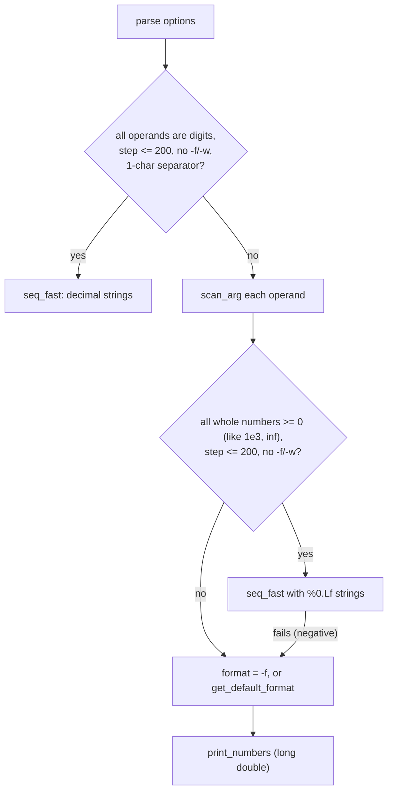

# `seq`: print a sequence of numbers

Source: `src/seq.c` (731 lines) · Tests: `tests/seq/` · Manual:
`info '(coreutils) seq invocation'`

`seq [FIRST [INCREMENT]] LAST` prints numbers from FIRST to LAST. There
are two separate methods:

- **`seq_fast`**: for non-negative whole numbers with a small step
  (at most `SEQ_FAST_STEP_LIMIT`, 200), no `-f`, no `-w` and a
  one-character separator. It adds to a **decimal string** in place, so it
  works for numbers of any size, and it writes through its own `BUFSIZ`
  buffer with `full_write`.
- **`print_numbers`**: the general method. It uses `long double` and
  `printf` with a format chosen from the input precision.

## Options

The table lists `long_options[]` (`src/seq.c:67-75`) and the short-option
string `"+f:s:w"`.

| Option | Effect |
|---|---|
| `-f`, `--format=FORMAT` | A `printf` format for one floating-point value. `long_double_format` checks that it has exactly one `%` directive (`a e f g A E F G`) and adds the `L` modifier. |
| `-s`, `--separator=STRING` | Between numbers (default `\n`). A newline is always printed at the end. |
| `-w`, `--equal-width` | Pad with leading zeros to the same width. Cannot be combined with `-f`. |

Negative numbers look like options. Before each `getopt_long` call, `main`
checks whether the next argument is `-` followed by a digit, `.` or the
locale's decimal point. If so, option parsing stops (`src/seq.c:589-601`).
So `seq -5 -1` and `seq -- -5 -1` both work.

## Code map

| Function | Location | Role |
|---|---|---|
| `main` | `src/seq.c:573` | Options, try `seq_fast`, parse the operands, try `seq_fast` again, choose a format, `print_numbers`. |
| `seq_fast` | `:485` | Whole numbers as digit strings. `incr_grows` adds 1, and is called `step` times. `cmp` compares by length and then `memcmp`. Handles `inf` as LAST. |
| `scan_arg` | `:160` | Parse with `cl_strtold`. Record the width and the number of digits after the decimal point (`precision`, or `INT_MAX` if the number is not plain fixed-point). Reject NaN. |
| `get_default_format` | `:396` | `%.PRECLf`, or `%0W.PRECLf` with `-w`, when all operands are fixed-point. Otherwise `%Lg`. |
| `long_double_format` | `:257` | Check a `-f` format and add `L`. |
| `print_numbers` | `:313` | The `long double` loop. |

## How it works

The diagram shows how `main` chooses a method.

### `print_numbers` and rounding

`print_numbers` (`src/seq.c:313-392`) computes each value as
`x = first + i * step`, not `x += step`. A comment says this gives less
rounding error. Two more checks deal with floating-point problems:

- **No progress.** If `step` is too small to change `x`, the loop stops
  when `i * step` passes `last - first`. Without this it could run forever
  (`tests/seq/seq-no-progress.sh`).
- **One extra number.** When `x` first goes past `last`, `seq` formats it.
  If the formatted value equals LAST and differs from the previous
  number, it is printed too. A comment gives the example that on x86
  `seq 0 0.000001 0.000003` would otherwise stop at `0.000002`
  (`tests/seq/seq-extra-number.sh`).

A counter that cannot be increased any more (`i + 1 == i`) gives
`sequence counter exhausted`.

### Default precision

`scan_arg` records how many digits follow the decimal point in each
operand. The output uses the larger of FIRST's and INCREMENT's precision
(LAST's precision only matters for `-w` widths). So `seq 1 0.5 3` prints
`1.0 1.5 2.0 2.5 3.0`. An exponent is taken into account: `1e-2` counts
as two digits after the point, and `1.5e1` as none. Hexadecimal operands
(`0x...`) and infinities leave the precision unknown (`INT_MAX`), and then
the format is `%Lg` (`src/seq.c:181-246`, `:396-432`).

## Errors and exit status

Invalid operands (`invalid floating point argument`), a zero increment, a
NaN, or a bad `-f` format are fatal errors with exit status 1. Write errors
are found by checking each `printf`/`fputs` (and by `close_stdout`).
`tests/seq/seq-epipe.sh` checks that `EPIPE` is reported when `SIGPIPE` is
ignored.

## Tests

| File | Covers |
|---|---|
| `tests/seq/seq.pl` | The main table of cases, including `-w`, `-f`, `-s` and negative numbers. |
| `tests/seq/seq-extra-number.sh`, `seq-no-progress.sh` | Floating-point edge cases in `print_numbers`. |
| `tests/seq/seq-precision.sh`, `seq-locale.sh`, `seq-long-double.sh` | Output precision, the locale's decimal point, `long double` range. |
| `tests/seq/seq-epipe.sh`, `seq-io-errors.sh` | Write errors. |

## See also

- [printf](printf.md) for the same kind of format handling.
