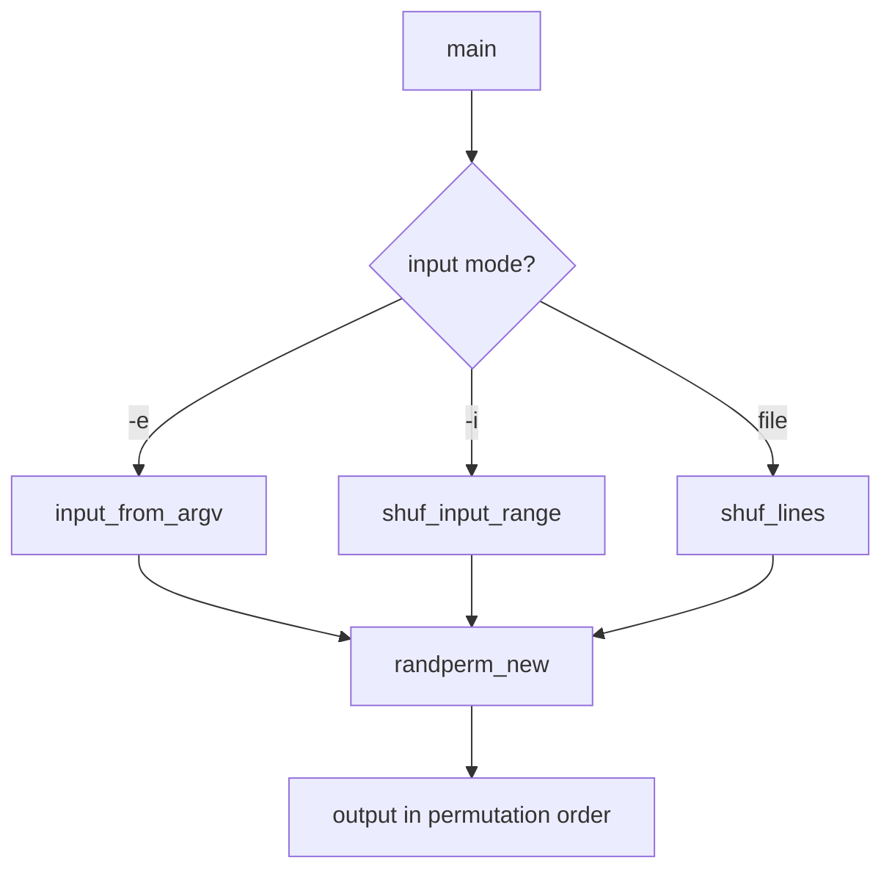

# `shuf`: shuffle input lines

Source: `src/shuf.c` (624 lines) · Tests: `tests/shuf/` ·
Manual: `info '(coreutils) shuf invocation'`

`shuf` writes a random permutation of input lines to standard output. It can
shuffle lines from a file, from command-line arguments (`-e`), or from a numeric
range (`-i`). It uses reservoir sampling for large inputs to avoid reading the
entire file into memory. The output can be limited to a count with `-n`.

## Options

The table lists `long_opts[]` (`src/shuf.c:105-117`) and the short-option
string `"ei:n:o:rz"`.

|| Option | Variables |
||---|---|
|| `-e`, `--echo` | Treat each ARG as an input line |
|| `-i LO-HI`, `--input-range=LO-HI` | Generate lines from LO through HI |
|| `-n COUNT`, `--head-count=COUNT` | Output at most COUNT lines |
|| `-o FILE`, `--output=FILE` | Write to FILE instead of stdout |
|| `--random-source=FILE` | Get random bytes from FILE |
|| `-r`, `--repeat` | Output lines can be repeated |
|| `-z`, `--zero-terminated` | NUL-terminated lines |

## Code map

|| Function | Location | Role |
||---|---|---|
|| `main` | `src/shuf.c:448` | Option parsing, dispatch to input mode, shuffle, output |
|| `input_from_argv` | `:120` | Convert argv to line format for `-e` mode |
|| `shuf_lines` | `:404` | Shuffle lines from file using reservoir or full read |
|| `shuf_input_range` | `:379` | Generate and shuffle numeric range |
|| `randperm_new` | (gnulib) | Generate random permutation |
|| `usage` | `:50` | Help message |

## How it works

### Input modes

`shuf` has three input modes (`src/shuf.c:448-445`):

- **File mode (default):** Read lines from file with `shuf_lines`.
- **`-e` mode:** Treat command-line arguments as lines.
- **`-i` mode:** Generate numeric lines from LO to HI with `shuf_input_range`.

### Reservoir sampling

For large inputs (≥ 8 MiB), `shuf_lines` uses reservoir sampling
(`src/shuf.c:404-445`) to avoid reading the entire file. It reads the file once,
maintaining a reservoir of candidates for the output. For smaller inputs, it
reads all lines into memory and uses `randperm_new` to generate a permutation.

### Random source

The random source can be specified with `--random-source`. By default, it uses
the system's random number generator via gnulib's `randint` module.

## Platform notes

`shuf` uses gnulib's `randint` and `randperm` modules for random number
generation. Reservoir sampling threshold is 8 MiB (`RESERVOIR_MIN_INPUT`).

## Errors and exit status

- **Invalid range:** Error from `xstrtoimax`
- **Invalid count:** Error from `xstrtoimax`
- **File read error:** Error from `read_file_name`

Exit status is 0 on success, 1 on errors.

## Tests

|| File | Covers |
||---|---|
|| `tests/shuf/shuf.sh` | Basic shuffling |
|| `tests/shuf/shuf-reservoir.sh` | Reservoir sampling |

## See also

- [sort](sort.md) with `-R` for random sorting
