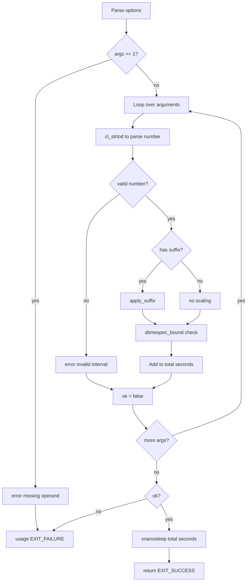

# `sleep`: delay for a specified time

Source: `src/sleep.c` (145 lines) · Tests: `tests/misc/sleep.sh` ·
Manual: `info '(coreutils) sleep invocation'`

`sleep` pauses for a specified number of seconds. It accepts floating-point
values and suffixes for minutes, hours, and days. Multiple arguments are summed.
The actual sleep is performed by the gnulib `xnanosleep` function.

## Options

No options other than `--help` and `--version`. Uses `parse_gnu_standard_options_only`
(`src/sleep.c:107-109`).

## Code map

|| Function | Location | Role |
||---|---|---|
|| `main` | `src/sleep.c:94` | Parse arguments, sum durations, call `xnanosleep`. |
|| `apply_suffix` | `:64` | Scale duration by suffix (s, m, h, d). |
|| `usage` | `:35` | Help text. |

## How it works

The diagram shows the parsing and sleep loop.



### Argument parsing

`main` loops through arguments (`src/sleep.c:117-136`). For each:
1. Parse with `cl_strtod` (C locale strtod)
2. Check the result is non-negative with `dtimespec_bound`
3. If there's a trailing character, it must be a single suffix character
4. Call `apply_suffix` to scale by the multiplier
5. Add to the running total

### Suffix handling

`apply_suffix` (`src/sleep.c:64-91`) scales the duration:
- `s` or none: ×1
- `m`: ×60
- `h`: ×3600
- `d`: ×86400

Invalid suffixes return false and trigger an error.

### Sleep

After parsing, `main` calls `xnanosleep` (`src/sleep.c:141`) with the total
seconds. This gnulib function handles the actual sleeping, converting the
floating-point value to a `timespec` and calling `nanosleep` (or an equivalent).

## Platform notes

- `dtimespec_bound` is a gnulib function that clamps values to the valid range
  for `struct timespec`
- `xnanosleep` is a gnulib wrapper that handles platform differences in
  high-resolution sleep

## Errors and exit status

- Missing operand: `error (0, 0, ...)` then `usage (EXIT_FAILURE)`
- Invalid time interval: `error (0, 0, ...)` then `usage (EXIT_FAILURE)`
- `xnanosleep` failure: `error (EXIT_FAILURE, errno, ...)`

## Tests

|| File | Covers |
||---|---|
|| `tests/misc/sleep.sh` | Various time formats, suffixes, floating-point values. |

## See also

- None directly related

## Source code

`src/sleep.c:1`

```c
/* sleep - delay for a specified amount of time.
   Copyright (C) 1984-2026 Free Software Foundation, Inc.

   This program is free software: you can redistribute it and/or modify
   it under the terms of the GNU General Public License as published by
   the Free Software Foundation, either version 3 of the License, or
   (at your option) any later version.

   This program is distributed in the hope that it will be useful,
   but WITHOUT ANY WARRANTY; without even the implied warranty of
   MERCHANTABILITY or FITNESS FOR A PARTICULAR PURPOSE.  See the
   GNU General Public License for more details.

   You should have received a copy of the GNU General Public License
   along with this program.  If not, see <https://www.gnu.org/licenses/>.  */

#include <config.h>
#include <stdio.h>
#include <sys/types.h>

#include "system.h"
#include "cl-strtod.h"
#include "dtimespec-bound.h"
#include "long-options.h"
#include "quote.h"
#include "xnanosleep.h"

/* The official name of this program (e.g., no 'g' prefix).  */
#define PROGRAM_NAME "sleep"

#define AUTHORS \
  proper_name ("Jim Meyering"), \
  proper_name ("Paul Eggert")

void
usage (int status)
{
  if (status != EXIT_SUCCESS)
    emit_try_help ();
  else
    {
      printf (_("\
Usage: %s NUMBER[SUFFIX]...\n\
  or:  %s OPTION\n\
Pause for NUMBER seconds, where NUMBER is an integer or floating-point.\n\
SUFFIX may be 's','m','h', or 'd', for seconds, minutes, hours, days.\n\
With multiple arguments, pause for the sum of their values.\n\
\n\
"),
              program_name, program_name);
      oputs (HELP_OPTION_DESCRIPTION);
      oputs (VERSION_OPTION_DESCRIPTION);
      emit_ancillary_info (PROGRAM_NAME);
    }
  exit (status);
}

/* Given a floating point value *X, and a suffix character, SUFFIX_CHAR,
   scale *X by the multiplier implied by SUFFIX_CHAR.  SUFFIX_CHAR may
   be the NUL byte or 's' to denote seconds, 'm' for minutes, 'h' for
   hours, or 'd' for days.  If SUFFIX_CHAR is invalid, don't modify *X
   and return false.  Otherwise return true.  */

static bool
apply_suffix (double *x, char suffix_char)
{
  int multiplier;

  switch (suffix_char)
    {
    case 0:
    case 's':
      multiplier = 1;
      break;
    case 'm':
      multiplier = 60;
      break;
    case 'h':
      multiplier = 60 * 60;
      break;
    case 'd':
      multiplier = 60 * 60 * 24;
      break;
    default:
      return false;
    }

  *x = dtimespec_bound (*x * multiplier, 0);

  return true;
}

int
main (int argc, char **argv)
{
  double seconds = 0.0;
  bool ok = true;

  initialize_main (&argc, &argv);
  set_program_name (argv[0]);
  setlocale (LC_ALL, "");
  bindtextdomain (PACKAGE, LOCALEDIR);
  textdomain (PACKAGE);

  atexit (close_stdout);

  parse_gnu_standard_options_only (argc, argv, PROGRAM_NAME, PACKAGE_NAME,
                                   Version, true, usage, AUTHORS,
                                   (char const *) NULL);

  if (argc == 1)
    {
      error (0, 0, _("missing operand"));
      usage (EXIT_FAILURE);
    }

  for (int i = optind; i < argc; i++)
    {
      char *p;
      errno = 0;
      double duration = cl_strtod (argv[i], &p);
      double s = dtimespec_bound (duration, errno);
      if (argv[i] == p
          /* Nonnegative interval.  */
          || ! (0 <= s)
          /* No extra chars after the number and an optional s,m,h,d char.  */
          || (*p && *(p + 1))
          /* Check any suffix char and update S based on the suffix.  */
          || ! apply_suffix (&s, *p))
        {
          error (0, 0, _("invalid time interval %s"), quote (argv[i]));
          ok = false;
        }

      seconds = dtimespec_bound (seconds + s, 0);
    }

  if (!ok)
    usage (EXIT_FAILURE);

  if (xnanosleep (seconds))
    error (EXIT_FAILURE, errno, _("cannot read realtime clock"));

  return EXIT_SUCCESS;
}
```
