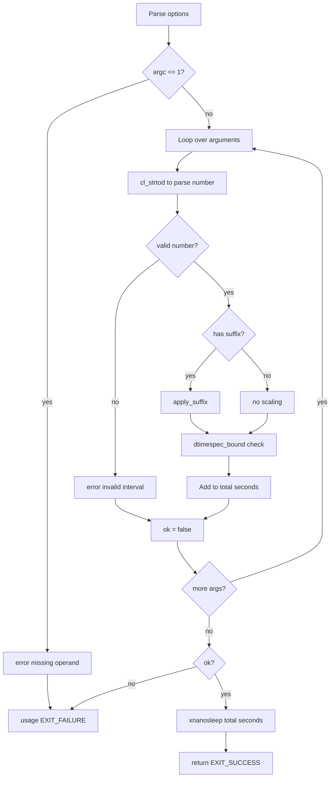

# `sleep`: delay for a specified time

Source: `src/sleep.c` (145 lines) · Tests: `tests/misc/sleep.sh` ·
Manual: `info '(coreutils) sleep invocation'`

`sleep` pauses for a specified number of seconds. It accepts floating-point
values and suffixes for minutes, hours, and days. Multiple arguments are summed.
The actual sleep is performed by the gnulib `xnanosleep` function.

## Options

No options other than `--help` and `--version`. Uses `parse_gnu_standard_options_only`
(`src/sleep.c:107-109`).

## Code map

|| Function | Location | Role |
||---|---|---|
|| `main` | `src/sleep.c:94` | Parse arguments, sum durations, call `xnanosleep`. |
|| `apply_suffix` | `:64` | Scale duration by suffix (s, m, h, d). |
|| `usage` | `:35` | Help text. |

## How it works

The diagram shows the parsing and sleep loop.

### Argument parsing

`main` loops through arguments (`src/sleep.c:117-136`). For each:
1. Parse with `cl_strtod` (C locale strtod)
2. Check the result is non-negative with `dtimespec_bound`
3. If there's a trailing character, it must be a single suffix character
4. Call `apply_suffix` to scale by the multiplier
5. Add to the running total

### Suffix handling

`apply_suffix` (`src/sleep.c:64-91`) scales the duration:
- `s` or none: ×1
- `m`: ×60
- `h`: ×3600
- `d`: ×86400

Invalid suffixes return false and trigger an error.

### Sleep

After parsing, `main` calls `xnanosleep` (`src/sleep.c:141`) with the total
seconds. This gnulib function handles the actual sleeping, converting the
floating-point value to a `timespec` and calling `nanosleep` (or an equivalent).

## Platform notes

- `dtimespec_bound` is a gnulib function that clamps values to the valid range
  for `struct timespec`
- `xnanosleep` is a gnulib wrapper that handles platform differences in
  high-resolution sleep

## Errors and exit status

- Missing operand: `error (0, 0, ...)` then `usage (EXIT_FAILURE)`
- Invalid time interval: `error (0, 0, ...)` then `usage (EXIT_FAILURE)`
- `xnanosleep` failure: `error (EXIT_FAILURE, errno, ...)`

## Tests

|| File | Covers |
||---|---|
|| `tests/misc/sleep.sh` | Various time formats, suffixes, floating-point values. |

## See also

- None directly related
