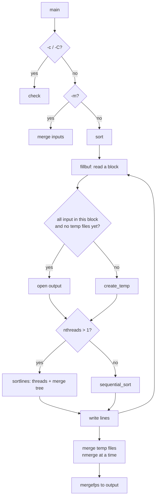

# `sort`: sort lines of text files

Source: `src/sort.c` (5173 lines) · Tests: `tests/sort/` (27 scripts) ·
Manual: `info '(coreutils) sort invocation'`

`sort` is the second-largest source file in coreutils, after `ls.c`. It is an
**external merge sort**: it reads as much input as fits in its buffer, sorts
that block in memory (with threads if it can), writes it to a temporary
file, and then merges the temporary files. If all the input fits in one
buffer, it writes straight to the output and makes no temporary files.

## Options

The table lists the main entries in `long_options[]`
(`src/sort.c:627-660`).

| Group | Options |
|---|---|
| Ordering (global, or per key) | `-b` ignore leading blanks, `-d` dictionary order, `-f` fold case, `-g` general numeric, `-h` human numeric (`2K`, `1G`), `-i` ignore non-printing, `-M` month, `-n` numeric, `-R` random, `-V` version, `-r` reverse, `--sort=WORD` |
| Keys | `-k POS1[,POS2]`, `-t SEP` (field separator), and the obsolete `+POS1 -POS2` |
| Other modes | `-c`/`-C`/`--check[=quiet\|diagnose-first]`, `-m` merge only, `-u` unique, `-s` stable |
| Resources | `-S SIZE` buffer size, `-T DIR` temporary directory (may be repeated), `--parallel=N`, `--batch-size=NMERGE`, `--compress-program=PROG` |
| I/O | `-o FILE`, `--files0-from=F`, `-z` NUL-terminated lines, `--random-source=FILE` |
| Debug | `--debug`: underline each key and warn about suspicious options |

## Main data structures

| Structure | Location | Purpose |
|---|---|---|
| `struct line` | `src/sort.c:167` | `text`, `length`, and `keybeg`/`keylim` (the first key, worked out once while reading). |
| `struct buffer` | `:176` | One large allocation. Line text grows up from the start, and the `struct line` array grows down from the end. |
| `struct keyfield` | `:202` | One `-k` key: start and end field and character, `ignore`/`translate` tables, and flags for each ordering. Keys form a linked list (`keylist`). |
| `struct merge_node`, `struct merge_node_queue` | `:234`, `:252` | The merge tree and its priority queue (a `heap` from `gl/lib/heap.c`) used for parallel sorting. |
| `struct tempnode` | | A temporary file, with the PID of its compressor if `--compress-program` is used. |

## Code map

| Function | Location | Role |
|---|---|---|
| `main` | `src/sort.c:4616` | Options, keys, locale tables, threads, then `check`, `merge` or `sort`. |
| `sort` | `:4334` | Read blocks with `fillbuf`, sort them, write to the output or temporary files, then `merge`. |
| `fillbuf` | `:2027` | Read input into `struct buffer`, find line ends, fill in `struct line` with the first key. |
| `sequential_sort` | `:3612` | Single-thread merge sort that needs room for only 1.5 N lines (Knuth 5.2.4-10, credited to D. A. Bell, 1958). |
| `sortlines`, `sortlines_thread` | `:4060`, `:4026` | Split the work across threads, then merge with the merge tree. |
| `merge_loop`, `mergelines_node` | `:3968`, `:3862` | Take nodes from the queue and merge them up the tree. |
| `merge` | `:4218` | Merge temporary files `nmerge` (default 16) at a time until one pass is left. |
| `mergefps` | `:3349` | Merge open streams, keeping the current line of each. |
| `compare` | `:3150` | Compare two lines: `keycompare` if there are keys, then a last-resort whole-line compare unless `-s` or `-u`. |
| `keycompare` | `:2955` | Compare key by key, using the right comparison for each key's flags. |
| `numcompare`, `general_numcompare`, `human_numcompare`, `getmonth`, `compare_random` | `:2265`, `:2285`, `:2248`, `:2316`, `:2466` | The comparisons for each ordering. |
| `begfield`, `limfield` | `:1871`, `:1918` | Find where a key starts and ends in a line. |
| `check` | `:3236` | `-c`/`-C`: report the first line out of order. |
| `default_sort_size`, `sort_buffer_policy` | `:1584`, `:1690` | Choose the buffer size. |
| `create_temp`, `pipe_child`, `open_temp` | `:1304`, `:1131`, `:1315` | Temporary files, optionally compressed through a child process. |
| `avoid_trashing_input` | `:4122` | If `-o` names one of the inputs, copy that input to a temporary file first. |
| `key_warnings` | `:2760` | The `--debug` warnings. |

## How it works

The diagram shows the path through `sort()` and `merge()`.

### Buffer size

Without `-S`, `default_sort_size()` (`src/sort.c:1584-1626`) takes the
smallest of these values:

- half of `RLIMIT_DATA` and `RLIMIT_AS`;
- 15/16 of `RLIMIT_RSS`;
- 3/4 of physical memory;
- the larger of available memory and 1/8 of total memory.

It is never less than `MIN_SORT_SIZE` (`nmerge * MIN_MERGE_BUFFER_SIZE`).
`sort_buffer_policy` then uses the input file sizes to choose a starting
size and a limit. It starts smaller and grows the buffer only when needed
(`maybe_growbuf`).

### Threads

`--parallel` defaults to the number of processors, but at most
`DEFAULT_MAX_THREADS` (8). A comment says that beyond 8 threads the gains
become small. `sortlines` divides the lines in two and starts a thread for
the lower half if it has more than one thread and at least
`SUBTHREAD_LINES_HEURISTIC` (128 Ki) lines. Each leaf sorts its part with
`sequential_sort`. The results are merged up a binary tree. Nodes that are
ready wait in a priority queue ordered by tree level and then by the
number of lines left (`compare_nodes`, `src/sort.c:3757`). Each merge step
moves at most `MAX_MERGE (total, level)` lines, so work is shared out in
small pieces. The node at `MERGE_ROOT` writes the output, and `-u` is
applied there by `write_unique`.

The number of `struct line` bytes reserved for each input line is
`(log2 nthreads + 1) * sizeof (struct line)` with threads, and
`1.5 * sizeof (struct line)` without (`src/sort.c:4353-4367`). This gives
room for the merge buffers.

### Comparing lines

`compare()` (`src/sort.c:3150-3189`):

1. If there are keys, call `keycompare`. If the keys differ, or `-u` or
   `-s` is given, stop.
2. Otherwise compare the whole line, as the last resort: `xmemcoll0` (which
   uses `strcoll`) in a locale with real collation (`hard_LC_COLLATE`),
   else `memcmp` and then the lengths.
3. Apply `-r`.

Notes on some orderings:

- **`-n`** uses `strnumcmp` (`gl/lib/strnumcmp.c`). It compares the digit
  strings directly, with the locale's decimal point and thousands
  separator, and never converts them to numbers. So numbers of any size
  compare correctly.
- **`-g`** converts with `strtold` and puts NaNs in a fixed order
  (`nan_compare`). `tests/sort/sort-NaN-infloop.sh` covers a past bug.
- **`-h`** compares the unit suffix (`find_unit_order`: `K M G T P E Z Y R
  Q`) first, then the number.
- **`-R`** hashes each key with MD5, starting from a random state seeded by
  `randread` (or `--random-source`). Equal keys get equal hashes, so they
  end up next to each other. `link_libcrypto()` can `dlopen` OpenSSL's MD5
  at run time.
- **`-V`** uses gnulib `filevercmp`.
- **`-M`** looks up a sorted month table built from the locale's
  abbreviated month names (`inittables`).

### Temporary files and merging

Temporary files go in the `-T` directories (default `$TMPDIR` or `/tmp`).
They are created with `mkostemp` and removed on exit, or on a signal
through `cleanup()` and `sighandler`. With `--compress-program=PROG`,
`pipe_child` uses `posix_spawnp` to run `PROG` (or `PROG -d` to read the
file back). It retries on `EAGAIN`. If the compressor still cannot be
started, `maybe_create_temp` prints `could not run compress program` (once
for each kind of error) and writes that temporary file uncompressed.

`merge()` merges `nmerge` files at a time into new temporary files until
`nmerge` or fewer remain, then merges those into the output. If not all
the files can be opened (for example, too few file descriptors),
`mergefiles` merges the ones that did open, as long as there are at least
two (`src/sort.c:3547-3556`). `tests/sort/sort-merge-fdlimit.sh` covers
this.

`sort -o FILE FILE` works because `avoid_trashing_input()` first copies any
input that is the same file as the output to a temporary file.

## Errors and exit status

| Status | Meaning |
|---|---|
| 0 | Success. With `-c`/`-C`, the input is sorted. |
| `SORT_OUT_OF_ORDER` (1) | `-c`/`-C` found disorder. |
| `SORT_FAILURE` (2) | Any other error. Set with `initialize_exit_failure`, so out-of-memory errors also exit with 2. |

`sort_die()` reports a read or write error on a named file and exits with
status 2.

## Tests

The table lists some of the tests.

| File | Covers |
|---|---|
| `tests/sort/sort.pl` | The main table of keys, orderings and options. |
| `tests/sort/sort-merge.pl`, `sort-merge-fdlimit.sh` | `-m`, and merging with few file descriptors. |
| `tests/sort/sort-compress*.sh` | `--compress-program`, including a compressor that hangs. |
| `tests/sort/sort-debug-keys.sh`, `sort-debug-warn.sh` | `--debug` output. |
| `tests/sort/sort-float.sh`, `sort-NaN-infloop.sh`, `sort-h-thousands-sep.sh` | Numeric edge cases. |
| `tests/sort/sort-rand.sh`, `sort-month.sh`, `sort-version.sh` | `-R`, `-M`, `-V`. |
| `tests/sort/sort-unique.sh`, `sort-unique-segv.sh`, `sort-u-FMR.sh` | `-u`. |
| `tests/sort/sort-spinlock-abuse.sh`, `sort-stale-thread-mem.sh` | Thread safety. |
| `tests/sort/sort-continue.sh`, `sort-exit-early.sh` | Running out of resources part-way, and stopping early. |
| `tests/sort/sort-files0-from.pl` | `--files0-from`. |

## See also

- [Shared infrastructure](../overview/shared-infrastructure.md) for `heap`,
  `strnumcmp` and `randread` in `gl/`.
