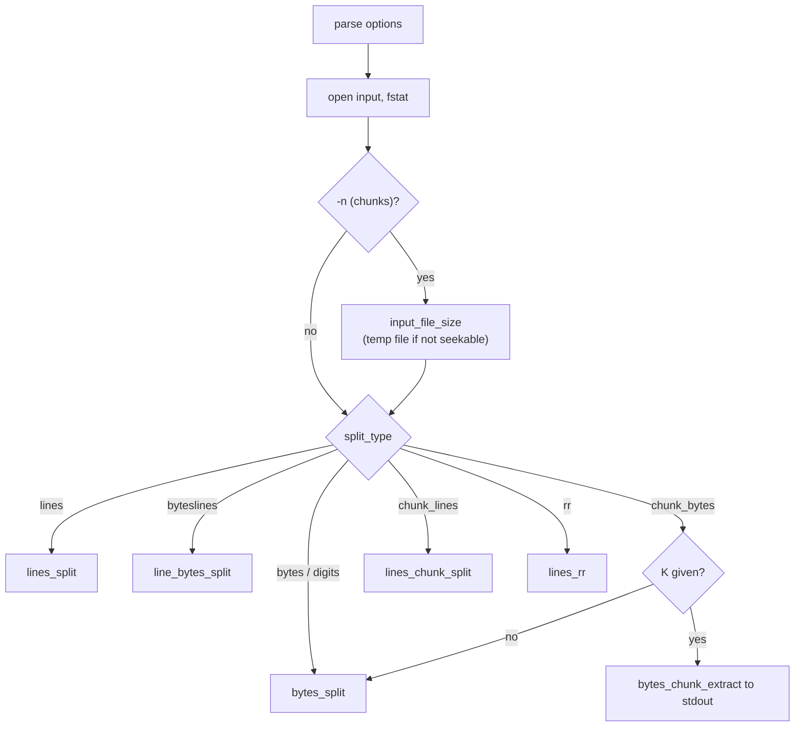

# `split`: split a file into pieces

Source: `src/split.c` (1770 lines), `src/temp-stream.c` · Tests:
`tests/split/` · Manual: `info '(coreutils) split invocation'`

`split` writes its input to files named `PREFIXaa`, `PREFIXab`, ... (or
with numeric or hex suffixes). Each piece can also be sent to a command
with `--filter`. There is one function for each splitting mode. For
`-n` (a fixed number of chunks), `split` must know the input size first.
If the input cannot be seeked, it is copied to a temporary file with
`temp_stream()`.

## Splitting modes

`enum Split_type` (`src/split.c`) lists the modes:

| Option | `Split_type` | Function |
|---|---|---|
| `-b SIZE`, `--bytes` | `type_bytes` | `bytes_split` |
| `-l N`, `--lines` (default 1000) | `type_lines` | `lines_split` |
| `-C SIZE`, `--line-bytes` | `type_byteslines` | `line_bytes_split`: at most SIZE bytes per file, splitting only at line ends when it can |
| `-n N`, `-n K/N` | `type_chunk_bytes` | `bytes_split` (all chunks), or `bytes_chunk_extract` (chunk K to stdout) |
| `-n l/N`, `-n l/K/N` | `type_chunk_lines` | `lines_chunk_split`: N chunks of about equal size, not splitting lines |
| `-n r/N`, `-n r/K/N` | `type_rr` | `lines_rr`: lines dealt round-robin to N files |
| `-NUM` (obsolete) | `type_digits` | Same as `-l NUM` |

Only one mode may be given (`FAIL_ONLY_ONE_WAY`).

## Other options

| Option | Effect |
|---|---|
| `-a N`, `--suffix-length=N` | Suffix length. Without it, the length grows automatically when the names run out (`suffix_auto`). |
| `-d`, `--numeric-suffixes[=FROM]`, `-x`, `--hex-suffixes[=FROM]` | Digits in place of letters, optionally starting at FROM. |
| `--additional-suffix=SUFFIX` | Add SUFFIX after the generated part. |
| `-e`, `--elide-empty-files` | With `-n`, do not create empty files. |
| `-u`, `--unbuffered` | With `-n r/...`, copy each line at once. |
| `-t SEP`, `--separator=SEP` | Record separator in place of newline (`\0` is allowed). |
| `--filter=COMMAND` | Write each piece to `$SHELL -c COMMAND`, with `FILE` set to the name. |
| `--verbose` | Print `creating file 'X'` (or `executing with FILE=X`) before each piece. |
| `---io-blksize=SIZE` | Hidden. For tests: set the buffer size. |

## Code map

| Function | Location | Role |
|---|---|---|
| `main` | `src/split.c:1419` | Options, open the input, choose a buffer size, for `-n` get the input size, call the split function, close. |
| `set_suffix_length` | `:172` | Work out the suffix length needed for `-n` or a numeric start value. |
| `next_file_name` | `:413` | Make the next output name, like an odometer over `suffix_alphabet`. When `suffix_auto` is on and the names run out, make the suffix longer. |
| `create` | `:524` | Open the next output (`O_EXCL` first). Refuse to overwrite the input. Or start the `--filter` child. |
| `cwrite` | `:694` | Write to the current output, starting a new file when asked. |
| `closeout` | `:635` | Close the output and, for `--filter`, wait for the child and check its exit status. |
| `input_file_size` | `:366` | Find the input size for `-n`. If the input cannot be seeked, copy it to a temporary file. |
| `copy_to_tmpfile` | `:331` | Read all input into `temp_stream()` and `dup2` it onto the input descriptor. |
| `ofile_open` | `:1148` | For `-n r/N`, open output files as needed. If there are too many open files, close others and reopen later. |
| `parse_chunk` | `:1400` | Parse `N` or `K/N`. |

## How it works

The diagram shows how `main` chooses a split function.

### Output names

`next_file_name()` keeps an array `sufindex[]` of positions in
`suffix_alphabet` (`a`-`z`, `0`-`9`, or `0`-`9a`-`f`) and adds one to it
like an odometer. With the default automatic length, when the first
character of the suffix would roll over, the name gets two characters
longer. This is why `split` makes `xaa`…`xyz`, then `xzaaa`…. `NEWS` for
the unreleased version records a fix: `--hex-suffixes=FROM` now gives
consecutive suffixes when FROM contains `a` to `f`.

### Protecting the input

`create()` first tries `open (..., O_EXCL)`. If the file exists, it opens
it normally, then checks with `psame_inode` that it is not the input
file: `'x' would overwrite input; aborting`. Only then is the file
truncated (`src/split.c:531-548`). `tests/split/guard-input.sh` covers
this.

### `--filter`

For each piece, `create()` sets `FILE` in the environment and starts
`$SHELL -c COMMAND` (or `/bin/sh` if `SHELL` is not set) with
`posix_spawn`, with a pipe for its stdin. `closeout()` waits for the
child (`src/split.c:654-683`). A child killed by `SIGPIPE` is not an
error, because a filter such as `head` may stop reading early. If the
child exits with a non-zero status N, `split` stops at once with status
N. If it is killed by another signal S, `split` stops with status
128 + S.

### `-n` on input that cannot be seeked

`input_file_size()` reads the first buffer. If the size is not known (a
pipe), or `lseek` gives a strange answer (`/dev/zero` on Linux), it
copies all the input to the temporary file from `temp_stream()`. That
file honours `$TMPDIR`, and `dup2` puts it on the input descriptor.
Then `split` knows the size and can seek.

## Errors and exit status

Bad sizes or chunk numbers, more than one mode, too short a suffix, and
write errors are fatal (exit status 1). A failing `--filter` child is
fatal too, with the child's exit status or 128 plus the signal number (see
above).

## Tests

| File | Covers |
|---|---|
| `tests/split/lines.sh`, `line-bytes.sh`, `record-sep.sh` | `-l`, `-C`, `-t`. |
| `tests/split/b-chunk.sh`, `l-chunk.sh`, `l-chunk-root.sh`, `r-chunk.sh` | `-n` modes. |
| `tests/split/suffix-length.sh`, `suffix-auto-length.sh`, `numeric.sh`, `additional-suffix.sh` | Output names. |
| `tests/split/filter.sh` | `--filter`, including `SIGPIPE`. |
| `tests/split/guard-input.sh` | Refusing to overwrite the input. |
| `tests/split/fail.sh`, `split-io-err.sh` | Errors. |
| `tests/split/non-utf8.sh` | Prefixes that are not valid UTF-8. |

## See also

- [Shared infrastructure](../overview/shared-infrastructure.md#other-small-modules)
  for `temp-stream.c` (also used by `tac`).
- [dd](dd.md) for copying a range of a file.
