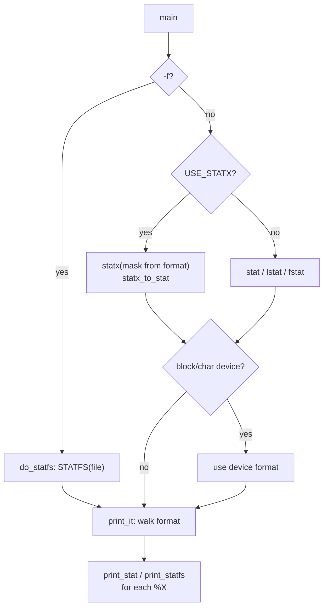

# `stat`: display file or file system status

Source: `src/stat.c` (1994 lines), `src/statx.h`,
`src/find-mount-point.c` · Tests: `tests/stat/` · Manual:
`info '(coreutils) stat invocation'`

`stat` gets a file's metadata (or, with `-f`, its file system's) and prints
it through a small `printf`-like formatter. Four parts are worth knowing:

- On Linux it uses `statx()` and asks only for the fields that the format
  needs (`format_to_mask`).
- The `%` directives are handled by `print_it()`, which builds a real
  `printf` format for each directive, with flags, width and precision.
- File system type names come from a large table of Linux magic numbers
  (`human_fstype`), or from a name field on BSD, macOS and Solaris.
- `%m` (mount point) also looks for bind mounts.

## Options

The table lists `long_options[]` (`src/stat.c:214-224`) and the
short-option string `"c:fLt"`.

| Option | Effect |
|---|---|
| `-L`, `--dereference` | `follow_links`: `stat` in place of `lstat`. |
| `-f`, `--file-system` | Show file system status (`do_statfs`). |
| `-c`, `--format=FORMAT` | Use FORMAT. A newline is added after each file. Backslash escapes are **not** interpreted. |
| `--printf=FORMAT` | Like `-c`, but escapes **are** interpreted and no newline is added. |
| `-t`, `--terse` | A short one-line default format. |
| `--cached=always\|never\|default` | Sets `dont_sync` (`AT_STATX_DONT_SYNC`) or `force_sync` (`AT_STATX_FORCE_SYNC`). Matters for network file systems. |

An operand of `-` means standard input. It is handled with `fstat`, or
with `statx (0, "", AT_EMPTY_PATH)`.

## Code map

| Function | Location | Role |
|---|---|---|
| `main` | `src/stat.c:1897` | Options, choose formats, a loop over files. |
| `default_format` | `:1665` | Build the default (or terse) format. There are separate formats for devices (`%Hr,%Lr`) and for SELinux (`Context: %C`). |
| `do_stat` (statx version) | `:1366` | `statx` with a mask from `format_to_mask`. Converts with `statx_to_stat`. Gets the birth time from `stx_btime`. |
| `do_stat` (stat version) | `:1454` | `stat`/`lstat`/`fstat`. Gets the birth time from `get_stat_birthtime`, or `getattrat` on Solaris. |
| `do_statfs` | `:1258` | `statvfs`/`statfs` (`STATFS` macro), then `print_it` with `print_statfs`. |
| `print_it` | `:1127` | Parse FORMAT. Handle `%%`, escapes (for `--printf`), flags, width and precision. Call the print function for each directive. |
| `print_stat` | `:1501` | One file directive. |
| `print_statfs` | `:878` | One file system directive. |
| `fmt_to_mask`, `format_to_mask` | `:1293`, `:1346` | Map directives to `STATX_*` bits. |
| `human_fstype` | `:254` | File system type name. |
| `out_mount_point`, `find_bind_mount` | `:1012`, `:973` | `%m`. |
| `out_epoch_sec` | `:733` | `%W %X %Y %Z` with an optional precision for fractional seconds. |
| `human_time` | `:650` | `%w %x %y %z`, formatted as `%Y-%m-%d %H:%M:%S.%N %z`. |

## How it works

The diagram shows the main path.

### Asking `statx` for less

`fmt_to_mask()` maps each directive to the `STATX_*` bits it needs
(`src/stat.c:1293-1342`). For example `%s` needs `STATX_SIZE`, `%i`
needs `STATX_INO`, and `%w`/`%W` need `STATX_BTIME`. On file systems where
some fields are expensive (for example network file systems), the kernel
can then skip work. `AT_NO_AUTOMOUNT` is added unless `--cached=never` is
given, so `stat` does not mount an automount point by accident.

### Directives

`stat --help` gives the full list. The file directives handled in
`print_stat` are:

`%a %A %b %B %C %d %D %f %F %g %G %h %i %m %n %N %o %r %R %s %t %T %u %U
%w %W %x %X %y %Y %z %Z`

The file system directives handled in `print_statfs` are:

`%a %b %c %d %f %i %l %n %s %S %t %T`

Modifiers placed before the letter:

| Modifier | Effect |
|---|---|
| `Q` (as in `%Qn`) | Quote the name with `QUOTING_STYLE` or `shell_escape_quoting_style`. Used in the default format. |
| `H`, `L` (as in `%Hd`, `%Lr`) | Major or minor part of a device number. |
| `.N` precision on `%W %X %Y %Z` | Number of digits after the decimal point. |

`print_it` adds `j` to integer conversions (`%jd`, `%ju`, `%jx`), so
`intmax_t` values print correctly. File sizes are printed without a sign
(`unsigned_file_size`), as `ls` does.

### File system types

On Linux, `human_fstype()` maps `f_type` to a name with a long `switch` of
`S_MAGIC_*` constants (`src/stat.c:254-640`). Each case says whether the
file system is local or remote. A comment gives a script that compares the
list with glibc's `linux_fsinfo.h` and with `man 2 statfs`. The build
generates `src/fs-is-local.h` from this table with `src/extract-magic`
(`src/local.mk:718-723`). `tail` uses that header (`is_local_fs_type`) to
decide whether inotify can be trusted. `README-release` tells maintainers
to run `make src/fs-magic-compare` and add new kernel magic numbers here.
Systems that have a type-name field (`f_basetype`, `f_fstypename`,
`fsh_name`) use that field.

### `%m`: mount point

`out_mount_point()` first calls `find_bind_mount()`, which looks for a
`me_dummy` mount entry whose source is the same inode. If none is found,
it calls `find_mount_point()`. `tests/stat/stat-mount.sh` checks this.

## Errors and exit status

Each operand is handled separately. A failure to stat gives `cannot stat
'X'` (or `cannot statx`), and the exit status is 1. An unknown directive
letter prints `?`. A flag or width before `%` (as in `%5%`) is a fatal
`invalid directive` error. An unknown backslash escape in `--printf` gives
a warning.

## Tests

| File | Covers |
|---|---|
| `tests/stat/stat-fmt.sh` | Format parsing, flags, width and precision. |
| `tests/stat/stat-printf.pl` | `--printf` escapes and directives. |
| `tests/stat/stat-birthtime.sh` | `%w`/`%W`. |
| `tests/stat/stat-nanoseconds.sh` | Fractional seconds. |
| `tests/stat/stat-mount.sh` | `%m`. |
| `tests/stat/stat-hyphen.sh`, `stat-slash.sh` | `-` as stdin, and trailing slashes. |

## See also

- [ls](ls.md): the other program that uses `statx` (through `src/statx.h`).
- [df](df.md) for file system usage of all mounts.
