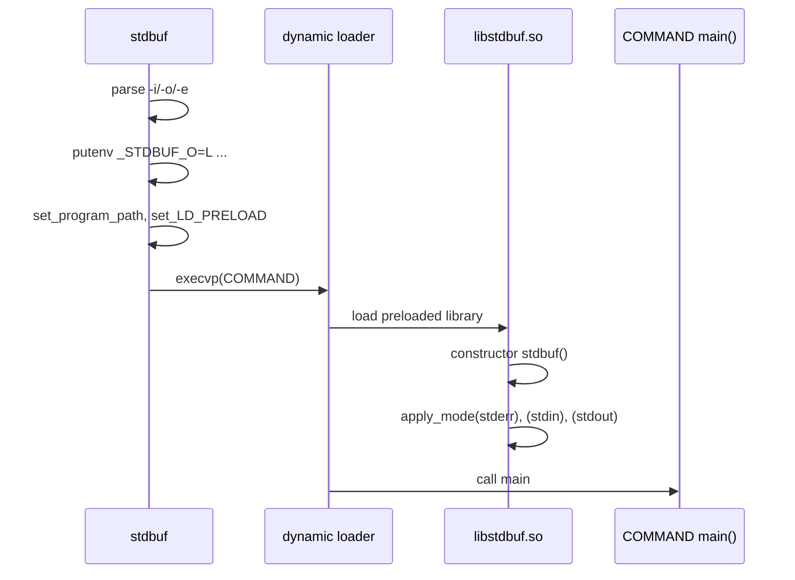

# `stdbuf`: run a command with different stdio buffering

Source: `src/stdbuf.c` (397 lines), `src/libstdbuf.c` (133 lines) · Tests:
`tests/misc/stdbuf.sh` · Manual: `info '(coreutils) stdbuf invocation'`

`stdbuf` cannot change another program's buffers directly. It works in two
parts:

1. `stdbuf` stores the modes you asked for in environment variables
   (`_STDBUF_I`, `_STDBUF_O`, `_STDBUF_E`). It adds `libstdbuf.so` to the
   preload variable and then `exec`s the command.
2. When the command starts, the dynamic loader loads `libstdbuf.so`. Its
   `constructor` function reads the variables and calls `setvbuf()` on
   `stdin`, `stdout` and `stderr` before the command's `main` runs.

So `stdbuf` affects only programs that are dynamically linked, use C stdio,
and do not call `setvbuf` themselves.

## Options

| Option | MODE | Environment variable |
|---|---|---|
| `-i`, `--input=MODE` | `0` or a size. **`L` is rejected** ("line buffering standard input is meaningless"). | `_STDBUF_I` |
| `-o`, `--output=MODE` | `0`, `L` or a size | `_STDBUF_O` |
| `-e`, `--error=MODE` | `0`, `L` or a size | `_STDBUF_E` |

- `0` means unbuffered (`_IONBF`), `L` means line buffered (`_IOLBF`), and
  a size means fully buffered (`_IOFBF`) with that many bytes.
- `parse_size()` (`src/stdbuf.c:66`) calls `xstrtoumax` with the suffixes
  `"EGkKMPQRTYZ0"`. So `1K`, `1KiB` and `1KB` all work. dd's `b`, `c`, `w`
  and `NxM` forms do not.
- The short-option string is `"+i:o:e:"`. The leading `+` stops option
  parsing at the first operand, so options meant for COMMAND are passed to
  it.

## Code map

| Function | Location | Role |
|---|---|---|
| `main` | `src/stdbuf.c:310` | Parse options, set the variables, find the library, `execvp`. |
| `parse_size` | `:66` | Parse a size MODE. |
| `set_libstdbuf_options` | `:276` | `putenv ("_STDBUF_X=MODE")` for each stream given. Returns `false` if no option was given. |
| `set_program_path` | `:133` | Find the directory `stdbuf` was run from: from `argv[0]` if it has a `/`, else `/proc/self/exe`, else a search of `$PATH`. |
| `set_LD_PRELOAD` | `:188` | Find `libstdbuf.so` and add it to the preload variable. |
| `stdbuf` (constructor) | `src/libstdbuf.c:126` | Runs inside the command. Calls `apply_mode` for stderr first (so that it can report errors), then stdin, then stdout. |
| `apply_mode` | `src/libstdbuf.c:71` | Parse one variable and call `setvbuf`. |

## How it works

The sequence diagram shows the two processes. `stdbuf` replaces itself with
COMMAND, so they are really the same process before and after `exec`.



### Finding `libstdbuf.so`

`set_LD_PRELOAD` tries two directories in order (`src/stdbuf.c:218-246`):

1. `program_path`: the directory of the running `stdbuf`. This lets an
   uninstalled build in `src/` find `src/libstdbuf.so`. If this directory
   cannot be found, `PKGLIBDIR` is used.
2. `PKGLIBEXECDIR`: the install location, usually
   `$prefix/libexec/coreutils`.

If the library is not in either place, `stdbuf` exits with status 125
(`failed to find 'libstdbuf.so'`). A comment explains why the system library
path is not searched: then a missing library would not cause an error.

The variable name depends on the platform:

| Platform | Variable | Extra |
|---|---|---|
| macOS | `DYLD_INSERT_LIBRARIES` | It also sets `DYLD_FORCE_FLAT_NAMESPACE=y`. |
| AIX | `LDR_PRELOAD` or `LDR_PRELOAD64` (by pointer size) | |
| Others | `LD_PRELOAD` | |

If the variable already has a value, the library is added to the end
(`old:libstdbuf`).

### `apply_mode` inside the command

```c
if (*mode == '0')
  setvbuf_mode = _IONBF;
else if (*mode == 'L')
  setvbuf_mode = _IOLBF;      /* FIXME: should we allow 1ML  */
else
  {
    setvbuf_mode = _IOFBF;
    ...
    size = strtoul (mode, &mode_end, 10);
    ...
    buf = (... ? malloc (size) : NULL);
```

(`src/libstdbuf.c:81-102`.) For full buffering the library allocates the
buffer itself, and does not pass `NULL` with a size. The long comment at the
top of the file says glibc ignores the size when the buffer is `NULL`.
Errors are printed to stderr and the stream is left unchanged. The library
cannot exit or report a status, because it runs inside someone else's
program.

`libstdbuf.c` does not link gnulib. It `#undef`s `fprintf`, `free`, `malloc`
and `strtoul` so that it calls the real libc functions (`:27-32`). It is
compiled with `-fPIC` and linked with `-shared` (`src/local.mk`).

## Platform notes

- `configure` builds `stdbuf` only if a shared object with
  `__attribute__ ((constructor))` links without warnings, and `$EXEEXT` is
  empty (so not on Windows). See `configure.ac:527-561`.
- It does not work for statically linked programs, set-UID programs (the
  loader ignores `LD_PRELOAD` for them), or programs that do their own I/O
  without stdio. `--help` names `dd` and `cat` as examples of the last kind,
  and `tee` as an example of a program that sets its own buffering.

## Errors and exit status

`main` calls `initialize_exit_failure (EXIT_CANCELED)`, so every error in
`stdbuf` itself exits with status 125. These include a bad MODE, `-iL`, no
mode option, no COMMAND, the library not found, and a failed `putenv`. If
`execvp` fails, the status is 127 when the command was not found (`ENOENT`)
and 126 otherwise. When it succeeds, the exit status is COMMAND's.

## Tests

`tests/misc/stdbuf.sh` checks:

- MODE syntax (`-o1`, `-oK`, `-o0`, `-oL`), and that `-ol`, an overflowing
  size, `-iL` and no mode all give status 125.
- Statuses 126 and 127 for a COMMAND that cannot be run or does not exist.
- Line-buffered and unbuffered output, timed through a FIFO with
  `stdbuf -oL uniq` and `stdbuf -o0 uniq`.
- That it is skipped when the build directory name has characters that
  break `LD_PRELOAD`.

## See also

- [tee](tee.md) and [cat](cat.md). `stdbuf --help` names `tee` as a
  program that sets its own buffering. The current `src/tee.c` actually
  writes with `write()` (`write_wait`) and does not use stdio for its data.
  `cat` does the same. So `stdbuf` has no effect on either of them.

## Source code

`src/stdbuf.c:1`

```c
/* stdbuf -- setup the standard streams for a command
   Copyright (C) 2009-2026 Free Software Foundation, Inc.

   This program is free software: you can redistribute it and/or modify
   it under the terms of the GNU General Public License as published by
   the Free Software Foundation, either version 3 of the License, or
   (at your option) any later version.

   This program is distributed in the hope that it will be useful,
   but WITHOUT ANY WARRANTY; without even the implied warranty of
   MERCHANTABILITY or FITNESS FOR A PARTICULAR PURPOSE.  See the
   GNU General Public License for more details.

   You should have received a copy of the GNU General Public License
   along with this program.  If not, see <https://www.gnu.org/licenses/>.  */

/* Written by Pádraig Brady.  */

#include <config.h>
#include <stdio.h>
#include <getopt.h>
#include <sys/types.h>

#include "system.h"
#include "assure.h"
#include "filenamecat.h"
#include "quote.h"
#include "xreadlink.h"
#include "xstrtol-error.h"
#include "xstrtol.h"
#include "c-ctype.h"

/* The official name of this program (e.g., no 'g' prefix).  */
#define PROGRAM_NAME "stdbuf"
#define LIB_NAME "libstdbuf.so" /* FIXME: don't hardcode  */

#define AUTHORS proper_name_lite ("Padraig Brady", "P\303\241draig Brady")

static char *program_path;

static struct
{
  size_t size;
  int optc;
  char *optarg;
} stdbuf[3];

static struct option const longopts[] =
{
  {"input", required_argument, NULL, 'i'},
  {"output", required_argument, NULL, 'o'},
  {"error", required_argument, NULL, 'e'},
  {GETOPT_HELP_OPTION_DECL},
  {GETOPT_VERSION_OPTION_DECL},
  {NULL, 0, NULL, 0}
};

/* Set size to the value of STR, interpreted as a decimal integer,
   optionally multiplied by various values.
   Return LONGINT_OK on success, otherwise an error for use with
   xstrtol_fatal.

   This supports dd BLOCK size suffixes.
   Note we don't support dd's b=512, c=1, w=2 or 21x512MiB formats.  */
static enum strtol_error
parse_size (char const *str, size_t *size)
{
  uintmax_t tmp_size;
  enum strtol_error e = xstrtoumax (str, NULL, 10,
                                    &tmp_size, "EGkKMPQRTYZ0");
  if (e == LONGINT_OK && ckd_add (size, tmp_size, 0))
    e = LONGINT_OVERFLOW;
  return e;
}

void
usage (int status)
{
  if (status != EXIT_SUCCESS)
    emit_try_help ();
  else
    {
      printf (_("Usage: %s OPTION... COMMAND\n"), program_name);
      fputs (_("\
Run COMMAND, with modified buffering operations for its standard streams.\n\
"), stdout);

      emit_mandatory_arg_note ();

      oputs (_("\
  -i, --input=MODE   adjust standard input stream buffering\n\
"));
      oputs (_("\
  -o, --output=MODE  adjust standard output stream buffering\n\
"));
      oputs (_("\
  -e, --error=MODE   adjust standard error stream buffering\n\
"));
      oputs (HELP_OPTION_DESCRIPTION);
      oputs (VERSION_OPTION_DESCRIPTION);
      fputs (_("\n\
If MODE is 'L' the corresponding stream will be line buffered.\n\
This option is invalid with standard input.\n"), stdout);
      fputs (_("\n\
If MODE is '0' the corresponding stream will be unbuffered.\n\
"), stdout);
      fputs (_("\n\
Otherwise MODE is a number which may be followed by one of the following:\n\
KB 1000, K 1024, MB 1000*1000, M 1024*1024, and so on for G,T,P,E,Z,Y,R,Q.\n\
Binary prefixes can be used, too: KiB=K, MiB=M, and so on.\n\
In this case the corresponding stream will be fully buffered with the buffer\n\
size set to MODE bytes.\n\
"), stdout);
      fputs (_("\n\
NOTE: If COMMAND adjusts the buffering of its standard streams ('tee' does\n\
for example) then that will override corresponding changes by 'stdbuf'.\n\
Also some filters (like 'dd' and 'cat' etc.) don't use streams for I/O,\n\
and are thus unaffected by 'stdbuf' settings.\n\
"), stdout);
      emit_exec_status (PROGRAM_NAME);
      emit_ancillary_info (PROGRAM_NAME);
    }
  exit (status);
}

/* argv[0] can be anything really, but generally it contains
   the path to the executable or just a name if it was executed
   using $PATH. In the latter case to get the path we can:
   search getenv("PATH"), readlink("/prof/self/exe"), getenv("_"),
   dladdr(), pstat_getpathname(), etc.  */

static void
set_program_path (char const *arg)
{
  if (strchr (arg, '/'))        /* Use absolute or relative paths directly.  */
    {
      program_path = dir_name (arg);
    }
  else
    {
      char *path = xreadlink ("/proc/self/exe");
      if (path)
        program_path = dir_name (path);
      else if ((path = getenv ("PATH")))
        {
          path = xstrdup (path);
          for (char *dir = strtok (path, ":"); dir != NULL;
               dir = strtok (NULL, ":"))
            {
              char *candidate = file_name_concat (dir, arg, NULL);
              if (access (candidate, X_OK) == 0)
                {
                  program_path = dir_name (candidate);
                  free (candidate);
                  break;
                }
              free (candidate);
            }
        }
      free (path);
    }
}

static int
optc_to_fileno (int c)
{
  int ret = -1;

  switch (c)
    {
    case 'e':
      ret = STDERR_FILENO;
      break;
    case 'i':
      ret = STDIN_FILENO;
      break;
    case 'o':
      ret = STDOUT_FILENO;
      break;
    default:
      affirm (false);
    }

  return ret;
}

static void
set_LD_PRELOAD (void)
{
  int ret;
#ifdef __APPLE__
  char const *preload_env = "DYLD_INSERT_LIBRARIES";
#elif defined _AIX
  char const *preload_env = (sizeof (void *) < 8
                             ? "LDR_PRELOAD" : "LDR_PRELOAD64");
#else
  char const *preload_env = "LD_PRELOAD";
#endif
  char *old_libs = getenv (preload_env);
  char *LD_PRELOAD;

  /* Note this would auto add the appropriate search path for "libstdbuf.so":
     gcc stdbuf.c -Wl,-rpath,'$ORIGIN' -Wl,-rpath,$PKGLIBEXECDIR
     However we want the lookup done for the exec'd command not stdbuf.

     Since we don't link against libstdbuf.so add it to PKGLIBEXECDIR
     rather than to LIBDIR.

     Note we could add "" as the penultimate item in the following list
     to enable searching for libstdbuf.so in the default system lib paths.
     However that would not indicate an error if libstdbuf.so was not found.
     Also while this could support auto selecting the right arch in a multilib
     environment, what we really want is to auto select based on the arch of the
     command being run, rather than that of stdbuf itself.  This is currently
     not supported due to the unusual need for controlling the stdio buffering
     of programs that are a different architecture to the default on the
     system (and that of stdbuf itself).  */
  char const *const search_path[] = {
    program_path,
    PKGLIBEXECDIR,
    NULL
  };

  char const *const *path = search_path;
  char *libstdbuf;

  while (true)
    {
      struct stat sb;

      if (!**path)              /* system default  */
        {
          libstdbuf = xstrdup (LIB_NAME);
          break;
        }
      ret = asprintf (&libstdbuf, "%s/%s", *path, LIB_NAME);
      if (ret < 0)
        xalloc_die ();
      if (stat (libstdbuf, &sb) == 0)   /* file_exists  */
        break;
      free (libstdbuf);

      ++path;
      if ( ! *path)
        error (EXIT_CANCELED, 0, _("failed to find %s"), quote (LIB_NAME));
    }

  /* FIXME: Do we need to support libstdbuf.dll, c:, '\' separators etc?  */

  if (old_libs)
    ret = asprintf (&LD_PRELOAD, "%s=%s:%s", preload_env, old_libs, libstdbuf);
  else
    ret = asprintf (&LD_PRELOAD, "%s=%s", preload_env, libstdbuf);

  if (ret < 0)
    xalloc_die ();

  free (libstdbuf);

  ret = putenv (LD_PRELOAD);
#ifdef __APPLE__
  if (ret == 0)
    ret = setenv ("DYLD_FORCE_FLAT_NAMESPACE", "y", 1);
#endif

  if (ret != 0)
    error (EXIT_CANCELED, errno,
           _("failed to update the environment with %s"),
           quote (LD_PRELOAD));
}

/* Populate environ with _STDBUF_I=$MODE _STDBUF_O=$MODE _STDBUF_E=$MODE.
   Return TRUE if any environment variables set.   */

static bool
set_libstdbuf_options (void)
{
  bool env_set = false;

  for (size_t i = 0; i < countof (stdbuf); i++)
    {
      if (stdbuf[i].optarg)
        {
          char *var;
          int ret;

          if (*stdbuf[i].optarg == 'L')
            ret = asprintf (&var, "%s%c=L", "_STDBUF_",
                            c_toupper (stdbuf[i].optc));
          else
            ret = asprintf (&var, "%s%c=%zu", "_STDBUF_",
                            c_toupper (stdbuf[i].optc),
                            stdbuf[i].size);
          if (ret < 0)
            xalloc_die ();

          if (putenv (var) != 0)
            error (EXIT_CANCELED, errno,
                   _("failed to update the environment with %s"),
                   quote (var));

          env_set = true;
        }
    }

  return env_set;
}

int
main (int argc, char **argv)
{
  int c;

  initialize_main (&argc, &argv);
  set_program_name (argv[0]);
  setlocale (LC_ALL, "");
  bindtextdomain (PACKAGE, LOCALEDIR);
  textdomain (PACKAGE);

  initialize_exit_failure (EXIT_CANCELED);
  atexit (close_stdout);

  while ((c = getopt_long (argc, argv, "+i:o:e:", longopts, NULL)) != -1)
    {
      int const oi = -1;
      int opt_fileno;

      switch (c)
        {
        /* Old McDonald had a farm ei...  */
        case 'e':
        case 'i':
        case 'o':
          opt_fileno = optc_to_fileno (c);
          affirm (0 <= opt_fileno && opt_fileno < countof (stdbuf));
          stdbuf[opt_fileno].optc = c;
          while (c_isspace (*optarg))
            optarg++;
          stdbuf[opt_fileno].optarg = optarg;
          if (c == 'i' && *optarg == 'L')
            {
              /* -oL will be by far the most common use of this utility,
                 but one could easily think -iL might have the same affect,
                 so disallow it as it could be confusing.  */
              error (0, 0, _("line buffering standard input is meaningless"));
              usage (EXIT_CANCELED);
            }

          if (!streq (optarg, "L"))
            {
              enum strtol_error e = parse_size (optarg,
                                                &stdbuf[opt_fileno].size);
              if (e != LONGINT_OK)
                xstrtol_fatal (e, oi, c, longopts, optarg);
            }

          break;

        case_GETOPT_HELP_CHAR;

        case_GETOPT_VERSION_CHAR (PROGRAM_NAME, AUTHORS);

        default:
          usage (EXIT_CANCELED);
        }
    }

  argv += optind;
  argc -= optind;

  /* must specify at least 1 command.  */
  if (argc < 1)
    {
      error (0, 0, _("missing operand"));
      usage (EXIT_CANCELED);
    }

  if (! set_libstdbuf_options ())
    {
      error (0, 0, _("you must specify a buffering mode option"));
      usage (EXIT_CANCELED);
    }

  /* Try to preload libstdbuf first from the same path as
     stdbuf is running from.  */
  set_program_path (program_name);
  if (!program_path)
    program_path = xstrdup (PKGLIBDIR);  /* Need to init to non-null.  */
  set_LD_PRELOAD ();
  free (program_path);

  execvp (*argv, argv);

  int exit_status = errno == ENOENT ? EXIT_ENOENT : EXIT_CANNOT_INVOKE;
  error (0, errno, _("failed to run command %s"), quote (argv[0]));
  return exit_status;
}
```
