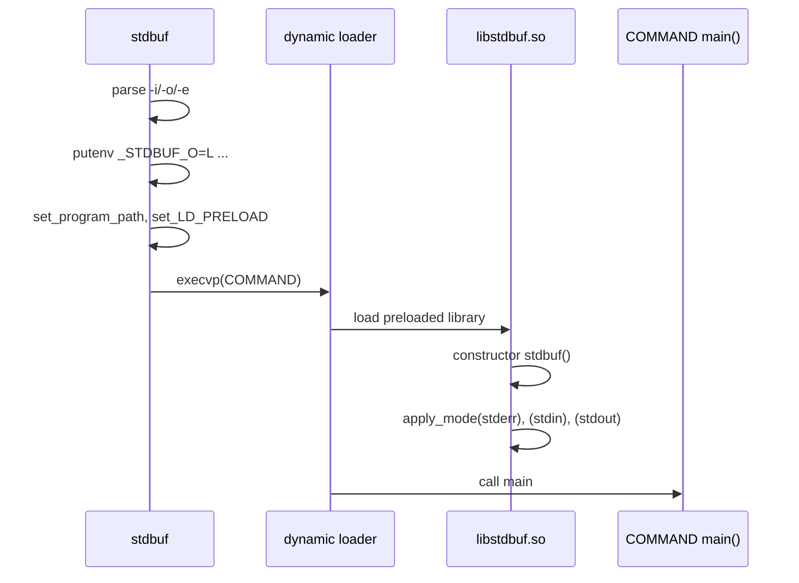

# `stdbuf`: run a command with different stdio buffering

Source: `src/stdbuf.c` (397 lines), `src/libstdbuf.c` (133 lines) · Tests:
`tests/misc/stdbuf.sh` · Manual: `info '(coreutils) stdbuf invocation'`

`stdbuf` cannot change another program's buffers directly. It works in two
parts:

1. `stdbuf` stores the modes you asked for in environment variables
   (`_STDBUF_I`, `_STDBUF_O`, `_STDBUF_E`). It adds `libstdbuf.so` to the
   preload variable and then `exec`s the command.
2. When the command starts, the dynamic loader loads `libstdbuf.so`. Its
   `constructor` function reads the variables and calls `setvbuf()` on
   `stdin`, `stdout` and `stderr` before the command's `main` runs.

So `stdbuf` affects only programs that are dynamically linked, use C stdio,
and do not call `setvbuf` themselves.

## Options

| Option | MODE | Environment variable |
|---|---|---|
| `-i`, `--input=MODE` | `0` or a size. **`L` is rejected** ("line buffering standard input is meaningless"). | `_STDBUF_I` |
| `-o`, `--output=MODE` | `0`, `L` or a size | `_STDBUF_O` |
| `-e`, `--error=MODE` | `0`, `L` or a size | `_STDBUF_E` |

- `0` means unbuffered (`_IONBF`), `L` means line buffered (`_IOLBF`), and
  a size means fully buffered (`_IOFBF`) with that many bytes.
- `parse_size()` (`src/stdbuf.c:66`) calls `xstrtoumax` with the suffixes
  `"EGkKMPQRTYZ0"`. So `1K`, `1KiB` and `1KB` all work. dd's `b`, `c`, `w`
  and `NxM` forms do not.
- The short-option string is `"+i:o:e:"`. The leading `+` stops option
  parsing at the first operand, so options meant for COMMAND are passed to
  it.

## Code map

| Function | Location | Role |
|---|---|---|
| `main` | `src/stdbuf.c:310` | Parse options, set the variables, find the library, `execvp`. |
| `parse_size` | `:66` | Parse a size MODE. |
| `set_libstdbuf_options` | `:276` | `putenv ("_STDBUF_X=MODE")` for each stream given. Returns `false` if no option was given. |
| `set_program_path` | `:133` | Find the directory `stdbuf` was run from: from `argv[0]` if it has a `/`, else `/proc/self/exe`, else a search of `$PATH`. |
| `set_LD_PRELOAD` | `:188` | Find `libstdbuf.so` and add it to the preload variable. |
| `stdbuf` (constructor) | `src/libstdbuf.c:126` | Runs inside the command. Calls `apply_mode` for stderr first (so that it can report errors), then stdin, then stdout. |
| `apply_mode` | `src/libstdbuf.c:71` | Parse one variable and call `setvbuf`. |

## How it works

The sequence diagram shows the two processes. `stdbuf` replaces itself with
COMMAND, so they are really the same process before and after `exec`.



### Finding `libstdbuf.so`

`set_LD_PRELOAD` tries two directories in order (`src/stdbuf.c:218-246`):

1. `program_path`: the directory of the running `stdbuf`. This lets an
   uninstalled build in `src/` find `src/libstdbuf.so`. If this directory
   cannot be found, `PKGLIBDIR` is used.
2. `PKGLIBEXECDIR`: the install location, usually
   `$prefix/libexec/coreutils`.

If the library is not in either place, `stdbuf` exits with status 125
(`failed to find 'libstdbuf.so'`). A comment explains why the system library
path is not searched: then a missing library would not cause an error.

The variable name depends on the platform:

| Platform | Variable | Extra |
|---|---|---|
| macOS | `DYLD_INSERT_LIBRARIES` | It also sets `DYLD_FORCE_FLAT_NAMESPACE=y`. |
| AIX | `LDR_PRELOAD` or `LDR_PRELOAD64` (by pointer size) | |
| Others | `LD_PRELOAD` | |

If the variable already has a value, the library is added to the end
(`old:libstdbuf`).

### `apply_mode` inside the command

```c
if (*mode == '0')
  setvbuf_mode = _IONBF;
else if (*mode == 'L')
  setvbuf_mode = _IOLBF;      /* FIXME: should we allow 1ML  */
else
  {
    setvbuf_mode = _IOFBF;
    ...
    size = strtoul (mode, &mode_end, 10);
    ...
    buf = (... ? malloc (size) : NULL);
```

(`src/libstdbuf.c:81-102`.) For full buffering the library allocates the
buffer itself, and does not pass `NULL` with a size. The long comment at the
top of the file says glibc ignores the size when the buffer is `NULL`.
Errors are printed to stderr and the stream is left unchanged. The library
cannot exit or report a status, because it runs inside someone else's
program.

`libstdbuf.c` does not link gnulib. It `#undef`s `fprintf`, `free`, `malloc`
and `strtoul` so that it calls the real libc functions (`:27-32`). It is
compiled with `-fPIC` and linked with `-shared` (`src/local.mk`).

## Platform notes

- `configure` builds `stdbuf` only if a shared object with
  `__attribute__ ((constructor))` links without warnings, and `$EXEEXT` is
  empty (so not on Windows). See `configure.ac:527-561`.
- It does not work for statically linked programs, set-UID programs (the
  loader ignores `LD_PRELOAD` for them), or programs that do their own I/O
  without stdio. `--help` names `dd` and `cat` as examples of the last kind,
  and `tee` as an example of a program that sets its own buffering.

## Errors and exit status

`main` calls `initialize_exit_failure (EXIT_CANCELED)`, so every error in
`stdbuf` itself exits with status 125. These include a bad MODE, `-iL`, no
mode option, no COMMAND, the library not found, and a failed `putenv`. If
`execvp` fails, the status is 127 when the command was not found (`ENOENT`)
and 126 otherwise. When it succeeds, the exit status is COMMAND's.

## Tests

`tests/misc/stdbuf.sh` checks:

- MODE syntax (`-o1`, `-oK`, `-o0`, `-oL`), and that `-ol`, an overflowing
  size, `-iL` and no mode all give status 125.
- Statuses 126 and 127 for a COMMAND that cannot be run or does not exist.
- Line-buffered and unbuffered output, timed through a FIFO with
  `stdbuf -oL uniq` and `stdbuf -o0 uniq`.
- That it is skipped when the build directory name has characters that
  break `LD_PRELOAD`.

## See also

- [tee](tee.md) and [cat](cat.md). `stdbuf --help` names `tee` as a
  program that sets its own buffering. The current `src/tee.c` actually
  writes with `write()` (`write_wait`) and does not use stdio for its data.
  `cat` does the same. So `stdbuf` has no effect on either of them.
