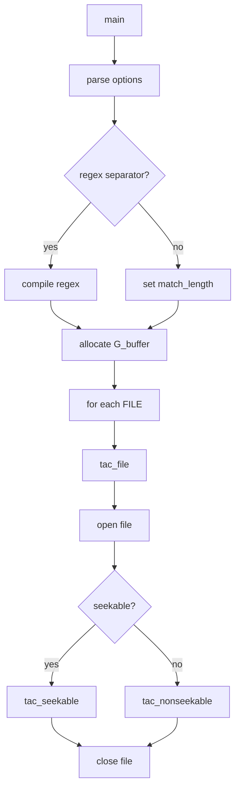

# `tac`: concatenate and print files in reverse

Source: `src/tac.c` (592 lines) · Tests: `tests/tac/` ·
Manual: `info '(coreutils) tac invocation'`

`tac` writes each file to standard output in reverse order by record (line by
default). It reads files backward using `lseek` for seekable files, or buffers
non-seekable input to a temporary file. The separator can be a string or a
regular expression. With `-b`, the separator is attached to the beginning of
each record instead of the end.

## Options

The table lists `longopts[]` (`src/tac.c:102-110`) and the short-option
string `"brs:"`.

|| Option | Variables |
||---|---|
|| `-b`, `--before` | `separator_ends_record = false`: separator before record |
|| `-r`, `--regex` | `sentinel_length = 0`: separator is a regex |
|| `-s STRING`, `--separator=STRING` | `separator`: custom separator string |

## Code map

|| Function | Location | Role |
||---|---|---|
|| `main` | `src/tac.c:491` | Option parsing, compile regex if `-r`, allocate buffer, call `tac_file` for each |
|| `tac_file` | `:451` | Open file, choose `tac_seekable` or `tac_nonseekable` based on seekability |
|| `tac_seekable` | `:190` | Read file backward, find separators, output records |
|| `tac_nonseekable` | `:362` | Buffer to temp file, then read backward |
|| `output` | `:149` | Write buffered output |
|| `save_buffer` | `:167` | Add data to output buffer |
|| `usage` | `:113` | Help message |

## How it works

### Seekable files

`tac_seekable` reads the file backward from the end
(`src/tac.c:190-360`). It:

1. Seeks to near the end, adjusting to a multiple of `read_size`.
2. Scans backward to find the actual end (for proc filesystems).
3. Scans forward to find the end.
4. Reads backward in chunks, searching for the separator.
5. For regex separators, uses `re_search`; for strings, uses direct comparison.
6. When a separator is found, outputs the record.
7. If the search goes off the front of the buffer, reads the previous chunk.

### Non-seekable files

`tac_nonseekable` buffers the entire input to a temporary file
(`src/tac.c:362-449`), then treats it as seekable using `tac_seekable`. The
temp file is created in `$TMPDIR` (default `/tmp`) using `temp_stream`.

### Separator handling

- **String separator:** Uses direct string comparison with `STREQ_LEN`.
- **Regex separator:** Uses `re_search` with the compiled pattern.
- **Separator position:** With `-b`, the separator is printed before the record;
  otherwise, after it.

### Buffer management

`G_buffer` is sized at `read_size * 2 + sentinel_length + 2`
(`src/tac.c:548-561`). This allows room for the current chunk, the next chunk,
and sentinel bytes for boundary matching. The buffer is dynamically expanded
if a record is larger than `read_size`.

## Platform notes

`tac` uses `lseek` for backward reading. Non-seekable input (pipes, terminals)
is buffered to a temporary file. Regex uses POSIX regex functions.

## Errors and exit status

- **Empty separator with regex:** "separator cannot be empty"
- **Regex compilation failure:** Error from `re_compile_pattern`
- **Regex search error:** "error in regular expression search"
- **Record too large:** "record too large"
- **File open failure:** "failed to open FILE for reading"
- **Seek failure:** "FILE: seek failed"
- **Read error:** "FILE: read error"
- **Write error:** From `write_error`

Exit status is 0 on success, 1 on any error.

## Tests

|| File | Covers |
||---|---|
|| `tests/tac/tac.pl` | Basic reverse operations |
|| `tests/tac/tac-continue.sh` | Multiple files |
|| `tests/tac/tac-locale.sh` | Locale-specific behavior |
|| `tests/tac/tac-2-nonseekable.sh` | Non-seekable input handling |

## See also

- [cat](cat.md) for forward concatenation
