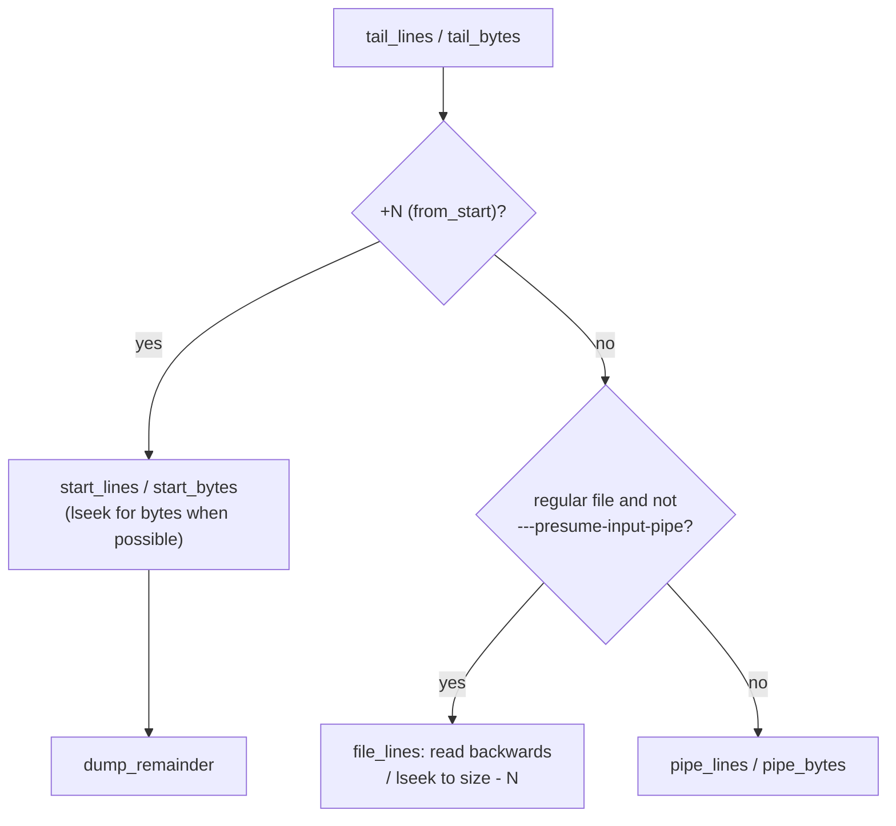
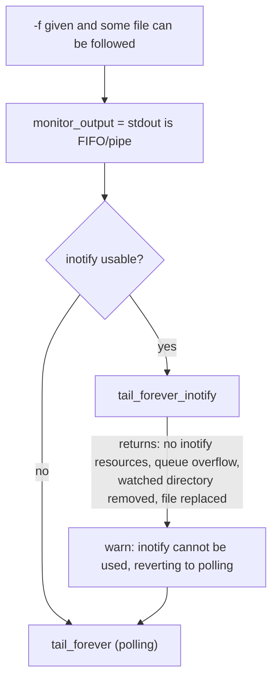

# `tail`: print the last part of files

Source: `src/tail.c` (2596 lines), `src/iopoll.c` · Tests: `tests/tail/`
(about 45 scripts) · Manual: `info '(coreutils) tail invocation'`

`tail` has two jobs:

1. **Print the end of a file** (`-n N`, `-c N`) or everything from a given
   point (`-n +N`). Seekable files are read backwards from the end. Pipes
   are read forward while the last N lines are kept in buffers.
2. **Follow files** (`-f`, `-F`) and print new data as it is written.
   This is the larger and more complex part. On Linux it uses `inotify`
   when it can, and otherwise checks the files with `fstat` at intervals.

## Options

The table lists `long_options[]` (`src/tail.c:252-274`) and the
short-option string `"c:n:fFqs:vz0123456789"`.

| Option | Effect |
|---|---|
| `-n`, `--lines=[+-]N` | Last N lines, or from line N with `+`. The default is 10. |
| `-c`, `--bytes=[+-]N` | The same for bytes. Size suffixes are allowed. |
| `-f`, `--follow[=descriptor\|name]` | `forever = true`. The default is `descriptor` (`DEFAULT_FOLLOW_MODE`). |
| `-F` | `--follow=name --retry`: follow the name and reopen files that are rotated or come back. |
| `--retry` | `reopen_inaccessible_files`: keep trying files that cannot be opened. |
| `-s`, `--sleep-interval=N` | Seconds between polls (a `double`, default 1.0). With `--pid`, the time between checks of the process. |
| `--pid=PID` | Stop following when all the given processes have exited. May be repeated. |
| `--max-unchanged-stats=N` | With `--follow=name` and polling, reopen the name after N checks with no change (default 5). |
| `-q`, `--quiet`, `--silent` / `-v`, `--verbose` | Headers. |
| `-z`, `--zero-terminated` | Lines end with NUL. |
| `--debug` | Print the follow method used: `using notification mode`, `using polling mode` or `using blocking mode`. |
| `---disable-inotify`, `---presume-input-pipe` | Hidden, for tests only. |
| `-N[bcfl]`, `+N[bcfl]` | Obsolete syntax, handled by `parse_obsolete_option`. |

`-n +0` is treated like `-n +1` (`src/tail.c:2441-2444`). If nothing could
ever be printed (`-n 0` without `-f`), `tail` exits at once without opening
any file.

## Code map

| Function | Location | Role |
|---|---|---|
| `main` | `src/tail.c:2404` | Options, call `tail_file` for each file, then choose inotify, polling or blocking for `-f`. |
| `parse_obsolete_option`, `parse_options` | `:2157`, `:2234` | Old and new option syntax. |
| `tail_file` | `:2052` | Open a file, record its state in `struct File_spec`, call `tail`. |
| `tail` → `tail_lines` / `tail_bytes` | `:2043`, `:1998`, `:1915` | Choose the method for each kind of file. |
| `file_lines` | `:542` | Seekable files: read backwards in blocks and count newlines. |
| `pipe_lines` | `:643` | Pipes: a linked list of `BUFSIZ` buffers holding the last N lines. |
| `pipe_bytes` | `:781` | Pipes: hold back the last N bytes. |
| `start_lines`, `start_bytes` | `:919`, `:887` | `+N`: skip N-1 items, then copy the rest. |
| `dump_remainder` | `:491` | Copy from the current position to end of file, or one buffer. |
| `tail_forever` | `:1174` | Polling loop: `fstat` each file, print new data, sleep. |
| `tail_forever_inotify` | `:1514` | inotify loop: watch files (and their directories with `--follow=name`). |
| `recheck` | `:987` | Reopen a name and decide whether it is now a different file. |
| `fremote` | `:957` | Is this file on a network file system? If so, inotify is not used. |
| `check_output_alive`, `die_pipe` | `:388`, `:379` | Stop when the reader of a stdout pipe goes away (uses `iopoll`). |
| `some_writers_exist` | `:1147` | `--pid`: `kill (pid, 0)` on each PID. |
| `struct File_spec` | `:118` | Name, fd, device and inode, mtime, mode, read position, `remote`, `tailable`, `ignore`, inotify watch descriptors. |

## How it works

### Printing the end

The diagram shows how `tail` chooses a method for one file.

`file_lines` reads blocks backwards from the end and counts newlines with
`memrchr`, like `elide_tail_lines_seekable` in `head.c`. A comment
(`src/tail.c:552-559`) explains that the buffer is at least one page. Some
files in `/proc` and `/sys` have a size that is a multiple of the page
size, and they return no data after a seek inside the file.

### Following

After the first output, `main` decides how to follow
(`src/tail.c:2509-2590`):

inotify is **not** used if any of these is true (a long comment at
`:2520-2556` explains each one):

- stdin is being followed (`tailable_stdin`);
- any file is on a remote file system (`fremote` uses `fstatfs` and
  `is_local_fs_type` from `src/fs-is-local.h`, which the build generates
  from the table in `src/stat.c`; unknown types count as remote);
- no open file is local;
- any operand is a symlink (inotify reports events for the target);
- any file is not a regular file or FIFO;
- following by descriptor and some file could not be opened.

**`tail_forever_inotify`** adds a watch for each file with `IN_MODIFY`.
With `--follow=name` it adds `IN_ATTRIB | IN_DELETE_SELF | IN_MOVE_SELF`,
and it also watches each parent directory for `IN_CREATE | IN_DELETE |
IN_MOVED_TO | IN_ATTRIB | IN_DELETE_SELF`, so it notices when a log file is
rotated. It waits with `poll` on the inotify descriptor, and also on
stdout when `monitor_output` is set. With `--pid`, it uses a timeout of
`sleep_interval` so that it can check the processes.

**`tail_forever`** (polling) goes through the files on each pass:

- `fstat` the descriptor. If the mode, size (for regular files) and mtime
  have not changed, it counts an "unchanged" pass. After
  `--max-unchanged-stats` such passes with `--follow=name`, it calls
  `recheck()` to see whether the name now refers to a new file.
- If the size went down, it prints `file truncated` and starts again from
  offset 0.
- It prints new data with `dump_remainder`. On network file systems it
  reads no more than `st_size`, because of a GlusterFS problem described
  in a comment.
- If nothing was read, it sleeps for `sleep_interval`. With `--pid`, it
  stops after one more pass once no writer is left (this avoids a race).

**Blocking mode:** if there is exactly one file, it is not a regular file,
there is no `--pid`, and following is by descriptor, `tail` simply blocks
in `read` (`blocking` in `tail_forever`). Otherwise descriptors are put in
`O_NONBLOCK` mode.

### Stopping when the reader goes away

When stdout is a pipe, `check_output_alive()` calls
`iopoll (-1, STDOUT_FILENO, false)`. If it reports
`IOPOLL_BROKEN_OUTPUT`, `die_pipe()` raises `SIGPIPE`. So
`tail -f log | grep -m1 x` ends when `grep` exits, even if no more data
arrives in the log.

## Errors and exit status

The exit status is 1 if any file could not be read at the start. With
`-f`, `no files remaining` is fatal when every file is gone and `--retry`
was not given. `--follow=name` with `-` is an error (`cannot follow '-' by
name`). Following a terminal on stdin gives a warning, because it cannot
work.

## Tests

The table lists some of the tests.

| File | Covers |
|---|---|
| `tests/tail/tail.pl` | The main table: `-n`, `-c`, `+N`, and the obsolete forms. |
| `tests/tail/tail-c.sh`, `start-middle.sh`, `basic-seek.sh`, `big-4gb.sh` | Seeking and large offsets. |
| `tests/tail/proc-ksyms.sh`, `tail-sysfs.sh` | `/proc` and `/sys` files with size problems. |
| `tests/tail/follow-name.sh`, `F-vs-rename.sh`, `F-vs-missing.sh`, `descriptor-vs-rename.sh` | Following by name and by descriptor across renames. |
| `tests/tail/inotify-*.sh` | inotify races, hash collisions, overflow, rotation and long names. |
| `tests/tail/pid.sh`, `pid-pipe.sh`, `wait.sh` | `--pid`, and leaving when there is nothing to do. |
| `tests/tail/pipe-f.sh`, `pipe-f2.sh` | `-f` on a pipe, and leaving when the reader goes away. |
| `tests/tail/truncate.sh`, `append-only.sh`, `append-to-input.sh` | Truncation, append-only files, and output appended to the input. |
| `tests/tail/debug.sh` | `--debug` messages. |

## See also

- [head](head.md): the reverse operation, with a similar backwards scan.
- [Shared infrastructure](../overview/shared-infrastructure.md#iopollc-noticing-a-closed-reader)
  for `iopoll`.
