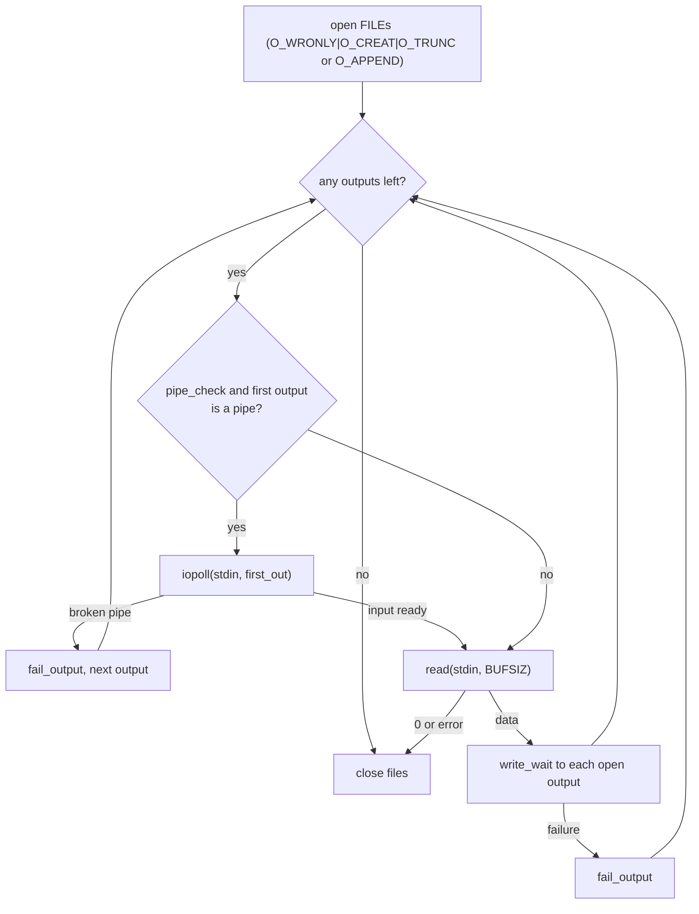

# `tee`: copy standard input to files and standard output

Source: `src/tee.c` (343 lines), `src/iopoll.c` · Tests: `tests/tee/` ·
Manual: `info '(coreutils) tee invocation'`

`tee` reads standard input in `BUFSIZ` blocks and writes each block to
standard output and to every FILE. The interesting part is what happens
when an output fails, especially when it is a pipe whose reader has gone
away. That is controlled by `--output-error` and uses `iopoll.c`.

## Options

The table lists `long_options[]` (`src/tee.c:59-67`) and the short-option
string `"aip"`.

| Option | Effect |
|---|---|
| `-a`, `--append` | Open files with `O_APPEND` in place of `O_TRUNC`. |
| `-i`, `--ignore-interrupts` | `signal (SIGINT, SIG_IGN)`. |
| `-p` | Same as `--output-error=warn-nopipe`. |
| `--output-error[=MODE]` | `warn`, `warn-nopipe`, `exit` or `exit-nopipe`. With no MODE, `warn-nopipe`. |

`-` is a file name, not standard output. POSIX requires this (comment at
`src/tee.c:261`). With no FILE operands, `tee` just copies stdin to stdout.

## Output error modes

`enum output_error` (`src/tee.c:48-55`) has five values. The table shows
how each one handles errors.

| Mode | `SIGPIPE` | Error on a broken pipe (`EPIPE`) | Other write errors | Stop early when every output is a broken pipe |
|---|---|---|---|---|
| (default) `output_error_sigpipe` | default action, so `tee` is killed | - | warn, drop that output, continue | - |
| `warn` | ignored | warn, drop output | warn, drop output | no |
| `warn-nopipe` (`-p`) | ignored | drop output quietly | warn, drop output | yes |
| `exit` | ignored | exit | exit | no |
| `exit-nopipe` | ignored | drop output quietly | exit | yes |

`fail_output()` (`src/tee.c:209-223`) applies these rules. It sets the
descriptor to -1, so later writes skip it. It returns `true` if the error
should make the exit status 1.

## Code map

| Function | Location | Role |
|---|---|---|
| `main` | `src/tee.c:129` | Options, signals, decide `pipe_check`, `tee_files`, close stdin. |
| `tee_files` | `:231` | Open the outputs, then loop: optional `iopoll`, `read`, `write_wait` to each output. |
| `fail_output` | `:209` | Handle one output failure, as in the table above. |
| `get_next_out` | `:197` | Next output that is still open. |

## How it works

The diagram shows the main loop in `tee_files`.



### Noticing a closed reader early

With a `nopipe` mode, `tee` should stop as soon as all its pipe readers
have gone, even if no more input comes. That needs `iopoll`
(`pipe_check`, `src/tee.c:177-179`). It is turned on only when stdin is
something that can block, such as a pipe or terminal. `iopoll_input_ok`
returns false for regular files and block devices, which are always ready.
The loop waits with `iopoll (STDIN_FILENO, descriptors[first_out], true)`.
That returns when input is ready **or** when the first output becomes a
broken pipe. In the second case the output is dropped as if `write` had
failed with `EPIPE`.

Only the first output still open is watched. When it is dropped,
`first_out` moves to the next one.

### Writes

Each block is written with `write_wait()` from `src/iopoll.c`. This is a
`write` loop that handles short writes and, for non-blocking outputs,
waits with `poll` on `EAGAIN`. `tests/tee/write-eagain.sh` and
`short-write.sh` check this. Standard output is always descriptor 0 in the
`descriptors[]` array, and it is not closed by `tee_files`.
`close_stdout` handles it at exit.

## Errors and exit status

The exit status is 1 if any FILE could not be opened, any output failed in
a way that `fail_output` reports, or stdin had a read error. With `exit` or
`exit-nopipe`, the first reported error exits at once.

## Tests

| File | Covers |
|---|---|
| `tests/tee/tee.sh` | Basic copies, `-` as a file name, and `--output-error` modes with broken pipes. |
| `tests/tee/append.sh` | `-a`. |
| `tests/tee/short-write.sh` | Short writes. |
| `tests/tee/write-eagain.sh` | Non-blocking output that returns `EAGAIN`. |

## See also

- [tail](tail.md) also uses `iopoll` to notice a closed reader.
- [Shared infrastructure](../overview/shared-infrastructure.md#iopollc-noticing-a-closed-reader).

## Source code

`src/tee.c:1`

```c
/* tee - read from standard input and write to standard output and files.
   Copyright (C) 1985-2026 Free Software Foundation, Inc.

   This program is free software: you can redistribute it and/or modify
   it under the terms of the GNU General Public License as published by
   the Free Software Foundation, either version 3 of the License, or
   (at your option) any later version.

   This program is distributed in the hope that it will be useful,
   but WITHOUT ANY WARRANTY; without even the implied warranty of
   MERCHANTABILITY or FITNESS FOR A PARTICULAR PURPOSE.  See the
   GNU General Public License for more details.

   You should have received a copy of the GNU General Public License
   along with this program.  If not, see <https://www.gnu.org/licenses/>.  */

/* Mike Parker, Richard M. Stallman, and David MacKenzie */

#include <config.h>
#include <sys/types.h>
#include <signal.h>
#include <getopt.h>

#include "system.h"
#include "argmatch.h"
#include "fadvise.h"
#include "fcntl--.h"
#include "iopoll.h"
#include "xbinary-io.h"
#include "iopoll.h"

/* The official name of this program (e.g., no 'g' prefix).  */
#define PROGRAM_NAME "tee"

#define AUTHORS \
  proper_name ("Mike Parker"), \
  proper_name ("Richard M. Stallman"), \
  proper_name ("David MacKenzie")

static bool tee_files (int nfiles, char **files, bool);

/* If true, append to output files rather than truncating them. */
static bool append;

/* If true, ignore interrupts. */
static bool ignore_interrupts;

enum output_error
  {
    output_error_sigpipe,      /* traditional behavior, sigpipe enabled.  */
    output_error_warn,         /* warn on EPIPE, but continue.  */
    output_error_warn_nopipe,  /* ignore EPIPE, continue.  */
    output_error_exit,         /* exit on any output error.  */
    output_error_exit_nopipe   /* exit on any output error except EPIPE.  */
  };

static enum output_error output_error;

static struct option const long_options[] =
{
  {"append", no_argument, NULL, 'a'},
  {"ignore-interrupts", no_argument, NULL, 'i'},
  {"output-error", optional_argument, NULL, 'p'},
  {GETOPT_HELP_OPTION_DECL},
  {GETOPT_VERSION_OPTION_DECL},
  {NULL, 0, NULL, 0}
};

static char const *const output_error_args[] =
{
  "warn", "warn-nopipe", "exit", "exit-nopipe", NULL
};
static enum output_error const output_error_types[] =
{
  output_error_warn, output_error_warn_nopipe,
  output_error_exit, output_error_exit_nopipe
};
ARGMATCH_VERIFY (output_error_args, output_error_types);

void
usage (int status)
{
  if (status != EXIT_SUCCESS)
    emit_try_help ();
  else
    {
      printf (_("Usage: %s [OPTION]... [FILE]...\n"), program_name);
      fputs (_("\
Copy standard input to each FILE, and also to standard output.\n\
\n\
"), stdout);
      oputs (_("\
  -a, --append\n\
         append to the given FILEs, do not overwrite\n\
"));
      oputs (_("\
  -i, --ignore-interrupts\n\
         ignore interrupt signals\n\
"));
      oputs (_("\
  -p\n\
         operate in a more appropriate MODE with pipes\n\
"));
      oputs (_("\
      --output-error[=MODE]\n\
         set behavior on write error.  See MODE below\n\
"));
      oputs (HELP_OPTION_DESCRIPTION);
      oputs (VERSION_OPTION_DESCRIPTION);
      fputs (_("\
\n\
MODE determines behavior with write errors on the outputs:\n\
  warn           diagnose errors writing to any output\n\
  warn-nopipe    diagnose errors writing to any output not a pipe\n\
  exit           exit on error writing to any output\n\
  exit-nopipe    exit on error writing to any output not a pipe\n\
The default MODE for the -p option is 'warn-nopipe'.\n\
With \"nopipe\" MODEs, exit immediately if all outputs become broken pipes.\n\
The default operation when --output-error is not specified, is to\n\
exit immediately on error writing to a pipe, and diagnose errors\n\
writing to non pipe outputs.\n\
"), stdout);
      emit_ancillary_info (PROGRAM_NAME);
    }
  exit (status);
}

int
main (int argc, char **argv)
{
  initialize_main (&argc, &argv);
  set_program_name (argv[0]);
  setlocale (LC_ALL, "");
  bindtextdomain (PACKAGE, LOCALEDIR);
  textdomain (PACKAGE);

  atexit (close_stdout);

  int optc;
  while ((optc = getopt_long (argc, argv, "aip", long_options, NULL)) != -1)
    {
      switch (optc)
        {
        case 'a':
          append = true;
          break;

        case 'i':
          ignore_interrupts = true;
          break;

        case 'p':
          if (optarg)
            output_error = XARGMATCH ("--output-error", optarg,
                                      output_error_args, output_error_types);
          else
            output_error = output_error_warn_nopipe;
          break;

        case_GETOPT_HELP_CHAR;

        case_GETOPT_VERSION_CHAR (PROGRAM_NAME, AUTHORS);

        default:
          usage (EXIT_FAILURE);
        }
    }

  if (ignore_interrupts)
    signal (SIGINT, SIG_IGN);

  if (output_error != output_error_sigpipe)
    signal (SIGPIPE, SIG_IGN);

  /* Whether to detect and close a broken pipe output.
     There is no need if the input is always ready for reading.  */
  bool pipe_check = ((output_error == output_error_warn_nopipe
                      || output_error == output_error_exit_nopipe)
                     && iopoll_input_ok (STDIN_FILENO));

  /* Do *not* warn if tee is given no file arguments.
     POSIX requires that it work when given no arguments.  */

  bool ok = tee_files (argc - optind, &argv[optind], pipe_check);
  if (close (STDIN_FILENO) != 0)
    error (EXIT_FAILURE, errno, "%s", _("standard input"));

  return ok ? EXIT_SUCCESS : EXIT_FAILURE;
}


/* Return the index of the first non-null descriptor after idx,
   or -1 if all are null.  */

ATTRIBUTE_PURE
static int
get_next_out (int *descriptors, int nfiles, int idx)
{
  for (idx++; idx <= nfiles; idx++)
    if (0 <= descriptors[idx])
      return idx;
  return -1;  /* no outputs remaining */
}

/* Remove descriptors[i] due to write failure or broken pipe.
   Return true if this indicates a reportable error.  */

static bool
fail_output (int *descriptors, char **files, int i)
{
  int w_errno = errno;
  bool fail = errno != EPIPE
              || output_error == output_error_exit
              || output_error == output_error_warn;
  if (fail)
    {
      error (output_error == output_error_exit
             || output_error == output_error_exit_nopipe,
             w_errno, "%s", quotef (files[i]));
    }
  descriptors[i] = -1;
  return fail;
}


/* Copy the standard input into each of the NFILES files in FILES
   and into the standard output.  As a side effect, modify FILES[-1].
   Return true if successful.  */

static bool
tee_files (int nfiles, char **files, bool pipe_check)
{
  size_t n_outputs = 0;
  int *descriptors;
  bool *out_pollable IF_LINT ( = NULL);
  char buffer[BUFSIZ];
  ssize_t bytes_read = 0;
  int first_out = 0;  /* idx of first non-null output in descriptors */
  bool ok = true;
  int flags = O_WRONLY | O_CREAT | O_BINARY | (append ? O_APPEND : O_TRUNC);

  xset_binary_mode (STDIN_FILENO, O_BINARY);
  xset_binary_mode (STDOUT_FILENO, O_BINARY);
  fadvise (stdin, FADVISE_SEQUENTIAL);

  /* Set up FILES[0 .. NFILES] and DESCRIPTORS[0 .. NFILES].
     In both arrays, entry 0 corresponds to standard output.  */

  descriptors = xnmalloc (nfiles + 1, sizeof *descriptors);
  if (pipe_check)
    out_pollable = xnmalloc (nfiles + 1, sizeof *out_pollable);
  files--;
  descriptors[0] = STDOUT_FILENO;
  if (pipe_check)
    out_pollable[0] = iopoll_output_ok (descriptors[0]);
  files[0] = bad_cast (_("standard output"));
  n_outputs++;

  for (int i = 1; i <= nfiles; i++)
    {
      /* Do not treat "-" specially - as mandated by POSIX.  */
      descriptors[i] = open (files[i], flags, MODE_RW_UGO);
      if (descriptors[i] < 0)
        {
          if (pipe_check)
            out_pollable[i] = false;
          error (output_error == output_error_exit
                 || output_error == output_error_exit_nopipe,
                 errno, "%s", quotef (files[i]));
          ok = false;
        }
      else
        {
          if (pipe_check)
            out_pollable[i] = iopoll_output_ok (descriptors[i]);
          n_outputs++;
        }
    }

  while (n_outputs)
    {
      if (pipe_check && out_pollable[first_out])
        {
          /* Monitor for input, or errors on first valid output.  */
          int err = iopoll (STDIN_FILENO, descriptors[first_out], true);

          /* Close the output if it became a broken pipe.  */
          if (err == IOPOLL_BROKEN_OUTPUT)
            {
              errno = EPIPE;  /* behave like write produced EPIPE */
              if (fail_output (descriptors, files, first_out))
                ok = false;
              n_outputs--;
              first_out = get_next_out (descriptors, nfiles, first_out);
              continue;
            }
          else if (err == IOPOLL_ERROR)
            {
              error (0, errno, _("iopoll error"));
              ok = false;
            }
        }

      bytes_read = read (STDIN_FILENO, buffer, sizeof buffer);
      if (bytes_read < 0 && errno == EINTR)
        continue;
      if (bytes_read <= 0)
        break;

      /* Write to all NFILES + 1 descriptors.
         Standard output is the first one.  */
      for (int i = 0; i <= nfiles; i++)
        if (0 <= descriptors[i]
            && ! write_wait (descriptors[i], buffer, bytes_read))
          {
            if (fail_output (descriptors, files, i))
              ok = false;
            n_outputs--;
            if (i == first_out)
              first_out = get_next_out (descriptors, nfiles, first_out);
          }
    }

  if (bytes_read == -1)
    {
      error (0, errno, _("read error"));
      ok = false;
    }

  /* Close the files, but not standard output.  */
  for (int i = 1; i <= nfiles; i++)
    if (0 <= descriptors[i] && close (descriptors[i]) < 0)
      {
        error (0, errno, "%s", quotef (files[i]));
        ok = false;
      }

  free (descriptors);
  if (pipe_check)
    free (out_pollable);

  return ok;
}
```
