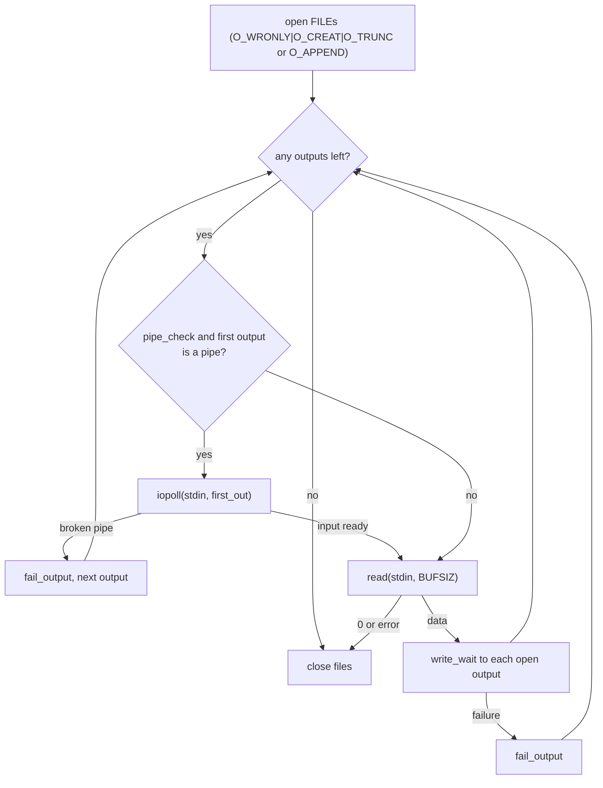

# `tee`: copy standard input to files and standard output

Source: `src/tee.c` (343 lines), `src/iopoll.c` · Tests: `tests/tee/` ·
Manual: `info '(coreutils) tee invocation'`

`tee` reads standard input in `BUFSIZ` blocks and writes each block to
standard output and to every FILE. The interesting part is what happens
when an output fails, especially when it is a pipe whose reader has gone
away. That is controlled by `--output-error` and uses `iopoll.c`.

## Options

The table lists `long_options[]` (`src/tee.c:59-67`) and the short-option
string `"aip"`.

| Option | Effect |
|---|---|
| `-a`, `--append` | Open files with `O_APPEND` in place of `O_TRUNC`. |
| `-i`, `--ignore-interrupts` | `signal (SIGINT, SIG_IGN)`. |
| `-p` | Same as `--output-error=warn-nopipe`. |
| `--output-error[=MODE]` | `warn`, `warn-nopipe`, `exit` or `exit-nopipe`. With no MODE, `warn-nopipe`. |

`-` is a file name, not standard output. POSIX requires this (comment at
`src/tee.c:261`). With no FILE operands, `tee` just copies stdin to stdout.

## Output error modes

`enum output_error` (`src/tee.c:48-55`) has five values. The table shows
how each one handles errors.

| Mode | `SIGPIPE` | Error on a broken pipe (`EPIPE`) | Other write errors | Stop early when every output is a broken pipe |
|---|---|---|---|---|
| (default) `output_error_sigpipe` | default action, so `tee` is killed | - | warn, drop that output, continue | - |
| `warn` | ignored | warn, drop output | warn, drop output | no |
| `warn-nopipe` (`-p`) | ignored | drop output quietly | warn, drop output | yes |
| `exit` | ignored | exit | exit | no |
| `exit-nopipe` | ignored | drop output quietly | exit | yes |

`fail_output()` (`src/tee.c:209-223`) applies these rules. It sets the
descriptor to -1, so later writes skip it. It returns `true` if the error
should make the exit status 1.

## Code map

| Function | Location | Role |
|---|---|---|
| `main` | `src/tee.c:129` | Options, signals, decide `pipe_check`, `tee_files`, close stdin. |
| `tee_files` | `:231` | Open the outputs, then loop: optional `iopoll`, `read`, `write_wait` to each output. |
| `fail_output` | `:209` | Handle one output failure, as in the table above. |
| `get_next_out` | `:197` | Next output that is still open. |

## How it works

The diagram shows the main loop in `tee_files`.

### Noticing a closed reader early

With a `nopipe` mode, `tee` should stop as soon as all its pipe readers
have gone, even if no more input comes. That needs `iopoll`
(`pipe_check`, `src/tee.c:177-179`). It is turned on only when stdin is
something that can block, such as a pipe or terminal. `iopoll_input_ok`
returns false for regular files and block devices, which are always ready.
The loop waits with `iopoll (STDIN_FILENO, descriptors[first_out], true)`.
That returns when input is ready **or** when the first output becomes a
broken pipe. In the second case the output is dropped as if `write` had
failed with `EPIPE`.

Only the first output still open is watched. When it is dropped,
`first_out` moves to the next one.

### Writes

Each block is written with `write_wait()` from `src/iopoll.c`. This is a
`write` loop that handles short writes and, for non-blocking outputs,
waits with `poll` on `EAGAIN`. `tests/tee/write-eagain.sh` and
`short-write.sh` check this. Standard output is always descriptor 0 in the
`descriptors[]` array, and it is not closed by `tee_files`.
`close_stdout` handles it at exit.

## Errors and exit status

The exit status is 1 if any FILE could not be opened, any output failed in
a way that `fail_output` reports, or stdin had a read error. With `exit` or
`exit-nopipe`, the first reported error exits at once.

## Tests

| File | Covers |
|---|---|
| `tests/tee/tee.sh` | Basic copies, `-` as a file name, and `--output-error` modes with broken pipes. |
| `tests/tee/append.sh` | `-a`. |
| `tests/tee/short-write.sh` | Short writes. |
| `tests/tee/write-eagain.sh` | Non-blocking output that returns `EAGAIN`. |

## See also

- [tail](tail.md) also uses `iopoll` to notice a closed reader.
- [Shared infrastructure](../overview/shared-infrastructure.md#iopollc-noticing-a-closed-reader).
