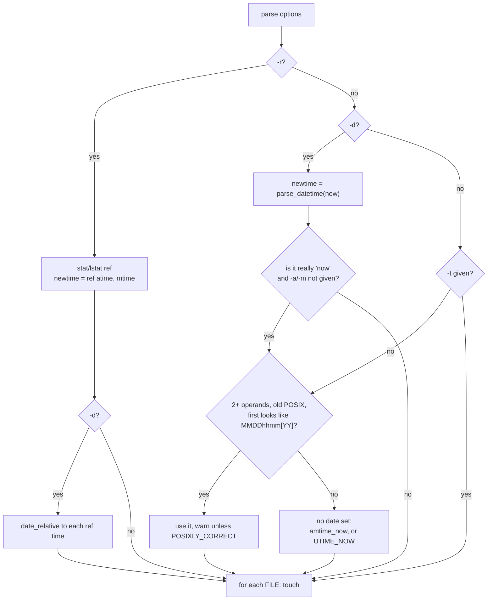

# `touch`: change file timestamps

Source: `src/touch.c` (451 lines) · Tests: `tests/touch/` · Manual:
`info '(coreutils) touch invocation'`

`touch` sets the access time and modification time of each FILE, and
creates the file if it does not exist. Most of `main` decides where the new
times come from: now, `-d`, `-t`, `-r`, or the obsolete `MMDDhhmm[YY]`
operand. The real work is one call to gnulib `fdutimensat()` for each file.

## Options

The table lists `longopts[]` (`src/touch.c:82-92`) and the short-option
string `"acd:fhmr:t:"`.

| Option | Effect |
|---|---|
| `-a`, `--time=atime\|access\|use` | `change_times \|= CH_ATIME`. |
| `-m`, `--time=mtime\|modify` | `change_times \|= CH_MTIME`. If neither `-a` nor `-m` is given, both are changed. |
| `-c`, `--no-create` | Do not create missing files, and do not report them. |
| `-d`, `--date=STRING` | Parse STRING with gnulib `parse_datetime` (the same parser as `date -d`). |
| `-t STAMP` | `[[CC]YY]MMDDhhmm[.ss]`, parsed with `posixtime`. Seconds may be `60`. |
| `-r`, `--reference=FILE` | Use FILE's times. With `-d`, the date is relative to FILE's times. |
| `-h`, `--no-dereference` | Change a symlink itself (`AT_SYMLINK_NOFOLLOW`). `touch` then does not create files, and a missing file is an error unless `-c` is also given. |
| `-f` | Ignored, for compatibility. |

`-t` cannot be combined with `-r` or `-d` ("cannot specify times from more
than one source").

## Code map

| Function | Location | Role |
|---|---|---|
| `main` | `src/touch.c:277` | Options, work out `newtime[2]`, call `touch` for each operand. |
| `touch` | `:121` | Open or create the file, then call `fdutimensat`, then choose the error message. |
| `date_relative` | `:109` | `parse_datetime` relative to a base time. Exits on a bad date. |

## How it works

The diagram shows how `main` chooses the time source.



### Setting the times for one file

`touch()` (`src/touch.c:121-207`):

1. If the operand is `-`, it uses standard output (`fd = STDOUT_FILENO`).
   This changes the times of whatever file stdout is open on.
2. Otherwise, unless `-c` or `-h` was given, it opens the file **on
   descriptor 0** with `fd_reopen (STDIN_FILENO, file, O_WRONLY | O_CREAT |
   O_NONBLOCK | O_NOCTTY, MODE_RW_UGO)`. `O_NONBLOCK` means a FIFO does not
   block (`tests/touch/fifo.sh`). If the open fails, the code saves `errno`
   and carries on, because the times may still be set by name.
3. If only one time is changing, the other is set to `UTIME_OMIT`.
4. It calls `fdutimensat (fd, AT_FDCWD, file, t, atflag)`. gnulib uses
   `futimens` when it has a descriptor and `utimensat` when it does not.

### Why "now" is special

POSIX allows any user with write permission to set a file's times to the
current time, by passing `NULL` as the times. Only the owner may set an
exact time. So when no time source was given and both times are changing,
`main` sets `amtime_now`, and `touch()` passes `t = NULL`.

`-d now` gets the same treatment. `main` checks that the string really
means "now" and is not a date that happens to equal the current time. It
parses the string again relative to `now.tv_sec ^ 1` and checks that the
result moved with the base time (`src/touch.c:384-398`).
`tests/touch/now-owned-by-other.sh` shows that this matters.

### Error messages

When `fdutimensat` fails, the message depends on whether the open failed
too:

- The open failed for a reason other than "this is a directory": `cannot
  touch 'f'`, with the open error. This covers a file that cannot be
  written and a parent directory that cannot be written.
- Otherwise: `setting times of 'f'`. With `-c`, `ENOENT` is not an error.

The directory check knows about several platforms. Opening a directory
gives `EISDIR` on Linux, `EINVAL` on Solaris and `EEXIST` for `/` on
macOS 26 (comment at `src/touch.c:179-184`).

### Obsolete timestamp operand

`touch 01011200 file` means `touch -t 01011200 file` only when all three of
these are true: there are at least two operands, `_POSIX2_VERSION` is older
than 200112, and no other time was given. Unless `POSIXLY_CORRECT` is set,
`touch` warns and shows the `-t` form to use.

## Errors and exit status

Each FILE is handled separately. Any failure makes the exit status 1. A bad
`-d`, `-t` or `--time` value, or a reference file that cannot be read, is
fatal at once.

## Tests

| File | Covers |
|---|---|
| `tests/touch/no-create-missing.sh` | `-c` on a missing file succeeds. |
| `tests/touch/dangling-symlink.sh`, `no-dereference.sh` | Create through a dangling link, and `-h`. |
| `tests/touch/dir-1.sh`, `trailing-slash.sh` | Directories, and `file/` on a non-directory. |
| `tests/touch/fifo.sh` | No hang on a FIFO. |
| `tests/touch/read-only.sh`, `no-rights.sh`, `not-owner.sh`, `now-owned-by-other.sh` | The rules about permission and ownership. |
| `tests/touch/fail-diag.sh` | Error message wording. |
| `tests/touch/relative.sh` | `-r` with `-d`. |
| `tests/touch/obsolescent.sh`, `60-seconds.sh` | Old 8- and 10-digit operands, and `.60` seconds. |
| `tests/touch/empty-file.sh` | Setting the time of an empty file. |

## See also

- [date](date.md) uses the same `parse_datetime` for `-d`.
- [stat](stat.md) shows the timestamps that `touch` sets.

## Source code

`src/touch.c:1`

```c
/* touch -- change modification and access times of files
   Copyright (C) 1987-2026 Free Software Foundation, Inc.

   This program is free software: you can redistribute it and/or modify
   it under the terms of the GNU General Public License as published by
   the Free Software Foundation, either version 3 of the License, or
   (at your option) any later version.

   This program is distributed in the hope that it will be useful,
   but WITHOUT ANY WARRANTY; without even the implied warranty of
   MERCHANTABILITY or FITNESS FOR A PARTICULAR PURPOSE.  See the
   GNU General Public License for more details.

   You should have received a copy of the GNU General Public License
   along with this program.  If not, see <https://www.gnu.org/licenses/>.  */

/* Written by Paul Rubin, Arnold Robbins, Jim Kingdon, David MacKenzie,
   and Randy Smith. */

#include <config.h>
#include <stdio.h>
#include <getopt.h>
#include <sys/types.h>

#include "system.h"
#include "argmatch.h"
#include "assure.h"
#include "fd-reopen.h"
#include "parse-datetime.h"
#include "posixtm.h"
#include "posixver.h"
#include "quote.h"
#include "stat-time.h"
#include "utimens.h"

/* The official name of this program (e.g., no 'g' prefix).  */
#define PROGRAM_NAME "touch"

#define AUTHORS \
  proper_name ("Paul Rubin"), \
  proper_name ("Arnold Robbins"), \
  proper_name ("Jim Kingdon"), \
  proper_name ("David MacKenzie"), \
  proper_name ("Randy Smith")

/* Bitmasks for 'change_times'. */
#define CH_ATIME 1
#define CH_MTIME 2

/* Which timestamps to change. */
static int change_times;

/* (-c) If true, don't create if not already there.  */
static bool no_create;

/* (-r) If true, use times from a reference file.  */
static bool use_ref;

/* (-h) If true, change the times of an existing symlink, if possible.  */
static bool no_dereference;

/* If true, the only thing we have to do is change both the
   modification and access time to the current time, so we don't
   have to own the file, just be able to read and write it.
   On some systems, we can do this if we own the file, even though
   we have neither read nor write access to it.  */
static bool amtime_now;

/* New access and modification times to use when setting time.  */
static struct timespec newtime[2];

/* File to use for -r. */
static char *ref_file;

/* For long options that have no equivalent short option, use a
   non-character as a pseudo short option, starting with CHAR_MAX + 1.  */
enum
{
  TIME_OPTION = CHAR_MAX + 1
};

static struct option const longopts[] =
{
  {"time", required_argument, NULL, TIME_OPTION},
  {"no-create", no_argument, NULL, 'c'},
  {"date", required_argument, NULL, 'd'},
  {"reference", required_argument, NULL, 'r'},
  {"no-dereference", no_argument, NULL, 'h'},
  {GETOPT_HELP_OPTION_DECL},
  {GETOPT_VERSION_OPTION_DECL},
  {NULL, 0, NULL, 0}
};

/* Valid arguments to the '--time' option. */
static char const *const time_args[] =
{
  "atime", "access", "use", "mtime", "modify", NULL
};

/* The bits in 'change_times' that those arguments set. */
static int const time_masks[] =
{
  CH_ATIME, CH_ATIME, CH_ATIME, CH_MTIME, CH_MTIME
};

/* The interpretation of FLEX_DATE as a date, relative to NOW.  */

static struct timespec
date_relative (char const *flex_date, struct timespec now)
{
  struct timespec result;
  if (! parse_datetime (&result, flex_date, &now))
    error (EXIT_FAILURE, 0, _("invalid date format %s"), quote (flex_date));
  return result;
}

/* Update the time of file FILE according to the options given.
   Return true if successful.  */

static bool
touch (char const *file)
{
  int fd = -1;
  int open_errno = 0;
  struct timespec const *t = newtime;

  if (streq (file, "-"))
    fd = STDOUT_FILENO;
  else if (! (no_create || no_dereference))
    {
      /* Try to open FILE, creating it if necessary.  */
      fd = fd_reopen (STDIN_FILENO, file,
                      O_WRONLY | O_CREAT | O_NONBLOCK | O_NOCTTY, MODE_RW_UGO);
      if (fd < 0)
        open_errno = errno;
    }

  if (change_times != (CH_ATIME | CH_MTIME))
    {
      /* We're setting only one of the time values.  */
      if (change_times == CH_MTIME)
        newtime[0].tv_nsec = UTIME_OMIT;
      else
        {
          affirm (change_times == CH_ATIME);
          newtime[1].tv_nsec = UTIME_OMIT;
        }
    }

  if (amtime_now)
    {
      /* Pass NULL to futimens so it will not fail if we have
         write access to the file, but don't own it.  */
      t = NULL;
    }

  char const *file_opt = fd == STDOUT_FILENO ? NULL : file;
  int atflag = no_dereference ? AT_SYMLINK_NOFOLLOW : 0;
  int utime_errno = (fdutimensat (fd, AT_FDCWD, file_opt, t, atflag) == 0
                     ? 0 : errno);

  if (fd == STDIN_FILENO)
    {
      if (close (STDIN_FILENO) != 0)
        {
          error (0, errno, _("failed to close %s"), quoteaf (file));
          return false;
        }
    }
  else if (fd == STDOUT_FILENO)
    {
      /* Do not diagnose "touch -c - >&-".  */
      if (utime_errno == EBADF && no_create)
        return true;
    }

  if (utime_errno != 0)
    {
      /* Don't diagnose with open_errno if FILE is a directory, as that
         would give a bogus diagnostic for e.g., 'touch /' (assuming we
         don't own / or have write access).  On Solaris 10 and probably
         other systems, opening a directory like "." fails with EINVAL.
         (On SunOS 4 it was EPERM but that's obsolete.)  On macOS 26
         opening "/" fails with EEXIST.  */
      struct stat st;
      if (open_errno
          && ! (open_errno == EISDIR
                || ((open_errno == EINVAL || open_errno == EEXIST)
                    && stat (file, &st) == 0 && S_ISDIR (st.st_mode))))
        {
          /* The wording of this diagnostic should cover at least two cases:
             - the file does not exist, but the parent directory is unwritable
             - the file exists, but it isn't writable
             I think it's not worth trying to distinguish them.  */
          error (0, open_errno, _("cannot touch %s"), quoteaf (file));
        }
      else
        {
          if (no_create && utime_errno == ENOENT)
            return true;
          error (0, utime_errno, _("setting times of %s"), quoteaf (file));
        }
      return false;
    }

  return true;
}

void
usage (int status)
{
  if (status != EXIT_SUCCESS)
    emit_try_help ();
  else
    {
      printf (_("Usage: %s [OPTION]... FILE...\n"), program_name);
      fputs (_("\
Update the access and modification times of each FILE to the current time.\n\
\n\
A FILE argument that does not exist is created empty, unless -c or -h\n\
is supplied.\n\
\n\
A FILE argument string of - is handled specially and causes touch to\n\
change the times of the file associated with standard output.\n\
"), stdout);

      emit_mandatory_arg_note ();

      oputs (_("\
  -a\n\
         change only the access time\n\
"));
      oputs (_("\
  -c, --no-create\n\
         do not create any files\n\
"));
      oputs (_("\
  -d, --date=STRING\n\
         parse STRING and use it instead of current time\n\
"));
      oputs (_("\
  -f\n\
         (ignored)\n\
"));
      oputs (_("\
  -h, --no-dereference\n\
         affect each symbolic link instead of any referenced file;\n\
         useful only on systems that can change the timestamps of a symlink\n\
"));
      oputs (_("\
  -m\n\
         change only the modification time\n\
"));
      oputs (_("\
  -r, --reference=FILE\n\
         use this file's times instead of current time\n\
"));
      oputs (_("\
  -t [[CC]YY]MMDDhhmm[.ss]\n\
         use specified time instead of current time,\n\
         with a date-time format that differs from -d's\n\
"));
      oputs (_("\
      --time=WORD\n\
         specify which time to change:\n\
         access time (-a): 'access', 'atime', 'use';\n\
         modification time (-m): 'modify', 'mtime'\n\
"));
      oputs (HELP_OPTION_DESCRIPTION);
      oputs (VERSION_OPTION_DESCRIPTION);
      emit_ancillary_info (PROGRAM_NAME);
    }
  exit (status);
}

int
main (int argc, char **argv)
{
  bool date_set = false;
  char const *flex_date = NULL;

  initialize_main (&argc, &argv);
  set_program_name (argv[0]);
  setlocale (LC_ALL, "");
  bindtextdomain (PACKAGE, LOCALEDIR);
  textdomain (PACKAGE);

  atexit (close_stdout);

  int c;
  while ((c = getopt_long (argc, argv, "acd:fhmr:t:", longopts, NULL)) != -1)
    {
      switch (c)
        {
        case 'a':
          change_times |= CH_ATIME;
          break;

        case 'c':
          no_create = true;
          break;

        case 'd':
          flex_date = optarg;
          break;

        case 'f':
          break;

        case 'h':
          no_dereference = true;
          break;

        case 'm':
          change_times |= CH_MTIME;
          break;

        case 'r':
          use_ref = true;
          ref_file = optarg;
          break;

        case 't':
          if (! posixtime (&newtime[0].tv_sec, optarg,
                           PDS_LEADING_YEAR | PDS_CENTURY | PDS_SECONDS))
            error (EXIT_FAILURE, 0, _("invalid date format %s"),
                   quote (optarg));
          newtime[0].tv_nsec = 0;
          newtime[1] = newtime[0];
          date_set = true;
          break;

        case TIME_OPTION:	/* --time */
          change_times |= XARGMATCH ("--time", optarg,
                                     time_args, time_masks);
          break;

        case_GETOPT_HELP_CHAR;

        case_GETOPT_VERSION_CHAR (PROGRAM_NAME, AUTHORS);

        default:
          usage (EXIT_FAILURE);
        }
    }

  if (change_times == 0)
    change_times = CH_ATIME | CH_MTIME;

  if (date_set && (use_ref || flex_date))
    {
      error (0, 0, _("cannot specify times from more than one source"));
      usage (EXIT_FAILURE);
    }

  if (use_ref)
    {
      struct stat ref_stats;
      /* Don't use (no_dereference?lstat:stat) (args), since stat
         might be an object-like macro.  */
      if (no_dereference ? lstat (ref_file, &ref_stats)
          : stat (ref_file, &ref_stats))
        error (EXIT_FAILURE, errno,
               _("failed to get attributes of %s"), quoteaf (ref_file));
      newtime[0] = get_stat_atime (&ref_stats);
      newtime[1] = get_stat_mtime (&ref_stats);
      date_set = true;
      if (flex_date)
        {
          if (change_times & CH_ATIME)
            newtime[0] = date_relative (flex_date, newtime[0]);
          if (change_times & CH_MTIME)
            newtime[1] = date_relative (flex_date, newtime[1]);
        }
    }
  else
    {
      if (flex_date)
        {
          struct timespec now = current_timespec ();
          newtime[1] = newtime[0] = date_relative (flex_date, now);
          date_set = true;

          /* If neither -a nor -m is specified, treat "-d now" as if
             it were absent; this lets "touch" succeed more often in
             the presence of restrictive permissions.  */
          if (change_times == (CH_ATIME | CH_MTIME)
              && timespec_cmp (newtime[0], now) == 0)
            {
              /* Check that it really was "-d now", and not a timestamp
                 that just happens to be the current time.  */
              struct timespec notnow, notnow1;
              notnow.tv_sec = now.tv_sec ^ 1;
              notnow.tv_nsec = now.tv_nsec;
              notnow1 = date_relative (flex_date, notnow);
              if (timespec_cmp (notnow1, notnow) == 0)
                date_set = false;
            }
        }
    }

  /* The obsolete 'MMDDhhmm[YY]' form is valid IFF there are
     two or more non-option arguments.  */
  if (!date_set && 2 <= argc - optind && posix2_version () < 200112
      && posixtime (&newtime[0].tv_sec, argv[optind],
                    PDS_TRAILING_YEAR | PDS_PRE_2000))
    {
      newtime[0].tv_nsec = 0;
      newtime[1] = newtime[0];
      date_set = true;

      if (! getenv ("POSIXLY_CORRECT"))
        {
          struct tm const *tm = localtime (&newtime[0].tv_sec);

          /* Technically, it appears that even a deliberate attempt to cause
             the above localtime to return NULL will always fail because our
             posixtime implementation rejects all dates for which localtime
             would fail.  However, skip the warning if it ever fails.  */
          if (tm)
            error (0, 0,
                   _("warning: 'touch %s' is obsolete; use "
                     "'touch -t %04ld%02d%02d%02d%02d.%02d'"),
                   argv[optind],
                   tm->tm_year + 1900L, tm->tm_mon + 1, tm->tm_mday,
                   tm->tm_hour, tm->tm_min, tm->tm_sec);
        }

      optind++;
    }

  if (!date_set)
    {
      if (change_times == (CH_ATIME | CH_MTIME))
        amtime_now = true;
      else
        newtime[1].tv_nsec = newtime[0].tv_nsec = UTIME_NOW;
    }

  if (optind == argc)
    {
      error (0, 0, _("missing file operand"));
      usage (EXIT_FAILURE);
    }

  bool ok = true;
  for (; optind < argc; ++optind)
    ok &= touch (argv[optind]);

  return ok ? EXIT_SUCCESS : EXIT_FAILURE;
}
```
