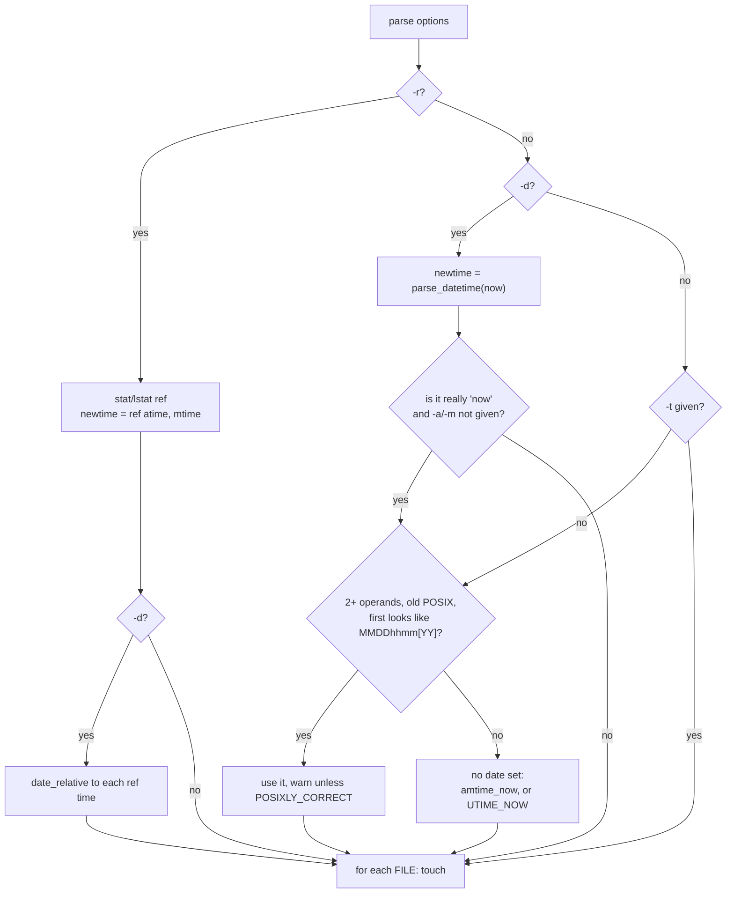

# `touch`: change file timestamps

Source: `src/touch.c` (451 lines) · Tests: `tests/touch/` · Manual:
`info '(coreutils) touch invocation'`

`touch` sets the access time and modification time of each FILE, and
creates the file if it does not exist. Most of `main` decides where the new
times come from: now, `-d`, `-t`, `-r`, or the obsolete `MMDDhhmm[YY]`
operand. The real work is one call to gnulib `fdutimensat()` for each file.

## Options

The table lists `longopts[]` (`src/touch.c:82-92`) and the short-option
string `"acd:fhmr:t:"`.

| Option | Effect |
|---|---|
| `-a`, `--time=atime\|access\|use` | `change_times \|= CH_ATIME`. |
| `-m`, `--time=mtime\|modify` | `change_times \|= CH_MTIME`. If neither `-a` nor `-m` is given, both are changed. |
| `-c`, `--no-create` | Do not create missing files, and do not report them. |
| `-d`, `--date=STRING` | Parse STRING with gnulib `parse_datetime` (the same parser as `date -d`). |
| `-t STAMP` | `[[CC]YY]MMDDhhmm[.ss]`, parsed with `posixtime`. Seconds may be `60`. |
| `-r`, `--reference=FILE` | Use FILE's times. With `-d`, the date is relative to FILE's times. |
| `-h`, `--no-dereference` | Change a symlink itself (`AT_SYMLINK_NOFOLLOW`). `touch` then does not create files, and a missing file is an error unless `-c` is also given. |
| `-f` | Ignored, for compatibility. |

`-t` cannot be combined with `-r` or `-d` ("cannot specify times from more
than one source").

## Code map

| Function | Location | Role |
|---|---|---|
| `main` | `src/touch.c:277` | Options, work out `newtime[2]`, call `touch` for each operand. |
| `touch` | `:121` | Open or create the file, then call `fdutimensat`, then choose the error message. |
| `date_relative` | `:109` | `parse_datetime` relative to a base time. Exits on a bad date. |

## How it works

The diagram shows how `main` chooses the time source.

### Setting the times for one file

`touch()` (`src/touch.c:121-207`):

1. If the operand is `-`, it uses standard output (`fd = STDOUT_FILENO`).
   This changes the times of whatever file stdout is open on.
2. Otherwise, unless `-c` or `-h` was given, it opens the file **on
   descriptor 0** with `fd_reopen (STDIN_FILENO, file, O_WRONLY | O_CREAT |
   O_NONBLOCK | O_NOCTTY, MODE_RW_UGO)`. `O_NONBLOCK` means a FIFO does not
   block (`tests/touch/fifo.sh`). If the open fails, the code saves `errno`
   and carries on, because the times may still be set by name.
3. If only one time is changing, the other is set to `UTIME_OMIT`.
4. It calls `fdutimensat (fd, AT_FDCWD, file, t, atflag)`. gnulib uses
   `futimens` when it has a descriptor and `utimensat` when it does not.

### Why "now" is special

POSIX allows any user with write permission to set a file's times to the
current time, by passing `NULL` as the times. Only the owner may set an
exact time. So when no time source was given and both times are changing,
`main` sets `amtime_now`, and `touch()` passes `t = NULL`.

`-d now` gets the same treatment. `main` checks that the string really
means "now" and is not a date that happens to equal the current time. It
parses the string again relative to `now.tv_sec ^ 1` and checks that the
result moved with the base time (`src/touch.c:384-398`).
`tests/touch/now-owned-by-other.sh` shows that this matters.

### Error messages

When `fdutimensat` fails, the message depends on whether the open failed
too:

- The open failed for a reason other than "this is a directory": `cannot
  touch 'f'`, with the open error. This covers a file that cannot be
  written and a parent directory that cannot be written.
- Otherwise: `setting times of 'f'`. With `-c`, `ENOENT` is not an error.

The directory check knows about several platforms. Opening a directory
gives `EISDIR` on Linux, `EINVAL` on Solaris and `EEXIST` for `/` on
macOS 26 (comment at `src/touch.c:179-184`).

### Obsolete timestamp operand

`touch 01011200 file` means `touch -t 01011200 file` only when all three of
these are true: there are at least two operands, `_POSIX2_VERSION` is older
than 200112, and no other time was given. Unless `POSIXLY_CORRECT` is set,
`touch` warns and shows the `-t` form to use.

## Errors and exit status

Each FILE is handled separately. Any failure makes the exit status 1. A bad
`-d`, `-t` or `--time` value, or a reference file that cannot be read, is
fatal at once.

## Tests

| File | Covers |
|---|---|
| `tests/touch/no-create-missing.sh` | `-c` on a missing file succeeds. |
| `tests/touch/dangling-symlink.sh`, `no-dereference.sh` | Create through a dangling link, and `-h`. |
| `tests/touch/dir-1.sh`, `trailing-slash.sh` | Directories, and `file/` on a non-directory. |
| `tests/touch/fifo.sh` | No hang on a FIFO. |
| `tests/touch/read-only.sh`, `no-rights.sh`, `not-owner.sh`, `now-owned-by-other.sh` | The rules about permission and ownership. |
| `tests/touch/fail-diag.sh` | Error message wording. |
| `tests/touch/relative.sh` | `-r` with `-d`. |
| `tests/touch/obsolescent.sh`, `60-seconds.sh` | Old 8- and 10-digit operands, and `.60` seconds. |
| `tests/touch/empty-file.sh` | Setting the time of an empty file. |

## See also

- [date](date.md) uses the same `parse_datetime` for `-d`.
- [stat](stat.md) shows the timestamps that `touch` sets.
