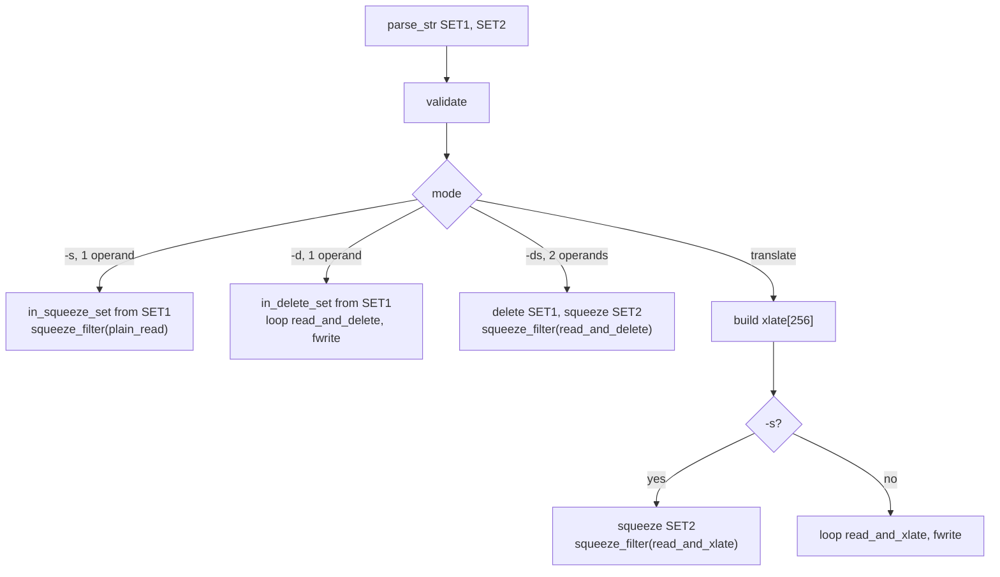

# `tr`: translate or delete characters

Source: `src/tr.c` (1908 lines) · Tests: `tests/tr/` · Manual:
`info '(coreutils) tr invocation'`

`tr` reads standard input and writes standard output. It has no file
operands. It turns its one or two SET arguments into 256-entry tables, then
runs a simple loop over each buffer: look up a translation table
(`xlate[]`), drop bytes found in `in_delete_set[]`, or squeeze runs of
bytes found in `in_squeeze_set[]`.

!!! warning "Bytes, not characters"
    GNU `tr` works on **single bytes** (`N_CHARS = UCHAR_MAX + 1`,
    `src/tr.c:38`). Ranges, classes and equivalence classes are made of
    `unsigned char` values. `is_equiv_class_member` is just `c ==
    equiv_class` (`src/tr.c:368-372`). Multibyte UTF-8 characters are
    treated as separate bytes. For example, `echo é | tr é e` does not do
    what you might expect.

## Options

The table lists `long_options[]` (`src/tr.c:267-275`) and the short-option
string `"+AcCdstu"`.

| Option | Variable | Notes |
|---|---|---|
| `-c`, `-C`, `--complement` | `complement` | Use the complement of SET1. |
| `-d`, `--delete` | `delete` | Delete bytes in SET1. |
| `-s`, `--squeeze-repeats` | `squeeze_repeats` | Replace a run of the same byte with one copy, if the byte is in the last SET given. |
| `-t`, `--truncate-set1` | `truncate_set1` | Truncate SET1 to the length of SET2 (System V behaviour). |
| `-A` | | Not documented. AIX compatibility: switch to the C locale for collation and character types. |
| `-u` | | Not documented. FreeBSD and macOS compatibility: unbuffered output. |

The leading `+` in the option string stops option parsing at the first
operand, so `tr -d -x` is an error but `tr -- -x y` works.

### Operand counts

`main` computes the allowed number of operands from `-d` and `-s`
(`src/tr.c:1739-1768`):

| Mode | Operands | Action |
|---|---|---|
| `tr SET1 SET2` | 2 | Translate (`translating = true`). |
| `tr -d SET1` | 1 | Delete. |
| `tr -s SET1` | 1 | Squeeze. |
| `tr -ds SET1 SET2` | 2 | Delete SET1, then squeeze SET2. |
| `tr -s SET1 SET2` | 2 | Translate, then squeeze SET2. |

## Code map

| Function | Location | Role |
|---|---|---|
| `main` | `src/tr.c:1679` | Options, parse SETs, `validate`, build the tables, run the right loop. |
| `parse_str` | `:1351` | `unquote` (backslash escapes), then `build_spec_list`. |
| `unquote` | `:444` | Turn `\n`, `\NNN` and similar into bytes. Record which bytes were escaped in `struct E_string`, so that `\[` is not taken as the start of a class. |
| `build_spec_list` | `:861` | Turn the string into a linked list of `struct List_element`: normal byte, range `a-z`, class `[:alpha:]`, equivalence class `[=c=]`, or repeat `[c*n]`. |
| `get_next` | `:1022` | Step through a list and return one byte at a time. Also reports whether the byte came from `[:upper:]` or `[:lower:]`. |
| `get_spec_stats`, `validate`, `validate_case_classes` | `:1245`, `:1440`, `:1171` | Check lengths, `[c*]` use, and class pairing. Fill in an indefinite `[c*]` repeat in SET2. |
| `set_initialize` | `:1666` | Fill a `bool[256]` membership table from a list, with optional complement. |
| `read_and_xlate`, `read_and_delete`, `plain_read` | `:1649`, `:1611`, `:1596` | Read one buffer and apply a table. |
| `squeeze_filter` | `:1511` | Squeeze runs, on top of one of the readers. |

## How it works

The diagram shows how `main` chooses a loop.

### Building the translation table

Without `-c`, `main` steps through SET1 and SET2 together with `get_next`
and sets `xlate[c1] = c2` (`src/tr.c:1848-1885`). `[:lower:]` paired with
`[:upper:]` (or the other way round) is handled specially: every byte for
which `islower()` is true is mapped with `toupper()`, and then both class
elements are skipped. That way the mapping follows the locale's single-byte
case rules and does not depend on the order of the class members.

With `-c`, SET1 becomes a membership table. Each byte that is not in SET1,
taken in byte order, is mapped to the next byte from SET2
(`:1818-1841`).

### SET1 longer than SET2

POSIX leaves this case unspecified. A comment at `src/tr.c:208-235` explains
the choice:

- By default GNU `tr` acts like BSD `tr`: SET2 is padded with its last
  byte. This keeps the common idiom `tr -cs A-Za-z0-9 '\012'` working.
- `-t` acts like System V `tr`: SET1 is cut to the length of SET2.

### Squeezing

`squeeze_filter` uses a trick described in its comment
(`src/tr.c:1536-1546`). A byte can only be squeezed if it appears twice in
a row, so the search for a byte in the squeeze set steps **two** bytes at
a time. Then it backs up by one if needed. This speeds up the usual case,
where few bytes are removed.

### I/O

Input is read with `read` into a `BUFSIZ` buffer (`io_buf`). Output uses
`fwrite` on `stdout`. Both are set to binary mode, and
`fadvise (stdin, FADVISE_SEQUENTIAL)` is called once.

## Errors and exit status

Bad SET syntax (for example `[:foo:]`, a range in reverse order, or `[c*]`
in SET1) is reported by `parse_str` or `validate`, and the exit status is
1. A read error is fatal (`read error`). On success the exit status is 0.

## Tests

| File | Covers |
|---|---|
| `tests/tr/tr.pl` | The main table: ranges, classes, repeats, `-c`, `-d`, `-s`, `-t`, escapes and errors. |
| `tests/tr/tr-case-class.sh` | `[:upper:]` and `[:lower:]` pairing rules, including a single-byte ISO-8859-1 locale where the classes have different sizes. |

## See also

- [cut](cut.md) and [wc](wc.md), which do handle multibyte characters.
