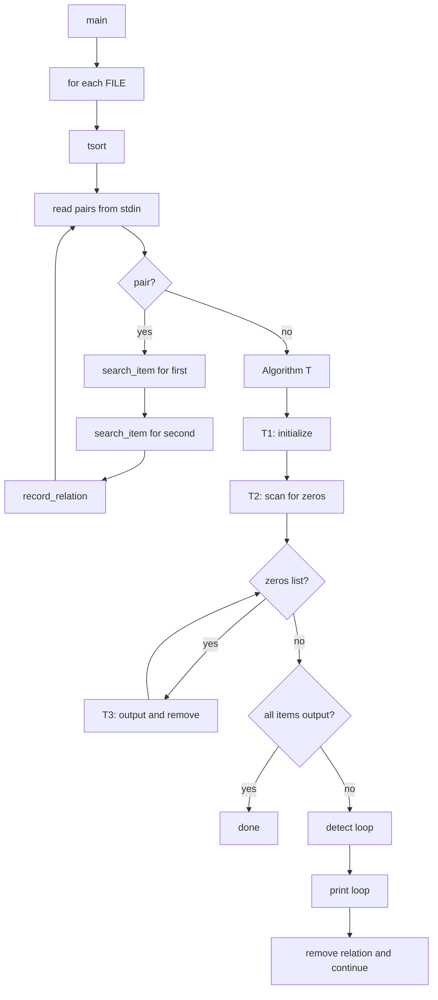

# `tsort`: topological sort

Source: `src/tsort.c` (575 lines) · Tests: (none) ·
Manual: `info '(coreutils) tsort invocation'`

`tsort` performs a topological sort on partial ordering pairs read from input.
It implements Knuth's Algorithm T (topological sort) from TAOCP Volume 1.
Items are stored in an AVL balanced binary tree for fast lookup. Successor
relationships are stored as linked lists. The algorithm repeatedly removes
items with no predecessors and prints them, detecting cycles.

## Options

|| Option | Variables |
||---|---|
|| `-w` | Ignored (for compatibility) |

## Code map

|| Function | Location | Role |
||---|---|---|
|| `main` | `src/tsort.c:531` | Option parsing, call `tsort` for each file |
|| `tsort` | `:447` | Read pairs, build successor lists, run Algorithm T, detect loops |
|| `search_item` | `:119` | AVL tree search/insert for item lookup |
|| `new_item` | `:101` | Create new item node |
|| `record_relation` | `:326` | Add successor relationship between two items |
|| `walk_tree` | `:387` | Walk tree for loop detection |
|| `detect_loop` | `:412` | Find and print a cycle |
|| `usage` | `:75` | Help message |

## How it works

### Algorithm T

The topological sort follows Knuth's Algorithm T (`src/tsort.c:447-528`):

1. **T1 (Initialize):** Set predecessor count to 0 for all items.
2. **T2 (Scan for zeros):** Build a queue of items with zero predecessors.
3. **T3-T6 (Output and remove):** While the queue is not empty:
   - Remove an item from the queue and print it.
   - For each successor, decrement its predecessor count.
   - If the count reaches zero, add it to the queue.
4. **T8 (End):** If items remain, the graph contains a cycle.

### AVL tree

`search_item` implements Algorithm A from TAOCP Volume 3 for balanced tree
search and insertion (`src/tsort.c:119-325`). The tree stores all unique
strings with their successor lists. Balance factors are adjusted during
insertion, and rotations (single or double) maintain AVL balance.

### Loop detection

If items remain after the main algorithm, a cycle exists
(`src/tsort.c:510-520`). `walk_tree` calls `detect_loop` on each item to find
and print the cycle. One relation is then removed to break the loop and
continue sorting.

### Input format

Input consists of pairs of whitespace-separated strings. Each pair `A B`
indicates that `A` must precede `B` in the ordering.

## Platform notes

`tsort` uses AVL trees for O(log n) lookup. No special platform requirements.

## Errors and exit status

- **Loop detected:** "FILE: input contains a loop:" (exit 1, continues after printing loop)
- **File read error:** From `fclose` error (exit 1)

Exit status is 0 on success, 1 on errors or cycles.

## Tests

No dedicated test files exist for `tsort`.

## See also

- [sort](sort.md) for general sorting
