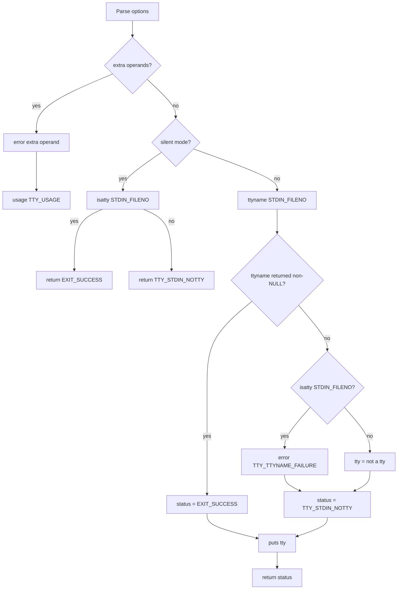

# `tty`: print terminal name

Source: `src/tty.c` (137 lines) · Tests: `tests/tty/tty.sh` ·
Manual: `info '(coreutils) tty invocation'`

`tty` prints the file name of the terminal connected to standard input, or
"not a tty" if stdin is not a terminal. With `-s`, it prints nothing and only
returns an exit status. It uses `isatty` to check if stdin is a terminal and
`ttyname` to get its path.

## Options

The table lists `longopts[]` (`src/tty.c:49-56`) and short options.

|| Option | Variable |
||---|---|
|| `-s`, `--silent`, `--quiet` | `silent = true` (print nothing, return exit status only) |

## Code map

|| Function | Location | Role |
||---|---|---|
|| `main` | `src/tty.c:82` | Option parsing, call `isatty` and `ttyname`, print result. |
|| `usage` | `:58` | Help text. |

## How it works

The diagram shows the decision flow.



### Silent mode

When `-s` is used, `main` calls `isatty` directly and returns without printing
(`src/tty.c:118-119`). Exit status is 0 if stdin is a tty, 1 otherwise.

### Normal mode

In normal mode, `main` calls `ttyname` to get the terminal path
(`src/tty.c:122-133`):

- If `ttyname` succeeds, exit status is 0
- If `ttyname` fails but `isatty` returns true, this is an error (the file
  descriptor is a tty but `ttyname` couldn't get its name)
- If `ttyname` fails and `isatty` returns false, print "not a tty" with exit
  status 1

## Platform notes

None significant. Relies on POSIX `isatty` and `ttyname`.

## Errors and exit status

|| Status | Condition |
||---|---|
|| 0 | stdin is a tty (or `ttyname` succeeded) |
|| 1 | stdin is not a tty |
|| 2 | Usage error (extra operands) |
|| 3 | Write error (set via `initialize_exit_failure`) |
|| 4 | `ttyname` failed on a tty |

## Tests

|| File | Covers |
||---|---|
|| `tests/tty/tty.sh` | Basic functionality, `-s` option, exit statuses. |
|| `tests/misc/tty-eof.pl` | EOF handling on tty. |
|| `tests/misc/tty-quoting.sh` | Quoting of tty name. |

## See also

- [stty](stty.md) (change terminal settings)

## Source code

`src/tty.c:1`

```c
/* tty -- print the name of the terminal connected to standard input
   Copyright (C) 1990-2026 Free Software Foundation, Inc.

   This program is free software: you can redistribute it and/or modify
   it under the terms of the GNU General Public License as published by
   the Free Software Foundation, either version 3 of the License, or
   (at your option) any later version.

   This program is distributed in the hope that it will be useful,
   but WITHOUT ANY WARRANTY; without even the implied warranty of
   MERCHANTABILITY or FITNESS FOR A PARTICULAR PURPOSE.  See the
   GNU General Public License for more details.

   You should have received a copy of the GNU General Public License
   along with this program.  If not, see <https://www.gnu.org/licenses/>.  */

/* Displays "not a tty" if stdin is not a terminal.
   Displays nothing if -s option is given.
   Exit status 0 if stdin is a tty, 1 if not a tty, 2 if usage error,
   3 if write error.

   Written by David MacKenzie <djm@gnu.ai.mit.edu>.  */

#include <config.h>
#include <stdio.h>
#include <getopt.h>
#include <sys/types.h>

#include "system.h"
#include "quote.h"

/* Exit statuses.  */
enum
  {
    TTY_STDIN_NOTTY = 1,
    TTY_USAGE = 2,
    TTY_WRITE_ERROR = 3,
    TTY_TTYNAME_FAILURE = 4
  };

/* The official name of this program (e.g., no 'g' prefix).  */
#define PROGRAM_NAME "tty"

#define AUTHORS proper_name ("David MacKenzie")

/* If true, return an exit status but produce no output. */
static bool silent;

static struct option const longopts[] =
{
  {"silent", no_argument, NULL, 's'},
  {"quiet", no_argument, NULL, 's'},
  {GETOPT_HELP_OPTION_DECL},
  {GETOPT_VERSION_OPTION_DECL},
  {NULL, 0, NULL, 0}
};

void
usage (int status)
{
  if (status != EXIT_SUCCESS)
    emit_try_help ();
  else
    {
      printf (_("Usage: %s [OPTION]...\n"), program_name);
      fputs (_("\
Print the file name of the terminal connected to standard input.\n\
\n\
"), stdout);
      oputs (_("\
  -s, --silent, --quiet\n\
         print nothing, only return an exit status\n\
"));
      oputs (HELP_OPTION_DESCRIPTION);
      oputs (VERSION_OPTION_DESCRIPTION);
      emit_ancillary_info (PROGRAM_NAME);
    }
  exit (status);
}

int
main (int argc, char **argv)
{
  int optc;

  initialize_main (&argc, &argv);
  set_program_name (argv[0]);
  setlocale (LC_ALL, "");
  bindtextdomain (PACKAGE, LOCALEDIR);
  textdomain (PACKAGE);

  initialize_exit_failure (TTY_WRITE_ERROR);
  atexit (close_stdout);

  while ((optc = getopt_long (argc, argv, "s", longopts, NULL)) != -1)
    {
      switch (optc)
        {
        case 's':
          silent = true;
          break;

        case_GETOPT_HELP_CHAR;

        case_GETOPT_VERSION_CHAR (PROGRAM_NAME, AUTHORS);

        default:
          usage (TTY_USAGE);
        }
    }

  if (optind < argc)
    {
      error (0, 0, _("extra operand %s"), quote (argv[optind]));
      usage (TTY_USAGE);
    }

  if (silent)
    return isatty (STDIN_FILENO) ? EXIT_SUCCESS : TTY_STDIN_NOTTY;

  int status;
  char const *tty = ttyname (STDIN_FILENO);

  if (tty)
    status = EXIT_SUCCESS;
  else
    {
      int ttyname_err = errno;
      if (isatty (STDIN_FILENO))
        error (TTY_TTYNAME_FAILURE, ttyname_err, _("ttyname error"));
      tty = _("not a tty");
      status = TTY_STDIN_NOTTY;
    }

  puts (tty);
  return status;
}
```
