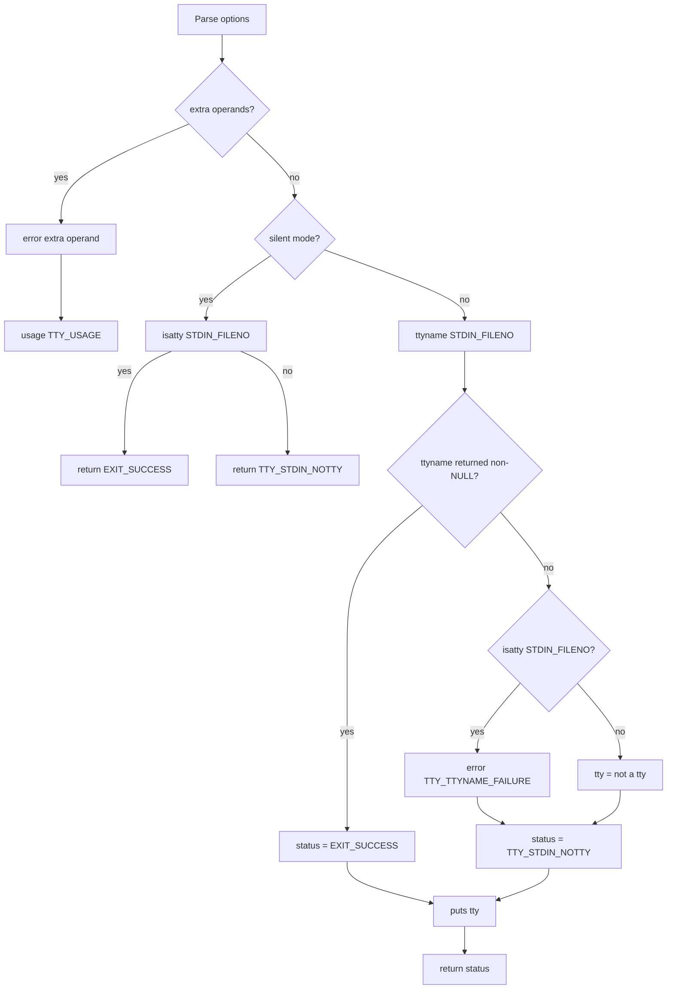

# `tty`: print terminal name

Source: `src/tty.c` (137 lines) · Tests: `tests/tty/tty.sh` ·
Manual: `info '(coreutils) tty invocation'`

`tty` prints the file name of the terminal connected to standard input, or
"not a tty" if stdin is not a terminal. With `-s`, it prints nothing and only
returns an exit status. It uses `isatty` to check if stdin is a terminal and
`ttyname` to get its path.

## Options

The table lists `longopts[]` (`src/tty.c:49-56`) and short options.

|| Option | Variable |
||---|---|
|| `-s`, `--silent`, `--quiet` | `silent = true` (print nothing, return exit status only) |

## Code map

|| Function | Location | Role |
||---|---|---|
|| `main` | `src/tty.c:82` | Option parsing, call `isatty` and `ttyname`, print result. |
|| `usage` | `:58` | Help text. |

## How it works

The diagram shows the decision flow.

### Silent mode

When `-s` is used, `main` calls `isatty` directly and returns without printing
(`src/tty.c:118-119`). Exit status is 0 if stdin is a tty, 1 otherwise.

### Normal mode

In normal mode, `main` calls `ttyname` to get the terminal path
(`src/tty.c:122-133`):

- If `ttyname` succeeds, exit status is 0
- If `ttyname` fails but `isatty` returns true, this is an error (the file
  descriptor is a tty but `ttyname` couldn't get its name)
- If `ttyname` fails and `isatty` returns false, print "not a tty" with exit
  status 1

## Platform notes

None significant. Relies on POSIX `isatty` and `ttyname`.

## Errors and exit status

|| Status | Condition |
||---|---|
|| 0 | stdin is a tty (or `ttyname` succeeded) |
|| 1 | stdin is not a tty |
|| 2 | Usage error (extra operands) |
|| 3 | Write error (set via `initialize_exit_failure`) |
|| 4 | `ttyname` failed on a tty |

## Tests

|| File | Covers |
||---|---|
|| `tests/tty/tty.sh` | Basic functionality, `-s` option, exit statuses. |
|| `tests/misc/tty-eof.pl` | EOF handling on tty. |
|| `tests/misc/tty-quoting.sh` | Quoting of tty name. |

## See also

- [stty](stty.md) (change terminal settings)
