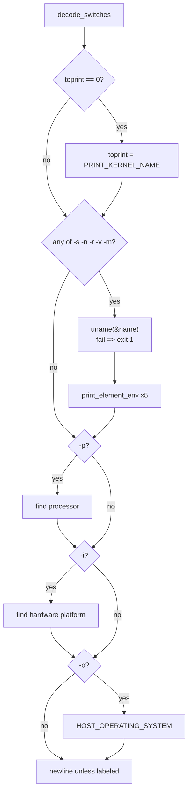

# `uname` and `arch`: print system information

Source: `src/uname.c` (418 lines), plus `src/uname-uname.c` or
`src/uname-arch.c` · Tests: `tests/misc/uname-labeled.sh`,
`tests/misc/arch.sh` · Manual: `info '(coreutils) uname invocation'`

`uname` prints fields from `uname(2)`, plus up to three more fields that
are less portable. `arch` is the same source built a second time. It
behaves like `uname -m` and accepts no options. `arch` is disabled by
default (`--enable-install-program=arch`).

## Two programs, one source

`src/local.mk:434-435` builds each program from `uname.c` plus one small
file that sets a global variable:

```c
/* src/uname-arch.c */
#include "uname.h"
enum uname_modes uname_mode = UNAME_ARCH;
```

`PROGRAM_NAME` is a run-time expression,
`(uname_mode == UNAME_UNAME ? "uname" : "arch")` (`src/uname.c:52`). Each
mode has its own `long_options` table. `arch` has only `--help` and
`--version`, and always sets `toprint = PRINT_MACHINE`.

## Options

The fields are selected by bits in `toprint` (`src/uname.c:57-80`). They
are always printed in this order, whatever order the options are given in.

| Option | Bit | Source of the value | Label for `-A` |
|---|---|---|---|
| `-s`, `--kernel-name` (`--sysname`, obsolete) | `PRINT_KERNEL_NAME` (1) | `utsname.sysname` | `Kernel name` |
| `-n`, `--nodename` | `PRINT_NODENAME` (2) | `utsname.nodename` | `Node name` |
| `-r`, `--kernel-release` (`--release`, obsolete) | `PRINT_KERNEL_RELEASE` (4) | `utsname.release` | `Kernel release` |
| `-v`, `--kernel-version` | `PRINT_KERNEL_VERSION` (8) | `utsname.version` | `Kernel version` |
| `-m`, `--machine` | `PRINT_MACHINE` (16) | `utsname.machine` | `Machine` |
| `-p`, `--processor` | `PRINT_PROCESSOR` (32) | See [Processor and hardware platform](#processor-and-hardware-platform) | `Processor` |
| `-i`, `--hardware-platform` | `PRINT_HARDWARE_PLATFORM` (64) | Same | `Hardware platform` |
| `-o`, `--operating-system` | `PRINT_OPERATING_SYSTEM` (128) | `HOST_OPERATING_SYSTEM`, set at build time by gnulib's `host-os` module (for example `GNU/Linux`) | `Operating system` |
| `-a`, `--all` | `toprint = UINT_MAX`, `labeled = false` | | |
| `-A`, `--all-labeled` | `toprint = UINT_MAX`, `labeled = true` | New in 9.12 (`NEWS`). | |

With no options, `toprint` is 0 and `main` sets it to
`PRINT_KERNEL_NAME`. Any operand gives an `extra operand` error.

## Code map

| Function | Location | Role |
|---|---|---|
| `main` | `src/uname.c:311` | Call `uname()` once if any of the first five bits is set, then print each field. |
| `decode_switches` | `:218` | Option parsing for both modes. Returns the `toprint` mask. |
| `print_element` | `:177` | Print one field. Unlabelled fields are joined by spaces. With `-A`, each field is printed as `Label: value` on its own line. |
| `print_element_env` | `:198` | On macOS only, use the environment variable `UNAME_SYSNAME`, `UNAME_NODENAME`, `UNAME_RELEASE`, `UNAME_VERSION` or `UNAME_MACHINE` in place of the real value when it is set. |

## How it works

The diagram shows the flow of `main`.



### Processor and hardware platform

These two fields are not in POSIX. The code tries several sources in turn
and uses the string `"unknown"` if none works (`src/uname.c:352-409`):

| Field | Sources, in order |
|---|---|
| `-p` | 1. On macOS, a value fixed at compile time from the target CPU: `arm`, `i386` or `powerpc`. 2. `sysinfo (SI_ARCHITECTURE)` (Solaris). 3. `sysctl ({CTL_HW, UNAME_PROCESSOR})` on BSD, where `UNAME_PROCESSOR` is `HW_MACHINE_ARCH` or `HW_MODEL`. |
| `-i` | 1. `sysinfo (SI_PLATFORM)` (Solaris). 2. `sysctl ({CTL_HW, HW_MODEL})` on FreeBSD and NetBSD. |

On GNU/Linux none of these sources exists, so both fields are `unknown`.
With `-a` or `-A`, an unknown field is left out
(`if (! (toprint == UINT_MAX && element == unknown))`). With an explicit
`-p` or `-i`, the word `unknown` is printed. This changed in coreutils 6.6
(see `NEWS`: "uname -a no longer generates the -p and -i outputs if they
are unknown").

The `sysctl` sources are compiled only when `<sys/sysctl.h>` exists and the
system is not glibc or Apple (`src/uname.c:30-45`).

## Errors and exit status

The only run-time error is a failure of `uname()`: `cannot get system
name`, exit status 1. A bad option or an operand exits with status 1 after
the usage hint.

## Tests

| File | Covers |
|---|---|
| `tests/misc/uname-labeled.sh` | `-A` and `--all-labeled` give the same output with the expected labels. `-a` still prints one unlabelled line. |
| `tests/misc/arch.sh` | `arch` and `arch --` give the same output as `uname -m`. |

## See also

- [hostname](hostname.md): `uname -n` gives the same name as
  `gethostname()` on most systems.
