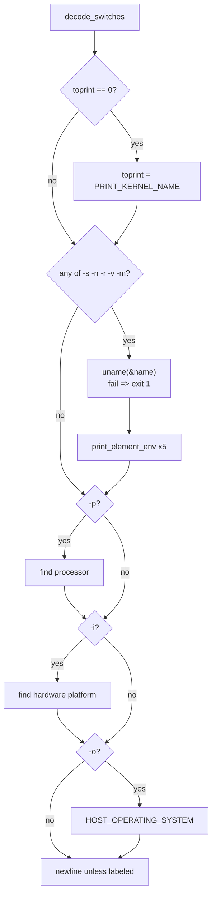

# `uname` and `arch`: print system information

Source: `src/uname.c` (418 lines), plus `src/uname-uname.c` or
`src/uname-arch.c` · Tests: `tests/misc/uname-labeled.sh`,
`tests/misc/arch.sh` · Manual: `info '(coreutils) uname invocation'`

`uname` prints fields from `uname(2)`, plus up to three more fields that
are less portable. `arch` is the same source built a second time. It
behaves like `uname -m` and accepts no options. `arch` is disabled by
default (`--enable-install-program=arch`).

## Two programs, one source

`src/local.mk:434-435` builds each program from `uname.c` plus one small
file that sets a global variable:

```c
/* src/uname-arch.c */
#include "uname.h"
enum uname_modes uname_mode = UNAME_ARCH;
```

`PROGRAM_NAME` is a run-time expression,
`(uname_mode == UNAME_UNAME ? "uname" : "arch")` (`src/uname.c:52`). Each
mode has its own `long_options` table. `arch` has only `--help` and
`--version`, and always sets `toprint = PRINT_MACHINE`.

## Options

The fields are selected by bits in `toprint` (`src/uname.c:57-80`). They
are always printed in this order, whatever order the options are given in.

| Option | Bit | Source of the value | Label for `-A` |
|---|---|---|---|
| `-s`, `--kernel-name` (`--sysname`, obsolete) | `PRINT_KERNEL_NAME` (1) | `utsname.sysname` | `Kernel name` |
| `-n`, `--nodename` | `PRINT_NODENAME` (2) | `utsname.nodename` | `Node name` |
| `-r`, `--kernel-release` (`--release`, obsolete) | `PRINT_KERNEL_RELEASE` (4) | `utsname.release` | `Kernel release` |
| `-v`, `--kernel-version` | `PRINT_KERNEL_VERSION` (8) | `utsname.version` | `Kernel version` |
| `-m`, `--machine` | `PRINT_MACHINE` (16) | `utsname.machine` | `Machine` |
| `-p`, `--processor` | `PRINT_PROCESSOR` (32) | See [Processor and hardware platform](#processor-and-hardware-platform) | `Processor` |
| `-i`, `--hardware-platform` | `PRINT_HARDWARE_PLATFORM` (64) | Same | `Hardware platform` |
| `-o`, `--operating-system` | `PRINT_OPERATING_SYSTEM` (128) | `HOST_OPERATING_SYSTEM`, set at build time by gnulib's `host-os` module (for example `GNU/Linux`) | `Operating system` |
| `-a`, `--all` | `toprint = UINT_MAX`, `labeled = false` | | |
| `-A`, `--all-labeled` | `toprint = UINT_MAX`, `labeled = true` | New in 9.12 (`NEWS`). | |

With no options, `toprint` is 0 and `main` sets it to
`PRINT_KERNEL_NAME`. Any operand gives an `extra operand` error.

## Code map

| Function | Location | Role |
|---|---|---|
| `main` | `src/uname.c:311` | Call `uname()` once if any of the first five bits is set, then print each field. |
| `decode_switches` | `:218` | Option parsing for both modes. Returns the `toprint` mask. |
| `print_element` | `:177` | Print one field. Unlabelled fields are joined by spaces. With `-A`, each field is printed as `Label: value` on its own line. |
| `print_element_env` | `:198` | On macOS only, use the environment variable `UNAME_SYSNAME`, `UNAME_NODENAME`, `UNAME_RELEASE`, `UNAME_VERSION` or `UNAME_MACHINE` in place of the real value when it is set. |

## How it works

The diagram shows the flow of `main`.



### Processor and hardware platform

These two fields are not in POSIX. The code tries several sources in turn
and uses the string `"unknown"` if none works (`src/uname.c:352-409`):

| Field | Sources, in order |
|---|---|
| `-p` | 1. On macOS, a value fixed at compile time from the target CPU: `arm`, `i386` or `powerpc`. 2. `sysinfo (SI_ARCHITECTURE)` (Solaris). 3. `sysctl ({CTL_HW, UNAME_PROCESSOR})` on BSD, where `UNAME_PROCESSOR` is `HW_MACHINE_ARCH` or `HW_MODEL`. |
| `-i` | 1. `sysinfo (SI_PLATFORM)` (Solaris). 2. `sysctl ({CTL_HW, HW_MODEL})` on FreeBSD and NetBSD. |

On GNU/Linux none of these sources exists, so both fields are `unknown`.
With `-a` or `-A`, an unknown field is left out
(`if (! (toprint == UINT_MAX && element == unknown))`). With an explicit
`-p` or `-i`, the word `unknown` is printed. This changed in coreutils 6.6
(see `NEWS`: "uname -a no longer generates the -p and -i outputs if they
are unknown").

The `sysctl` sources are compiled only when `<sys/sysctl.h>` exists and the
system is not glibc or Apple (`src/uname.c:30-45`).

## Errors and exit status

The only run-time error is a failure of `uname()`: `cannot get system
name`, exit status 1. A bad option or an operand exits with status 1 after
the usage hint.

## Tests

| File | Covers |
|---|---|
| `tests/misc/uname-labeled.sh` | `-A` and `--all-labeled` give the same output with the expected labels. `-a` still prints one unlabelled line. |
| `tests/misc/arch.sh` | `arch` and `arch --` give the same output as `uname -m`. |

## See also

- [hostname](hostname.md): `uname -n` gives the same name as
  `gethostname()` on most systems.

## Source code

`src/uname.c:1`

```c
/* uname -- print system information

   Copyright (C) 1989-2026 Free Software Foundation, Inc.

   This program is free software: you can redistribute it and/or modify
   it under the terms of the GNU General Public License as published by
   the Free Software Foundation, either version 3 of the License, or
   (at your option) any later version.

   This program is distributed in the hope that it will be useful,
   but WITHOUT ANY WARRANTY; without even the implied warranty of
   MERCHANTABILITY or FITNESS FOR A PARTICULAR PURPOSE.  See the
   GNU General Public License for more details.

   You should have received a copy of the GNU General Public License
   along with this program.  If not, see <https://www.gnu.org/licenses/>.  */

/* Written by David MacKenzie <djm@gnu.ai.mit.edu> */

#include <config.h>
#include <stdio.h>
#include <sys/types.h>
#include <sys/utsname.h>
#include <getopt.h>

#if HAVE_SYSINFO && HAVE_SYS_SYSTEMINFO_H
# include <sys/systeminfo.h>
#endif

#if HAVE_SYS_SYSCTL_H && ! defined __GLIBC__ && ! defined __APPLE__
# if HAVE_SYS_PARAM_H
#  include <sys/param.h> /* needed for OpenBSD 3.0 */
# endif
# include <sys/sysctl.h>
# ifdef HW_MODEL
#  ifdef HW_MACHINE_ARCH
/* E.g., FreeBSD 4.5, NetBSD 1.5.2 */
#   define UNAME_HARDWARE_PLATFORM HW_MODEL
#   define UNAME_PROCESSOR HW_MACHINE_ARCH
#  else
/* E.g., OpenBSD 3.0 */
#   define UNAME_PROCESSOR HW_MODEL
#  endif
# endif
#endif

#include "system.h"
#include "quote.h"
#include "uname.h"

/* The official name of this program (e.g., no 'g' prefix).  */
#define PROGRAM_NAME (uname_mode == UNAME_UNAME ? "uname" : "arch")

#define AUTHORS proper_name ("David MacKenzie")
#define ARCH_AUTHORS "David MacKenzie", "Karel Zak"

/* Values that are bitwise or'd into 'toprint'. */
/* Kernel name. */
#define PRINT_KERNEL_NAME 1

/* Node name on a communications network. */
#define PRINT_NODENAME 2

/* Kernel release. */
#define PRINT_KERNEL_RELEASE 4

/* Kernel version. */
#define PRINT_KERNEL_VERSION 8

/* Machine hardware name. */
#define PRINT_MACHINE 16

/* Processor type. */
#define PRINT_PROCESSOR 32

/* Hardware platform.  */
#define PRINT_HARDWARE_PLATFORM 64

/* Operating system.  */
#define PRINT_OPERATING_SYSTEM 128

static bool labeled = false;

static struct option const uname_long_options[] =
{
  {"all", no_argument, NULL, 'a'},
  {"all-labeled", no_argument, NULL, 'A'},
  {"kernel-name", no_argument, NULL, 's'},
  {"sysname", no_argument, NULL, 's'},	/* Obsolescent.  */
  {"nodename", no_argument, NULL, 'n'},
  {"kernel-release", no_argument, NULL, 'r'},
  {"release", no_argument, NULL, 'r'},  /* Obsolescent.  */
  {"kernel-version", no_argument, NULL, 'v'},
  {"machine", no_argument, NULL, 'm'},
  {"processor", no_argument, NULL, 'p'},
  {"hardware-platform", no_argument, NULL, 'i'},
  {"operating-system", no_argument, NULL, 'o'},
  {GETOPT_HELP_OPTION_DECL},
  {GETOPT_VERSION_OPTION_DECL},
  {NULL, 0, NULL, 0}
};

static struct option const arch_long_options[] =
{
  {GETOPT_HELP_OPTION_DECL},
  {GETOPT_VERSION_OPTION_DECL},
  {NULL, 0, NULL, 0}
};

void
usage (int status)
{
  if (status != EXIT_SUCCESS)
    emit_try_help ();
  else
    {
      printf (_("Usage: %s [OPTION]...\n"), program_name);

      if (uname_mode == UNAME_UNAME)
        {
          fputs (_("\
Print certain system information.  With no OPTION, same as -s.\n\
\n\
"), stdout);
          oputs (_("\
  -a, --all                print all information, in the following order,\n\
                             except omit -p and -i if unknown\n\
"));
          oputs (_("\
  -A, --all-labeled        print all information, one labeled field per line,\n\
                             except omit -p and -i if unknown\n\
"));
          oputs (_("\
  -s, --kernel-name        print the kernel name\n\
"));
          oputs (_("\
  -n, --nodename           print the network node hostname\n\
"));
          oputs (_("\
  -r, --kernel-release     print the kernel release\n\
"));
          oputs (_("\
  -v, --kernel-version     print the kernel version\n\
"));
          oputs (_("\
  -m, --machine            print the machine hardware name\n\
"));
          oputs (_("\
  -p, --processor          print the processor type (non-portable)\n\
"));
          oputs (_("\
  -i, --hardware-platform  print the hardware platform (non-portable)\n\
"));
          oputs (_("\
  -o, --operating-system   print the operating system\n\
"));
        }
      else
        {
          fputs (_("\
Print machine architecture.\n\
\n\
"), stdout);
        }

      oputs (HELP_OPTION_DESCRIPTION);
      oputs (VERSION_OPTION_DESCRIPTION);
      emit_ancillary_info (PROGRAM_NAME);
    }
  exit (status);
}

/* Print ELEMENT, preceded by a space if something has already been
   printed.  */

static void
print_element (char const *element, char const *label)
{
  if (labeled)
    {
      printf ("%s: %s\n", label, element);
    }
  else
    {
      static bool printed;
      if (printed)
        putchar (' ');
      printed = true;
      fputs (element, stdout);
    }
}

/* Print ELEMENT, preceded by a space if something has already been
   printed.  But if the environment variable ENVVAR is set, print its
   value instead of ELEMENT.  */

static void
print_element_env (char const *element,
                   MAYBE_UNUSED char const *envvar,
                   char const *label)
{
#ifdef __APPLE__
  if (envvar)
    {
      char const *val = getenv (envvar);
      if (val)
        element = val;
    }
#endif
  print_element (element, label);
}


/* Set all the option flags according to the switches specified.
   Return the mask indicating which elements to print.  */

static int
decode_switches (int argc, char **argv)
{
  int c;
  unsigned int toprint = 0;

  if (uname_mode == UNAME_ARCH)
    {
      while ((c = getopt_long (argc, argv, "",
                               arch_long_options, NULL))
             != -1)
        {
          switch (c)
            {
            case_GETOPT_HELP_CHAR;

            case_GETOPT_VERSION_CHAR (PROGRAM_NAME, ARCH_AUTHORS);

            default:
              usage (EXIT_FAILURE);
            }
        }
      toprint = PRINT_MACHINE;
    }
  else
    {
      while ((c = getopt_long (argc, argv, "asnrvmpioA",
                               uname_long_options, NULL))
             != -1)
        {
          switch (c)
            {
            case 'a':
              toprint = UINT_MAX;
              labeled = false;
              break;

            case 'A':
              toprint = UINT_MAX;
              labeled = true;
              break;

            case 's':
              toprint |= PRINT_KERNEL_NAME;
              break;

            case 'n':
              toprint |= PRINT_NODENAME;
              break;

            case 'r':
              toprint |= PRINT_KERNEL_RELEASE;
              break;

            case 'v':
              toprint |= PRINT_KERNEL_VERSION;
              break;

            case 'm':
              toprint |= PRINT_MACHINE;
              break;

            case 'p':
              toprint |= PRINT_PROCESSOR;
              break;

            case 'i':
              toprint |= PRINT_HARDWARE_PLATFORM;
              break;

            case 'o':
              toprint |= PRINT_OPERATING_SYSTEM;
              break;

            case_GETOPT_HELP_CHAR;

            case_GETOPT_VERSION_CHAR (PROGRAM_NAME, AUTHORS);

            default:
              usage (EXIT_FAILURE);
            }
        }
    }

  if (argc != optind)
    {
      error (0, 0, _("extra operand %s"), quote (argv[optind]));
      usage (EXIT_FAILURE);
    }

  return toprint;
}

int
main (int argc, char **argv)
{
  static char const unknown[] = "unknown";

  /* Mask indicating which elements to print. */
  unsigned int toprint = 0;

  initialize_main (&argc, &argv);
  set_program_name (argv[0]);
  setlocale (LC_ALL, "");
  bindtextdomain (PACKAGE, LOCALEDIR);
  textdomain (PACKAGE);

  atexit (close_stdout);

  toprint = decode_switches (argc, argv);

  if (toprint == 0)
    toprint = PRINT_KERNEL_NAME;

  if (toprint
       & (PRINT_KERNEL_NAME | PRINT_NODENAME | PRINT_KERNEL_RELEASE
          | PRINT_KERNEL_VERSION | PRINT_MACHINE))
    {
      struct utsname name;

      if (uname (&name) == -1)
        error (EXIT_FAILURE, errno, _("cannot get system name"));

      if (toprint & PRINT_KERNEL_NAME)
        print_element_env (name.sysname, "UNAME_SYSNAME", _("Kernel name"));
      if (toprint & PRINT_NODENAME)
        print_element_env (name.nodename, "UNAME_NODENAME", _("Node name"));
      if (toprint & PRINT_KERNEL_RELEASE)
        print_element_env (name.release, "UNAME_RELEASE", _("Kernel release"));
      if (toprint & PRINT_KERNEL_VERSION)
        print_element_env (name.version, "UNAME_VERSION", _("Kernel version"));
      if (toprint & PRINT_MACHINE)
        print_element_env (name.machine, "UNAME_MACHINE", _("Machine"));
    }

  if (toprint & PRINT_PROCESSOR)
    {
      char const *element = unknown;
#ifdef __APPLE__
# if defined __arm__ || defined __arm64__
      element = "arm";
# elif defined __i386__ || defined __x86_64__
      element = "i386";
# elif defined __ppc__ || defined __ppc64__
      element = "powerpc";
# endif
#endif
#if HAVE_SYSINFO && defined SI_ARCHITECTURE
      if (element == unknown)
        {
          static char processor[257];
          if (0 <= sysinfo (SI_ARCHITECTURE, processor, sizeof processor))
            element = processor;
        }
#endif
#ifdef UNAME_PROCESSOR
      if (element == unknown)
        {
          static char processor[257];
          size_t s = sizeof processor;
          static int mib[] = { CTL_HW, UNAME_PROCESSOR };
          if (sysctl (mib, 2, processor, &s, 0, 0) >= 0)
            element = processor;
        }
#endif
      if (! (toprint == UINT_MAX && element == unknown))
        print_element (element, _("Processor"));
    }

  if (toprint & PRINT_HARDWARE_PLATFORM)
    {
      char const *element = unknown;
#if HAVE_SYSINFO && defined SI_PLATFORM
      {
        static char hardware_platform[257];
        if (0 <= sysinfo (SI_PLATFORM,
                          hardware_platform, sizeof hardware_platform))
          element = hardware_platform;
      }
#endif
#ifdef UNAME_HARDWARE_PLATFORM
      if (element == unknown)
        {
          static char hardware_platform[257];
          size_t s = sizeof hardware_platform;
          static int mib[] = { CTL_HW, UNAME_HARDWARE_PLATFORM };
          if (sysctl (mib, 2, hardware_platform, &s, 0, 0) >= 0)
            element = hardware_platform;
        }
#endif
      if (! (toprint == UINT_MAX && element == unknown))
        print_element (element, _("Hardware platform"));
    }

  if (toprint & PRINT_OPERATING_SYSTEM)
    print_element (HOST_OPERATING_SYSTEM, _("Operating system"));

  if (!labeled)
    putchar ('\n');

  return EXIT_SUCCESS;
}
```
