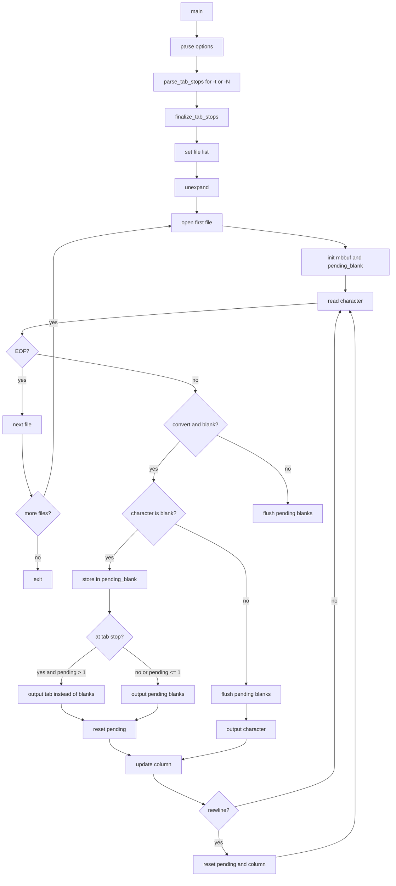

# `unexpand`: convert spaces to tabs

Source: `src/unexpand.c` (343 lines) · Tests: `tests/unexpand/` ·
Manual: `info '(coreutils) unexpand invocation'`

`unexpand` converts spaces (and other blanks in non-POSIX locales) to tabs.
By default, it converts only leading blanks at the beginning of lines. With
`-a`, it converts all blanks. It uses functions from `expand-common.c` for
tab stop management and multi-character handling. Backspace characters are
preserved and decrement the column count.

## Options

The table lists `longopts[]` (`src/unexpand.c:62-70`) and the short-option
string `",0123456789at:"`.

|| Option | Variables |
||---|---|
|| `-a`, `--all` | `convert_entire_line = true`: convert all blanks, not just initial |
|| `--first-only` | `convert_first_only = true`: only leading blanks (overrides `-a`) |
|| `-t LIST`, `--tabs=LIST` | `convert_entire_line = true`, call `parse_tab_stops(LIST)` |
|| `-N` (single digit) | Set tab value N |
|| `,` | Add tab stop from accumulated value |

## Code map

|| Function | Location | Role |
||---|---|---|
|| `main` | `src/unexpand.c:274` | Option parsing, `parse_tab_stops`, `finalize_tab_stops`, set file list, call `unexpand` |
|| `unexpand` | `:114` | Read input, convert blanks to tabs, write output |
|| `usage` | `:73` | Help message |

## How it works

### Blank conversion

`unexpand` buffers pending blanks and converts them to tabs when they align
with a tab stop (`src/unexpand.c:177-257`):

- When a blank is encountered, it's added to `pending_blank`.
- `get_next_tab_column` finds the next tab stop.
- If blanks extend to or past a tab stop, and there are 2+ blanks, they are
  replaced with a tab.
- Backspace decrements the column; tabs advance to the next tab stop.

### Initial vs all conversion

With `convert_entire_line = false` (default), conversion stops after the first
non-blank on each line (`src/unexpand.c:256`). With `-a`, conversion continues
throughout the line. `--first-only` overrides `-a` to convert only leading blanks.

### Multi-byte support

`unexpand` uses `mbbuf` from gnulib for multi-byte character handling
(`src/unexpand.c:128-129`). Blanks are detected with `c32issep`.

## Platform notes

`unexpand` uses `expand-common.c` for shared tab stop logic with `expand`.
Multi-byte character handling uses gnulib functions.

## Errors and exit status

- **Invalid tab stop:** Error from `parse_tab_stops`
- **Write error:** From `write_error`

Exit status is 0 on success, 1 on errors.

## Tests

|| File | Covers |
||---|---|
|| `tests/unexpand/unexpand.pl` | Various conversion scenarios |
|| `tests/unexpand/mb.sh` | Multi-byte character handling |
|| `tests/unexpand/bounded-memory.sh` | Memory limits |

## See also

- [expand](expand.md) for converting tabs to spaces
- [expand-common](../overview/shared-infrastructure.md) for shared tab stop logic
