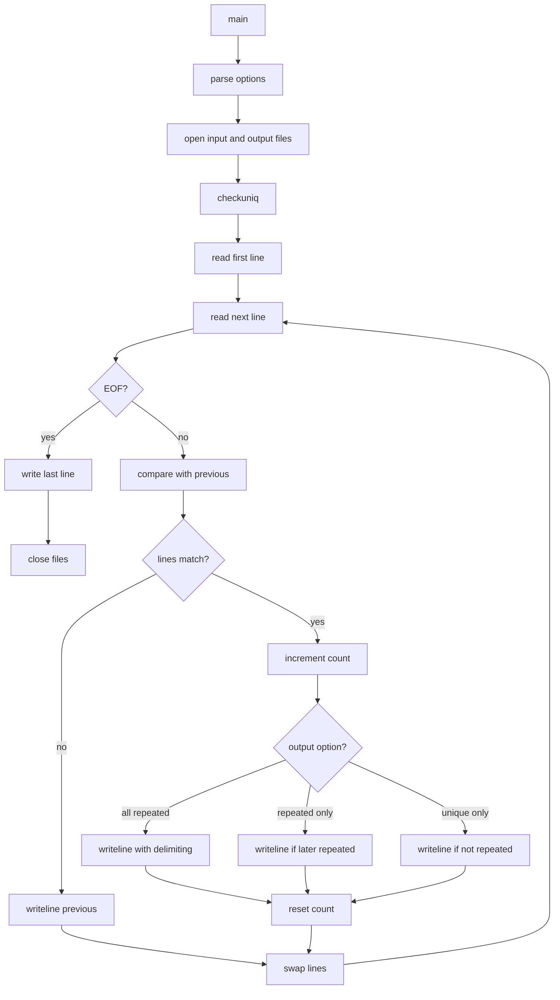

# `uniq`: remove duplicate lines from sorted file

Source: `src/uniq.c` (680 lines) · Tests: `tests/uniq/` ·
Manual: `info '(coreutils) uniq invocation'`

`uniq` filters adjacent matching lines from sorted input. By default, it merges
duplicate lines to the first occurrence. It can skip fields and characters when
comparing, count occurrences, and output only unique or duplicate lines. With
`--group`, it shows all lines separated by empty lines to indicate groups.

## Options

The table lists `longopts[]` (`src/uniq.c:135-150`) and the short-option
string `"0123456789Dcdf:is:uw:z"`.

|| Option | Variables |
||---|---|
|| `-c`, `--count` | `count_occurrences = true`: prefix lines with occurrence count |
|| `-d`, `--repeated` | `output_unique = false`, `output_later_repeated = false`: only duplicates |
|| `-u`, `--unique` | `output_first_repeated = false`: only unique lines |
|| `-D`, `--all-repeated[=METHOD]` | `delimit_groups`: print all duplicates with optional delimiting |
|| `-f N`, `--skip-fields=N` | `skip_fields`: skip N fields |
|| `-s N`, `--skip-chars=N` | `skip_chars`: skip N characters after fields |
|| `-w N`, `--check-chars=N` | `check_chars`: compare only N characters |
|| `-i`, `--ignore-case` | `ignore_case = true`: case-insensitive comparison |
|| `-z`, `--zero-terminated` | `delimiter = '\0'`: NUL-terminated lines |
|| `--group[=METHOD]` | `grouping`: show all lines with group delimiters |
|| `-N` | Set skip_fields, skip_chars, or check_chars depending on context |

## Code map

|| Function | Location | Role |
||---|---|---|
|| `main` | `src/uniq.c:502` | Option parsing, open files, call `checkuniq` |
|| `checkuniq` | `:385` | Read lines, compare, filter duplicates, write output |
|| `writeline` | `:358` | Write line with optional count and delimiter |
|| `compare_fields` | `:286` | Compare lines with field/char skipping |
|| `line_compare` | `:243` | Compare two linebuffers (with or without case) |
|| `usage` | `:153` | Help message |

## How it works

### Line comparison

Lines are compared with `compare_fields` (`src/uniq.c:286-356`), which:

- Skips the specified number of fields with `skipchars`.
- Skips the specified number of characters.
- Compares up to `check_chars` characters.
- Uses `line_compare` with `memcasecmp` if `-i`, otherwise `memcmp`.

### Output control

Three boolean flags control which lines are output
(`src/uniq.c:68-70`):

- **`output_unique`:** Output lines that appear only once (default true).
- **`output_first_repeated`:** Output the first line of each duplicate group (default true).
- **`output_later_repeated`:** Output subsequent duplicate lines (default false).

With `-c`, each line is prefixed with its occurrence count.

### Grouping

With `--group`, all lines are output with empty line delimiters between groups
(`src/uniq.c:427-470`). The delimiter position (prepend, append, separate, both)
is controlled by the `grouping` enum.

## Platform notes

`uniq` uses `linebuffer` from gnulib. Locale-aware comparison uses `memcasecmp`.

## Errors and exit status

- **Extra operand:** "extra operand FILE"
- **Invalid numeric argument:** Error from `xstrtoimax`
- **File open failure:** Error from `quotef(FILE)`
- **Read error:** "error reading FILE"

Exit status is 0 on success, 1 on errors.

## Tests

|| File | Covers |
||---|---|
|| `tests/uniq/uniq.pl` | Various filtering scenarios |
|| `tests/uniq/uniq-collate.sh` | Locale-aware comparison |
|| `tests/uniq/uniq-c-width.sh` | `-w` option |
|| `tests/uniq/uniq-perf.sh` | Performance tests |

## See also

- [sort](sort.md) for sorting before uniq
- [comm](comm.md) for comparing sorted files
