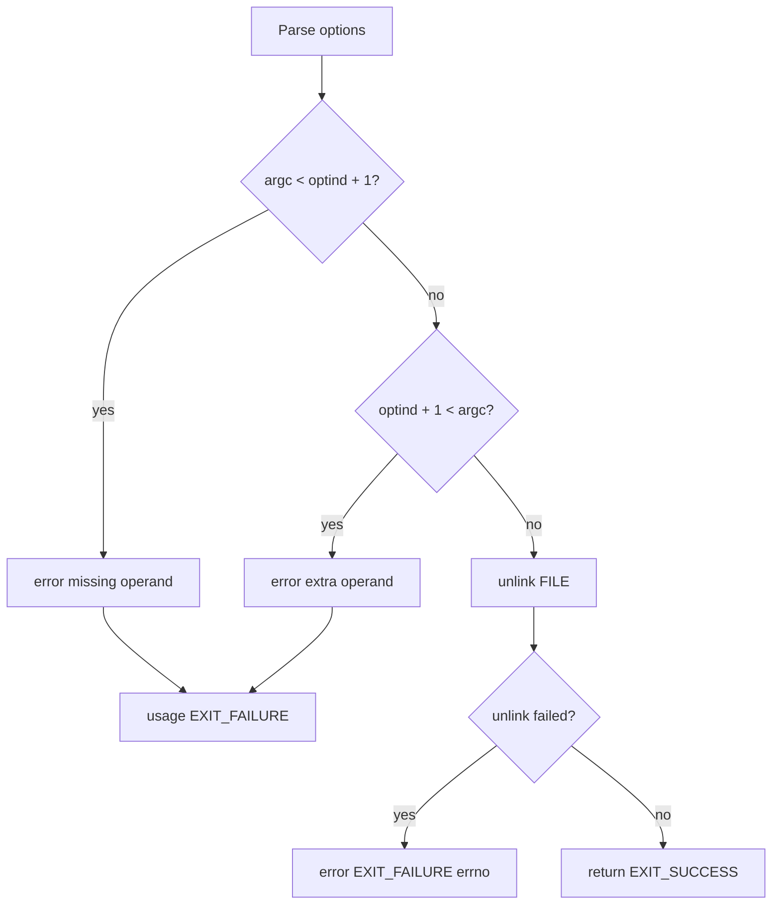

# `unlink`: remove a file

Source: `src/unlink.c` (86 lines) · Tests: `tests/misc/unlink.sh` ·
Manual: `info '(coreutils) unlink invocation'`

`unlink` removes the specified FILE by calling the system `unlink` function.
This is a low-level interface equivalent to `rm` without any options. It can
only remove one file at a time and does not accept any options.

## Options

No options other than `--help` and `--version`. Uses `parse_gnu_standard_options_only`
(`src/unlink.c:66-68`).

## Code map

|| Function | Location | Role |
||---|---|---|
|| `main` | `src/unlink.c:56` | Validate arguments, call `unlink`. |
|| `usage` | `:36` | Help text. |

## How it works

The diagram shows the simple flow.

`main` validates that exactly one operand is provided (`src/unlink.c:70-80`),
then calls the system `unlink` function (`src/unlink.c:82`). If `unlink` fails,
it reports an error and exits.

## Platform notes

- The system `unlink` function removes a directory entry and decrements the
  link count
- If the link count reaches zero and no processes have the file open, the
  file's data is freed
- `unlink` cannot remove directories (use `rmdir` instead)

## Errors and exit status

- Missing operand: `error (0, 0, ...)` then `usage (EXIT_FAILURE)`
- Extra operand: `error (0, 0, ...)` then `usage (EXIT_FAILURE)`
- `unlink` failure: `error (EXIT_FAILURE, errno, ...)`
- Write failure: handled by `atexit (close_stdout)`

## Tests

|| File | Covers |
||---|---|
|| `tests/misc/unlink.sh` | Basic functionality, error cases. |

## See also

- [rm](rm.md) (remove files with more options)
- [link](link.md) (create a hard link)
- [rmdir](rmdir.md) (remove directories)
